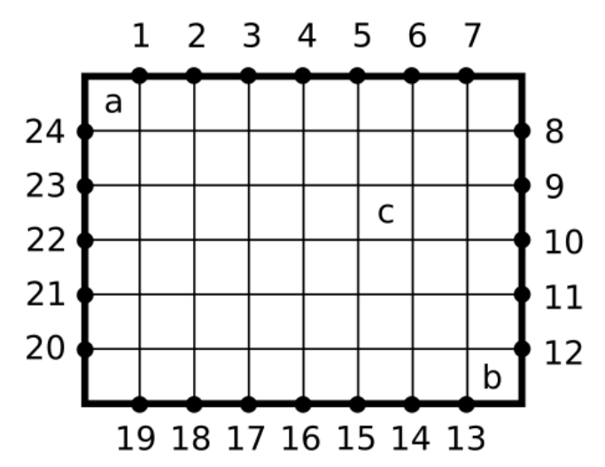
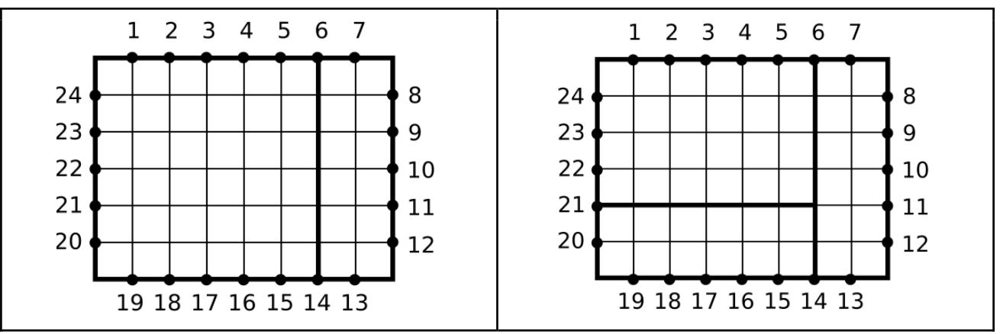
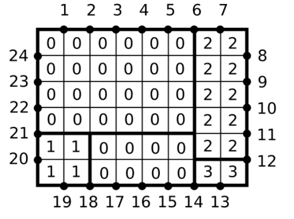
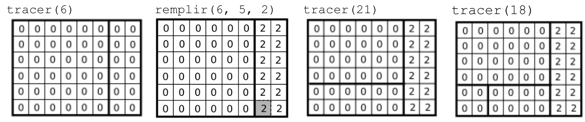
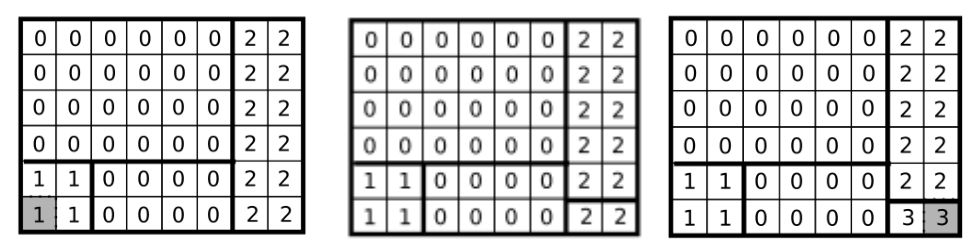
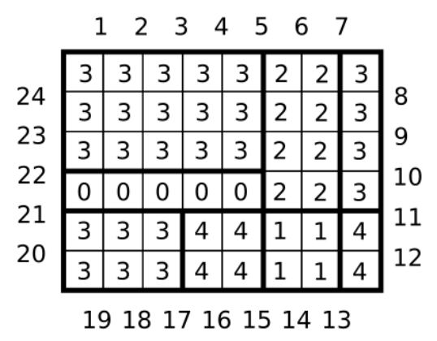
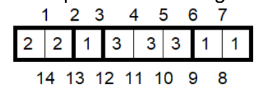
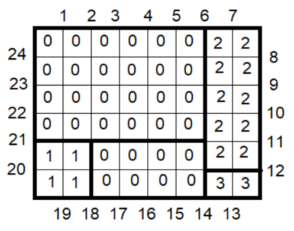

# Concours général 2022

!!! info "Session 2022"
    Classes de terminale, spécialité NSI. Durée : 5 heures. L'usage de la calculatrice est interdit.

    Le sujet comporte trois exercices : **structures de données**, **bases de données**, **algorithmique**.

    [Sujet original (PDF)](pdf/cg-nsi-2022.pdf){ .md-button }

## Structures de données

Dans cet exercice, on s'intéresse aux structures de données utilisées dans l'implémentation d'un éditeur de texte. On considère qu'un texte est une séquence de caractères, où certains des caractères sont des retours à la ligne. Techniquement, en python chaque caractère sera une chaîne de longueur 1. À tout moment, on a un curseur positionné avant un caractère du texte, ou bien après le dernier caractère du texte.

On s'intéresse aux manipulations suivantes sur le texte : déplacements du curseur, insertion ou suppression d'un caractère, accès à un caractère à une certaine position du texte.

On se limitera dans cet exercice, à l'utilisation de tableaux (listes) python et de variables simples. On n'utilisera ainsi pas de structures préexistantes plus avancées telles que le dictionnaire.

Par ailleurs, pour manipuler un tableau, on n'utilisera que les syntaxes suivantes :

- Créer un tableau, par exemple : `texte = [" "]*10000`
- Lire une case du tableau : `caractereLu = texte[position]`
- Écrire dans une case du tableau : `texte[position] = caractereEcrit`

En particulier, on ne devra en aucun cas :

- Faire appel à des fonctions plus avancées de manipulations de tableaux, telles que `append` et `insert`.
- Proposer des solutions utilisant l'implémentation de structures arborescentes.

Lorsque le coût en temps d'une fonction sera demandé, il devra être exprimé comme l'ordre de grandeur du nombre d'écritures et de lectures dans des tableaux.

Les différentes parties A à E de cet exercice peuvent être traitées relativement indépendamment les unes des autres et, en particulier, la première question d'une partie est souvent plus facile à résoudre que la dernière question des parties précédentes.

### A. Stockage dans un simple tableau

Dans cette partie, on stocke le texte édité dans trois variables globales :

- `texte` : un simple tableau contenant les caractères du texte, dans l'ordre,
- `nbCaracteres` : le nombre de caractères du texte,
- `posCurseur` : la position actuelle du curseur.

Pour simplifier, on considère dans cette partie que le tableau `texte` est créé avec 10000 cases, et que la longueur du texte manipulé ne dépassera jamais 10000 caractères. On initialise ainsi un texte vide comme ceci :

```python
texte = [" "]*10000
nbCaracteres = 0
posCurseur = 0
```

Notons que ce texte est vide en raison du fait que `nbCaracteres` vaut zéro, et non à cause du fait que le tableau ne contient que des espaces.

On suppose que l'on dispose déjà des fonctions suivantes :

```python
def avancerCurseur():
   global posCurseur
   if posCurseur < nbCaracteres:
      posCurseur += 1

def reculerCurseur():
   global posCurseur
   if posCurseur > 0:
      posCurseur -= 1

def caractereCourant():
   assert(posCurseur < nbCaracteres),"Pas de caractère ici !"
   return texte[posCurseur]
```

On souhaite implémenter la fonction `inserer`, de paramètre `caractereInsere`, qui insère le caractère `caractereInsere` à la position du curseur, puis augmente de 1 la position du curseur.

Par exemple, si le texte est « bonjour » et `posCurseur` vaut 3, alors au départ, `nbCaracteres` vaut 7. Après un appel à `inserer("i")`, le texte devient « bonijour », `posCurseur` vaut 4, et `nbCaracteres` vaut 8.

**1.** En partant de ce dernier état, décrire le résultat final de la séquence d'appels suivante :

```python
inserer("p")
inserer("u")
reculerCurseur()
inserer("d")
avancerCurseur()
inserer("b")
```

**2.** Implémenter la fonction `inserer`. On pourra supposer que la position du curseur est valide.

**3.** Donner le coût en temps de cette fonction `inserer`.

### B. Améliorations

Dans cette partie, on souhaite réduire significativement le coût en temps de la fonction `inserer`. On pourra à nouveau considérer que la longueur du texte manipulé ne dépassera jamais 10 000 caractères.

On notera que les réponses attendues pour les questions 4 et 5 sont relativement courtes à décrire, mais trouver la bonne idée peut être difficile. Ne pas hésiter à passer à la partie C.

**4.** Décrire une modification de la structure présentée dans la partie A, qui permet de réduire le coût en temps d'une nouvelle version de la fonction `inserer`.

Plus précisément, la structure décrite devra être telle que `inserer` n'effectue pas plus d'une écriture et une lecture dans un tableau, et que le coût en temps des fonctions `caractereCourant`, `avancerCurseur` et `reculerCurseur` n'augmente pas, c'est-à-dire que le nombre de lectures ou écritures dans des tableaux effectuées par ces fonctions reste le même que dans la partie A.

**5.** Implémenter les fonctions `inserer`, `avancerCurseur` et `reculerCurseur` correspondant à la solution proposée pour la question précédente.

Ne pas traiter cette question si la solution décrite à la question précédente augmente le coût en temps de `caractereCourant`, `avancerCurseur` ou `reculerCurseur`.

### C. Ligne et colonne

Dans cette partie, on s'intéresse à la visualisation du texte comme une grille de lignes et colonnes contenant des caractères.

Le texte peut être constitué de plusieurs lignes, identifiées par le caractère `"\n"`, qui représente un retour à la ligne.

Prenons par exemple le texte suivant, constitué de trois lignes :

```python
"Bonjour,\nCeci est un texte\nsur plusieurs lignes."
```

On peut représenter ce texte par les trois lignes suivantes :

```
Bonjour,\n
Ceci est un texte\n
sur plusieurs lignes.
```

On peut ainsi attribuer à chaque caractère un numéro de ligne, et un numéro de colonne au sein de cette ligne. Par exemple, le caractère `"x"` est situé à la ligne 2, colonne 15, tandis que le caractère `"\n"` un peu plus loin, est situé à la ligne 2, colonne 18.

**6.** Donner la valeur des caractères aux positions suivantes :

- Ligne 1, colonne 4
- Ligne 2, colonne 7
- Ligne 3, colonne 5

**7.** Implémenter la fonction `lireCoordonnees`, de paramètres `ligne` et `colonne`, qui renvoie le caractère situé à la ligne et la colonne indiquées en paramètres s'il existe, et un espace sinon.

On utilisera la structure définie dans la partie A.

**8.** Donner le coût en temps de cette fonction `lireCoordonnees`.

**9.** Proposer une modification de la structure définie dans la partie A, et le principe d'une nouvelle implémentation de la fonction `lireCoordonnees`, qui rend le coût en temps de l'exécution de cette fonction constant, c'est-à-dire que le nombre de lectures et écritures dans des tableaux lors de son exécution ne doit pas augmenter en fonction de la longueur du texte.

La structure devra utiliser le moins de mémoire possible, pour un texte ne dépassant pas 10 000 caractères. Il n'est pas nécessaire que cette structure de donnée permette une implémentation efficace de la fonction `inserer`.

### D. Découpage en blocs

Dans cette partie, on stocke le texte au sein d'un tableau `blocs` constitué de 200 blocs, où chaque bloc est lui-même un tableau de taille 100, contenant une partie du texte.

On stocke par ailleurs un tableau `sequence`, qui décrit le contenu du texte dans l'ordre, par une suite de paires constituées chacune d'un numéro de bloc et du nombre de caractères du texte présents dans ce bloc.

Par exemple, le texte suivant :

```python
"Bonjour\n, ceci est un texte."
```

peut être stocké comme ceci (les `…` représentent des parties constituées uniquement de `None`, ou bien à la fin de `blocs`, de tableaux remplis uniquement de `None`. Tous les tableaux ont une longueur de 100) :

```python
blocs = [
      ["n", " ", "t", "e", "x", "t", "e", ".", None, …],
      ["B", "o", "n", "j", "o", "u", None, …],
      ["c", "i", " ", "e", "s", "t", " ", "u", None, …]
      ["r", "\n", ",", " ", "c", "e", None, …],
      [None, …],
      …
]
sequence = [[1, 6], [3, 6], [2, 8], [0, 8], None, ...]
```

Le texte est en effet constitué des 6 premiers caractères du bloc d'indice 1, `"Bonjou"`, suivi des 5 premiers caractères du bloc d'indice 3, `"r\n, ce"`, et ainsi de suite.

Le même bloc ne pourra être utilisé qu'une seule fois dans la séquence, et on utilisera l'ensemble du contenu du bloc. Les emplacements non utilisés d'un bloc contiendront `None`.

Rappel : en Python, lorsque l'on affecte tout un tableau à une variable, ou à une case d'un autre tableau, l'opération prend un temps constant et faible, car on ne recopie pas l'ensemble du tableau. Par exemple le programme suivant, qui échange les deux premiers blocs, est très rapide :

```python
a = blocs[0]
blocs[0] = blocs[1]
blocs[1] = a
```

**10.** Implémenter la fonction `lireNumero`, qui prend un paramètre `num`, et doit renvoyer le `num`-ième caractère du texte. Dans notre exemple, `lireNumero(11)` doit renvoyer `"c"`.

**11.** On propose une fonction `insererAuNumero`, qui prend deux paramètres `caractere` et `num`, et doit insérer le caractère donné à la position indiquée par le paramètre `num`. On suppose que l'on dispose d'une fonction `positionNumero`, qui prend un paramètre `num` et renvoie l'indice dans la séquence, du bloc dans lequel se trouve le caractère ayant ce numéro, et la position du caractère de ce numéro dans ce bloc. Si `num` vaut la longueur du texte, `positionNumero(num)` renvoie l'indice du dernier bloc dans cette séquence, et la position située après le dernier caractère de ce bloc.

```python
def insererAuNumero(caractere, num):
      posDansSequence, posDansBloc = positionNumero(num)
      bloc = blocs[sequence[posDansSequence][0]]
      nbCaracteresBloc = sequence[posDansSequence][1]
      posDansBloc += 1
      pos = nbCaracteresBloc
      while pos > posDansBloc:
            bloc[pos] = bloc[pos - 1]
            pos -= 1
      bloc[pos] = caractere
      sequence[posDansSequence][1] = nbCaracteresBloc + 1
```

Décrire dans quel cas cette implémentation ne fonctionne pas correctement. On peut supposer que les paramètres `caractere` et `num` sont valides.

**12.** Décrire les principes d'une version rapide de la fonction `insererAuNumero`, qui fonctionne dans les cas non gérés par la fonction précédente.

### E. Enregistrement des modifications

Dans cette partie, on propose une approche adaptée aux cas où l'on fait des modifications sur un texte très long.

On utilise trois variables :

- `donnees` est un simple tableau de caractères.
- `nbCaracteres` est un entier qui indique combien de caractères sont déjà « remplis » dans le tableau `donnees`.
- `morceaux` est un tableau de paires `[indiceDebut, longueur]`, décrivant le texte en cours par une succession de morceaux, qui sont des extraits du tableau `donnees`, où chaque extrait est défini par `indiceDebut`, l'indice du premier caractère de l'extrait dans le tableau `donnees`, et `longueur` le nombre de caractères de l'extrait. Le même caractère du tableau `donnees` ne peut faire partie que d'un seul morceau.

On ne modifiera le tableau `donnees` qu'en ajoutant des caractères après ceux déjà placés. En particulier, on ne modifiera jamais le contenu d'une case contenant autre chose que `None`. Le tableau ne contiendra ainsi jamais de trou, c'est à dire de valeurs `None` suivies de valeurs autres que `None`.

Si par exemple on a :

```python
donnees = ["m", "p", "E", "x", "e", "l", "e", None, …]
nbCaracteres = 8
morceaux = [[2, 3], [0, 2], [5, 2], None, …]
```

Le texte actuel est alors la concaténation des extraits `"Exe"`, `"mp"` et `"le"`, qui donne `"Exemple"`.

**13.** Donner l'implémentation d'une fonction `lireNumero`, qui prend un paramètre `num`, et doit renvoyer le `num`-ème caractère du texte. Dans notre exemple, `lireNumero(4)` doit renvoyer `"p"`.

**14.** Décrire comment traiter efficacement l'insertion de texte à une position donnée en utilisant cette structure. Préciser son coût en temps, d'une part dans le cas d'une insertion à un endroit quelconque du texte, et d'autre part dans le cas d'une insertion juste après la position de l'insertion précédente.

**15.** Décrire comment traiter efficacement la suppression d'un caractère à une position donnée.

**16.** Proposer une modification de la structure, qui permet d'accélérer les insertions et suppressions. Les autres fonctions peuvent éventuellement être ralenties.

## Bases de données

On nous donne une table `T` avec deux attributs : `x` et `altitude`. La table contient exactement un enregistrement pour chaque entier `x` de 1 à N. L'attribut `altitude` est un entier relatif.

Voici un exemple de contenu de cette table. On la représente ici avec un attribut sur chaque ligne, et un enregistrement par colonne, pour obtenir un affichage plus compact.

| **T**        |    |    |   |   |   |    |   |   |   |    |
|--------------|----|----|---|---|---|----|---|---|---|----|
| `x`          | 1  | 2  | 3 | 4 | 5 | 6  | 7 | 8 | 9 | 10 |
| `altitude`   | -3 | -1 | 4 | 3 | 2 | -2 | 3 | 1 | 2 | -1 |

On demande d'écrire plusieurs requêtes SQL, en utilisant les éléments de syntaxe SQL suivants :

- **La sélection** de plusieurs attributs de tous les enregistrements d'une table qui respectent certaines conditions. Par exemple,

    ```sql
    SELECT T.x, T.altitude FROM T WHERE T.x < T.altitude AND T.x > 0
    ```

    renvoie les attributs `x` et `altitude`, de l'ensemble des enregistrements de la table `T` dont l'attribut `altitude` est supérieur à l'attribut `x`, et tels que `x` est strictement supérieur à 0.

- **La jointure simple** entre plusieurs tables (pas forcément distinctes), éventuellement en utilisant des alias pour chacune de ces tables. Par exemple,

    ```sql
    SELECT A.x, B.x, A.altitude
    FROM T as A
    JOIN T as B ON A.altitude = -B.altitude
    WHERE A.x < 10 AND A.altitude > 0
    ```

    renvoie les attributs `A.x`, `B.x` et `A.altitude` pour toutes les paires d'enregistrements `A` et `B` de la table `T` telles que `A.x` est strictement inférieur à 10, et l'attribut `altitude` de `A` est strictement positif et est l'opposé de l'attribut `altitude` de `B`. Voici le résultat sur l'exemple donné plus haut :

    | `A.x`        | 4 | 5 | 7 | 8 | 9 |
    |--------------|---|---|---|---|---|
    | `B.x`        | 1 | 6 | 1 | 2 | 6 |
    | `A.altitude` | 3 | 2 | 3 | 1 | 2 |

    On notera que la condition de jointure peut contenir d'autres types de comparaison, et utiliser les opérateurs `OR` et `AND`, par exemple on peut écrire : `ON (A.x < B.altitude AND A.altitude > B.x)`

- **L'utilisation de la jointure gauche.** Une jointure gauche (`LEFT JOIN`) entre une table `A` et une table `B`, va renvoyer tout ce que renvoie une jointure simple, mais également tous les enregistrements de `A` qui remplissent les conditions de la section `WHERE`, mais auxquels aucun enregistrement de `B` n'est associé, selon la condition de la jointure.

    Par exemple si l'on reprend l'exemple précédent mais en utilisant un `LEFT JOIN` :

    ```sql
    SELECT A.x, B.x, A.altitude
    FROM T as A
    LEFT JOIN T as B ON A.altitude = -B.altitude
    WHERE A.x < 10 AND A.altitude > 0
    ```

    La requête renverra aussi des paires `(A.x, NULL, A.altitude)` pour tous les enregistrements de la table `T` tels que `T.x < 10` et `T.altitude > 0` mais où il n'existe aucun enregistrement de la table `T` ayant une altitude opposée. Voici le résultat :

    | `A.x`        | 3    | 4 | 5 | 7 | 8 | 9 |
    |--------------|------|---|---|---|---|---|
    | `B.x`        | NULL | 1 | 6 | 1 | 2 | 6 |
    | `A.altitude` | 1    | 3 | 2 | 3 | 1 | 2 |

    Les jointures multiples et imbriquées sont autorisées, et par exemple on peut écrire :

    ```sql
    SELECT *
    FROM A JOIN (B LEFT JOIN C ON B.x = C.x) ON A.y = B.y
    ```

    La requête effectue une jointure entre la table `A`, et le résultat de la jointure entre `B` et `C`.

- **Les opérateurs `MIN`, `MAX`, `SUM` et `COUNT`.** Par exemple,

    ```sql
    SELECT MIN(T.x), MAX(T.x + T.altitude), SUM(T.x), COUNT(*)
    FROM T WHERE T.altitude > 10
    ```

    renvoie parmi les enregistrements de la table `T` qui ont une `altitude > 10` : le minimum des `x`, le maximum des `x + altitude`, la somme des `x`, le nombre de ces enregistrements.

- **Les opérateurs `+`, `-`, `ABS`.** Par exemple,

    ```sql
    SELECT T.x + T.altitude, T.x - T.altitude, ABS(T.x - T.altitude)
    FROM T
    ```

    renvoie pour chaque enregistrement de la table `T`, la somme des attributs `x` et `altitude`, leur différence, et la valeur absolue de leur différence.

- **Les opérateurs `AND`, `OR`.** Par exemple,

    ```sql
    SELECT * FROM T WHERE (x >= 5 AND x <= 10) OR x = 18
    ```

    renvoie tous les enregistrements de `T` tels que `T.x` est soit entre 5 et 10 inclus, soit égal à 18.

- **La condition `IS NULL`.** Par exemple,

    ```sql
    SELECT * FROM T WHERE x IS NULL
    ```

    renvoie tous les enregistrements de `T` tels que `x` vaut `NULL`.

- **L'insertion du résultat d'une requête SQL dans une table.** Par exemple,

    ```sql
    INSERT INTO T2 SELECT x, altitude FROM T WHERE x < altitude
    ```

    insère dans la table `T2`, les attributs `x` et `altitude` de tous les enregistrements de `T` qui ont `x < altitude`. On suppose que `T2` contient exactement deux attributs de même type que `x` et `altitude`.

- **La modification du contenu d'une table.** Par exemple : `UPDATE T SET x = 0 WHERE altitude < 0` met à 0 l'attribut `x` de `T` pour tous les enregistrements de `T` tels que `altitude` est négatif.

Vos requêtes ne peuvent pas contenir :

- `GROUP BY`
- plusieurs fois le mot clé `SELECT` dans la même requête
- `EXISTS`
- `ORDER BY`
- `LIMIT`

Pour chacune des questions suivantes, il est possible d'obtenir le résultat en une seule requête. Il est cependant autorisé de proposer une succession de requêtes, dont la dernière renvoie le résultat demandé. On pourra en particulier créer une ou plusieurs tables supplémentaires dont il faudra décrire le schéma (nom et type des attributs). On les considère vides au départ. Il est possible ensuite de la remplir lors d'une première requête, puis l'utiliser dans une deuxième requête. Les solutions en une seule requête seront cependant récompensées.

Par exemple pour calculer les enregistrements de `T` dont les `x` sont compris entre 0 et 10, on peut faire les deux requêtes suivantes :

```sql
INSERT INTO temporaire SELECT * FROM T WHERE x >= 0
SELECT * FROM temporaire WHERE x <= 10
```

Avec `temporaire` qui a le même schéma que `T`.

Pour chaque question, expliquez brièvement l'idée des requêtes proposées. Moins la réponse utilisera de requêtes, plus le nombre de points attribués sera élevé.

### A. Altitudes

Voici de nouveau l'exemple :

| **T**        |    |    |   |   |   |    |   |   |   |    |
|--------------|----|----|---|---|---|----|---|---|---|----|
| `x`          | 1  | 2  | 3 | 4 | 5 | 6  | 7 | 8 | 9 | 10 |
| `altitude`   | -3 | -1 | 4 | 3 | 2 | -2 | 3 | 1 | 2 | -1 |

**17.** Écrire une requête qui renvoie la somme des altitudes des enregistrements correspondant à une position strictement au-dessus du niveau de la mer (`altitude > 0`).

Sur les données d'exemple, la requête doit ainsi renvoyer 15, car les 6 cases de `x` 3, 4, 5, 7, 8 et 9 ont une altitude strictement positive, dont la somme est 4+3+2+3+1+2 = 15.

**18.** Écrire une requête qui renvoie le plus grand dénivelé (différence d'altitude, en valeur absolue) entre deux positions consécutives, qui sont toutes deux au-dessus du niveau de la mer.

Sur les données d'exemple, la requête doit renvoyer 2, correspondant au dénivelé entre les cases de positions `x` 7 et 8, qui est de 3 - 1 = 2. Il s'agit du plus grand dénivelé sur cet exemple.

**19.** Écrire une requête qui renvoie la position `x` dont l'altitude est la plus élevée. On supposera qu'il n'y a qu'une seule position ayant cette altitude.

Sur les données d'exemple, la requête doit renvoyer 3, qui a une altitude de 4, l'altitude la plus élevée.

**20.** Écrire une requête qui renvoie le nombre de sommets. Il s'agit ici de positions dont l'altitude est strictement plus élevée que les altitudes des positions immédiatement avant et après elles.

Sur les données d'exemple, la requête doit renvoyer 3, correspondant aux trois sommets dont la position `x` vaut respectivement 3, 7 et 9.

**21.** Écrire une requête qui renvoie le nombre de plateaux, à savoir les zones de une ou plusieurs positions consécutives de même altitude, telles que cette altitude est strictement plus élevée que les altitudes des positions immédiatement avant la position la plus à gauche du plateau, et immédiatement avant la position la plus à droite du plateau.

| `x`          | 1  | 2  | 3 | 4 | 5 | 6  | 7 | 8 | 9 | 10 |
|--------------|----|----|---|---|---|----|---|---|---|----|
| `altitude`   | -3 | -1 | 4 | 4 | 2 | -2 | 3 | 1 | 2 | 0  |

Sur cet exemple, la requête doit renvoyer 3, correspondant au plateau constitué des positions `x` 3 et 4, ainsi qu'aux deux plateaux constitués chacun d'une position, respectivement 7 et 9.

### B. Averse

Dans cette partie, on va considérer le comportement de la chute de gouttes d'eau sur le terrain. On versera des gouttes d'eau à une position représentée par `xGoutte`.

Au départ, aucune des positions n'est recouverte d'eau.

Lorsqu'une goutte d'eau arrive sur une position, on considère l'algorithme suivant :

- Si une case à sa gauche (position `x` inférieure) a une altitude strictement inférieure à sa case actuelle, et que toutes les cases intermédiaires, s'il y en a, ont la même altitude que sa case actuelle, alors la goutte d'eau se déplace vers cette case.
- Sinon, si une case à sa droite (position `x` supérieure) a une altitude strictement inférieure à sa case actuelle, et que toutes les cases intermédiaires, s'il y en a, ont la même altitude que sa case actuelle, alors la goutte d'eau se déplace vers cette case.
- Sinon, la goutte d'eau reste sur cette case, et augmente ainsi de 1 l'altitude de cette case.

Notez bien que l'on applique cet algorithme jusqu'à ce que la goutte d'eau cesse de se déplacer.

Pour éviter de gérer les situations où une goutte d'eau se trouve sur la première ou dernière position, on garantit que ces deux positions ont une altitude strictement supérieure à toutes les autres, qu'on ne verse jamais d'eau qui pourrait passer par ces positions.

On considérera comme exemple le terrain suivant, constitué de 14 cases :

| `x`          | 1  | 2  | 3 | 4 | 5 | 6  | 7 | 8 | 9 | 10 | 11 | 12 | 13 | 14 |
|--------------|----|----|---|---|---|----|---|---|---|----|----|----|----|----|
| `altitude`   | 10 | -1 | 4 | 3 | 2 | -2 | 3 | 1 | 1 | 2  | 2  | 5  | 2  | 10 |

Si l'on verse une goutte d'eau à la position `x` = 4, cette goutte d'eau se déplace vers la droite jusqu'à la position 6, dont l'altitude devient -1. Si l'on verse ensuite une goutte d'eau à la position 12, elle se déplace vers la gauche jusqu'à la position 9 dont l'altitude devient alors 2.

**22.** Donner les altitudes des cases que l'on obtient en partant de l'exemple de départ (partie B), si l'on verse 16 gouttes d'eau à la position `x` = 5.

**23.** On verse des gouttes d'eau à une position `xGoutte`, dont l'altitude est au départ strictement inférieure à `h`. On s'arrête juste avant que l'altitude de la position `xGoutte` ne dépasse une hauteur de `h`.

Écrire une requête qui donne la position `x` de la case la plus à droite dont l'altitude sera modifiée.

Rappel : à défaut d'une seule requête, on pourra proposer une séquence de requêtes.

Sur l'exemple, si l'on verse des gouttes à la position `x` = 5 jusqu'à la hauteur 4, la case la plus à droite qui sera mouillée, donc modifiée, sera la case de position 11.

**24.** On verse une seule goutte d'eau à une position `xGoutte`. Écrire une requête qui renvoie la position où s'arrête cette goutte d'eau. On garantit que le terrain est tel que cette goutte va se diriger vers la gauche.

Dans l'exemple, si l'on verse une goutte à la position `x` = 12, la goutte s'arrête à la position 9.

**25.** On verse des gouttes d'eau à une position `xGoutte`, en s'arrêtant juste avant que l'altitude de la position `xGoutte` ne dépasse une hauteur de `h`. Écrire une requête qui renvoie le nombre de gouttes versées.

## Algorithmique

Dans cet exercice, on va s'intéresser aux coûts en temps des algorithmes proposés. Comme on ne va manipuler que des tableaux et des entiers dont la valeur ne dépasse pas 1 milliard, on considérera que le coût en temps correspond à l'ordre de grandeur du nombre de fois où l'on accède en lecture ou écriture à un entier.

Lorsque l'on demande de décrire un algorithme, on ne demande pas une implémentation python de l'algorithme, mais une description en français, la plus claire possible, des principes de l'algorithme, des structures de données qu'il utilise, et une indication de son coût en temps et en mémoire.

On part d'un rectangle de dimensions *nbColonnes* × *nbLignes*.

On numérote des points de coordonnées entières le long du périmètre de ce rectangle, dans le sens horaire (c'est-à-dire le sens des aiguilles d'une montre), en ignorant les coins et en partant du point juste à droite du coin en haut à gauche. Pour un rectangle de 8 colonnes et 6 lignes, cela donne la numérotation suivante :

{ width="340" }

Par ailleurs, on identifie les cases par leurs coordonnées (colonne, ligne), en commençant par (0,0) pour la case en haut à gauche (représentée par a), jusqu'à (*nbColonnes* - 1, *nbLignes* - 1) pour la case en bas à droite (représentée par b). Ainsi, la case représentée par c a pour coordonnées (5, 2).

On va considérer deux types d'actions sur ce rectangle :

`tracer`, de paramètre `numPoint` : trace un segment épais, qui part du point numéroté `numPoint`, et va vers l'intérieur du rectangle, horizontalement ou verticalement, jusqu'au premier segment épais rencontré.

`tracer(6)` produit l'image de gauche, `tracer(21)` produit ensuite l'image de droite :



`remplir`, de paramètres `colonne`, `ligne` et `numero` : remplit toutes les cases du rectangle contenant la case aux coordonnées (`colonne`, `ligne`), avec le numéro donné en paramètre. Le rectangle est défini par les segments épais qui délimitent une zone fermée contenant la case en question.

Les cases de la grille sont remplies de 0 au départ.

Exemple de programme :

```python
tracer(6)
remplir(6, 5, 2)
tracer(21)
tracer(18)
remplir(0, 5, 1)
tracer(12)
remplir(7, 5, 3)
```

Résultat obtenu :

{ width="300" }

Voici les étapes successives qui mènent à ce résultat :



Puis `remplir(0, 5, 1)`, `tracer(12)` et `remplir(7, 5, 3)` :

{ width="500" }

On considérera que les programmes sont fournis sous la forme de tableaux, comme ceci :

```python
programme = [["tracer", 6],
             ["remplir", 6, 5, 2],
             ["tracer", 21],
             ["tracer", 18],
             ["remplir", 0, 5, 1],
             ["tracer", 12],
             ["remplir", 7, 5, 3]]
```

Pour les calculs de coût en temps, on notera *nbAppels*, le nombre d'instructions d'un tel programme. Dans l'exemple ci-dessus, *nbAppels* vaut donc 7.

### A. Programme le plus court

**26.** Donner un programme le plus court possible, qui produit le résultat suivant :

{ width="280" }

Pour obtenir tous les points, le programme devra être constitué de seulement 12 instructions.

### B. Simulation 1D

**27.** On considère le cas où *nbLignes* = 1. Décrire un algorithme qui, étant donné un programme constitué d'appels à la fonction `tracer`, suivi d'appels à la fonction `remplir`, calcule le contenu de la grille à l'issue de l'exécution du programme.

Par exemple si *nbColonnes* = 8, et que le programme est le suivant :

```python
tracer(2)
tracer(6)
tracer(3)
remplir(2, 0, 1)
remplir(0, 0, 2)
remplir(6, 0, 1)
remplir(3, 0, 3)
```

L'algorithme attendu devra produire la liste suivante :

```
2, 2, 1, 3, 3, 3, 1, 1
```

Correspondant à cette grille :

{ width="220" }

Pour obtenir tous les points, l'algorithme devra avoir un coût en temps proportionnel à *nbColonnes* + *nbAppels*, ou moins.

On notera bien que l'algorithme ne doit pas traiter les cas où des appels à la fonction `remplir` se font avant des appels à la fonction `tracer`.

### C. Simulation 2D

**28.** Décrire un algorithme qui, étant donné un programme ne contenant que des appels à la fonction `tracer`, affiche une suite de nombres correspondant à la longueur de chaque segment ainsi tracé, dans l'ordre.

Par exemple si le programme est le suivant, pour *nbColonnes* = 8 et *nbLignes* = 6 :

```python
tracer(6)
tracer(21)
tracer(18)
tracer(12)
```

L'algorithme devra produire la séquence de longueurs suivante :

```
6, 6, 2, 2
```

**29.** Pour obtenir tous les points, l'algorithme devra avoir un coût en temps proportionnel à *nbAppels* + *nbLignes* + *nbColonnes*. Un coût proportionnel à *nbAppels* × log(*nbAppels*) est déjà une très bonne réponse.

On donne en entrée un programme constitué d'une séquence d'appels à la fonction `tracer`, suivie d'une séquence d'appels à la fonction `remplir`.

Décrire un algorithme rapide qui, calcule pour chaque numéro présent dans la grille, ce numéro et le nombre de cases qui le contiennent. L'affichage doit se faire par numéro croissant.

Par exemple pour la grille ci-dessous, l'algorithme devra produire la sortie suivante :

```
0, 32
1, 4
2, 10
3, 2
```

{ width="280" }

Pour obtenir tous les points, l'algorithme devra avoir un coût en temps proportionnel à *nbAppels* × log(*nbAppels*), ou moins.

### D. Générer un programme

**30.** On nous donne en entrée la description d'un ensemble de segments tracés par un programme constitué d'une séquence d'appels à la fonction `tracer`. Les segments sont donnés dans un ordre quelconque, sous la forme de paires `(numPoint, longueur)`, où `numPoint` est la position de départ du segment, et `longueur` est sa longueur.

Décrire un algorithme rapide qui génère un programme qui produit cette séquence de segments. Il s'agit en fait de déterminer un ordre dans lequel ces segments ont pu être tracés.

Pour obtenir tous les points, l'algorithme devra avoir un coût en temps proportionnel à *nbAppels* × log(*nbAppels*), ou moins.

**31.** On nous donne en entrée les dimensions et le contenu d'une grille (le nombre contenu dans chaque case), produite par un programme constitué d'une séquence d'appels aux fonctions `tracer` et `remplir`.

Décrire un algorithme rapide qui génère un programme qui produit une telle grille. Le programme généré par cet algorithme doit contenir le minimum possible d'appels à la fonction `tracer`. Le nombre d'appels à la fonction `remplir` n'a pas d'importance.

Pour obtenir tous les points, l'algorithme devra avoir un coût en temps proportionnel à max(*nbLignes*, *nbColonnes*)<sup>4</sup>, ou moins.

**32.** Proposer une modification de cet algorithme, qui permet de minimiser le nombre total d'appels du programme généré, à savoir le nombre d'appels à la fonction `tracer`, plus le nombre d'appels à la fonction `remplir`. Le programme généré peut effectuer des appels aux deux fonctions dans un ordre quelconque, et en particulier avoir des appels à `remplir` avant des appels à `tracer`, comme dans l'exemple initial.

Pour obtenir tous les points, l'algorithme devra avoir un coût en temps proportionnel à max(*nbLignes*, *nbColonnes*)<sup>5</sup>, ou moins.
