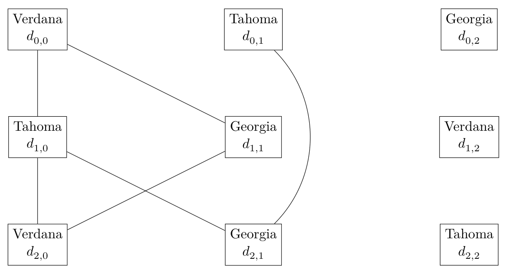
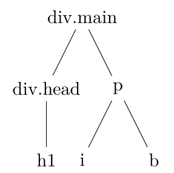
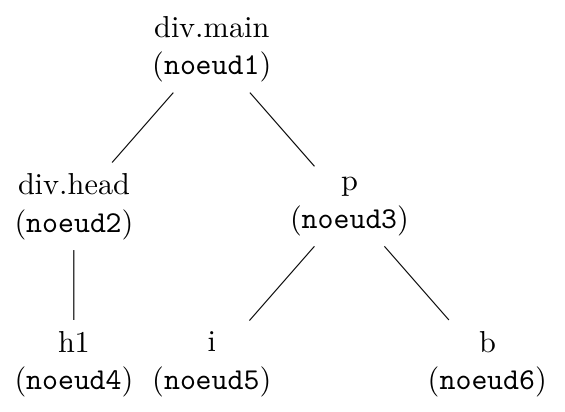

# Concours général 2023

!!! info "Session 2023 : dans les coulisses du Web"
    Classes de terminale, spécialité NSI. Durée : 5 heures. L'usage de la calculatrice est interdit.

    Le sujet comporte trois parties indépendantes : **limitation du nombre de polices**, **application des styles CSS**, **hachage cryptographique**.

    [Sujet original (PDF)](pdf/cg-nsi-2023.pdf){ .md-button }

Ce sujet étudie des aspects algorithmiques liés à des algorithmes utilisés en pratique dans la conception de navigateurs Web, en particulier lors du processus de rendu graphique de pages HTML stylées avec CSS et lors des échanges sur le réseau. Il est constitué de trois parties totalement indépendantes que les candidates et les candidats peuvent aborder dans l'ordre de leur choix. Chaque partie débute par quelques questions d'application directe et se poursuit par des questions de difficulté croissante.

Lorsque l'écriture de programmes est demandée, ceux-ci devront être rédigés en Python.

## 1. Limitation du nombre de polices de caractères sur une page

Une *police de caractères* est un ensemble de représentations visuelles qui indiquent la manière dont chaque caractère d'un texte doit être dessiné à l'écran. Lors de la conception graphique d'un document, on utilise plusieurs polices de caractères adaptées aux différents éléments du texte. Ce sujet utilise par exemple une police pour le texte général, une police à chasse fixe pour les exemples de programmes et une police italique pour définir de nouveaux termes.

Une bonne pratique lors de la conception d'une page Web est de limiter le nombre total de polices de caractères différentes présentes sur la page. Le but est de permettre au lecteur d'établir des repères visuels.

Le navigateur attribue à chaque balise du document HTML une police de caractères grâce aux déclarations de la feuille de style CSS. Dans cette partie, on s'intéresse uniquement à des déclarations CSS simples, où pour chaque nom de balise on indique une propriété `font-family`. Cette propriété donne, par ordre de préférence, la liste des polices de caractères qu'il est possible d'utiliser pour chaque élément déclaré avec cette balise.

*Exemple 1.1* (Déclarations de polices).

```css
body { font-family: avenir next, avenir, segoe ui, Helvetica Neue, Helvetica,
                    Cantarell, Ubuntu, Roboto, noto, Arial; }
p    { font-family: Verdana, Tahoma, Georgia; }
code { font-family: Roboto, Lucida Console; }
pre  { font-family: Lucida Console, Roboto; }
h1   { font-family: Tahoma, Georgia; }
h2   { font-family: Georgia, Verdana; }
```

On dit qu'une police est *déclarée* lorsqu'elle apparait dans la feuille de style. Chaque personne qui visite le site Web ne dispose pas nécessairement de toutes les polices : on dit qu'une police est *installée* si elle est présente sur le poste de l'utilisateur et peut effectivement servir lors de l'affichage.

### 1.1 Choix des polices pour chaque balise

Pour choisir avec quelle police une balise est affichée à l'écran, le navigateur considère, dans l'ordre, les polices de la liste `font-family` et sélectionne la première police installée dans l'ordre de déclaration. Ainsi dans l'exemple 1.1, si un utilisateur a seulement les polices Tahoma et Georgia d'installées, il verra la balise `p` en Tahoma.

**Question 1.** Dans cette question uniquement, l'utilisateur a installé les polices de caractères suivantes : Helvetica, Roboto, Tahoma, Verdana. Déterminer, pour chaque élément de l'exemple 1.1, dans quelle police il sera affiché.

**Question 2.** On suppose que l'on dispose d'une page qui utilise toutes les règles de l'exemple 1.1. On ne sait pas quelles sont les polices installées sur le système de l'utilisateur. Donner une liste de polices installées qui maximise le nombre de polices affichées lors du rendu de la page.

On représente en Python les déclarations CSS par un dictionnaire qui à chaque nom de balise associe la liste des polices de caractères possibles. L'exemple 1.1 est ainsi représenté par :

*Exemple 1.2* (Représentation en Python de déclarations de polices).

```python
{
  'body': ['avenir next', 'avenir', 'segoe ui', 'Helvetica Neue', 'Helvetica',
           'Cantarell', 'Ubuntu', 'Roboto', 'noto', 'Arial'],
  'p': ['Verdana', 'Tahoma', 'Georgia'],
  'code': ['Roboto', 'Lucida Console'],
  'pre': ['Lucida Console', 'Roboto'],
  'h1': ['Tahoma', 'Georgia'],
  'h2': ['Georgia', 'Verdana'],
}
```

**Question 3.** Écrire une fonction `nombre_polices_utilisees` qui prend en paramètres un dictionnaire de déclarations CSS et une liste des polices de caractères installées, et qui renvoie le nombre de polices différentes effectivement utilisées.

**Question 4.** Dans cette question, on dispose d'un nombre $n$ de polices de caractères, notées $p_1, \cdots, p_n$. On suppose que l'utilisateur a installé au moins deux polices dans cette liste, mais on ignore lesquelles. Proposer une liste de règles CSS, la plus courte possible, qui garantit que la page s'affichera toujours avec au moins deux polices différentes. Justifier votre réponse.

**Question 5.** Dans cette question, on dispose de quatre polices de caractères, notées $p_1$, $p_2$, $p_3$, $p_4$. On suppose que l'utilisateur a installé au moins trois polices dans cette liste, mais on ignore lesquelles. Proposer une liste de règles CSS, la plus courte possible, qui garantit que la page s'affichera toujours avec au moins trois polices différentes.

**Question 6.** Dans cette question, on dispose de 8 polices, notées $p_1, \cdots, p_8$. On suppose que l'utilisateur a installé au moins trois polices dans cette liste, mais on ignore lesquelles. Proposer une liste de règles CSS, la plus courte possible, qui garantit que la page s'affichera toujours avec au moins trois polices différentes.

### 1.2 Détermination du maximum

On cherche à concevoir un outil d'analyse statique qui prend en entrée un dictionnaire de déclarations CSS et qui détermine le nombre maximal de polices pouvant être affichées simultanément en respectant les styles. On commence par écrire un algorithme qui énumère toutes les configurations possibles. On présente dans un deuxième temps un autre algorithme, que l'on appelle algorithme par *retour sur trace*.

Afin de garantir que toutes les balises pourront s'afficher et pour simplifier le problème, on va supposer que toutes les déclarations déclarent toutes les polices. On appelle $p$ le nombre de déclarations dans la feuille de style et on appelle $n$ le nombre de polices. Par commodité, on représente ces déclarations sous la forme d'un tableau à $p$ lignes et $n$ colonnes. Chaque case en ligne $i$ et colonne $j$ contient le nom de la $j$-ème police présente dans la déclaration $i$. Les indices $i$ et $j$ commencent à 0. On numérote ligne par ligne les cases de ce tableau. La case numéro 0 est la case en ligne 0 colonne 0. Les cases suivantes de la ligne 0 sont numérotées de 1 à $n-1$. Puis la case en ligne 1 colonne 0 est numérotée $n$. La dernière case, en ligne $p-1$ colonne $n-1$ est ainsi numérotée $n \times p - 1$. Le tableau suivant représente cette numérotation :

| ligne \ colonne | $0$        | $1$          | $2$          | $\cdots$ | $n-1$            |
|:---------------:|:----------:|:------------:|:------------:|:--------:|:----------------:|
| $0$             | $0$        | $1$          | $2$          | $\cdots$ | $n-1$            |
| $1$             | $n$        | $n+1$        | $n+2$        | $\cdots$ | $2n-1$           |
| $2$             | $2n$       | $2n+1$       | $2n+2$       | $\cdots$ | $3n-1$           |
| $\vdots$        | $\vdots$   | $\vdots$     | $\vdots$     |          | $\vdots$         |
| $p-1$           | $(p-1)n$   | $(p-1)n+1$   | $(p-1)n+2$   | $\cdots$ | $p \times n - 1$ |

**Question 7.** Donner une expression Python qui, à partir des numéros de ligne et de colonne, donne le numéro. Réciproquement, donner des expressions Python qui, à partir d'un numéro, donnent d'une part sa ligne et d'autre part sa colonne.

#### 1.2.1 Méthode par énumération des configurations

**Question 8.** Écrire une fonction `polices_declarees` qui prend en paramètre un dictionnaire de déclarations CSS et qui renvoie la liste de toutes les polices déclarées. Dans la liste résultat, chaque police ne devra apparaitre qu'une seule fois même si elle est présente dans plusieurs déclarations CSS.

Étant donné un ensemble de polices déclarées, on appelle *configuration* le sous-ensemble des polices déclarées qui sont effectivement installées par un utilisateur. On représente la configuration d'un utilisateur par un dictionnaire qui à chaque nom de police associe un booléen indiquant si l'utilisateur possède cette police.

*Exemple 1.3* (Représentation d'une configuration en Python).

```python
{'Verdana': True, 'Tahoma': False, 'Roboto': True, 'Lucida Console': True }
```

Le but est d'énumérer toutes les configurations possibles. On commence pour cela par le dictionnaire dans lequel aucune police n'est disponible :

*Exemple 1.4* (Représentation d'une configuration en Python).

```python
{'Verdana': False, 'Tahoma': False, 'Roboto': False, 'Lucida Console': False }
```

Puis on avance, étape par étape, d'une configuration à une autre. Voici un début d'énumération possible (il est possible d'en imaginer d'autres) :

*Exemple 1.5* (Début d'une énumeration de configurations).

```python
{'Verdana': False, 'Tahoma': False, 'Roboto': False, 'Lucida Console': False }
{'Verdana': False, 'Tahoma': False, 'Roboto': False, 'Lucida Console': True  }
{'Verdana': False, 'Tahoma': False, 'Roboto': True,  'Lucida Console': False }
{'Verdana': False, 'Tahoma': False, 'Roboto': True,  'Lucida Console': True  }
```

**Question 9.** Expliquer comment énumérer simplement toutes les configurations, en partant de la configuration vide, où aucune police n'est disponible, et en arrivant à la configuration pleine, où toutes les polices sont disponibles. Lors de l'énumération, chaque configuration ne doit être considérée qu'une seule fois. Déterminer le nombre total de configurations en fonction du nombre de polices déclarées.

**Question 10.** Proposer une fonction `configuration_suivante` qui prend en paramètre une configuration utilisateur et renvoie la configuration suivante. Vous pouvez suivre l'ordre d'énumération décrit dans l'exemple ou bien choisir un autre ordre, si ce choix vous semble plus facile à programmer ou plus efficace.

**Question 11.** En déduire une fonction `nombre_polices_max` qui prend en paramètre un dictionnaire de déclarations CSS et qui renvoie le nombre maximum de polices utilisées.

#### 1.2.2 Méthode par retour sur trace

À partir d'un dictionnaire de déclarations CSS, on va construire le *graphe des compatibilités* de la façon suivante. Les sommets de ce graphe sont notés sous la forme $d_{i,j}$. Le sommet $d_{i,j}$ correspond à la $j$-ème police dans la liste de la $i$-ème déclaration.

*Exemple 1.6* (Exemple de notation des sommets).

```css
p  { font-family: Verdana /* d0,0 */, Tahoma /* d0,1 */, Georgia /* d0,2 */; }
h1 { font-family: Tahoma /* d1,0 */, Georgia /* d1,1 */, Verdana /* d1,2 */; }
h2 { font-family: Verdana /* d2,0 */, Georgia /* d2,1 */, Tahoma /* d2,2 */; }
```

Dans l'exemple précédent, on remarque qu'il n'est jamais possible d'utiliser simultanément la police Tahoma pour les balises `p` et la police Georgia pour les balises `h1`. En effet, en présence de la police Tahoma pour `p`, celle-ci serait préférée pour afficher `h1`. On dit que les sommets $d_{0,1}$ et $d_{1,1}$ ne sont pas compatibles. Inversement, les sommets $d_{1,0}$ et $d_{2,1}$ sont *compatibles* car si Tahoma et Georgia sont installées et si Verdana n'est pas installée, alors `h1` sera affichée avec Tahoma et `h2` sera affichée avec Georgia.

**Compatibilité.** De manière générale, le sommet $d_{i,j}$, situé en ligne $i$, est *compatible* avec le sommet $d_{i',j'}$ lorsque les *deux* conditions suivantes sont satisfaites :

- sur la ligne $i'$, la police de $d_{i,j}$ apparait *après* la colonne $j'$, c'est-à-dire sur une colonne dont le numéro est entre $j'+1$ (inclus) et $n-1$ (inclus),
- et sur la ligne $i$, la police de $d_{i',j'}$ apparait *après* la colonne $j$, c'est-à-dire sur une colonne dont le numéro est entre $j+1$ (inclus) et $n-1$ (inclus).

Le *graphe de compatibilité* est obtenu en reliant entre eux les sommets $d_{i,j}$ et $d_{i',j'}$ à chaque fois qu'ils sont compatibles.

On peut remarquer en particulier que :

- si l'on prend deux sommets d'une même ligne, ils ne sont pas compatibles. Dans le graphe de compatibilité, il n'y a jamais d'arête entre les sommets d'une même ligne,
- deux sommets ayant la même police, sur deux lignes différentes, ne sont pas non plus compatibles. Les sommets ayant la même police ne sont jamais reliés dans le graphe de compatibilité.

*Exemple 1.7* (Graphe des compatibilités de l'exemple 1.6).

{ width="560" }

**Clique.** On appelle *clique* dans le graphe de compatibilité un ensemble de sommets tel pour toute paire de sommets dans l'ensemble on ait une arête entre ces deux sommets. On peut alors remarquer que, puisque deux sommets ayant la même police ne sont pas compatibles, une clique correspond exactement à un choix de polices qui s'affichent toutes lors du rendu de la page. **Trouver un choix de polices qui maximise le nombre de polices affichées revient à sélectionner une clique comportant le plus de sommets possible.**

*Exemple 1.8.* Dans l'exemple 1.7, les sommets $d_{0,0}$, $d_{1,1}$ forment une clique. Cet ensemble est même une clique maximale : il n'existe aucun ensemble possédant plus de sommets qui forme une clique. S'il existait une arête entre $d_{0,0}$ et $d_{2,1}$ alors le triplet $(d_{0,0}, d_{1,0}, d_{2,1})$ formerait une clique de taille 3 mais ce n'est pas le cas car $d_{2,1}$ et $d_{0,0}$ ne sont pas compatibles.

**Manipulation des graphes en Python.** Les graphes de compatibilités seront représentés par leurs *listes d'adjacences*. Pour cela, on numérote les sommets de la façon décrite en question 7. Un graphe est alors représenté en mémoire par une liste `graphe` telle que `graphe[i]` donne la liste des sommets voisins du sommet `i`.

*Exemple 1.9* (Listes d'adjacences de l'exemple 1.7).

```python
graphe_exemple = [
  [3, 4],     # Liste des voisins du sommet numéro 0.
  [7],        # Liste des voisins du sommet numéro 1.
  [],         # etc.
  [7, 6, 0],  # L'ordre des voisins dans chaque liste n'a pas d'importance.
  [0, 6],
  [],
  [4, 3],
  [1, 3],
  [],
]
```

Dans cet exemple, `graphe_exemple[3]` donne la liste des sommets voisins du sommet numéro 3. Il s'agit des sommets 0, 7 et 6. Dans le graphe, ceci correspond au fait que le sommet $d_{1,0}$ (Tahoma) est compatible avec les sommets $d_{0,0}$ (Verdana sur ligne du haut), $d_{2,0}$ (Verdana sur ligne du bas) et $d_{2,1}$ (Georgia sur la ligne du bas).

**Question 12.** Écrire une fonction `graphe_compatibilite` qui prend en paramètre un dictionnaire de déclarations CSS et qui renvoie le graphe de compatibilité, c'est-à-dire la liste des listes d'adjacences.

**Question 13.** Écrire une fonction `ajout_clique` qui prend en paramètre le graphe des compatibilités et un ensemble de sommets qui forment une clique. Cette fonction renvoie l'ensemble des sommets tels que si on ajoute un de ces sommets à l'ensemble, cela forme toujours une clique.

L'algorithme par *retour sur trace* est un algorithme récursif. Il démarre avec une clique vide (sans sommets) et ajoute dans cette clique des sommets récursivement.

Lors du premier appel :

- on ajoute le sommet 0 dans la clique,
- récursivement, on tente de construire une clique maximale en ajoutant d'autres sommets,
- on recommence mais en partant du sommet 1 au lieu du sommet 0,
- puis en partant du sommet 2,
- à la fin, parmi toutes les solutions cliques considérées, on conserve celle qui a le plus de sommets.

De manière générale, lors de chaque appel récursif :

- on dispose déjà d'une clique $I_k$. C'est une solution partielle que l'on cherche à compléter,
- on considère, tour à tour, les sommets que l'on peut ajouter à $I_k$ de sorte que le résultat forme encore une clique. Pour chacun de ces sommets, cela nous donne une nouvelle clique $I_{k+1}$,
- on effectue un appel récursif pour compléter la clique $I_{k+1}$,
- parmi toutes ces cliques obtenues récursivement, on ne conserve que celle qui maximise le nombre de sommets.

**Question 14.** Écrire une fonction `nombre_polices_max` qui calcule le nombre maximum de polices utilisées en utilisant l'algorithme par retour sur trace.

*Indication.* Vous pouvez si vous le souhaitez, sans que ce soit obligatoire, d'abord écrire une fonction `construit_clique` telle que l'appel :

```python
construit_clique(graphe, clique_partielle)
```

prend en paramètres le graphe de compatibilité et la clique partielle $I_k$, et complète cette clique. Cette fonction renvoie la taille de la plus grande clique qui contient $I_k$.

**Question 15.** Les cliques sont des ensembles de sommets, ainsi la clique où l'on ajoute d'abord $d_{0,0}$ puis $d_{1,1}$ est la même que la clique où l'on ajoute d'abord $d_{1,1}$ puis $d_{0,0}$. Votre solution risque-t-elle de construire deux fois la même clique ? Si oui, expliquer comment on peut optimiser simplement la fonction `nombre_polices_max` pour éviter de considérer plusieurs fois la même clique.

## 2. Gestion de l'application des styles

Dans cette partie, nous nous intéressons au fonctionnement du moteur CSS. Il s'agit de la partie du navigateur qui prend en entrée :

- et une liste de règles CSS,
- une représentation du document HTML sous forme d'arbre, que l'on appelle *arbre DOM* (pour *Document Object Model*). Il s'agit d'un arbre dont les nœuds correspondent aux balises du document et où la relation de descendance dans l'arbre correspond à l'emboîtement des balises. Dans ce sujet vous n'aurez pas à construire cet arbre, simplement à le manipuler. De surcroît, les nœuds de cet arbre correspondront tous à des balises HTML (les navigateurs supportent d'autres types de nœuds, notamment pour stocker des nœuds de texte). On donne dans l'exemple 2.1 un fragment de code HTML et sa traduction en arbre DOM.

Le moteur CSS décide quelles règles CSS s'appliquent pour chaque nœud de l'arbre DOM. Cette étape doit être très efficace, car les contraintes de temps d'exécution et de représentation en mémoire sont très fortes :

- l'arbre DOM d'une page Web peut compter plusieurs milliers de nœuds,
- la feuille de style peut comporter plusieurs centaines de règles,
- les styles applicables peuvent varier très fréquemment en fonction des actions de l'utilisateur,
- l'utilisateur s'attend à ce que la page soit affichée rapidement.

*Exemple 2.1* (Exemple de document HTML et sa traduction en arbre DOM).

```html
<div class="main">
  <div class="head">
    <h1>Grand titre</h1>
  </div>
  <p>Du texte <i>étrange</i> et <b>très important</b> !</p>
</div>
```

{ width="150" }

L'arbre DOM est représenté en mémoire par un arbre d'objets. Chaque objet correspond à une balise HTML du fichier source et possède les attributs suivants :

- `tagName` donne le nom de la balise,
- `parentNode` donne l'objet parent,
- `childNodes` donne la liste des objets enfants,
- `classList` est une liste de chaines de caractères qui donne la liste des classes de la balise.

*Exemple 2.2.* On reprend l'exemple 2.1. On nomme `noeud1` jusqu'à `noeud6` les nœuds de l'arbre. Alors on peut parcourir l'arbre de la façon suivante :

```python
noeud1.tagName      # Vaut "div"
noeud1.parentNode   # Vaut None
noeud1.childNodes   # Vaut [noeud2, noeud3]
noeud1.classList    # Vaut ["main"]

noeud4.tagName      # Vaut "h1"
noeud4.parentNode   # Vaut noeud2
noeud4.childNodes   # Vaut []
noeud4.classList    # Vaut []
```

{ width="290" }

*Exemple 2.3* (Exemple de feuille CSS appliquée à ce document).

```css
h1 { font-size: 16pt ; } /* force la taille 16pt de police pour h1 */
p { font-size: 8pt ; } /* taille de 8pt de police pour tout le contenu de p */
i { font-style: italic ; } /* utilise l'italique pour i */
b { font-style: bold ; } /* utilise le gras pour b */
```

### 2.1 Sélecteurs élémentaires

La première étape élémentaire de l'application des styles consiste à déterminer quelles règles CSS s'appliquent aux différents éléments de l'arbre DOM. Une règle CSS s'écrit sous la forme :

```css
sélecteur {
  propriété1: valeur1;
  propriété2: valeur2;
}
```

Elle débute par un sélecteur qui identifie les éléments de l'arbre DOM auxquels s'appliqueront les propriétés données dans les accolades qui suivent. À chaque propriété, on attribue une valeur. On considère une version simplifiée des sélecteurs, le langage CSS étant beaucoup plus riche. Un *sélecteur élémentaire* s'écrit sous la forme `nom_balise.nom_classe1.nom_classe2.nom_classe3`. Il donne le nom de l'élément auquel il s'applique et la liste des classes qui doivent être présentes (éventuellement parmi d'autres) dans l'attribut `class` de l'élément. Chacune des parties du sélecteur est optionnelle et peut être omise. Il n'y a pas de limite sur le nombre de classes que l'on peut indiquer.

*Exemple 2.4* (Exemples de sélecteurs élémentaires).

```css
p { /* S'applique à toutes les balises <p>. */ }
div { /* S'applique à toutes les balises <div>, avec ou sans "class". */ }
div.remark { /* S'applique aux <div class="remark">,
                ou encore <div class="remark aside">. */ }
.sidebar { /* S'applique à toute balise de la forme <... class="sidebar ...">. */ }
```

On représente en Python un sélecteur CSS par une valeur de type `Selecteur`.

```python
class Selecteur:
    def __init__(self, balise, classes, ancetre):
        self.balise = balise
        self.classes = classes
        self.ancetre = ancetre
```

Il s'agit d'objets possédant trois attributs :

- `balise` donne le nom de la balise auquel le sélecteur s'applique (éventuellement `None` pour s'appliquer à tous les éléments),
- `classes` donne la liste de tous les noms de classes qui doivent être présents sur la balise,
- `ancetre` sera utilisé en partie 2.2 et vaut pour l'instant uniquement `None` dans cette partie.

*Exemple 2.5* (Représentation Python des sélecteurs en 2.4). Grâce à la méthode `__init__` de la classe `Selecteur`, on peut créer des objets correspondant aux sélecteurs de l'exemple 2.4 avec le code suivant :

```python
s1 = Selecteur(balise="p", classes=[], ancetre=None)
s2 = Selecteur(balise="div", classes=[], ancetre=None)
s3 = Selecteur(balise="div", classes=["remark"], ancetre=None)
s4 = Selecteur(balise=None, classes=["sidebar"], ancetre=None)
```

*Exemple 2.6.* On peut obtenir, à partir d'un tel sélecteur, la valeur de chaque champ de la façon suivante :

```python
s1.balise   # Vaut "p"
s3.classes  # Vaut ["remark"]
```

**Question 16.** Écrire une fonction `correspond_elementaire` qui prend en paramètres un objet DOM représentant une balise et un sélecteur élémentaire CSS, et qui renvoie un booléen qui vaut `True` exactement lorsque le sélecteur élémentaire s'applique à la balise.

### 2.2 Sélecteurs hiérarchiques

On peut chainer plusieurs sélecteurs élémentaires en les séparant par des espaces. Par exemple si l'on note `selecteur1 selecteur2 selecteur3` une telle liste, alors la règle s'applique à une balise qui correspond à `selecteur3` à condition qu'elle soit descendante d'une balise correspondant à `selecteur2`, qui à son tour est descendante d'une balise qui correspond à `selecteur1`. La relation de descendance n'est pas nécessairement directe : il peut y avoir d'autres balises dans la branche de l'arbre qui mène de `selecteur1` à `selecteur2` et de `selecteur2` à `selecteur3`.

*Exemple 2.7* (Exemple de sélecteurs avec des ancêtres).

```css
menu li { /* ... */ }
.content div.example p.dfn { /* ... */ }
```

*Exemple 2.8* (Fragment HTML pour illustrer les sélecteurs de l'exemple 2.7).

```html
<body>
  <main class="content">
    <div class="example">
      <p class="dfn">Un exemple pour comprendre. Le deuxième sélecteur
         s'applique ici.</p>
      <div class="hint">
        <p class="dfn other">Le deuxième sélecteur s'applique aussi, les
           ancêtres ne sont pas nécessairement des parents directs.</p>
      </div>
    </div>
    <p>Un paragraphe qui ne correspond à aucun sélecteur précédent.</p>
  </main>
  <menu>
    <li class="active">Le premier sélecteur s'applique ici.</li>
    <li>Et ici aussi.</li>
  </menu>
</body>
```

En Python, pour chaque sélecteur élémentaire de la liste, on stockera dans le champ `ancetre` de l'objet `Selecteur` le sélecteur élémentaire qui se trouve à sa gauche. Le sélecteur le plus à gauche aura la valeur `None` dans ce champ.

*Exemple 2.9* (Représentation Python de l'exemple 2.7).

```python
s5 = Selecteur(balise="li", classes=[],
               ancetre=Selecteur(balise="menu", classes=[], ancetre=None))
s6 = Selecteur(
    balise="p", classes=["dfn"],
    ancetre=Selecteur(
        balise="div", classes=["example"],
        ancetre=Selecteur(
            balise=None, classes=["content"], ancetre=None
        )
    )
)
```

**Question 17.** Écrire une fonction `correspond_hierarchique` qui prend en paramètre un objet DOM et un sélecteur, et qui renvoie `True` quand le sélecteur s'applique à l'objet et `False` sinon.

### 2.3 Priorité des règles

Plusieurs règles CSS peuvent s'appliquer à une même balise, et ces diverses règles peuvent donner des valeurs différentes à une même propriété. Entre deux valeurs proposées par deux sélecteurs, CSS retient celle qui vient du sélecteur le plus *spécifique*. La *spécificité* d'un sélecteur est le couple $(c, b)$ de deux entiers calculé à partir des sélecteurs élémentaires composant le sélecteur de la façon suivante :

- $c$ correspond au nombre total de classes présentes dans ses sélecteurs élémentaires,
- $b$ correspond au nombre de ses sélecteurs élémentaires qui contiennent un nom de balise.

Étant données les spécificités $(c_1, b_1)$ et $(c_2, b_2)$ de deux sélecteurs $s_1$ et $s_2$ on dit que $s_1$ est plus spécifique que $s_2$ quand $(c_1, b_1)$ est plus grand que $(c_2, b_2)$ dans l'ordre lexicographique. C'est-à-dire soit $c_1 > c_2$ soit $c_1 = c_2$ et $b_1 > b_2$.

*Exemple 2.10.* Les sélecteurs de l'exemple 2.7 ont, respectivement, pour spécificités $(0, 2)$ et $(3, 2)$. La spécificité $(3, 2)$ est plus grande que la spécificité $(0, 2)$ car le premier élément du couple est plus grand.

De même, la spécificité $(3, 0)$ est plus grande que $(2, 7)$ à cause du premier élément du couple.

Enfin, la spécificité $(4, 2)$ est plus petite que $(4, 5)$ à cause du deuxième élément du couple, car le premier élément est le même dans les deux couples.

**Question 18.** Écrire une fonction `specificite` qui prend en paramètre un sélecteur CSS et renvoie sa spécificité.

**Question 19.** Proposer une méthode efficace pour calculer la liste des propriétés et valeurs de styles retenues pour une balise donnée. On programmera cette méthode dans une fonction `styles_directs` qui prend en paramètres un objet DOM, représentant une balise, et une liste de règles CSS et qui renvoie un dictionnaire qui à chaque propriété CSS associe la valeur retenue parmi celles déclarées dans les règles.

### 2.4 Cascade des styles

Le style d'une balise donnée peut provenir des règles CSS qui s'appliquent directement à cette balise, mais il peut également provenir des règles CSS qui s'appliquent à ses parents. Par exemple, avec la feuille de style suivante :

```css
body {
  font-family: Helvetica, sans-serif;
  font-size: 12pt;
}
h1 {
  font-size: 14pt;
}
strong {
  font-weight: bold;
}
```

Et le fragment HTML suivant :

```html
<body>
  <h1>Bonnes pratiques pour les concepteurs Web</h1>
  <p>Ce document liste les bonnes pratiques <strong>recommandées</strong>.</p>
</body>
```

Alors les éléments `<p>` et `<h1>` sont dessinés avec la police de caractères Helvetica, ou sans serif si Helvetica est absente, car ces éléments *héritent* de la propriété `font-family` définie sur leur ancêtre `<body>`.

**Question 20.** On se donne l'arbre DOM complet du document ainsi que la liste de toutes les règles CSS. Décrire une méthode, la plus efficace possible, qui permet de calculer le style complet de chaque balise de l'arbre.

Pour estimer l'efficacité de l'algorithme, on rappelle que l'arbre DOM peut-être de très grande taille, aussi bien en nombre total de nœuds qu'en la longueur des branches. On supposera que le nombre de règles CSS est petit comparé à la taille de l'arbre DOM. On supposera que le nombre de sélecteurs élémentaires dans chaque règle et que le nombre de classes de chaque balise sont tous deux très petits.

Dans cette question, on demande une description précise de votre algorithme mais il n'est pas indispensable d'écrire une fonction Python. Vous pouvez faire des choix de structures de données auxiliaires qui vous semblent pertinentes pour concevoir votre algorithme.

### 2.5 Recalcul des règles CSS après mise à jour

Les parties précédentes permettent d'effectuer rapidement le calcul des styles lors du chargement initial de la page. Cependant, il arrive que l'arbre DOM soit modifié après le chargement initial, ce qui va nécessiter de recalculer les styles. C'est par exemple le cas quand un script Javascript modifie le document. Ces modifications peuvent ajouter une balise (par exemple un `<li>` dans un menu), supprimer une balise avec sa descendance, ou changer les classes (on rajoute la classe `hidden` à un nœud) ou le type d'une balise (un `<div>` devient `<span>`). Ces modifications sont fréquentes mais il est assez rare que ces changements affectent l'ensemble de la page.

On s'intéresse dans cette partie à mettre à jour le style des balises dont le style a pu changer après un changement de l'arbre DOM. Noter que les sélecteurs CSS considérés dans ce sujet sont tous *descendants*, c'est-à-dire que les seules balises dont le style peut changer après une modification sont des balises descendantes de la balise qui a été changée.

**Question 21.** Proposer une solution très efficace pour calculer le style initial du document puis le style après chaque changement (un changement étant une modification de l'ensemble des classes d'une balise, un ajout ou une suppression d'une balise dans l'arbre DOM).

Pour cette question, il n'est pas demandé un code précis mais une description des données que vous maintenez après chaque modification, des structures de données qui permettent d'être efficace pour maintenir ces données, la description de comment répercuter les changements sur ces structures et enfin l'explication de comment recalculer le style pour chaque balise dont le style peut changer.

## 3. Hachage cryptographique

Lors des échanges entre les navigateurs et les serveurs Web, il arrive fréquemment qu'un navigateur demande à nouveau une page qui a déjà été récemment téléchargée. Pour éviter de la télécharger à nouveau, le navigateur peut la conserver en mémoire mais il doit vérifier rapidement auprès du serveur que le contenu n'a pas changé. La norme HTTP permet d'utiliser des hachages cryptographiques pour traiter ce genre de problèmes. Dans cette partie, nous étudierons divers algorithmes, ou protocoles, autour de ce thème.

**Hachage cryptographique.** Une fonction de hachage cryptographique est une fonction ayant les propriétés suivantes.

- Elle prend en entrée un tableau d'octets de taille quelconque, et renvoie 64 octets. Ce résultat s'appelle le *haché*.
- Si on appelle plusieurs fois la fonction avec le même tableau d'octets on obtient toujours le même haché. Le résultat est aussi le même si la fonction est appelée sur deux ordinateurs différents.
- Le temps de calcul est proportionnel à la longueur du tableau d'entrée.
- On appelle une *collision* le fait d'avoir deux tableaux qui donnent le même haché. Considérez qu'il est impossible en pratique de trouver des collisions ou de tomber dessus par hasard.
- En général, changer ne serait-ce qu'un bit des données change complètement la valeur du haché.

Cette partie étudie plusieurs propriétés d'un tel hachage cryptographique, utilisables pour échanger des données entre deux ordinateurs notamment pour reconstituer des informations ou pour s'assurer de l'intégrité des données.

Les deux ordinateurs disposent d'une même fonction de hachage cryptographique sous la forme d'une fonction Python `hachage` prenant en argument une donnée et renvoyant un haché de 64 octets. Cette fonction de hachage sera vue comme une boîte noire, c'est-à-dire qu'on ne connaît pas son fonctionnement interne.

Dans toute la suite du sujet, on considère les ordinateurs d'Alice, appelé $A$, et Bob, appelé $B$. Ces deux ordinateurs $A$ et $B$ disposent chacun d'un gros fichier (au plus 1 Mio = $2^{20}$ octets = $2^{23}$ bits), et vont communiquer au sujet du contenu de ces deux fichiers.

*Exemple 3.1.* Voici un haché de taille 64 octets, représenté en encodage `base64` :

```
o93ZQEc0ry/wvXitQpNjUJz02487RaBycOUcfAMeugf6DwLGQSFfDI0YZm/TQWO0GCdhxAzwSxpDILO4zcMLIA==
```

**Fonction aléatoire en Python.** Pour toute cette partie, vous disposez d'une fonction `randint(a,b)` qui renvoie un entier aléatoire entre `a` et `b`, tous deux inclus.

**Échanges de messages en Python.** Afin de représenter les échanges entre les deux ordinateurs, on suppose fournies deux fonctions :

- `send(x)` permet d'envoyer des informations à l'autre ordinateur,
- `y = receive()` permet de récupérer des informations depuis l'autre ordinateur.

La fonction `receive` est bloquante : l'exécution de `y = receive()` fait attendre l'exécution du programme jusqu'à ce qu'une information soit reçue de l'autre ordinateur.

Les fonctions `send` et `receive` ne peuvent envoyer que des objets des types suivants : bit, entier, haché, booléen, chaîne de caractères. Elles préservent le type des objets échangés. Ainsi, si un ordinateur envoie une chaîne de caractères au moyen de `send`, le `receive` associé renverra une chaîne de caractères.

**Quantité d'informations transmises.** Dans certaines questions, on s'intéresse à la quantité d'informations transmises sur le réseau. Pour simplifier, on suppose dans le reste de l'énoncé que la quantité d'information (en bits) transmise par le réseau est exactement la taille de la donnée. Par exemple :

- pour l'envoi d'un booléen ou un bit, on a un coût de 1 bit,
- pour un envoi d'une chaîne de caractères, on aura un coût de 8 bits par caractère de la chaîne. On ne pourra pas envoyer des chaines de caractères vides,
- pour un envoi d'un entier, on aura un coût d'un bit par chiffre dans l'écriture binaire, par exemple pour $127 = 2^7 - 1$ on aura un coût de 7 bits. Pour envoyer 0 ou 1, on aura un coût de 1 bit,
- pour un envoi d'un haché, on aura un coût de 64 octets donc $64 \times 8 = 512$ bits.

*Exemple 3.2* (Un échange entre $A$ et $B$). L'ordinateur $A$ exécute la `fonction_A` ci-dessous et l'ordinateur $B$ exécute la `fonction_B` ci-dessous :

```python
def fonction_A():
    send("Concours")
    send("Général")
    annee = receive()
    print(annee+1)

def fonction_B():
    c = receive()
    g = receive()
    print(c + " " + g)
    send(2022)
```

Ceci produit alors l'affichage `2023` sur l'ordinateur $A$ et `Concours Général` sur l'ordinateur $B$. Le coût en échange est alors de 11 bits pour l'entier `2022`, et 15 octets pour les envois de `"Concours"` et `"Général"`.

**Manipulation des fichiers.** Les fichiers de données peuvent être manipulés comme des tableaux d'octets, c'est-à-dire dont les valeurs sont des entiers entre 0 et 255. Ainsi, dans une fonction définie par `def exemple(donnee)` où l'argument `donnee` est le contenu du fichier, on pourra faire les manipulations suivantes :

- écrire dans l'octet à la position `i` du fichier, par exemple : `donnee[i] = 127`,
- lire l'octet à la position `i`, par exemple : `octetLu = donnee[i]`,
- accéder à la longueur (en nombre d'octets) : `len(donnee)`.

**Utilisation du terme protocole.** Pour cette partie, nous utiliserons le terme de *protocole* pour désigner une description des calculs et échanges à faire effectuer à deux ordinateurs.

*Exemple 3.3* (Un protocole particulier entre $A$ et $B$). La description suivante :

- l'ordinateur $A$ envoie la chaîne de caractères `"Concours"` puis la chaîne de caractère `"Général"`,
- l'ordinateur $B$ reçoit deux chaînes de caractères, affiche leur concaténation, puis envoie l'entier `2022`,
- l'ordinateur $A$ reçoit alors cet entier et affiche sa valeur augmentée de 1,

est le protocole décrivant le comportement des exécutions des deux fonctions `fonction_A` et `fonction_B` présentées à l'exemple 3.2.

**Question 22.** Décrire comment les deux ordinateurs peuvent communiquer pour déterminer si leurs fichiers respectifs sont identiques. Proposer pour cela deux fonctions Python :

- `verifie_egalite_A(donneeA)` prenant en argument un fichier `donneeA`,
- `aide_verification_B(donneeB)` prenant en argument un fichier `donneeB`.

telles que si la fonction `verifie_egalite_A` est exécutée sur un ordinateur $A$ et `aide_verification_B` est exécutée sur un ordinateur $B$ alors la fonction `verifie_egalite_A` renvoie un booléen indiquant si les deux fichiers sont identiques.

À titre d'exemple, l'exécution des deux fonctions ci-dessous permet à $A$ de tester l'égalité du premier octet de `donneeA` avec le premier octet de `donneeB`.

```python
def verifie_egalite_premier_octet_A(donneeA):
    d0b=receive()
    return (donneeA[0] == d0b)

def aide_verification_premier_octet_B(donneeB):
    send(donneeB[0])
```

On attend ici un protocole qui envoie au plus 2 kio, c'est-à-dire 2048 bits.

**Question 23.** L'ordinateur $A$ a perdu la valeur d'un octet du fichier, mais a conservé la valeur du haché du fichier, c'est-à-dire le haché de la liste des octets du fichier. Il connaît la position exacte de cet octet. L'autre ordinateur $B$ a le même fichier, mais complet. Décrire comment Alice peut retrouver la valeur de cet octet. La priorité absolue est de minimiser la quantité de données à échanger entre les deux ordinateurs.

Donner deux fonctions Python :

- `recupere_manquant(donnee_corrompue, pos, h)` sera exécuté sur l'ordinateur $A$. Elle prend en paramètres un tableau `donnee_corrompue`, qui est le fichier de données dont l'octet à la position `pos` a été corrompu, et `h` est le haché de ce fichier avant corruption,
- `aide_recuperation(donnee)` sera exécuté sur l'ordinateur $B$ : `donnee` est le fichier non corrompu.

**Question 24.** On se place dans le même contexte que la question précédente mais l'ordinateur $A$ a perdu le haché du fichier d'origine. L'ordinateur $A$ a cette fois également perdu 10 bits du fichier au total, non nécessairement contigus. L'ordinateur $A$ connaît la position des bits perdus (mais pas $B$). Par bit perdu on entend que $A$ ne sait pas si la valeur de ce bit dans la case concernée du tableau est la valeur d'origine.

On ne demande pas ici de donner le code Python, une description claire en français du protocole suffira. Un protocole correct transférant strictement moins de 240 bits vous vaudra tous les points. Un protocole qui transfère 240 bits ou plus ne donnera qu'une partie des points. Attention, on rappelle qu'il y a $2^{20}$ octets dans le fichier et donc $2^{23}$ positions de bits différentes.

Afin de clarifier les données que vous pouvez manipuler, on précise les entêtes des fonctions Python qui implémenteraient votre protocole :

```python
def retrouve_bits_perdus_A(tableau_bits, donnee_corrompue): …
def aide_retrouve_bits_perdus_B(donnee): …
```

où `tableau_bits` est un tableau de 10 entiers indiquant les indices des bits perdus, par exemple, le cinquième bit du troisième octet sera représenté par l'entier 20.

**Question 25.** Les deux ordinateurs stockent chacun un fichier. Ces deux fichiers sont différents mais de même taille. On souhaite trouver la position du premier octet différent entre les deux fichiers.

Proposer un protocole d'échanges permettant de trouver cette position, en minimisant la somme des temps de calcul des deux ordinateurs.

On attend un coût temporel proportionnel à la taille des fichiers, et un coût en communication inférieur à 2 kio = 2048 octets.

**Préfixe et extrait.** On dit qu'un fichier $F$ de longueur $n$, représenté par un tableau, est un *préfixe* d'un autre fichier $G$ lorsque $F$ est identique aux $n$ premières cases de $G$. Un fichier $F$ de longueur $n$, représenté par un tableau est un *extrait* d'un autre fichier $G$ lorsque $F$ est identique à un morceau de $G$ allant d'une case d'indice $i$ à la case d'indice $i + n - 1$.

Dans les trois questions qui suivent, les deux ordinateurs stockent deux fichiers, qui peuvent être différents et de tailles différentes. Chaque ordinateur n'a aucune information sur le fichier de l'autre.

**Question 26.** L'ordinateur $A$ aimerait savoir si son fichier est un préfixe du fichier de l'ordinateur $B$. Proposer pour cela deux fonctions Python :

- `est_prefixe(donneeA)` sera exécuté sur l'ordinateur $A$,
- `aide_prefixe(donneeB)` sera exécuté sur l'ordinateur $B$.

La fonction `est_prefixe` doit renvoyer un booléen indiquant si `donneeA` est un préfixe de `donneeB`. Un protocole correct transférant strictement moins de 1000 bits vous vaudra tous les points.

**Question 27.** L'ordinateur $B$ est en train d'exécuter la fonction suivante :

```python
def ouvre_acces(h_passe):
    while True:
        mot_de_passe = receive()
        if len(mot_de_passe) != 8:
            send(False)
        else:
            h_envoi = hachage(mot_de_passe)
            send(h_passe[0] == h_envoi[0] and h_passe[1] == h_envoi[1])
```

Dans cette question, il n'est pas nécessaire d'écrire du code Python, vous pouvez uniquement donner une description précise de ce que votre fonction fait. Décrire une fonction `casse_protection()` que l'ordinateur $A$ peut exécuter, en envoyant successivement des chaînes de caractères de longueur 8 afin de réussir à obtenir une réponse `True` de la part de l'ordinateur $B$. Votre fonction doit envoyer le moins de données possible. Évaluer la quantité de données échangées.

**Question 28.** L'ordinateur $B$ stocke un gros fichier dont chacun des octets a été produit aléatoirement. Décrire un protocole qui permet de déterminer si le fichier de l'ordinateur $A$ est un extrait du fichier de l'ordinateur $B$. Le protocole doit transférer moins de 2048 bits au total. Votre objectif est de minimiser la somme des temps de calcul des deux ordinateurs pour un fichier produit aléatoirement.

**Question 29.** Dans cette question, les deux ordinateurs ont exactement le même fichier au départ. On suppose que vous êtes en contrôle uniquement de l'ordinateur $A$ mais pas de l'ordinateur $B$.

L'ordinateur $A$ ne fait pas confiance à $B$ et le soupçonne d'avoir perdu une partie de son contenu, par exemple pour économiser de l'espace disque.

Décrire un protocole à exécuter par les deux ordinateurs, qui permet à l'ordinateur $A$ de s'assurer (avec une probabilité forte, de l'ordre de $1 - 2^{-60}$ ou plus), que l'ordinateur $B$ est bien en possession de l'intégralité du fichier.

On considère que si l'ordinateur $B$ ne dispose effectivement pas de l'intégralité du fichier, il cherchera à convaincre $A$ du contraire, et pourra pour cela exécuter une version modifiée du protocole. On pourra en revanche supposer que $B$ répond toujours par un message du bon type aux moments prévus par le protocole.

On essaiera de limiter les calculs effectués par les ordinateurs (on s'attend à une somme de calculs au plus proportionnelle à la longueur des fichiers), ainsi que les échanges de communication (on s'attend à un volume d'échanges d'au plus 80 octets).

Un protocole qui permet de s'assurer que l'ordinateur $B$ dispose d'au moins 90 % du contenu du fichier (pas nécessairement consécutifs), obtiendra une partie des points.

**Question 30.** Les deux ordinateurs souhaitent s'assurer mutuellement qu'ils ont eu connaissance tous les deux d'un fichier secret. Si le protocole le permet, un ordinateur qui n'a pas eu accès au fichier secret essaiera de faire croire à l'autre qu'il a eu accès au secret même si cela n'est pas vrai. On veut un protocole qui empêche cela.

Le protocole travaillera en deux phases, dans la première phase les deux ordinateurs ne communiquent pas mais s'ils ont accès au fichier ils peuvent le lire et effectuer des calculs dessus. À la fin de cette première phase, ils ne peuvent conserver que 1024 bits et n'ont plus accès au fichier. Dans la seconde phase les ordinateurs communiquent et doivent se convaincre qu'ils ont bien eu accès au fichier secret.

Décrire un tel protocole. On acceptera un protocole qui a une probabilité très élevée de fonctionner, supérieure à $1 - 2^{-60}$.

Un protocole consistant à calculer et stocker le haché du fichier dans la première phase et l'envoyer à l'autre ordinateur dans la seconde phase ne fonctionnerait pas car l'autre ordinateur pourrait lui aussi envoyer ce haché qu'il a reçu, faisant ainsi croire à tort qu'il a eu connaissance du fichier.

**Question 31.** L'ordinateur $A$ a la responsabilité de stocker la première moitié d'un fichier, tandis que l'ordinateur $B$ doit stocker l'autre moitié. Les deux ordinateurs ont eu connaissance de l'intégralité du fichier, mais ne peuvent ensuite conserver que leur moitié du fichier ainsi que 256 octets supplémentaires.

Décrire un protocole qui permet à un ordinateur de demander à l'autre « quelle est la valeur de l'octet à cette position ? » et de vérifier qu'il ne ment pas. Les ordinateurs peuvent échanger d'autres données.

Pendant l'exécution du protocole, les deux ordinateurs disposent d'autant de mémoire que nécessaire pour effectuer leurs calculs et stocker les contenus des messages reçus.

On essaiera de limiter les calculs effectués par les ordinateurs (on s'attend à une somme de calculs au plus proportionnelle à la longueur des fichiers), ainsi que les échanges de communication (on s'attend à un volume d'échanges d'au plus 2048 octets).
