# Concours général 2024

!!! info "Session 2024"
    Classes de terminale, spécialité NSI. Durée : 5 heures. L'usage de la calculatrice est interdit.

    Le sujet comporte un exercice, **la résistance des œufs** (programmation dynamique), et un problème, **représenter et manipuler des données en trois dimensions** (voxels, maillages, demi-arêtes, base de données).

    [Sujet original (PDF)](pdf/cg-nsi-2024.pdf){ .md-button }

Ce sujet comporte un exercice et un problème comportant plusieurs parties largement indépendantes.

Lorsque l'écriture de programmes est demandée, ceux-ci devront être rédigés en Python. Lorsque des requêtes de bases de données sont demandées, celles-ci devront être rédigées en SQL.

## 1. Détermination de la résistance d'œufs

On s'intéresse ici au problème crucial de la résistance des œufs à des chutes.

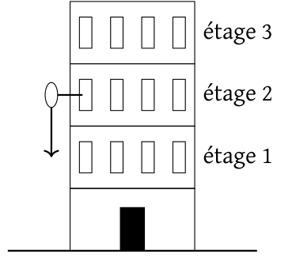{ width="190" }

*Figure 1. Dispositif expérimental pour tester la résistance des œufs.*

Le dispositif expérimental présenté à la figure 1 consiste à lâcher des œufs depuis des hauteurs variables et à constater lesquels se brisent. Plus précisément, on suppose disposer d'un immeuble de grande hauteur de $n$ étages ainsi que d'un certain nombre, $k$, d'œufs, et on cherche quel est le plus petit étage tel qu'un œuf lâché de cet étage se brise au sol. Cet étage, s'il existe, est appelé *étage critique*. Pour simplifier le modèle, nous supposons que tous les œufs ont la même résistance et, en outre, qu'un œuf tombé au sol sans se briser conserve sa résistance initiale et peut donc être utilisé pour un nouveau lâcher.

On cherche, compte tenu du nombre d'étages $n$ et du nombre d'œufs disponibles $k$, à minimiser le nombre de lâchers nécessaires à la détermination de l'étage critique. On ne considère pas le rez-de-chaussée : les étages testés sont de 1 à $n$.

**Remarque :** lorsque le nombre $k$ est petit, il faut faire attention car un œuf, s'il casse parce qu'on teste un étage trop élevé, ne peut plus être utilisé.

L'objectif de cet exercice est de trouver une stratégie « efficace » pour découvrir l'étage critique. L'efficacité mesure ici le nombre de lâchés (qu'on cherche à minimiser) et non pas le nombre d'œufs cassés. (La question 2 montre qu'on peut trouver l'étage critique avec un seul œuf.)

### 1.1 Exemples de stratégies pour des cas particuliers

**On suppose disposer d'une fonction `lacher` de paramètre $i$ qui simule le lâcher d'un œuf depuis l'étage $i$ et renvoie `True` si l'œuf est brisé, `False` sinon.**

**Attention, on suppose que cette fonction provoque une erreur lorsqu'il n'y a plus d'œuf disponible.**

**Question 1.** On suppose dans cette question que quelqu'un prétend que l'étage critique est $c$ avec $c > 1$. On veut vérifier ce fait en utilisant un seul œuf. Écrire une fonction `verif_etage_critique` prenant en paramètre $c$ et renvoyant `True` si c'est bien l'étage critique et `False` sinon.

**Question 2.** On suppose dans cette question qu'on ne dispose que d'un seul œuf : $k = 1$. Écrire une fonction `critique_un_seul_oeuf` prenant en paramètre un entier naturel $n$ correspondant au nombre d'étages de l'immeuble et renvoyant l'étage critique associé. Si l'étage critique n'existe pas, `critique_un_seul_oeuf` renvoie $n + 1$.

**Question 3.** On suppose maintenant qu'on dispose d'autant d'œufs que d'étages : $k = n$.

1. Justifier qu'on peut déterminer l'étage critique par une méthode dichotomique.
2. Donner l'ordre de grandeur du nombre de lâchers nécessaires selon cette méthode.
3. Programmer une fonction `critique_dichotomie` prenant en paramètre un entier naturel $n$ correspondant au nombre d'étages de l'immeuble et renvoyant l'étage critique associé. Si l'étage critique n'existe pas, `critique_dichotomie` renvoie $n + 1$.
4. Prouver la terminaison de la fonction `critique_dichotomie`.

**Question 4.** On suppose ici que l'on dispose de deux œufs : $k = 2$ et que le nombre d'étages $n$ est de la forme $p^2$. Montrer qu'on peut déterminer l'étage critique avec un nombre de lâchers de l'ordre de $2p$.

### 1.2 Étude du cas général

On cherche à résoudre le problème par programmation dynamique. On note $L(e, r)$ le nombre minimal de lâchers nécessaires, dans le pire cas, à la détermination de l'étage critique lorsqu'il y a $e$ étages à tester et qu'on dispose de $r$ œufs restants. On a donc $e \leq n$ et $r \leq k$.

**Question 5.** On considère dans cette question que tous les étages restent à tester, on a donc $e = n$. On suppose, de plus, $r > 0$ et on lâche un œuf de l'étage $i$.

1. Si l'œuf se casse, combien d'étages reste-t-il à tester et de combien d'œufs dispose-t-on alors ?
2. Même question si l'œuf ne se casse pas.
3. Si l'œuf ne se casse pas après le lâché de l'étage $i$, doit on tester les étages $i-$, $i-2$, etc. ? De combien d'œufs dispose t'on alors, et combien d'étages doit on encore tester ?

**Question 6.** Montrer que pour $r > 0$ et $e > 0$,

$$L(e, r) = 1 + \min_{1 \leqslant i \leqslant e} \left(\max\left(L(i-1, r-1), L(e-i, r)\right)\right).$$

Autrement dit, $L(e, r)$ peut être calculé en parcourant les indices $i$ de 1 à $e$ pour chercher le minimum des valeurs de $\max(L(i-1, r-1), L(e-i, r))$ et en ajoutant 1 au résultat.

On fixe de plus $L(0, r) = 0$ pour tout $r$, et pour $e > 0$, $L(e, 0) = +\infty$. En Python, on suppose disposer d'une valeur `Infty` représentant $+\infty$. Cette valeur se comporte comme on l'attend mathématiquement pour les opérations usuelles, c'est-à-dire que pour tout entier `x` :

- `Infty + x` = `Infty`,
- `Infty` > `x`.

**Question 7.** Écrire une fonction `L` qui étant donné $e$ et $r$ renvoie $L(e, r)$. Pour obtenir tous les points, vous devrez justifier que le coût d'exécution en temps de votre fonction est de l'ordre de $e^2 r$.

On souhaite à présent écrire une fonction qui détermine l'étage critique en appliquant la stratégie optimale conçue ci-dessus.

**Question 8.** Adapter la fonction précédente en une fonction `Lprec` qui renvoie un dictionnaire ou une matrice `prec` (selon la méthode adoptée pour `L`), indiquant pour chaque couple `(e,r)` quel est le `i` utilisé pour réaliser le `min` dans le calcul de $L(e, r)$.

**Question 9.** Écrire une fonction `strategie` qui prend en paramètres `prec`, `n` et `k`, applique la stratégie en suivant les informations stockées dans `prec` et renvoie l'étage critique. Si l'étage critique n'existe pas, `strategie` renvoie $n + 1$. Pour rappel, la fonction `lacher` présentée au début permet de simuler les lâchers d'œufs.

**Indication :** on peut utiliser une fonction récursive qui prend en paramètres :

- `prec` calculé par la fonction précédente,
- `k` le nombre d'œufs restants,
- `niv_haut` le numéro du plus haut étage d'où l'œuf pourrait ne pas se casser,
- `niv_bas` le numéro du plus bas étage d'où l'œuf pourrait se casser,

et qui renvoie l'étage critique s'il est entre `niv_bas` et `niv_haut`, `niv_haut + 1` sinon.

Attention à ne pas oublier le décalage à opérer dans le choix de l'étage d'où lâcher l'œuf lorsque `niv_bas` $\neq 1$.

## 2. Représenter et manipuler des données en trois dimensions

Le but de ce problème est de réfléchir à la manière dont on peut représenter et manipuler des données en trois dimensions. Ces données peuvent être des surfaces géométriques comme des maillages ou des données volumétriques comme la température de l'air en tout point.

Les applications sont innombrables. Citons par exemple les données issues d'un scanner médical ou la représentation détaillée d'une maison en architecture.

La grande quantité de données à traiter dans ces applications demande de réfléchir à la fois sur l'efficacité du stockage et sur la complexité des manipulations.

Ce problème étudie deux représentations différentes :

- une représentation dite *pleine* qui découpe les solides en cubes élémentaires appelés des *voxels*,
- une représentation dite *creuse* qui ne stocke que la surface externe d'un solide sous la forme d'un maillage de faces polygonales.

Ces représentations sont illustrées sur la figure 2.

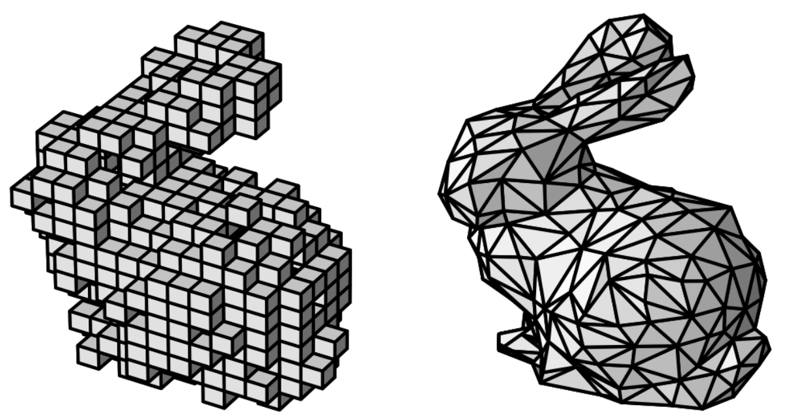

*Figure 2. Le lapin de Stanford représenté par des voxels (à gauche) et par maillage (à droite).*

Dans ce sujet, les points de l'espace sont représentés par des triplets `(x,y,z)` de nombres, flottants ou entiers selon les cas.

Une face d'un solide est représentée par un tableau de points `[p0,p1,...,pn]` indiquant qu'elle est délimitée par les arêtes `(p0,p1),(p1,p2),...,(pn,p0)`.

Ainsi, la face représentée par `[(0,0,0),(2,0,2),(1,1,1),(1,3,1),(0,3,0)]` est illustrée sur la figure 3.

Lorsque la face comporte plus de trois points, on supposera qu'ils appartiennent tous à un même plan.

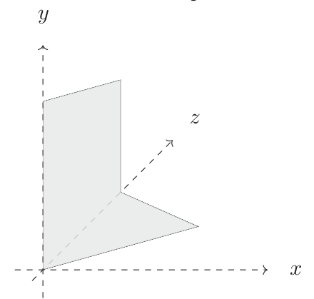{ width="230" }

*Figure 3. Exemple de face.*

### 2.1 Représentation par voxels

#### 2.1.1 Définition d'un voxel

On sait qu'une image est naturellement représentée par un tableau de *pixels* identifiés par leurs coordonnées entières dans un repère. La partie gauche de la figure 4 présente des pixels et leurs coordonnées.

On repère un pixel par son sommet inférieur gauche. Ainsi, le pixel $(x, y)$ correspond au carré de côté 1 de sommets : $(x, y)$, $(x+1, y)$, $(x+1, y+1)$ et $(x, y+1)$. Ce repérage est indiqué dans la figure 4 à droite.

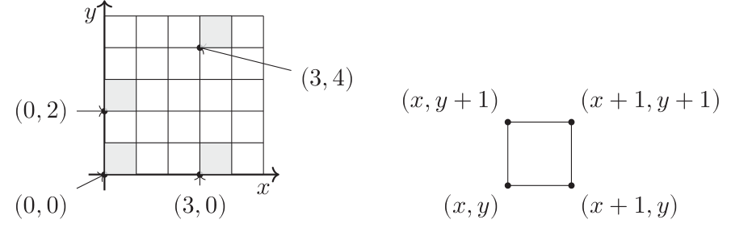{ width="480" }

*Figure 4. Pixels : coordonnées entières (à gauche) et représentation dans le plan en tant que carré (à droite).*

On considère maintenant l'espace à 3 dimensions et les *voxels* sont la généralisation à 3 dimensions des pixels :

- un voxel est un cube de coté 1 dont les sommets sont repérés par des coordonnées entières,
- un voxel est repéré par son sommet dont les trois coordonnées sont les plus petites dans le cube,
- ainsi le voxel $(x, y, z)$ représente le cube de sommets : $(x, y, z)$, $(x+1, y, z)$, $(x, y+1, z)$, $(x, y, z+1)$, $\cdots$.

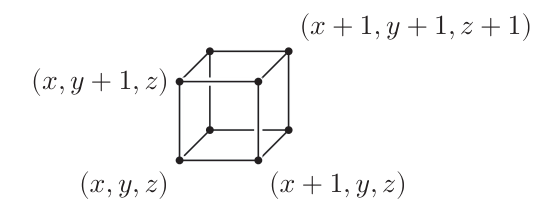{ width="290" }

**Question 10.** Un voxel comporte 6 faces, chaque face comporte 4 sommets. Écrire une fonction `faces` qui prend en argument un voxel donné par un triplet de coordonnées entières et qui renvoie le tableau de ses faces, où chaque face est un tableau de 4 points de l'espace, à coordonnées entières, selon la représentation décrite précédemment.

#### 2.1.2 Représentation d'un volume par des voxels

Une manière naïve de représenter un volume est d'utiliser un tableau de voxels. Ainsi, le parallélépipède rectangle présenté sur la figure ci-dessous est donné par le tableau

```python
[ (0,0,0), (1,0,0), (2,0,0), (0,1,0), (1,1,0), (2,1,0) ]
```

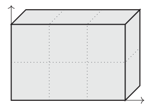{ width="170" }

Bien entendu, l'ordre des voxels n'est pas important et la représentation n'est pas unique.

Chaque voxel comporte 6 faces, mais certaines d'entre elles ne sont pas des faces visibles. Ainsi, le parallélépipède précédent comporte 6 voxels, donc 36 faces, mais seules 22 sont visibles.

**Question 11.** Écrire une fonction `nb_faces_visibles` qui compte naïvement le nombre de faces visibles d'un volume donné par un tableau de voxels. On supposera que le tableau ne comporte aucun voxel en double. Le coût attendu de votre fonction pourra être quadratique en le nombre de voxels. Expliquer alors comment on pourrait améliorer cette fonction pour obtenir un coût linéaire.

#### 2.1.3 Estimer la surface interne et externe d'une géode

Une géode est une cavité rocheuse tapissée de cristaux qu'on extrait sous la forme d'une grande pierre qu'il est alors nécessaire de casser pour en découvrir le contenu. On considère ici qu'un appareil de mesure a permis d'obtenir une représentation par voxels d'une géode qu'on va utiliser pour en déduire des informations sur celle-ci. La figure 5 illustre cette représentation.

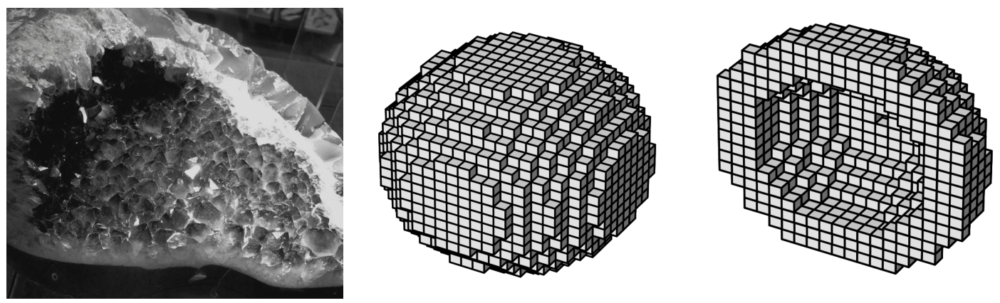

*Figure 5. L'intérieur d'une géode (à gauche), sa représentation par voxels entière (au milieu) et en coupe (à droite). Source de la photographie : Circe Denyer, publiée en domaine public sur PublicDomainPictures.net.*

Du point de vue géométrique, une géode est un volume connexe comportant un unique trou en son centre. Elle dispose donc d'une surface externe, la roche, et d'une surface interne, les cristaux. On cherche à estimer ici ces deux surfaces en comptant le nombre de faces de voxels qu'elles comportent.

**Question 12.** Expliquer pourquoi il suffit de savoir calculer la surface externe pour en déduire très simplement la surface interne.

Pour calculer la surface externe, on va considérer le voxel de plus petite coordonnée en x.

**Question 13.** Déterminer une face de ce voxel qui appartient forcément à la surface externe.

Pour résoudre ce problème, on va considérer une structure de graphe sur les faces visibles : chaque face visible est connectée à une autre face visible si elles partagent une arête.

**Question 14.** Que peut-on dire de l'ensemble des faces accessibles dans ce graphe depuis une face de la surface externe ?

**Question 15.** Décrire informellement un algorithme sur ce graphe permettant de calculer la surface externe.

**Question 16.** Écrire une fonction `surface_externe` qui prend en argument une géode donnée par son tableau de voxels et renvoie le nombre de faces de sa surface externe.

#### 2.1.4 Des voxels en évolution

On considère le découpage de l'espace en voxels et on va considérer une caractérisation de ceux-ci en deux classes : les voxels actifs, en nombre fini, et les voxels inactifs, tous les autres.

On dit que deux voxels sont voisins quand **ils partagent un même sommet**. Ainsi, chaque voxel a 26 voxels voisins.

On décrit maintenant un processus évolutif. Lors de celui-ci, tous les voxels changent d'état simultanément selon les règles suivantes :

- Si un voxel était actif et a exactement 2 ou 3 voisins actifs, il reste actif. Sinon, il devient inactif.
- Si un voxel est inactif et a exactement 3 voisins actifs, il devient actif. Sinon, il reste inactif.

**Question 17.** Écrire une fonction `voisins` qui prend en paramètre un voxel et renvoie le tableau de ses 26 voisins.

**Attention :** votre fonction ne devra pas énumérer les voisins explicitement mais elle devra plutôt utiliser des boucles.

**Question 18.** Écrire une fonction `evolution` qui prend en paramètre le tableau des voxels actifs avant l'application de ce processus et renvoie le tableau des voxels actifs à l'issue de celui-ci.

**Note :** les réponses garantissant un coût linéaire par rapport au nombre de voxels actifs seront valorisées.

### 2.2 Représentation par un maillage

Manipuler des voxels présente l'avantage de pouvoir représenter facilement des volumes complexes comme cela peut être le cas avec des données provenant de capteurs physiques. Cependant, la structure de cette représentation demande un très grand volume de stockage et les algorithmes de manipulation dépendent du nombre de voxels.

On va maintenant s'intéresser à une représentation plus efficace consistant à décomposer la surface en un ensemble de faces polygonales reliées entre elles : on parle de *maillage*.

Contrairement aux voxels, il va falloir manipuler des coordonnées non entières. Pour cela, on va considérer des nombres flottants.

**Question 19.** Les nombres flottants des ordinateurs sont très différents des nombres réels mathématiques. Quels problèmes cela peut-il poser pour tester si deux points sont identiques ? Proposez une manière d'y remédier.

Dans la suite de ce problème, nous ignorerons les difficultés liées aux manipulations de flottants.

#### 2.2.1 Première représentation

Un maillage est représenté dans cette partie par deux tableaux :

- un tableau `S` de sommets chacun sous la forme d'un triplet de nombres flottants,
- un tableau `F` de faces sous la forme du tableau des indices dans `S` de ses sommets.

```python
S = [ (0.,0.,0.), (1.,0.,0.), (0.,0.,1.), (1.,0.,1.), (.5,2.,.5) ]
F = [ [0,1,2,3], [0,1,4], [1,2,4], [2,3,4], [3,0,4] ]
```

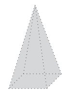{ width="70" }

**Question 20.** Écrire une fonction `faces_adjacentes_sommet` qui prend en paramètres un tableau de faces `F` décrivant une surface, **l'indice** d'un sommet `p`, et qui renvoie le tableau des **indices** dans `F` des faces contenant le sommet d'indice `p`.

**Question 21.** Écrire une fonction `faces_adjacentes_cote` qui prend en paramètres un tableau de faces `F` décrivant une surface, **l'indice** d'une face `k` et qui renvoie le tableau des **indices** dans `F` des faces ayant un sommet commun avec la face d'indice `k`.

**Question 22.** Estimer le coût des fonctions précédentes en fonction du nombre $n$ de faces et du plus grand nombre $s$ de sommets d'une face.

Dans la plupart des applications, on se restreint à des surfaces *triangulées* : chaque face polygonale est un triangle.

Une manière simple et naïve pour trianguler une surface est de couper chaque face polygonale en plusieurs triangles. Il n'existe pas une unique manière de trianguler une surface.

La figure suivante présente une face pentagonale et deux triangulations possibles :

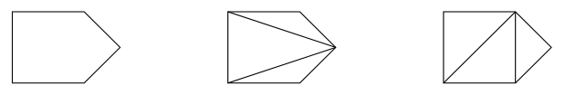{ width="340" }

**Question 23.** Écrire une fonction `triangule` qui prend en paramètre une surface donnée par un tableau `F` de faces et qui renvoie un tableau de faces triangulaires pour la même surface.

**On suppose que toutes les faces sont planes, c'est-à-dire que tous les sommets qui composent une face appartiennent à un même plan.**

#### 2.2.2 Représentation par demi-arêtes

La représentation précédente est utile quand il s'agit de stocker ou d'afficher simplement une surface. Cependant, elle est peu efficace dans le cas de traitements complexes des surfaces. Pour cela, on va introduire un raffinement : la représentation par demi-arêtes.

Une demi-arête est une arête munie d'un sens de parcours. Ainsi, chaque arête conduit naturellement à deux demi-arêtes, ce qui justifie leur nom. Une demi-arête a un sommet source et un sommet but.

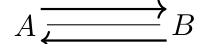{ width="120" }

*Figure 6. Une arête et sa séparation en deux demi-arêtes.*

On se restreint ici à des surfaces **fermées bien subdivisées**, c'est-à-dire des surfaces dont le maillage est complet, ne présente aucun trou (ce qui n'interdit pas qu'elle soit en plusieurs morceaux tous fermés) et où deux faces adjacentes partagent une même arête (ce qui signifie qu'aucun sommet n'appartient à une arête sans en être une des deux extremités).

Comme illustré sur la figure 7, les faces ont alors une orientation naturelle vers l'extérieur, ce qui permet de définir deux sens de parcours des sommets et des arêtes : un sens anti-horaire intérieur et un sens horaire extérieur. Comme la surface est fermée, chaque demi-arête est l'arête intérieure d'exactement une face et arête extérieure d'exactement une autre face.

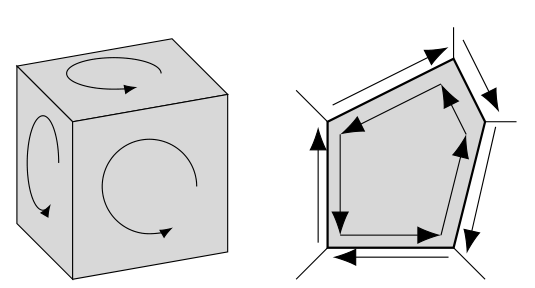{ width="300" }

*Figure 7. Orientation vers l'extérieur des faces d'une surface fermée (à gauche) et classification induite des demi-arêtes (à droite).*

On va considérer maintenant des données plus riches que des tuples ou des tableaux afin de permettre de faire des liens entre les différents éléments composant une surface.

On va ainsi définir trois classes : `Sommet`, `Face` et `DArete`. Dans la mesure où il y a des dépendances cycliques, il est impossible de définir, à la construction, l'ensemble de ces informations.

```python
class Sommet:
    def __init__(self, x, y, z):
        self.x = x
        self.y = y
        self.z = z
        self.darete = None # à remplir plus tard

class Face:
    def __init__(self):
        self.darete = None # à remplir plus tard

class DArete:
    def __init__(self, source, but, face):
        # si la face n'a pas encore de demi-arête associée
        # on utilise celle-ci
        if face.darete is None:
            face.darete = self
        # si le sommet source n'a pas encore de demi-arête
        # associée on utilise celle-ci
        if source.darete is None:
            source.darete = self
        self.source = source
        self.but = but
        self.face = face
        self.suivant = None # à remplir plus tard
        self.miroir = None # à remplir plus tard
```

Après la phase d'initialisation, on dira que les valeurs sont valides lorsque les propriétés suivantes sont garanties :

- si `s` est un sommet, alors `s.darete` est une demi-arête valide et `s.darete.source == s`,
- si `f` est une face, alors `f.darete` est une demi-arête valide telle que `f.darete.face == f`. De plus, `f.darete` est intérieure pour `f`,
- si `a` est une demi-arête, alors `a.face` est la face dont c'est une arête intérieure, `a.source` est son sommet source, `a.but` est son sommet but, `a.miroir` est sa demi-arête opposée et `a.suivant` est la demi-arête intérieure suivante pour `a.face`.

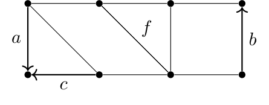{ width="250" }

*Figure 8. Une partie d'un maillage d'une surface.*

**Question 24.** On considère une partie d'un maillage présenté sur la figure 8. En partant de la demi-arête $a$, on peut obtenir la demi-arête $c$ avec l'expression `a.suivant.miroir`. Donner une expression Python dont la valeur est :

1. la demi-arête $b$,
2. la face $f$.

**Question 25.** Écrire des fonctions `valide_sommet` et `valide_face` renvoyant un booléen indiquant si les conditions précédentes sur les sommets et les faces sont remplies pour un sommet ou une face donnés.

**Attention :** la notion intérieur/extérieur dépendant du point de vue ou de la connaissance de l'ensemble de la surface, on ne pourra pas en tenir compte.

**Question 26.** Écrire une fonction `valide_darete` renvoyant un booléen indiquant si les conditions précédentes sur les demi-arêtes sont remplies pour une demi-arête donnée.

**Indication :** il s'agira notamment de vérifier qu'on a une chaîne de demi-arêtes toutes associées à la même face.

**Question 27.** À quelle structure de données étudiée en classe peut-on rapprocher la structure des demi-arêtes avec l'attribut `suivant` ?

**Question 28.** Écrire une fonction `faces_voisines` qui prend en argument une face et renvoie le tableau des faces qui partagent une arête avec celle-ci.

**Question 29.** Écrire une fonction `composante_connexe` qui prend en argument une face et renvoie le tableau des faces accessibles depuis celle-ci de proche en proche le long de la surface.

**Question 30.** Écrire une fonction `separe_face` telle que l'appel à `separe_face(f, a, b)` où `a` et `b` sont deux sommets non adjacents de la face `f` subdivise la face en deux en rajoutant une arête entre `a` et `b` et renvoie une des demi-arêtes ainsi crée.

**Attention :** votre fonction devra garantir que les nouvelles valeurs sont valides.

#### 2.2.3 Sérialisation dans une base de données

Dans cette partie, on va chercher à stocker dans une base de données la représentation par demi-arêtes précédente.

On considère le schéma de base de données suivant :

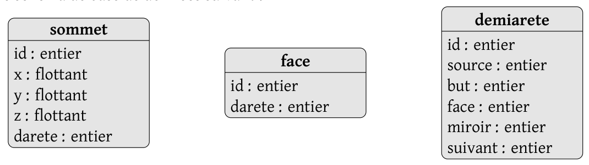{ width="540" }

Ce schéma est très proche des classes précédentes, la nuance principale provient du fait que les sommets, faces et demi-arêtes ont des identificateurs uniques, des clés primaires entières, et que le lien entre les valeurs se fait par l'intermédiaire de ces identificateurs, c'est la notion de clés étrangères.

**Question 31.** Identifier avec précision les clés primaires et les clés étrangères.

On rappelle que pour insérer un sommet d'identificateur 4, de coordonnées $(1, 0.3, 2)$ et dont l'identificateur de la demi-arête choisie est 8, il faut écrire :

```sql
INSERT INTO sommet VALUES (4, 1, 0.3, 2, 8);
```

On peut également insérer d'un coup, dans une même table, plusieurs valeurs en les mettant à la suite :

```sql
INSERT INTO sommet VALUES (4, 1, 0.3, 2, 8), (3, -1.2, 0, 3, 7);
```

On suppose définie en Python une fonction `sql_execute` qui prend en argument une requête SQL sous forme de chaîne et l'exécute.

On pourra ainsi réaliser la requête précédente ainsi en Python :

```python
request = 'INSERT INTO sommet VALUES (4, 1, 0.3, 2, 8), (3, -1.2, 0, 3, 7);'
sql_execute(request)
```

**Question 32.** Écrire une fonction `serialise` qui prend en argument une surface fermée donnée sous la forme d'un tableau `S` de sommets, d'un tableau `F` de faces, d'un tableau `A` de demi-arêtes, et qui insère tous ces éléments dans la base de données.

**On supposera que tous les entiers sont disponibles comme identificateurs dans la base au moment où on évalue la fonction.**

Il faudra garantir que votre base est intègre à la fin des insertions : les champs `id` de chaque table doivent être des clés primaires et les contraintes de clés étrangères doivent être garanties.
