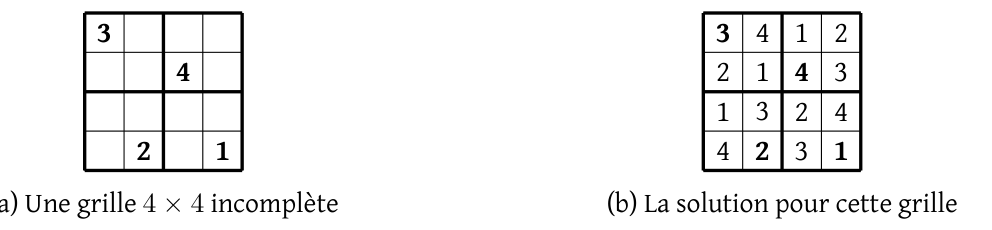
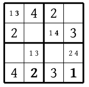
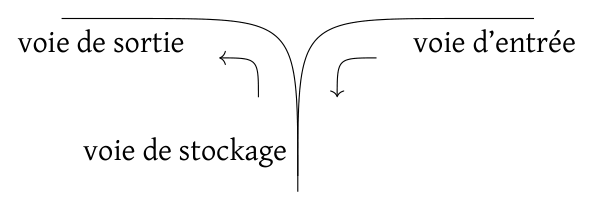
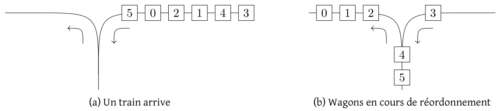
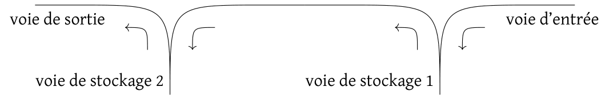
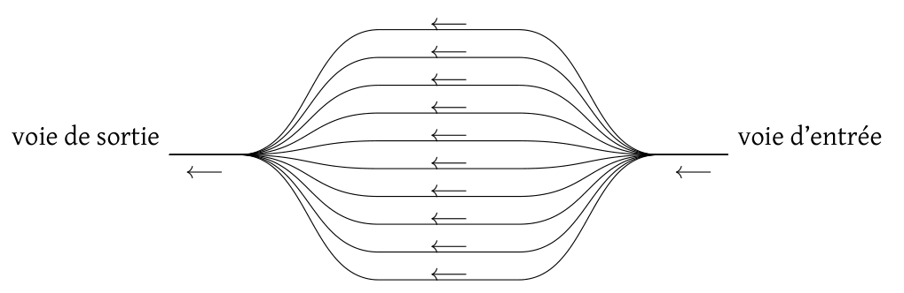

# Concours général 2025

!!! info "Session 2025"
    Classes de terminale, spécialité NSI. Durée : 5 heures. L'usage de la calculatrice est interdit.

    Le sujet comporte deux problèmes indépendants : **un solveur SAT** (logique booléenne, retour sur trace, SQL, sudoku) et **le mélange de wagons** (piles, files, plus long sous-train décroissant).

    [Sujet original (PDF)](pdf/cg-nsi-2025.pdf){ .md-button }

Ce sujet comporte deux problèmes, totalement indépendants l'un de l'autre.

Lorsque l'écriture de programmes est demandée, ceux-ci devront être rédigés en Python. Lorsque des requêtes sur des bases de données sont demandées, celles-ci devront être rédigées en SQL.

## 1. Problème : solveur SAT

Ce problème comporte 4 parties qui s'intéressent à l'implémentation d'un solveur SAT (parties 1.2 et 1.3) et à l'expression de contraintes avec des formules (partie 1.4). La partie 1.1 introduit les notations utilisées dans tout le problème. La partie 1.4 est indépendante des deux suivantes. Même si les questions des parties 1.2 et 1.3 sont indépendantes, il est nécessaire d'avoir compris les idées et les notations de la partie 1.2 pour traiter la partie 1.3.

Votre code peut utiliser des fonctionnalités des questions précédentes même si vous ne les avez pas faites.

### 1.1 Introduction

Dans ce problème, on s'intéresse à des expressions *booléennes*, c'est-à-dire des expressions qui peuvent prendre soit la valeur *vrai* soit la valeur *faux*. On utilise fréquemment de telles expressions en Python, en particulier dans les conditions des `if` et des `while`.

On ne considèrera dans ce problème que des *formules booléennes* qui n'utilisent que les éléments suivants :

- le connecteur de *conjonction*, qui correspond à `and` en Python, et que l'on notera « $\wedge$ »,
- le connecteur de *disjonction*, qui correspond à `or` en Python, et que l'on notera « $\vee$ »,
- le connecteur de *négation*, qui correspond à `not` en Python, et que l'on notera « $\neg$ »,
- des *variables booléennes*, que l'on notera $x_1$, $x_2$, etc., en les numérotant à partir de 1,
- la constante *vrai*, qui correspond à `True` en Python, et que l'on notera « $1$ »,
- la constante *faux*, qui correspond à `False` en Python, et que l'on notera « $0$ ».

*Remarque.* Python a d'autres opérateurs produisant des booléens. Ceux-ci ne sont pas autorisés dans les formules considérées. Par exemple « `len(T)<10` » n'est *pas* une formule telle qu'on vient de les définir.

Dans les premières parties, les variables booléennes seront notées en italique : $x_1$, $x_2$, etc. Dans la partie 1.4, nous utiliserons des noms significatifs écrits avec une police à chasse fixe, comme `case_1_2_contient_3`.

*Exemple 1.1.* Voici des exemples de formules booléennes :

$$A = \neg x_1 \vee (x_1 \wedge x_2) \qquad\qquad B = \neg x_1 \wedge x_2 \wedge (x_1 \vee x_2)$$

$$C = (x_1 \vee x_2) \wedge (\neg x_1 \vee \neg x_3) \wedge (\neg x_1 \vee \neg x_2 \vee x_3) \wedge (x_1 \vee \neg x_2 \vee \neg x_3)$$

L'opérateur $\neg$ est prioritaire sur les autres opérateurs. Ainsi, la formule $A$ est identique à $A = (\neg x_1) \vee (x_1 \wedge x_2)$.

Un *solveur SAT* est un programme qui cherche à *satisfaire* une formule booléenne, c'est-à-dire trouver une valeur *vrai* ou *faux* pour chaque variable de façon à rendre la formule vraie. Les solveurs SAT modernes peuvent gérer des formules contenant des centaines de milliers de variables et ont de nombreuses applications pratiques.

S'il y a plusieurs solutions pour satisfaire une formule, le solveur SAT peut renvoyer n'importe laquelle. S'il n'y en a pas, il doit renvoyer la valeur spéciale `None`.

*Exemple 1.2.* La formule $(x_1 \vee x_2) \wedge (\neg x_1 \vee x_3) \wedge (\neg x_2 \vee \neg x_3)$ peut être satisfaite. Les deux seules possibilités sont :

- les valeurs $x_1 = 1, x_2 = 0, x_3 = 1$,
- ou bien $x_1 = 0, x_2 = 1, x_3 = 0$.

Un solveur SAT peut renvoyer indifféremment l'une ou l'autre.

**Question 1.** Pour chaque formule de l'exemple 1.1, indiquer si on peut satisfaire la formule en choisissant bien les valeurs des variables. Lorsque la formule peut-être satisfaite, donner une des manières de la satisfaire, en précisant la valeur donnée à chaque variable.

**Question 2.** Donner un exemple de formule, qui n'utilise pas les constantes 0 et 1, et qui ne peut pas être satisfaite, *quelles que soient les valeurs données à ses variables*.

**Question 3.** La table de vérité du $\wedge$ donne la valeur de $x_1 \wedge x_2$ en fonction des valeurs de $x_1$ et $x_2$ :

| $x_1$ | $x_2$ | $x_1 \wedge x_2$ |
|:-----:|:-----:|:----------------:|
| 0     | 0     | 0                |
| 0     | 1     | 0                |
| 1     | 0     | 0                |
| 1     | 1     | 1                |

Donner la table de vérité du $\vee$, qui donne la valeur de $x_1 \vee x_2$ en fonction des valeurs de $x_1$ et $x_2$.

**Question 4.** Justifier les égalités suivantes :

a) $x \vee 0 = x$ &emsp; b) $x \vee 1 = 1$ &emsp; c) $x \wedge 0 = 0$ &emsp; d) $x \wedge 1 = x$

Les solveurs SAT modernes imposent souvent une forme particulière aux formules qu'ils utilisent.[^1] Cette forme, appelée *forme normale conjonctive*, se définit en trois étapes.

[^1]: Cette restriction n'est pas contraignante car toutes les formules booléennes peuvent être réécrites pour avoir cette forme.

**Littéral :** on parle de *littéral* pour les variables *et* leurs négations. Aussi bien « $x_3$ » que « $\neg x_{123}$ » sont des littéraux. Une variable seule est qualifiée de « littéral positif » alors que la négation d'une variable est qualifiée de « littéral négatif ». Ainsi, « $x_3$ » est un littéral positif et « $\neg x_{123}$ » est un littéral négatif.

> 1. Nous représenterons les littéraux par des entiers non nuls. Dans les premières parties, toutes les variables seront de la forme $x_1$, $x_2$, etc. et le littéral positif « $x_k$ » sera représentée par l'entier $+k$ tandis que le littéral négatif « $\neg x_k$ » sera représenté par l'entier $-k$.

**Clause :** on appelle *clause* toute disjonction de littéraux (positifs ou négatifs). Chaque clause sera notée entre parenthèses, comme « $(x_1 \vee \neg x_{123} \vee x_7)$ ». Un littéral seul peut être vu comme une clause. Par exemple, « $(\neg x_5)$ » est une clause.

> 2. Nous représenterons les clauses par la liste de leurs littéraux. Ainsi, une clause sera simplement une liste d'entiers non nuls.

**Forme normale conjonctive :** on dit qu'une formule est en *forme normale conjonctive* (abréviation : FNC) si c'est une conjonction de clauses.

> 3. Nous représenterons une formule en FNC par la liste de ses clauses, c'est-à-dire une liste de listes d'entiers non nuls.

La formule $C$ de l'exemple 1.1 était en FNC. Elle contenait 4 clauses et 10 littéraux :

$$\overbrace{(\underbrace{x_1}_{\text{lit. 1}} \vee \underbrace{x_2}_{\text{lit. 2}})}^{\text{clause 1}} \wedge \overbrace{(\underbrace{\neg x_1}_{\text{lit. 3}} \vee \underbrace{\neg x_3}_{\text{lit. 4}})}^{\text{clause 2}} \wedge \overbrace{(\underbrace{\neg x_1}_{\text{lit. 5}} \vee \underbrace{\neg x_2}_{\text{lit. 6}} \vee \underbrace{x_3}_{\text{lit. 7}})}^{\text{clause 3}} \wedge \overbrace{(\underbrace{x_1}_{\text{lit. 8}} \vee \underbrace{\neg x_2}_{\text{lit. 9}} \vee \underbrace{\neg x_3}_{\text{lit. 10}})}^{\text{clause 4}}$$

**Question 5.**

a) Quelle est la formule en FNC représentée par l'expression Python `[[1,2],[-1,-5,3],[-3],[5,-2]]` ?

b) Pourquoi est-il important d'interdire le nombre `0` dans la représentation des formules en FNC ?

### 1.2 Un solveur SAT récursif

Une manière d'écrire un solveur SAT est d'utiliser une fonction récursive qui va tester toutes les possibilités.

Ce solveur choisit un littéral, teste d'abord le cas où on le rend vrai puis celui où on le rend faux. Dans chaque cas, le solveur simplifie la formule et se rappelle récursivement si la formule contient encore des littéraux.

À chaque étape, on vérifie donc si la formule est « vraie » (auquel cas, on a trouvé une solution), « fausse » (auquel cas la solution que l'on est en train de construire ne marche pas) ou « indéterminée » (auquel cas il faut continuer).

#### 1.2.1 Un solveur naïf

La partie centrale de ce solveur est la simplification des formules booléennes. Étant donnée une formule $F$ en FNC et un littéral que l'on suppose vrai, la simplification revient à remplacer ce littéral par la constante 1 et son littéral opposé par la constante 0. Cela revient à effectuer les transformations suivantes :

- les clauses qui contiennent le littéral donné sont supprimées de la formule,
- les occurrences de son opposé sont supprimées des autres clauses.

*Exemple 1.3.* Si $F$ est $(x_1 \vee x_2) \wedge (\neg x_1 \vee x_3) \wedge (\neg x_2 \vee \neg x_3)$, si on suppose que le littéral $\neg x_2$ est vrai, on aura :

$$
\begin{array}{lll}
 & (x_1 \vee x_2) \wedge (\neg x_1 \vee x_3) \wedge (\neg x_2 \vee \neg x_3) & \text{avec } \neg x_2 \text{ vrai, c'est-à-dire } x_2 = 0 \\
= & (x_1 \vee 0) \wedge (\neg x_1 \vee x_3) \wedge (1 \vee \neg x_3) & \\
= & (x_1) \wedge (\neg x_1 \vee x_3) \wedge (1) & \text{car } x_1 \vee 0 = x_1 \text{ et } 1 \vee \neg x_3 = 1 \\
= & (x_1) \wedge (\neg x_1 \vee x_3) & \text{car } C_1 \wedge C_2 \wedge 1 = C_1 \wedge C_2
\end{array}
$$

Autrement dit, la simplification a fait disparaitre :

- la clause $(\neg x_2 \vee \neg x_3)$,
- le littéral $x_2$ de la clause $(x_1 \vee x_2)$.

**Question 6.** Écrire la fonction `simplifie(F, lit)` qui prend en argument une liste de listes d'entiers non nuls (`F`) et un entier non nul (`lit`) et qui applique la simplification décrite plus haut. Elle ne doit pas modifier `F` mais recréer une nouvelle formule. On aura par exemple :

```python
>>> simplifie([[1, 2, 3], [-1, 3], [-4]], -1)
[[2, 3], [-4]]
>>> simplifie([[1, 2, 3], [-1, 3], [-4]], 4)
[[1, 2, 3], [-1, 3], []]
>>> simplifie([[1, 2, 3], [-1, 3], [-4]], -4)
[[1, 2, 3], [-1, 3]]
```

**Attention,** il est important de ne pas modifier la formule `F`. N'utilisez notamment ni les méthodes « `.remove` » et « `.pop` », ni le mot-clé « `del` ». Votre code ressemblera vraisemblablement à :

```python
def simplifie(F, l):
    G = []              # formule simplifiée que l'on reconstruit
    ...                 # boucle etc.
        G.append(cl)    # ajout de la nouvelle clause
    ...
    return G
```

*Remarque.* Le reste du solveur qui fait la recherche récursive de solution en appelant `simplifie` est décrit [en annexe](#a-annexes).

#### 1.2.2 Simplification des clauses unitaires

Malheureusement, même avec seulement quelques dizaines de variables, le temps d'exécution de ce solveur peut facilement dépasser plusieurs heures ! On peut améliorer les performances en constatant que :

<center>**si la formule contient une clause avec un seul littéral, alors ce littéral est forcément vrai.**</center>

En effet, pour qu'une formule soit vraie, toutes ses clauses doivent l'être, et une clause avec un seul littéral est vraie précisément quand son unique littéral est vrai. On appelle ces clauses des *clauses unitaires*. On commence donc par les variables correspondantes, et on n'a pas besoin de tester les deux valeurs booléennes pour celles-ci.

*Exemple 1.4.* Avec la formule $(x_1 \vee x_2 \vee \neg x_3 \vee x_4) \wedge (\neg x_2) \wedge (x_2 \vee x_3)$, on commence avec :

$$
\begin{array}{lll}
 & (x_1 \vee x_2 \vee \neg x_3 \vee x_4) \wedge (\neg x_2) \wedge (x_2 \vee x_3) & (\neg x_2) \text{ est une clause unitaire, donc } x_2 = 0 \\
\texttt{simplifie} \rightsquigarrow & (x_1 \vee \neg x_3 \vee x_4) \wedge (x_3) & (x_3) \text{ est une clause unitaire, donc } x_3 = 1 \\
\texttt{simplifie} \rightsquigarrow & (x_1 \vee x_4) &
\end{array}
$$

On a ainsi simplifié la formule et trouvé une partie de la solution éventuelle : $x_2 = 0, x_3 = 1$.

**Question 7.** Écrire la fonction `simplifie_clauses_unitaires`. Cette fonction prend une formule en argument et renvoie une paire contenant :

- une nouvelle liste contenant la formule simplifiée sans aucune clause unitaire,
- la liste des littéraux correspondant aux clauses unitaires simplifiées.

**Attention :**

1. La simplification de clauses unitaires peut en faire apparaitre de nouvelles, qu'il faut simplifier également.
2. Si une clause unitaire apparait en double, il ne faut ajouter le littéral correspondant qu'une seule fois dans la solution.

### 1.3 Un solveur itératif

Le code complet du solveur précédent est très court. En simplifiant légèrement, il tient sur une trentaine de lignes de code. Grâce à la simplification des clauses unitaires, il peut par exemple résoudre de nombreux sudoku $9 \times 9$ (voir partie 1.4) simples où la formule correspondante contient plusieurs centaines de variables, plusieurs milliers de clauses, et plusieurs dizaines de milliers de littéraux.

Utiliser un langage plus rapide que Python permettrait d'améliorer un peu les performances, mais améliorer l'algorithme est encore plus important. L'essentiel du temps de calcul est passé dans la simplification de la formule (question 6). Afin d'éviter de recréer une nouvelle liste à chaque simplification de la formule, nous allons garder la formule initiale inchangée et stocker à part la liste des valeurs choisies pour les variables. Initialement, les variables ont une valeur indéterminée. Elles prennent la valeur « vrai » ou « faux » au cours de l'exécution du solveur SAT.

*Exemple 1.5.* On prend la formule $(x_1 \vee \neg x_2) \wedge (\neg x_3) \wedge (\neg x_1 \vee x_3)$. L'algorithme commence avec la liste de valeurs $x_1 = ?, x_2 = ?, x_3 = ?$ (toutes les variables sont indéterminées). L'algorithme choisit par exemple de mettre la variable $x_3$ à « faux », la formule ne change pas, mais la liste des valeurs devient $x_1 = ?, x_2 = ?, x_3 = 0$. La formule reste indéterminée car les clauses $(x_1 \vee \neg x_2)$ et $(\neg x_1 \vee x_3)$ sont encore indéterminées. L'algorithme va continuer en choisissant des valeurs pour les variables suivantes jusqu'à :

- soit obtenir une formule vraie, dans ce cas la formule peut être satisfaite,
- soit obtenir une formule fausse, dans ce cas il revient en arrière pour tester d'autres valeurs pour les variables.

Les valeurs des variables sont suffisantes pour calculer si la formule initiale prend elle-même la valeur « vrai », « faux » ou « indéterminé ».

Concrètement, la représentation d'une formule contiendra :

- une liste de clauses `Clause`, comme précédemment,
- un tableau `Valeur` donnant, pour chaque variable, sa valeur :
    - `True` ou `False` pour les variables faisant partie de la solution partielle,
    - `None` (« indéterminé ») pour les variables n'en faisant pas partie.

Notez que comme les numéros de variables sont strictement positifs, la case `F.Valeur[0]` ne correspond à rien. Nous n'y accèderons jamais. Ici comme dans toute la suite du sujet, nous utiliserons « `_` » pour dénoter une valeur arbitraire qui ne sert à rien.

*Exemple 1.6.* Pour la formule $(x_1 \vee x_2 \vee \neg x_3 \vee x_4) \wedge (\neg x_2) \wedge (x_2 \vee x_3)$ et la solution partielle $x_2 = 0, x_3 = 1$, on aura : `F.Clause = [[1,2,-3,4],[-2],[2,3]]` et `F.Valeur = [_,None,False,True,None]`.

En effet, $x_2 = 0, x_3 = 1$ correspondent au fait que `F.Valeur[2] = False` et `F.Valeur[3] = True`. Comme $x_1$ et $x_4$ ne font pas partie de la solution, on a `F.Valeur[1] = F.Valeur[4] = None`.

La classe `Formule` ressemble donc à

```python
class Formule:
    def __init__(self, F, nb_variables):
        self.Clause = F                   # liste des clauses de la formule
        self.nb_variables = nb_variables
        # Initialement, toutes les variables sont indéterminées
        # le tableau contient nb+1 cases car la case 0 ne correspond
        # à aucune variable
        self.Valeur = [None] * (nb_variables+1)
```

Cette classe sera étendue dans la suite.

La présence de valeurs booléennes indéterminées rend les tables de vérité des connecteurs plus complexes. Voici les lignes supplémentaires des tables de la négation, disjonction et conjonction :

| $x$ | $\neg x$ |
|:---:|:--------:|
| ?   | ?        |

| $x_1$ | $x_2$ | $x_1 \vee x_2$ |
|:-----:|:-----:|:--------------:|
| ?     | ?     | ?              |
| ?     | 0     | ?              |
| ?     | 1     | 1              |
| 0     | ?     | ?              |
| 1     | ?     | 1              |

| $x_1$ | $x_2$ | $x_1 \wedge x_2$ |
|:-----:|:-----:|:----------------:|
| ?     | ?     | ?                |
| ?     | 0     | 0                |
| ?     | 1     | ?                |
| 0     | ?     | 0                |
| 1     | ?     | ?                |

**Question 8.** Écrire une méthode `valeur_formule(self)` dans la classe `Formule` qui renvoie `True`, `False` ou `None` suivant que la formule correspondante est vraie, fausse, ou indéterminée. On essaiera d'écrire une fonction qui s'arrête le plus rapidement possible.

Pour l'exemple de la formule précédente $(x_1 \vee x_2 \vee \neg x_3 \vee x_4) \wedge (\neg x_2) \wedge (x_2 \vee x_3)$ avec les valeurs suivantes, on aura :

```python
>>> (F1.Clause, F1.Valeur)
([[1, 2, -3, 4], [-2], [2, 3]], [_, None, False, True, None])
>>> F1.valeur_formule()
None
>>> (F2.Clause, F2.Valeur)
([[1, 2, -3, 4], [-2], [2, 3]], [_, None, True, None, None])
>>> F2.valeur_formule()
False
>>> (F3.Clause, F3.Valeur)
([[1, 2, -3, 4], [-2], [2, 3]], [_, True, False, True, None])
>>> F3.valeur_formule()
True
```

Dans le premier cas, avec $x_2 = 0, x_3 = 1$, la formule est indéterminée (la simplification donnerait $(x_1 \vee x_4)$), dans le deuxième cas $x_2 = 1$, la formule est fausse, et dans le troisième cas $x_1 = 1, x_2 = 0, x_3 = 1$, la formule est vraie.

#### 1.3.1 Retour sur trace itératif

L'exécution d'une fonction récursive nécessite de conserver tous les arguments successifs dans la pile d'exécution. Pour éviter ceci, nous allons utiliser une version itérative du solveur. Nous devrons donc gérer le « retour sur trace » (on parle de *backtracking*) lorsqu'une solution partielle (le tableau `Valeur`) s'avère mauvaise.

Pour revenir en arrière sur la solution partielle $x_3 = 1, x_7 = 0$, il faut savoir quelle est la dernière variable introduite car c'est elle qu'il faudra changer. Il faut également savoir si on déjà testé l'autre valeur de cette variable. S'il faut tester l'autre valeur, on le fait, sinon, il faudra regarder l'avant-dernière variable, etc.

On utilise pour ceci une liste `Ordre` qui contient les variables de la solution partielle, dans l'ordre d'introduction. Le tableau `Reste` indique, pour chaque variable, s'il *reste* une valeur à tester. `Ordre` et `Reste` font partie de la formule et on ajoute donc les lignes suivantes dans la méthode `__init__` :

```python
class Formule:
    def __init__(self, F, nb_variables):
        ...
        # La solution initiale ne contient aucune variable
        self.Ordre = []

        # Comme la solution initiale ne contient aucune variable,
        # les valeurs de Reste[x] n'ont pas d'importance.
        self.Reste = [_] * (nb_variables+1)
```

*Exemple 1.7.* Voici un exemple d'évolution des tableaux `Valeur`, `Ordre` et `Reste` pour une formule à 3 variables :

1. solution partielle vide :
   `F.Valeur = [_, None, None, None]`, `F.Ordre = []`, `F.Reste = [_, _, _, _]`
2. on teste $x_1 = 0$ :
   `F.Valeur = [_, False, None, None]`, `F.Ordre = [1]`, `F.Reste = [_, True, _, _]`
3. on teste $x_1 = 0, x_3 = 1$ :
   `F.Valeur = [_, False, None, True]`, `F.Ordre = [1, 3]`, `F.Reste = [_, True, _, True]`
4. on se rend compte que la solution ne marche pas, on essaie donc $x_1 = 0, x_3 = 0$ :
   `F.Valeur = [_, False, None, False]`, `F.Ordre = [1, 3]`, `F.Reste = [_, True, _, False]`
5. on se rend compte que la solution ne marche pas, on supprime donc $x_3$ de la solution et on teste $x_1 = 1$.

**Question 9.** Quelles seront les valeurs de `F.Valeur`, `F.Ordre` et `F.Reste` lorsqu'on teste $x_1 = 1$ au point 5 dans l'exemple précédent ?

Les tableaux `F.Valeur` et `F.Reste` sont des tableaux de taille fixe. Ils sont initialisés au début du programme et on y accède avec `F.Valeur[i]` et `F.Reste[i]`. La liste `Ordre` est de taille variable et on y accède uniquement par sa dernière case. On ajoute une case avec `F.Ordre.append(x)` et on retire la dernière case avec `x = F.Ordre.pop()`.

**Question 10.**

a) Quelle structure de données standard correspond à cette utilisation du champ `Ordre` ?

b) Écrire une méthode `ajoute_lit(self, lit)` qui ajoute un nouveau littéral vrai à la solution partielle courante. Cette méthode devra mettre les champs `Valeur`, `Ordre` et `Reste` à jour, mais ne touchera pas le champ `Clause`.

**Question 11.** Écrire une méthode `backtrack(self)` qui modifie les champs `Valeur`, `Ordre` et `Reste` d'une formule pour revenir en arrière et modifier la dernière décision prise. S'il n'y a plus aucune décision modifiable, `Ordre` deviendra (ou restera) vide et la méthode renverra la valeur `False`. S'il y en avait une, la méthode renverra `True`.

*Remarque.* Pour une formule `F`, les tableaux `F.Valeur` et `F.Reste` peuvent être lus et modifiés en place avec des affections de la forme `F.Valeur[i] = v` ou `v = F.Reste[i]`, tandis que pour modifier `F.Ordre` il faut seulement utiliser les méthodes `F.Ordre.push(x)` et `x = F.Ordre.pop()`.

Par exemple :

```python
>>> print(F.Valeur, F.Ordre, F.Reste)
>>> [_, False, None, True] [1, 3] [_, True, False, True]
>>> F.backtrack()
True
>>> print(F.Valeur, F.Ordre, F.Reste)
[_, False, None, False] [1, 3] [_, True, False, False]
>>> F.backtrack()
True
>>> print(F.Valeur, F.Ordre, F.Reste)
[_, True, None, None] [1] [_, False, False, False]
>>> F.backtrack()
False
>>> print(F.Valeur, F.Ordre, F.Reste)
[_, None, None, None] [] [_, False, False, False]
```

Si on omet les détails inintéressants, le code du solveur pourrait ressembler à :

```python
def solve(Cl, nb_variables):
    F = Formule(Cl, nb_variables))   # initialisation de F
    while True:
        val = F.valeur_formule()
        if val == True:
            return F.Valeur           # on a trouvé une solution !
        elif val == False:
            b = F.backtrack()         # mauvaise solution, on revient en arrière
            if not b:
                return None           # échec du backtracking: pas de solution
        else:
            x = ...                   # on choisit une nouvelle variable
            F.ajoute_lit(x)           # que l'on ajoute à la solution
```

#### 1.3.2 « Listes de surveillance » et suppression des appels à la méthode « valeur_formule »

Malheureusement, le temps gagné à ne pas simplifier la formule est perdu dans l'appel à `F.valeur_formule()` qui parcourt toute la formule à chaque étape. Avant d'ajouter la simplification des clauses unitaires, nous allons donc remplacer cette méthode par une autre, plus efficace.

L'idée est que seule la dernière variable choisie peut modifier la valeur de formule. Pour éviter de parcourir toute la formule `F`, il faudrait savoir quelles clauses regarder lorsqu'on a modifié cette variable. On ajoute donc, pour chaque littéral `lit`, une liste de clauses `Surveille[lit]` à « surveiller » lorsque ce littéral prend une nouvelle valeur. Le dictionnaire `Surveille` est initialisé de la manière suivante :

- `Surveille` a les clés `x` et `-x` pour chaque variable `x` de la formule,
- pour chaque littéral `lit` de la formule, la case `Surveille[lit]` contient la liste des indices des clauses dont `lit` est le *premier* littéral.

*Exemple 1.8.* Pour la formule $(x_1 \vee \neg x_2 \vee x_3) \wedge (\neg x_1 \vee \neg x_3 \vee x_4) \wedge (x_2 \vee \neg x_4) \wedge (x_2 \vee \neg x_1)$, dont la représentation est `[[1,-2,3],[-1,-3,4],[2,-4],[2,-1]]`, le dictionnaire `Surveille` contiendra les cases suivantes :

- `Surveille[1] = [0]` car la seule clause de `F` qui commence par le littéral `1` est la clause n°0 (`[1,-2,3]`),
- `Surveille[-1] = [1]` car la seule clause de `F` qui commence par le littéral `-1` est la clause n°1 (`[-1,-3,4]`),
- `Surveille[2] = [2,3]` car les clauses n°2 et n°3 commencent par le littéral `2` (`[2,-4]` et `[2,-1]`),
- toutes les autres cases de `Surveille` contiennent la liste vide car aucune clause ne commence par les littéraux correspondants.

Cette initialisation est faite à la fin de la méthode `__init__` :

```python
class Formule:
    def __init__(self, F, nb_variables):
        ...
        # initialisation de Surveille
        self.Surveille = {}
        for x in range(1, nb_variables + 1):
            self.Surveille[x] = []
            self.Surveille[-x] = []
        for i in range(len(self.Clause)):
            self.Surveille[self.Clause[i][0]].append(i)
```

Initialement, toutes les variables sont indéterminées, et aucune clause de `F` ne commence par un littéral faux. Cette propriété va nous permettre d'accélérer les calculs et nous allons maintenir les deux propriétés suivantes :

1. l'indice de chaque clause commençant par le littéral `lit` est présent dans la liste `F.Surveille[lit]` et nulle part ailleurs,
2. aucune clause de `F` ne commence par un littéral faux.

Les deux propriétés sont vraies lors de l'initialisation, mais il faut ensuite garantir qu'elles restent vraies après avoir donné une valeur à une variable de la solution courante.

La méthode qui remplacera `valeur_formule` ne sera pas aussi précise car elle n'aura que 2 valeurs possibles : `False` lorsque la formule est fausse, et `True` lorsque la formule n'est pas fausse, c'est-à-dire qu'elle est vraie ou indéterminée. Pour cette raison, nous appellerons la méthode `non_fausse`.

Notez bien les points suivants.

- Avant l'introduction de la dernière variable dans la solution, la formule n'était pas fausse. (Sinon, on aurait utilisé la méthode `backtrack`.)
- La dernière variable ajoutée peut s'obtenir avec `x=self.Ordre[-1]`.
- Lorsqu'on a ajouté `x` à la solution, la propriété 2 « aucune clause de `F` ne commence par un littéral faux » n'est plus nécessairement satisfaite. La méthode `non_fausse` doit donc changer l'ordre des littéraux dans les clauses concernées pour que la propriété 2 redevienne vraie. *Ce n'est pas toujours possible.*
- La méthode `non_fausse` doit modifier le dictionnaire `F.Surveille` lorsqu'elle change l'ordre des littéraux d'une clause. Il faut en effet garantir que la propriété 1 « l'indice de chaque clause commençant par le littéral `lit` est présent dans la liste `F.Surveille[lit]` et nulle part ailleurs » reste vraie.

**Question 12.** Avant de coder la méthode `non_fausse` dans la question suivante, répondez attentivement aux questions suivantes :

a) Quand la formule est non fausse, pourquoi peut-on rétablir la propriété a ? Quand la formule est fausse, pourquoi ne peut-on pas rétablir la propriété ?

b) On vient d'introduire la variable `x`. Pour rétablir la propriété a, pourquoi n'est-il pas nécessaire de regarder les clauses qui commencent par un littéral différent de `x` ou `-x` ?

c) Si `x` est la dernière variable introduite, et si la valeur de `x` est « vraie » (c'est-à-dire `F.Valeur[x]==True`), est-il nécessaire de modifier les clauses de `F.Surveille[x]` ? Si oui, comment ? Et pour les clauses de `F.Surveille[-x]` ?

d) Et si la dernière variable avait la valeur « faux » ?

**Question 13.** Écrire la méthode `non_fausse(self)` en prenant bien en compte les remarques précédentes.

**Question 14.** Lorsque le solveur évalue une solution, il ne fait pas la différence entre les solutions indéterminées et les solutions correctes car la méthode `non_fausse` renvoie le même résultat dans les deux cas. Le solveur doit donc trouver une nouvelle condition à évaluer pour sortir de la boucle `while True:`.

a) Pourquoi n'est-il pas judicieux d'utiliser la méthode `valeur_formule` de la question 8 pour arrêter la boucle ?

b) Quelle condition d'arrêt peut-on utiliser pour savoir qu'on a trouvé une solution correcte ?

#### 1.3.3 Simplification des clauses unitaires

Pour rechercher les clauses unitaires sans parcourir toute la formule, on ajoute un champ à la classe `Formule`. La liste `Active` va contenir la liste des *variables actives*. Une variable est « active » lorsqu'elle n'a pas de valeur dans la solution courante et apparait dans le premier littéral d'une clause. En plus de simplifier la recherche des clauses unitaires, cette liste donne également une manière simple de chercher une variable à ajouter à la solution partielle : il suffit de prendre une variable de `Active`.

**Question 15.**

a) Initialement, la solution partielle est vide, et une variable `x` est dans `Active` si `x` ou `-x` apparait comme premier littéral d'une clause de `F`. Écrire le code Python qu'il faudrait ajouter à la méthode `__init__` pour initialiser `self.Active` de manière efficace à partir des valeurs de `self.Clause`, `self.Valeur` et `self.Surveille`. Attention, la liste `Active` ne doit pas contenir de doublons.

b) Décrire le code de la méthode `clause_unitaire(self)` qui rechercherait une clause unitaire dans une `Formule`. Expliquer notamment comment le champ `Active` permet d'éviter de considérer certaines clauses.

c) Faut-il modifier le code de la méthode `backtrack` (question 11) ? Si oui, comment ?

d) Faut-il modifier le code de la méthode `non_fausse` (question 13) ? Si oui, comment ?

*Remarque.* Avant d'écrire du code Python pour les points b, c et d prenez quelques minutes pour décrire ce que vous feriez. Une description détaillée et correcte pourra vous rapporter tous les points, même si elle n'est pas accompagnée de code.

**Question 16.** Pour avoir une recherche des clauses unitaires encore plus efficace, on peut généraliser l'utilisation des listes `Surveille[lit]` pour contenir les indices des clauses qui ont le littéral `lit` en première *ou deuxième* position. Comme précédemment, on demande également que ces 2 littéraux soient « non faux ».

En quoi ceci permet-il d'accélérer la recherche des clauses unitaires ?

#### 1.3.4 Statistiques sur les formules

Le choix des variables à rendre vraies ou fausses dans un solveur SAT est très important en pratique. Il faut choisir une variable qui a *le plus de chances* de rendre la formule vraie. Pour ceci, il faut identifier des propriétés qui permettent de savoir rapidement si une formule a de fortes chances de pouvoir être satisfaite.

Pour faire des statistiques, on a stocké des formules dans une base de données SQL, dont le schéma est le suivant :

- **formule** (<u>id_formule</u> : entier, est_sat : booléen)
- **litteral** (num_litteral : entier, num_clause : entier, id_formule : entier), où `id_formule` fait référence à `formule.id_formule`

Chaque formule a un identifiant unique id_formule et un booléen est_sat qui indique si elle peut être satisfaite. On rappelle que le littéral $x_k$ a pour numéro $k$ et que le littéral $\neg x_k$ a pour numéro $-k$.

*Exemple 1.9.* Pour la formule $B = \neg x_1 \wedge x_2 \wedge (x_1 \vee x_2)$, d'identifiant 17, la table litteral contient les lignes :

```
 num_litteral | num_clause | id_formule
--------------+------------+------------
           -1 |          0 |         17
            2 |          1 |         17
            1 |          2 |         17
            2 |          2 |         17
```

**Question 17.** Écrire une requête qui permet d'obtenir la liste des identifiants de formules, et pour chacune de ces formules, de connaitre le nombre de clauses.

*Remarque.* On rappelle qu'en SQL, on peut utiliser le mot-clé `DISTINCT`.

Par exemple en exécutant cette requête on pourrait obtenir une réponse qui commence par les lignes suivantes :

```
 id_formule | nb_clauses
------------+------------
          0 |         68
          1 |        102
          2 |         74
```

**Question 18.** De même, écrire une requête qui permet d'obtenir pour chaque formule son nombre de variables : si une variable apparait plusieurs fois dans la formule, on ne la compte qu'une seule fois.

*Remarque.* La fonction `ABS(x)` en SQL renvoie `x` lorsque `x` est positif et `-x` sinon.

Par exemple en exécutant cette requête on pourrait obtenir une réponse qui commence par les lignes suivantes :

```
 id_formule | nb_variables
------------+--------------
          0 |           34
          1 |           51
          2 |           36
```

Le quotient formé du nombre de clauses divisé par le nombre de variables semble jouer un rôle significatif pour estimer si une formule a des chances d'être satisfaite.

**Question 19.** Écrire une requête SQL qui permet, pour chaque valeur de ce quotient, de connaitre le nombre de formules de la base de données qui peuvent être satisfaites.

Par exemple en exécutant cette requête on pourrait obtenir une réponse qui contient les lignes suivantes :

```
 quotient | nb_formules
----------+-------------
      2.5 |         217
      3.5 |         196
      4.1 |         140
      4.2 |          99
      4.6 |          75
      5.9 |           7
```

### 1.4 Un exemple de formule FNC : résolution de sudoku

Chercher une solution pour la satisfiabilité d'une formule peut être vu comme de la résolution de contraintes : la formule exprime des contraintes booléennes, et une solution doit satisfaire toutes les contraintes de la formule. S'il y a trop de contraintes, la formule peut même devenir *insatisfiable*. Des problèmes aussi différents que l'allocation de ressources, le pavage d'un rectangle par des pièces de tetris ou la résolution d'un sudoku s'expriment assez facilement par des formules booléennes. Un solveur SAT permet donc de résoudre tous ces problèmes, *à condition que l'on sache écrire la formule correspondante*.

Nous allons nous intéresser dans cette partie à la résolution de sudoku $4 \times 4$. Une grille de sudoku incomplète est représentée en figure 1a.

{ width="560" }

*Figure 1. Un exemple de sudoku.*

L'objectif est de remplir chaque case vide avec un entier entre 1 et 4 en respectant les règles suivantes :

- chaque ligne contient tous les entiers de 1 à 4,
- chaque colonne contient tous les entiers de 1 à 4,
- chacun des quatre blocs[^2] contient tous les entiers de 1 à 4.

[^2]: Délimités par une bordure plus épaisse : en haut à gauche, en haut à droite, en bas à gauche et en bas à droite.

La solution (unique) pour la figure 1a est représentée en figure 1b.

Pour modéliser une grille de sudoku par une formule, nous allons utiliser 64 variables « `case_`$i$`_`$j$`_contient_`$k$ » où chaque entier $i, j, k$ est compris entre 1 et 4 :

- $i$ donne un numéro de colonne en partant de la gauche,
- $j$ donne un numéro de ligne en partant du haut,
- $k$ donne un entier pouvant se trouver dans la case de coordonnées $(i, j)$.

Le reste de cette partie s'intéresse à exprimer les règles du jeu sous la forme de contraintes, qui seront des listes de clauses.

Chaque entier positionné dans la grille initiale donne une clause (unitaire). Pour l'exemple précédent, nous obtenons la formule à 4 clauses suivante :

(`case_1_1_contient_3`) $\wedge$ (`case_3_2_contient_4`) $\wedge$ (`case_2_4_contient_2`) $\wedge$ (`case_4_4_contient_1`)

Pour simplifier, nous allons seulement *afficher* ces contraintes de la manière suivante :

- un littéral positif sera affiché comme une chaine de caractères,
- un littéral négatif sera préfixé par le signe `-`,
- les littéraux d'une clause seront affichés sur une unique ligne,
- chaque clause d'une formule en FNC sera affichée sur sa propre ligne.

Transformer une formule écrite sous cette forme en une liste de clauses utilisable par les solveurs SAT de la partie précédente ne nécessite qu'une vingtaine de lignes de code et ne sera pas fait dans ce sujet.

On rappelle les points suivants du langage Python :

- on peut insérer des expressions Python au milieu d'une chaine en ajoutant un « `f` » avant le premier guillemet de la chaine, et en mettant les expressions entre accolades :

    ```python
    >>> i = 1
    >>> j = 2
    >>> n = 3
    >>> f"case_{i}_{j}_{n}"
    "case_1_2_3"
    ```

- pour éviter le retour à la ligne à la fin d'un `print`, il faut ajouter l'argument `end=""` :

    ```python
    >>> for i in range(4):
    ...     print(f"case_{i}_{i+1}_{2*i} ", end="")
    ...
    case_0_1_0 case_1_2_2 case_2_3_4 case_3_4_6 >>>
    ```

    Attention, dans cet exemple, il n'y a pas non plus de retour à la ligne final ! On pourrait en ajouter un avec un `print()` après la boucle.

**Question 20.** Donner une clause qui exprime la contrainte « la ligne n°1 contient *au moins* une fois le nombre 2 ».

**Question 21.** Écrire le code Python pour produire, comme décrit précédemment, toutes les clauses exprimant cette contrainte pour tous les entiers 1, 2, 3 et 4, pour toutes les lignes.

Les contraintes pour les colonnes et pour les blocs sont similaires et ne sont pas demandées. On suppose qu'elles ont été écrites.

Les règles impliquent que chaque ligne contient au plus une fois chaque nombre.

**Question 22.** On veut exprimer la contrainte « la ligne n°1 contient *au plus* une fois le nombre 2. » Une possibilité est d'utiliser le fait que la ligne n°1 contient au plus une fois le nombre 2 si et seulement si le nombre 2 n'apparait pas deux fois sur la ligne n°1, c'est-à-dire si, pour chaque paire de cases sur la ligne n°1, au moins une des 2 cases ne contient pas un 2. Donner une formule en FNC pour exprimer ceci.

**Question 23.** Écrire le code Python pour produire les clauses correspondantes pour tous les entiers 1, 2, 3, et 4, pour toutes les colonnes.

Les contraintes pour les lignes et les blocs sont similaires et ne sont pas demandées. On suppose qu'elles ont été écrites.

**Question 24.** En plus des contraintes précédentes, il faut ajouter les contraintes : « chaque case contient exactement un nombre entre 1 et 4 ». Sans ces contraintes, le solveur pourrait proposer la solution ci-dessous.

{ width="100" }

a) Donner la forme générale des clauses « chaque case contient au moins un entier entre 1 et 4 ».

b) Donner la forme générale des clauses « chaque case contient au plus un entier entre 1 et 4 ».

c) Écrire le code qui génère toutes ces clauses.

**Question 25.** Notons $F_1$ la liste des clauses issues de la question 21 et $F_2$ la liste des clauses issues de la question 23. Notons $F_3$ les clauses issues de la question 24a et $F_4$ les clauses issues de la question 24b.

Expliquer pourquoi il n'est pas nécessaire de prendre les clauses de $F_1$ et $F_4$ car les clauses de $F_2$ et $F_3$ sont suffisantes pour respecter les règles du jeu.

**Question 26.** Lors de tests sur des sudoku $9 \times 9$, le solveur SAT est parfois *plus lent*, lorsqu'on supprime les clauses redondantes (question 25) de $F_1$ et $F_4$. Expliquer pourquoi, dans certains cas, utiliser une formule équivalente *plus petite* (strictement moins de clauses) peut *ralentir* le solveur SAT.

## 2. Problème : mélange de wagons

Dans ce problème, on s'intéresse à des algorithmes qui permettent de réordonner des wagons de trains. Les wagons pouvant uniquement se déplacer le long d'itinéraires prédéfinis, les rails, on souhaite étudier ce qu'il est possible de faire en tenant compte de ces contraintes.

Les wagons d'un train doivent toujours suivre les chemins donnés par les rails. Lorsque deux wagons se suivent sur un même rail, on ne peut en particulier pas changer l'ordre, c'est-à-dire qu'il est impossible pour un wagon de doubler un autre wagon quand les deux sont sur le même rail.

### 2.1 Tri avec une voie de stockage

Le train arrive par une voie d'entrée (à droite). Cette voie est suivie d'une voie de stockage (au milieu), elle-même suivie d'une voie de sortie (à gauche). Les voies sont donc disposées de la façon suivante :

{ width="330" }

*Figure 2. Schéma des trois voies.*

Étant donné la configuration des voies, à chaque étape on peut donc réaliser une des opérations suivantes :

1. prendre le wagon en tête (à gauche) de la voie d'entrée et le mettre en haut de la voie de stockage,
2. prendre le wagon en haut de la voie de stockage et le mettre en queue (à droite) de la voie de sortie.

Un wagon dans la voie de stockage ne peut pas retourner vers la voie d'entrée et un wagon dans la voie de sortie ne peut pas retourner dans la voie de stockage. Les trois voies sont assez grandes pour faire entrer tous les wagons si nécessaire.

En général, on a $n$ wagons, numérotés de $0$ à $n-1$. Ils arrivent dans n'importe quel ordre sur la voie d'entrée. On veut constituer sur la voie de sortie un train où les wagons sont dans l'ordre croissant de leurs numéros, le wagon $0$ doit être le plus à gauche en sortie et le wagon $n-1$ le plus à droite.



*Figure 3. Exemple de train sur les voies.*

**Question 27.** Détailler les étapes qui permettent de remettre dans l'ordre les wagons du train de la figure 3a.

**Question 28.** Avec quelle structure de données étudiée en classe peut-on représenter naturellement la voie de stockage ?

**Question 29.**

a) Quand un train à $n$ wagons peut être remis dans l'ordre, combien de mouvements de wagons sont nécessaires ?

b) Pour un train donné qui peut être remis dans l'ordre, combien de suites de mouvements différentes permettent de le trier ?

Un train est de *type 120* s'il existe trois wagons, numérotés $i$, $j$ et $k$, tels que $i < j < k$ et, sur la voie d'entrée, le wagon $i$ est plus à droite que le wagon $k$, qui lui-même est plus à droite que le wagon $j$. Le train $(1, 2, 0)$ est un train de ce type.

**Question 30.** Pourquoi ne peut-on pas remettre dans l'ordre un train de type 120 ? Votre réponse doit s'appliquer à tout train de type 120, et pas uniquement au train $(1, 2, 0)$.

**Question 31.** Si le train n'est pas de type 120, proposer un algorithme simple qui permet de le remettre dans l'ordre. On pourra l'écrire en Python en supposant que l'on a accès aux fonctions suivantes :

- `entree_vers_stockage()` prend le wagon suivant sur la voie d'entrée et le met dans le stockage,
- `stockage_vers_sortie()` prend le wagon suivant sur la voie de stockage et le met dans la voie de sortie,
- `suivant_entree()` donne le numéro du wagon suivant sur la voie d'entrée, ou $-1$ si la voie est vide,
- `suivant_stockage()` donne le numéro du wagon suivant sur la voie de stockage, ou $-1$ si la voie est vide,
- `suivant_sortie()` donne le numéro du wagon suivant sur la voie de sortie, ou $-1$ si la voie est vide.

On ajoute une deuxième voie de stockage, à la suite de la première. Lorsque l'on sort un wagon de la première voie de stockage, il va instantanément dans la deuxième voie de stockage :

{ width="560" }

*Figure 4. Deux voies de stockage à la suite.*

**Question 32.** On considère dans cette question uniquement la gare présentée en figure 4.

a) Montrer qu'on peut remettre dans l'ordre le train $(1, 2, 0)$.

b) Quand un train peut-être remis dans l'ordre, y a-t-il plusieurs suites de mouvements de wagons possibles pour remettre le train dans l'ordre ?

c) On peut vérifier que tous les trains de 6 wagons peuvent être remis dans l'ordre. Montrer qu'il existe certains trains qui ne peuvent pas être remis dans l'ordre.

### 2.2 Gare de triage

Une gare de triage est constituée d'une voie d'entrée, qui se sépare en plusieurs voies de triage parallèles. Les voies de triage se rejoignent pour aller sur la voie de sortie. Un wagon peut uniquement avancer, et jamais reculer. Ainsi, à chaque étape on peut réaliser l'une des opérations suivantes :

- prendre le wagon suivant sur la voie d'entrée et l'envoyer sur une voie de triage, à la suite des wagons déjà présents sur cette voie de triage,
- prendre le premier wagon d'une voie de triage et l'envoyer sur la voie de sortie.

Les wagons ne peuvent pas rebrousser chemin. Ils ne se déplacent que dans un sens, de la droite vers la gauche.

{ width="520" }

*Figure 5. Une gare de triage avec 10 voies de triage.*

**Question 33.** Avec quelle structure de données étudiée en classe peut-on représenter naturellement une voie de triage ?

Si $T$ est un train, alors un *sous-train de $T$* est obtenu lorsque l'on retire des wagons de $T$, mais sans changer l'ordre entre ces wagons. Un sous-train est *décroissant* si ses wagons sont dans l'ordre décroissant.

*Exemple 2.1.* Si $T$ est constitué des wagons $(8, \underline{0}, 9, 10, 7, 1, \underline{2}, \underline{4}, 6, 5, \underline{3})$ alors $(0, 2, 4, 3)$ est un sous-train de $T$.

Le sous-train $(0, 2, 4, 3)$ n'est *pas* décroissant mais $(10, 7, 4, 3)$ est un sous-train décroissant de $T$.

Parmi tous les sous-trains décroissants de $T$, l'un d'entre eux est le plus long possible. On note $d(T)$ le nombre de wagons d'un plus long sous-train décroissant de $T$.

*Exemple 2.2.* Dans l'exemple précédent, $d(T) = 5$ et un plus long sous-train décroissant est donné par $(10, 7, 6, 5, 3)$.

Le but des questions 34, 35 et 37 est d'illustrer le résultat suivant : « Si on se donne $m$ voies de triage, alors les trains $T$ que l'on peut remettre dans l'ordre sont exactement ceux qui vérifient $d(T) \leq m$. »

**Question 34.** On se donne 10 voies de triage parallèles. Trouver un train $T$ que l'on ne peut pas remettre dans l'ordre avec cette gare de triage. Justifier précisément la réponse, en expliquant pourquoi $T$ ne peut pas être remis dans l'ordre, quels que soient les mouvements que l'on effectue avec les wagons.

**Question 35.** Expliquer comment la réponse précédente se généralise pour un nombre quelconque $m$ de voies de triage avec n'importe quel train $T$ qui vérifie $d(T) > m$.

On dispose d'une classe nommée `VoieTriage` qui représente une voie de triage. On crée une nouvelle voie de triage avec l'appel `VoieTriage()`. À sa création, une voie de triage est vide. Elle dispose des méthodes suivantes :

- `est_vide()` renvoie un booléen qui indique si la voie est vide,
- `queue()` renvoie le numéro du wagon le plus à droite. Elle provoque une erreur si la voie est vide,
- `tete()` renvoie le numéro du wagon le plus à gauche. Elle provoque une erreur si la voie est vide,
- `ajoute(wagon)` ajoute le wagon dont le numéro est donné en paramètre à droite de la voie de triage,
- `retire()` retire le wagon le plus à gauche, et renvoie son numéro. Elle provoque une erreur si la voie est vide.

**Question 36.** On a un train $T$ qui vérifie $d(T) \leq m$. Expliquer pourquoi un algorithme qui remet le train dans l'ordre peut : d'abord vider la voie d'entrée en mettant les wagons un par un dans les voies de triage, puis vider les voies de triage vers la voie de sortie.

Décrire précisément un tel algorithme.

**Question 37.** Écrire une fonction Python `gare_triage` qui prend en paramètres :

- le nombre `m` de voies de triage,
- une voie d'entrée `entree`, de type `VoieTriage`, qui contient initialement tous les wagons,
- une voie de sortie `sortie`, de type `VoieTriage`, qui est initialement vide,

et qui effectue une suite d'opérations utilisant uniquement les voies de sortie, d'entrée et $m$ voies de triage afin de remettre dans l'ordre un train. On suppose que la condition $d(T) \leq m$ est vérifiée par le train en entrée, c'est-à-dire que le train est effectivement triable. Si ce n'est pas le cas, le comportement de la fonction `gare_triage` peut être quelconque.

Dans la question précédente, le nombre de voies de triage était fixé à priori. Désormais, on choisit un train $T$ particulier et on veut savoir combien de voies de triage doit avoir une gare de triage afin de pouvoir remettre ce train dans l'ordre.

Si $T$ est un train, on note $T[0{:}k]$ la partie du train $T$ composée uniquement des $k$ premiers wagons de $T$. On note $D(k, M)$ la longueur d'un plus long sous-train de $T[0{:}k]$ décroissant dont tous les wagons ont un numéro supérieur ou égal à $M$.

**Question 38.** Lorsque $T[k] \geq M$, expliquer pourquoi on a l'égalité suivante :

$$D(k+1, M) = \max\left(D(k, M), 1 + D(k, T[k]+1)\right)$$

**Question 39.** Lorsque $T[k] < M$, expliquer pourquoi on a l'égalité suivante : $D(k+1, M) = D(k, M)$.

**Question 40.** Écrire une fonction `max_decroissant` qui prend en paramètre un train `T` représenté par le tableau de ses wagons et qui renvoie la longueur du plus grand sous-train décroissant.

*Remarque.* Une attention particulière sera portée au temps de calcul de la fonction proposée.

**Question 41.** Si $T$ est un train à $n$ wagons, quel est l'ordre de grandeur du nombre d'opérations élémentaires effectué par votre fonction `max_decroissant` ?

## A. Annexes

*Note : ces annexes décrivent le reste du code nécessaire pour obtenir un solveur SAT complet. Elle ne contiennent pas de question et il n'est pas nécessaire de les consulter pendant l'épreuve.*

### A.1 Le solveur naïf

Avec la fonction `simplifie` (question 6), nous pouvons écrire un premier solveur SAT avec une douzaine de lignes de Python :

```python
def solveur1(F, sol):
    if F == []:
        # si la formule est vide, `sol` contient une vraie solution
        return sol
    if [] in F:
        # si la formule contient une clause vide, `sol` n'est
        # pas bonne et il faut essayer autre chose
        return None
    # on prend le premier littéral de la première clause
    lit = F[0][0]
    # on essaie de mettre `lit` à vrai
    solution = solveur1(simplifie(F, lit), sol+[lit])
    if solution != None:
        return solution
    # si ça n'a pas marché, on essaie de mettre `lit` à faux
    solution = solveur1(simplifie(F, lit), sol+[-lit])
    if solution != None:
        return solution
    # si rien n'a marché, il n'y a pas de solution qui étende `sol`
    return None
```

L'argument `F` contient la formule (liste de liste d'entiers non nuls) et l'argument `sol` contient une solution partielle (liste d'entiers non nuls) qu'on essaie d'agrandir. La formule est simplifiée et les littéraux contenus dans `sol` ne peuvent donc pas apparaitre dans `F`.

Il y a deux conditions d'arrêt.

1. « `F == []` » : toutes les clauses ont disparu car elles contiennent toutes un littéral vrai. La solution qu'on était en train de tester rend la formule vraie et on peut la renvoyer.
2. « `[] in F` » : une clause est devenue vide car tous ses littéraux sont devenus faux. Dans ce cas, la formule simplifiée est fausse (c'est une conséquence de l'égalité $x \wedge 0 = 0$). La solution courante ne fonctionne pas et il faut essayer autre chose. La valeur `None` est utilisée pour dire que `sol` ne marche pas.

### A.2 Le solveur naïf, avec simplification des clauses unitaires

Pour alterner les étapes de « simplification des clauses unitaires » (fonction `simplifie_clauses_unitaires`, question 7) et de « recherche récursive de solution », il suffit d'appeler la fonction de simplification dans le solveur précédent :

```python
def solveur2(F, sol):
    F, clu = simplifie_clauses_unitaires(F)
    sol = sol + clu   # on ajoute les clauses unitaires (forcées) à la solution
    if F == []:
        # si la formule est vide, `sol` contient une vraie solution
        return sol
    ...
    le reste du code est identique à celui de solveur1
    ...
```

En pratique, l'impact de ces simplifications sur les performances est souvent énorme. Cependant, la complexité de cet algorithme reste exponentielle au pire cas. La question de savoir s'il existe un solveur SAT efficace (de complexité polynomiale) est équivalente au problème « $P = NP$ », l'un des grands problèmes ouverts en informatique.
