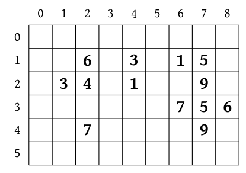
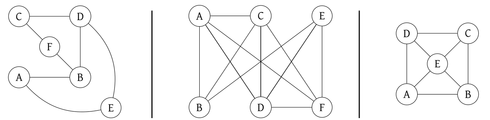
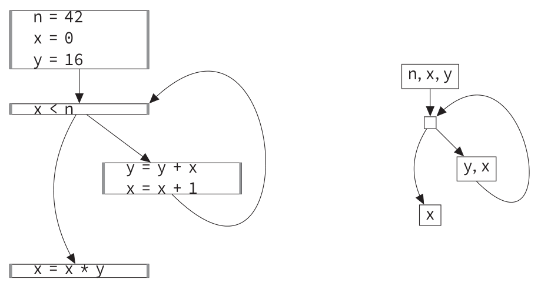
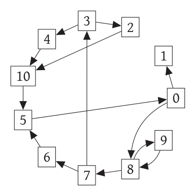
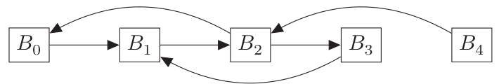

# Concours général 2026

!!! info "Session 2026"
    Classes de terminale, spécialité NSI. Durée : 5 heures. L'usage de la calculatrice est interdit.

    Le sujet comporte deux problèmes indépendants : **un problème de robots** (grilles à portails, structures de données, tests) et **des algorithmes pour la compilation** (allocation de registres, coloriage de graphes, forme SSA).

    [Sujet original (PDF)](pdf/cg-nsi-2026.pdf){ .md-button }

Ce sujet comporte deux problèmes, totalement indépendants l'un de l'autre.

Lorsque l'écriture de programmes est demandée, ceux-ci devront être rédigés en Python.

## 1. Un problème de robots

Un robot se déplace verticalement, vers le bas dans une grille rectangulaire. Cette grille peut contenir des paires de portails téléporteurs reliés entre eux qui modifient le déplacement du robot : lorsqu'il *rentre* dans une case contenant un portail, il est envoyé sur la case contenant un portail « jumeau » avant de continuer son déplacement vers le bas.

Plus précisément :

a. on dispose d'une grille rectangulaire avec `nb_lignes` lignes et `nb_colonnes` colonnes. On a dans toutes les grilles `nb_lignes`$\geq 2$ et `nb_colonnes`$\geq 1$,  
b. les cases sont numérotées par leurs coordonnées $(x, y)$ en partant du coin en haut à gauche, à partir de $(0, 0)$, où $x$ désigne le numéro de colonne et $y$ le numéro de ligne,  
c. chaque case de la grille contient au plus un portail représenté par un entier $p$. Cet entier doit être compris entre $0$ et `(nb_lignes-2)*nb_colonnes-1`,  
d. un numéro de portail ne peut pas apparaitre plus que deux fois dans la grille,  
e. la grille ne contient aucun numéro de portail sur la première ligne ($y = 0$), ni sur la dernière ligne ($y =$ `nb_lignes`-1).

Voici un exemple de grille :

- avec `nb_lignes = 6` et `nb_colonnes = 9`,
- qui contient 13 portails,
- les portails ont les numéros 1 (deux portails), 3 (deux portails), 4 (*un seul* portail), 5 (deux portails), 6 (deux portails), 7 (deux portails) et 9 (deux portails),
- la case de coordonnées $(1, 2)$ contient un portail numéroté $3$, etc.

{ width="300" }

*Figure 1. Un exemple de grille.*

Le robot entre dans la grille par la case en haut d'une colonne puis descend case par case verticalement jusqu'à soit arriver sur la dernière ligne de la grille soit arriver sur une case contenant un portail :

1. s'il arrive sur une case contenant un portail unique (comme le portail 4 dans notre exemple), il reste coincé sur cette case et n'atteindra jamais la dernière ligne,
2. lorsqu'il arrive sur une case contenant un portail présent deux fois dans la grille, il est téléporté vers la case contenant l'autre occurrence du même portail avant de continuer son déplacement vers le bas. Le robot pourra réemprunter le même portail plus tard dans un sens ou l'autre.

Ainsi sur la grille de la figure 1, un robot qui entre par la première case de la colonne 2 se déplace vers le bas jusqu'à arriver sur la case contenant le portail 6, est téléporté vers la case contenant le deuxième 6, puis continue à descendre jusqu'à arriver en bas de la grille, dans la colonne 8.

**Question 1.**

a. Sur la grille de la figure 1, le robot commence dans la première case de la colonne 1. Par quels portails passe-t-il, et dans quelle colonne arrive-t-il en bas de la grille ?

b. Le robot commence cette fois ci dans la première case de la colonne 7. Par quels portails passe-t-il, et dans quelle colonne arrive-t-il en bas de la grille ?

c. Le robot peut-il rester coincé dans la grille de la figure 1 sans jamais atteindre la dernière ligne ? Si c'est possible, donner un numéro de colonne de départ, sinon donner un raisonnement pour expliquer pourquoi ce n'est pas possible.

### 1.1 Grilles statiques

#### 1.1.1 Questions préliminaires

On souhaite créer une classe `GrilleRobot` avec au moins les deux méthodes suivantes :

1. `__init__(self, nb_colonnes, nb_lignes, portails)` qui définit la grille à partir des paramètres. Le paramètre `portails` est une liste de triplets de la forme `(x,y,n)` contenant les portails présents dans la grille : `x` et `y` sont les coordonnées du portail, et `n` son numéro. La méthode `__init__` peut effectuer les initialisations de votre choix en plus des attributs `nb_colonnes` et `nb_lignes`,
2. `traverse(self, colonne)`, qui prend en paramètre le numéro de colonne par laquelle le robot entre dans la grille, et qui renvoie :
    - le numéro de colonne du robot lorsqu'il atteint la dernière ligne
    - ou -1 si le robot n'atteint jamais la dernière ligne de la grille.

**Question 2.**

a. Donner un exemple de création d'un objet `GrilleRobot` valide, et un exemple de création d'un objet `GrilleRobot` invalide car les paramètres ne respectent pas les contraintes issues des points a., b., c., d. et e. donnés dans l'introduction. Cette seconde instantiation doit cependant être du Python valide, et les paramètres doivent avoir le bon type : entier pour `nb_colonnes` et `nb_lignes` et liste de triplets d'entiers pour `portails`.

b. Donner un exemple d'appel valide à la méthode `traverse`. Donner aussi un exemple d'appel invalide et cet appel doit, comme dans le point précédent, être du Python valide et le paramètre `colonne` doit être un entier.

**Question 3.** Écrire du code Python qui vérifie que les paramètres sont valides, c'est-à-dire qu'ils respectent les contraintes issues des points a. b. c. d. et e. données dans l'introduction.

Vous n'avez pas besoin d'implémenter le cœur de la méthode `__init__`.

*Remarque :* vous n'avez pas à vérifier le type des données. Votre code peut donc supposer que `nb_colonnes` et `nb_lignes` sont des entiers et que `portails` est une liste de triplets d'entiers.

Ce code de validation pourra être inséré au début de la méthode `__init__` :

```python
class GrilleRobot:
    def __init__(self, nb_colonnes, nb_lignes, portails):
        if DEBUG:   # variable globale pour activer le débogage
            ... code de validation des paramètres ...
        ... reste de la méthode __init__ ...
    ... à écrire dans les questions suivantes...
```

**Question 4.** Le robot peut-il rester dans la grille sans jamais atteindre la dernière ligne s'il ne passe jamais par un portail téléporteur unique ?

Donner un exemple si la réponse est « oui » ou un raisonnement si la réponse est « non ».

#### 1.1.2 Implémentation

L'optimisation du temps d'exécution d'une fonction dépend souvent du cas d'utilisation attendu. Pour prendre un exemple indépendant du problème en cours, la meilleure fonction de tri n'est pas forcément la même suivant que l'on souhaite trier de nombreuses petites listes ou une seule grande liste.

L'importance relative des temps d'exécution des méthodes `__init__` et `traverse` peut donc dépendre de la situation.

**Question 5.** Décrire des conditions d'utilisation de la classe `GrilleRobot` où il est préférable d'avoir une méthode `__init__` lente si cela permet d'avoir une méthode `traverse` rapide.

Décrire également des conditions d'utilisation où la situation est inversée, c'est-à-dire qu'il peut être préférable d'avoir une méthode `traverse` un peu plus lente si cela permet d'avoir une méthode `__init__` plus rapide.

Nous nous plaçons maintenant dans la situation où nous voulons optimiser les temps d'exécution des méthodes `__init__` et `traverse` pour :

- les grilles carrées : `nb_lignes==nb_colonnes`,
- contenant des portails dans toutes les cases : `len(portails)==(nb_lignes-2)*nb_colonnes`.

L'objectif est que la méthode `traverse` soit la plus rapide possible (c'est-à-dire où l'ordre de grandeur du temps d'exécution en fonction du nombre de colonnes soit le plus petit possible).

La méthode `__init__` doit elle aussi être la plus rapide possible mais cet objectif est secondaire par rapport au précédent.

*Attention,* ces situations sont uniquement utilisées pour estimer le temps d'exécution des méthodes. Les algorithmes que vous choisissez doivent fonctionner dans tous les cas valides tels que décrits dans l'introduction (points a. b. c. d. et e.).

**Question 6.** Décrire en français des algorithmes et structures de données que l'on pourrait utiliser pour les méthodes `__init__` et `traverse`.

**Question 7.** Implémenter la classe `GrilleRobot` et les méthodes correspondant à l'algorithme décrit dans la question précédente.

Note : il n'est pas nécessaire d'inclure les tests demandés à la question 3.

**Question 8.** Décrire le pire cas envisageable pour la question précédente. Estimer l'ordre de grandeur du temps d'exécution de vos deux méthodes dans ce pire cas, en fonction du nombre de colonnes (qu'on suppose égal au nombre de lignes).

Estimer également l'ordre de grandeur de la quantité de mémoire utilisée par vos méthodes.

#### Tests

De nombreux bugs dans l'implémentation de fonctions ou méthodes viennent des situations limites que l'on oublie parfois de traiter. Un exemple serait par exemple une fonction `croissante(l)` qui teste si une liste est croissante, en oubliant de traiter les cas où `l` est une liste de taille 0 ou 1.

Un autre type de problème courant est une mauvaise initialisation, comme faire une boucle jusqu'à une valeur $n$, au lieu de $n - 1$ ou $n + 1$.

Certains de ces bugs n'apparaissent que dans certains cas et il faut donc créer des tests pertinents qui activent le plus de cas « bizarres » possibles.

Dans le cas de la classe `GrilleRobot`, voici 2 exemples de situation à tester :

1. grille(s) avec un portail unique accessible par le robot,
2. grille(s) avec des numéros de portails minimaux, c'est-à-dire 0, et maximaux, c'est-à-dire `nb_colonnes*(nb_lignes-2)-1`

*Attention,* on ne s'intéresse ici qu'aux bugs d'implémentation de l'algorithme sur des entrées valides, pas à la vérification de contraintes concernant la validité de paramètres. Par exemple, le comportement de la méthode `__init__` n'est pas défini si le nombre de colonnes est 0. Il ne sert donc à rien de prévoir un test sur une grille avec 0 ligne ou 0 colonne.

**Question 9.** Ajouter entre 4 et 6 situations à tester dans la liste ci-dessus et donner 4 grilles de petite taille (moins de 7 lignes et colonnes) pour tester autant de situations de la liste que possible.

Pour chacune des 4 grilles de test donnée, il faudra lister la ou les situations qu'elle permet de tester.

Donner également, pour chacune des 4 grilles, la listes des résultats attendus de la méthode `traverse` :

```python
[ G.traverse(0), G.traverse(1), ..., G.traverse(G.nb_colonnes-1) ]
```

*Remarque :* l'évaluation portera autant sur la pertinence de vos situations de tests que sur leur nombre.

### 1.2 Grilles dynamiques

On souhaite maintenant programmer une classe similaire mais où le nombre de numéros de portail n'est pas fixé à l'initialisation : on commence avec une grille vide (sans numéros de portail) et on ajoute, avant chaque traversée de robot, un nouveau numéro de portail dans une case vide de la grille. D'autre part, on souhaite obtenir, lors de la traversée d'un robot, la liste des numéros de portails par lesquels le robot est passé.

Cette nouvelle classe, appelée `GrilleRobotDynamique` contiendra au moins les trois méthodes suivantes :

1. `__init__(self, nb_colonnes, nb_lignes)`, qui prend en paramètres la taille de la grille et effectue des initialisations pour créer une grille sans aucun portail,
2. `ajoute(self, x, y, p)` qui prend en paramètres les données d'un portail de numéro `p` qui sera positionné dans la case `(x,y)`,
3. `traverse(self, x)`, qui prend en paramètre un numéro de colonne par laquelle le robot rentre dans la grille (toujours par la case du haut) et qui renvoie une paire contenant :
    - dans la première composante, un entier :
        - le numéro de colonne du robot lorsqu'il atteint la dernière ligne,
        - ou -1 si le robot n'atteint jamais la dernière ligne de la grille,
    - dans la seconde composante, une liste d'entiers : les numéros de portails par lesquels le robot est passé, dans l'ordre, en ne mettant qu'un numéro par téléportation.

On se place dans la situation où l'utilisation principale de cette classe sera la suivante :

1. on initialise une grille dynamique carrée taille $n \times n$,
2. on effectue une suite d'environ $n$ appels consécutifs alternés à `ajoute_portail` et `traverse`.

Un exemple d'utilisation typique serait donc :

```python
G = GrilleRobotDynamique(n, n)
for i in range(n):
  ... choix de x, y et p
  G.ajoute_portail(x, y, p)
  ... choix de x
  r, P = G.traverse(x)
  ... traitement de r et P
```

L'objectif est que la somme des temps d'exécution des méthodes `ajoute_portail` et `traverse` soit la plus petite possible dans ce type de situation.

*Attention,* comme dans la partie précédente, les méthodes doivent fonctionner dans toutes les situations valides décrites dans l'introduction (points a. b. c. d. et e.).

**Question 10.** Décrire en français des algorithmes et structures de données que l'on pourrait utiliser pour implémenter la classe `GrilleRobotDynamique` avec les méthodes associées.

**Question 11.** Écrire en Python la définition de la la classe `GrilleRobotDynamique` et les méthodes correspondant aux algorithmes décrits dans la question 10.

Note : il n'est pas nécessaire d'utiliser des tests, assertions ou exceptions pour évaluer les pré-conditions ou post-conditions.

**Question 12.** Décrire le pire cas considéré pour la question précédente, puis calculer en justifiant, l'ordre de grandeur du temps d'exécution d'une utilisation typique décrite plus haut.

Calculer également, toujours en justifiant, l'ordre de grandeur de la quantité de mémoire utilisée dans cette même situation.

## 2. Problème. Algorithmes pour la compilation

La plupart des programmes sont écrits dans des langages de programmation de haut niveau, tels que Python. Cependant, les machines qui exécutent ces programmes ne sont souvent capables d'exécuter que des instructions élémentaires très simples. Pour pouvoir exécuter ces programmes écrits dans des langages de haut niveau, il est nécessaire d'avoir une transformation du *langage source*, de haut niveau, vers le *langage cible*, proche de la machine.

Un *compilateur* est un programme qui effectue cette transformation. La compilation d'un programme dépend très fortement des contraintes du langage cible :

- il existe des contraintes matérielles, notamment sur les emplacements en mémoire disponibles pour manipuler des variables, que l'on étudie en partie 2.1. Cette partie utilise notamment une première approche pour résoudre un problème de coloriage,
- la transformation du programme source en programme cible n'est en général pas directe, mais elle passe par plusieurs étapes intermédiaires où le programme change légèrement de forme. Ceci sert notamment à réaliser certaines optimisations. En partie 2.2 on étudie une représentation intermédiaire fréquemment utilisée.

Ce problème comporte deux parties. Chaque partie peut être abordée de manière totalement indépendante de l'autre partie. Il est possible de traiter chaque partie séparément.

### 2.1 Allocation de registres dans les compilateurs

**Les registres du processeur.** Les ordinateurs utilisent deux types de mémoires pour exécuter les programmes : une mémoire très rapide mais en quantité très limitée, ce sont les *registres* du processeur, et une mémoire gigantesque mais plus lente que l'on appelle la *mémoire vive*.

**Allocation de registres.** Pour que le programme produit par un compilateur soit rapide, il est essentiel que les variables soient, le plus possible, stockées dans des registres. Une tâche importante des compilateurs est donc celle de *l'allocation de registre* c'est-à-dire choisir quelle variable stocker dans quel registre. Si l'on souhaite compiler un programme qui utilise $V$ variables et qu'il y a $R$ registres avec $R \geq V$, il suffit de stocker la $i^e$ variable dans le $i^e$ registre mais souvent il y a bien plus de variables que de registres... il va donc falloir qu'un même registre puisse être utilisé pour plusieurs variables.

#### 2.1.1 Allocation par durée de vie

Supposons que dans le programme fourni au compilateur il y a deux variables $a$ et $b$ mais que l'on soit sûr que la première utilisation de $b$ soit après la dernière utilisation de $a$. On peut alors stocker $a$ et $b$ dans le même registre sans mélanger les valeurs de $a$ et $b$. De manière plus générale, on peut stocker un ensemble $V$ de variables dans un même registre si pour toute paire $a, b$ de variables alors $a$ est finie d'être utilisée avant que $b$ ne soit utilisée ou inversement que $b$ est finie d'être utilisée avant que $a$ ne soit utilisée.

Pour cette partie, on suppose que le compilateur a déjà fait une analyse de l'utilisation des variables. Cette partie fournit le résultat sous la forme d'une liste d'événements, chaque événement étant « début $i$ », indiquant que la variable $i$ commence à être utilisée, ou « fin $i$ », indiquant qu'elle ne sera plus utilisée. L'objectif de cette partie est de calculer des affectations qui utilisent un nombre minimal de registres pour stocker toutes les variables. Par exemple dans le cas 1 décrit ci-bas, on peut affecter $a$ et $b$ au même registre $R_0$ mais dans le cas 2, il faut deux registres car entre les événements 2 et 3 nous avons $a$ et $b$ qui sont toutes deux utilisées simultanément.

| Cas 1      | Cas 2      |
|------------|------------|
| début $a$  | début $a$  |
| fin $a$    | début $b$  |
| début $b$  | fin $b$    |
| fin $b$    | fin $a$    |

**Question 13.** Voici quatre listes d'événements correspondant à quatre programmes qui utilisent les variables $a$, $b$, $c$ et $d$. Dans chaque cas, proposer une affectation des variables aux registres $R_0, R_1, R_2, R_3$ qui utilise le moins de registres possibles. À chaque fois, justifier que l'on ne peut pas utiliser moins de registres.

| Cas 3      | Cas 4      | Cas 5      | Cas 6      |
|------------|------------|------------|------------|
| début $a$  | début $a$  | début $a$  | début $a$  |
| début $b$  | début $b$  | début $b$  | début $b$  |
| début $c$  | début $c$  | fin $a$    | début $c$  |
| début $d$  | fin $b$    | début $c$  | début $d$  |
| fin $d$    | début $d$  | fin $b$    | fin $a$    |
| fin $c$    | fin $c$    | début $d$  | fin $b$    |
| fin $b$    | fin $d$    | fin $c$    | fin $c$    |
| fin $a$    | fin $a$    | fin $d$    | fin $d$    |

**Question 14.** Écrire une fonction `nombre_de_registres_necessaires(n,E)` qui prend en paramètres un nombre de variables `n` ainsi qu'une liste Python `E` de $2n$ événements. L'entrée `E[i]` de la liste décrit le $i^e$ événement et `E[i][0]` contient la chaine de caractère `"début"` ou `"fin"` décrivant si l'événement est celui d'un début ou d'une fin d'utilisation tandis que `E[i][1]` contient un entier entre 0 et `n-1`, le numéro de la variable qui est concernée par l'événement. Vous pouvez supposer que la liste est cohérente, c'est-à-dire que pour chaque variable, il y a exactement un seul événement début et un événement fin, et que l'événement début est avant l'événement fin.

Par exemple pour le cas 2 précédent, la liste donnée en paramètre est :

```python
evenements_cas_2 = [
    ["debut", 0],
    ["debut", 1],
    ["fin", 1],
    ["fin", 0],
]
```

L'appel `nombre_de_registres_necessaires(2, evenements_cas_2)` doit renvoyer la valeur 2.

*Indication :* le nombre de registres nécessaires correspond au nombre maximal de variables utilisées simultanément.

**Question 15.** Écrire une fonction `affectation_registres(n,E)` qui prend un nombre de variables `n` et une liste d'événements `E` (au même format que la question précédente) et renvoie une liste `R` de taille `n`. Dans cette liste, à la case `R[i]` il doit y avoir un nombre entre 0 et `nombre_de_registres_necessaires(n,E)-1` et cela signifie que la variable `i` doit être stockée dans le registre `R[i]`. Il existe en général plusieurs affectations qui utilisent un nombre minimal de registres, dans ce cas là on peut renvoyer n'importe laquelle.

#### 2.1.2 Gérer le nombre insuffisant de registres

La méthode vue dans la partie précédente est souvent insuffisante car il y a trop de variables simultanément actives. Une manière de contourner ce problème consiste à choisir pour chaque variable un emplacement de la mémoire et dès que l'on a besoin d'une variable on la charge depuis la mémoire vive vers un registre et quand on n'a plus besoin d'une variable on fait l'opération inverse et l'on charge le contenu du registre vers l'emplacement de la mémoire.

Cette méthode marche même quand il y a un très grand nombre de variables et peu de registres mais comme la mémoire vive n'est pas très rapide en comparaison du processeur, les opérations charger et décharger sont assez coûteuses. Pour éviter de trop répéter ces opérations, les compilateurs ne rechargent pas une variable quand ils peuvent s'assurer que son registre n'a pas été utilisé depuis la dernière utilisation de cette variable. Et pour optimiser encore plus, les compilateurs assignent à chaque variable un registre en essayant que les paires de variables fréquemment utilisées ensemble ne soient pas affectées aux mêmes registres, et c'est sur ce problème que cette partie se concentre.

**Graphe d'allocation.** À partir d'une liste des variables et une liste de paires de variables que l'on sait fréquemment utilisées simultanément, on peut créer le *graphe d'allocation*. Dans ce graphe, les nœuds correspondent aux variables et il y a un arête entre deux nœuds $n_a$ et $n_b$ qui représentent les variables $a$ et $b$ si $a$ et $b$ sont fréquemment utilisées simultanément.

**Coloriage d'un graphe.** Un coloriage $c$ d'un graphe $G$ est la donnée d'une fonction qui associe chaque nœud de $G$ à une couleur de sorte que deux nœuds voisins dans $G$ ne soient pas coloriés de la même couleur.

**Allocation par coloriage de graphe.** Dans cette partie nous allons supposer qu'une analyse des variables fréquemment utilisées simultanément a déjà été faite et a produit un graphe d'allocation. Cette partie va donc se concentrer sur le problème d'affecter un registre à chaque variable de sorte qu'il n'existe pas deux variables fréquemment utilisées simultanément qui soient affectées au même registre, c'est-à-dire chercher un coloriage du graphe d'allocation où les « couleurs » sont les registres.

**Question 16.** Combien de couleurs sont requises pour colorier chacun des graphes suivants ? Pour chaque graphe donner le nombre minimal de couleurs requises ainsi qu'un coloriage avec ce nombre minimal de couleurs.



**Question 17.** Écrire une fonction `calcul_degre(G)` qui prend en paramètre `G`, un graphe qui a `len(G)` nœuds. La fonction doit renvoyer une liste de `len(G)` entiers, le $i^e$ entier correspondant au degré (c'est-à-dire au nombre de voisins) du $i^e$ nœud.

Le graphe $G$ est représenté sous forme de liste d'adjacence, c'est-à-dire que c'est une liste de listes, la $i^e$ liste de $G$ décrivant les voisins du $i^e$ nœud de $G$. Par exemple le graphe de gauche de la question 16 est représenté par la liste `graphe1`, où $A$ est remplacé par 0, $B$ par 1, etc.

```python
graphe1 = [
  [1,4],   # les voisins de A=0 sont B=1, E=4
  [0,3,5], # les voisins de B=1 sont A=0, D=3, F=5
  [3,5],   # les voisins de C=2 sont D=3, F=5
  [1,2,4], # les voisins de D=3 sont B=1, C=2, E=4
  [0,3],   # les voisins de E=4 sont A=0, D=3
  [1,2]    # les voisins de F=5 sont B=1, C=2
  ]
```

On doit donc avoir

```python
calcul_degre(graphe1) = [2, 3, 2, 3, 2, 2]
```

On cherche maintenant à vérifier si un coloriage est valide ou non. Pour représenter le coloriage d'un graphe $G$ à $n$ nœuds on utilise une liste de longueur $n$ qui associe au nœud $i$ sa couleur qui sera un entier positif ou nul.

**Question 18.** Écrire une fonction `est_valide(G,C)` qui prend un graphe `G` et un coloriage `C` et renvoie `True` ou `False` selon si le coloriage `C` est valide. On rappelle qu'un coloriage est valide si deux nœuds qui sont voisins dans le graphe n'ont pas la même couleur.

#### 2.1.3 Une heuristique de coloriage

Trouver un coloriage d'un graphe avec exactement $K$ couleurs ou même simplement savoir s'il existe un tel coloriage est un problème compliqué algorithmiquement. Dans cette partie nous allons étudier une méthode qui ne répondra que des coloriages valides mais qui parfois ne trouvera pas de solutions alors qu'il en existe.

L'heuristique que l'on va étudier s'appuie sur le constat suivant : si l'on cherche à colorier un graphe avec $K$ couleurs qui contient (au moins) un nœud avec strictement moins de $K$ voisins, alors on peut retirer ce nœud du graphe, colorier le graphe obtenu, puis colorier le nœud que l'on a enlevé. Comme ce nœud a strictement moins de $K$ voisins, il reste forcément une couleur disponible pour le colorier.

Formellement la procédure est la suivante : on part d'un graphe $G$ et tant qu'il existe un nœud de degré strictement inférieur à $K$ dans $G$, on le retire en retirant les arêtes le contenant (ce qui diminue les degrés de ses voisins), on colorie le graphe obtenu puis on remet le nœud en le coloriant. La récursion s'arrête dans deux cas : soit dans un graphe vide, auquel cas le coloriage est possible, soit dans un graphe non vide dans lequel tous les nœuds ont un degré supérieur à $K$ et, dans ce cas, on renvoie une erreur.

**Question 19.** Dans chacun des graphes de la question 16, quelle est la plus petite valeur de $K$ pour laquelle l'heuristique ne bloque pas ? Justifier votre réponse en décrivant, pour chaque cas, quel est le blocage pour le plus grand $K$ qui bloque. Pour chaque graphe, donner un exemple de coloriage obtenu avec le plus petit $K$ qui ne bloque pas en décrivant les étapes qui ont permis d'obtenir ce coloriage.

**Question 20.** Écrire une fonction `coloriage_heuristique(G,K)` qui prend en paramètres un graphe `G` ayant `n` nœuds avec un paramètre entier `K` et renvoie un coloriage de `G` à `K` couleurs utilisant l'heuristique décrite ci-haut. Le coloriage renvoyé sera sous la forme d'une liste `C`, `C[i]` sera un entier entre 0 et `K-1` représentant la couleur du nœud `i`.

Dans le cas où l'algorithme bloque car tous les nœuds restants ont un degré supérieur, on appelle la fonction `erreur_coloriage()` qu'on suppose définie et qu'il n'est pas demandé d'écrire. Cette fonction affiche une erreur et arrête le calcul.

*Indications :*

- il est recommandé de ne pas construire un nouveau graphe à chaque nœud retiré. On pourra, par exemple, maintenir une liste `retire` de booléens indiquant pour chaque nœud s'il a été retiré ou non et faire une fonction récursive `coloriage_heuristique_recursif(G,K,retire,nb_restants)` où `nb_restants` donne le nombre de nœuds restants à colorier,
- pour simplifier le code il peut être pertinent d'introduire des fonctions auxiliaires, on pourra par exemple faire une fonction qui prend le graphe avec l'information des nœuds retirés et sélectionne un sommet qui a un nombre de voisins non retirés inférieur strictement à $K$.

**Question 21.** Dans l'heuristique, il faut pouvoir trouver rapidement, après chaque nœud retiré, un autre nœud à retirer. Expliquer comment l'algorithme peut éviter de recalculer tous les degrés après chaque nœud retiré. Expliquer aussi comment l'algorithme peut maintenir une liste des nœuds dont le nombre de voisins non retirés est inférieur à K.

**Question 22.** Donner un exemple de graphe $G$ à $n$ nœuds et de valeur $K$ où `coloriage_heuristique(G,K)` bloque alors qu'un coloriage valide de $G$ avec $K$ couleurs existe. On détaillera pourquoi l'algorithme bloque et on donnera un exemple de coloriage à $K$ couleurs.

#### 2.1.4 Vers un coloriage optimal

Dans cette partie nous avons un graphe $G$ et un nombre de couleurs $K$ et l'on cherche un coloriage de $G$ avec $K$ couleurs. Une première méthode, très lente, consiste à produire tous les coloriages possibles (valides ou non) et à trouver dans la liste des coloriages si l'un est valide ou non.

**Question 23.** Écrire une fonction `coloriage_lent(G,K)` qui prend en paramètre un graphe `G` et un nombre de couleurs `K` et renvoie la liste des coloriages valides de `G` avec les couleurs de 0 à `K-1`.

*Attention :* en Python si vous ajoutez un coloriage `C` à une liste de liste `l` avec `l.append(C)` et que vous modifiez ensuite la liste `C`, cela va aussi modifier le coloriage inséré dans `l`. Pour insérer `C` et le modifier ensuite il faut ajouter une copie. Il faut donc faire `l.append(C.copy())`.

**Optimisation sur les coloriages invalides.** La fonction développée à la question précédente est assez inefficace. Une première manière de l'optimiser est de vérifier qu'à chaque fois que l'on marque la couleur d'un nœud dans le coloriage partiel alors aucun voisin de ce nœud n'a cette couleur sinon le coloriage sera forcément invalide. De cette façon, on limite le nombre de coloriages invalides que l'on considère.

**Optimisation sur les coloriages symétriques.** Une autre source d'inefficacité est que la fonction considère beaucoup de coloriages qui sont symétriques : si elle trouve un coloriage où des nœuds sont coloriés 0 et d'autres 1, on peut échanger les couleurs de ces nœuds et le coloriage restera valide.

**Question 24.** Expliquer à haut niveau (sans écrire de Python) comment on peut modifier l'algorithme de la fonction `coloriage_lent(G,K)` pour qu'il énumère les coloriages en évitant de considérer des coloriages symétriques.

*Attention,* l'objectif est de gagner du temps en exploitant les symétries, on ne se contentera donc pas d'un algorithme qui considère tous les coloriages et retire de la liste renvoyée les coloriages symétriques. Il faut directement éviter de considérer ces symétries.

**Question 25.** Écrire une fonction `coloriage_moins_lent(G,K)` qui prend un graphe `G` et un nombre de couleurs `K` et renvoie un coloriage valide de `G` avec les couleurs de 0 à `K-1` en utilisant les optimisations décrites ci-dessus. Si plusieurs coloriages existent on peut renvoyer n'importe lequel, s'il n'en existe pas, on renvoie `None`.

*Attention :* si l'on veut tester des propriétés sur les coloriages partiels, il faut bien s'assurer qu'on ne teste que des nœuds coloriés. Il faut donc s'assurer que les nœuds non coloriés dans un coloriage partiel sont bien marqués comme tels tout du long de l'algorithme, par exemple avec une valeur spéciale comme `None`.

### 2.2 Représentation intermédiaire en forme SSA

Un compilateur réalise en général des optimisations afin que le programme produit s'exécute plus efficacement. Les optimisations sont plus faciles à réaliser lorsque le code source est dans une forme contrainte, appelée *forme SSA* (*Static Single Assignment*). Dans cette partie, on étudie la transformation d'un code source vers une forme SSA.

On dit qu'un code source est en forme SSA lorsque chaque variable se situe exactement une seule fois à gauche d'un signe `=`, lors de sa définition, puis n'est plus jamais modifiée à une autre ligne du code source du programme. Ainsi le programme suivant est en forme SSA :

```python
x = 3
y = 7
z = x + y
w = x + 1
```

tandis que celui-ci ne l'est pas :

```python
x = 3
y = 7
z = x + y
x = x + 1 # Il est interdit de redéfinir x en forme SSA
```

Tout programme peut être transformé pour être mis en forme SSA, en créant arbitrairement de nouvelles variables. Par exemple, le programme suivant n'est pas en forme SSA :

```python
x = 7
x = 2 * x
x = x * x
```

mais on peut écrire un programme équivalent qui calcule la même chose et qui est en forme SSA :

```python
x0 = 7
x1 = 2 * x0
x2 = x1 * x1
```

Lors de la transformation vers une forme SSA, seules les deux opérations suivantes sont permises :

- renommer des variables,
- introduire des fonctions $\varphi$, telles que décrites à partir de la partie 2.2.2.

On interdit toute autre modification sur le code source.

#### 2.2.1 Mise en forme SSA de blocs simples

On considère des petits programmes composés uniquement d'une suite d'affectations toutes de la forme :

```python
x = 3 * r + 4 - z * x
```

où on trouve à gauche de l'affectation un nom de variable et, à droite de l'affectation, une expression qui peut contenir des opérateurs arithmétiques binaires (chaque opérateur agit sur deux opérandes).

En Python, on représente une expression par un entier s'il s'agit d'une constante, par une chaîne de caractère s'il s'agit d'une variable et, s'il s'agit d'une opération, par un triplet `(operateur, expr_gauche, expr_droite)` où :

- `operateur` est une chaine de caractères qui représente l'opérateur, parmi `+`, `-`, `*` ou `/`,
- `expr_gauche` représente l'expression à gauche de l'opérateur donc il s'agit soit d'un entier, soit d'une chaine de caractères pour désigner une variable, soit récursivement d'un autre triplet pour désigner une sous-expression,
- `expr_droite` représente de même l'expression à droite de l'opérateur.

L'expression à droite dans l'exemple précédent est donc représentée de la façon suivante :

```python
('+', ('*', 3, 'r'), ('-', 4, ('*', 'z', 'x')))
```

L'instruction tout entière est un couple `(variable, expression)` où `variable` est le nom de la variable à gauche du signe `=` et `expression` est une représentation de l'expression située à droite du signe `=`.

L'instruction de l'exemple précédent est ainsi représentée par le couple :

```python
('x', ('+', ('*', 3, 'r'), ('-', 4, ('*', 'z', 'x'))))
```

**Question 26.** Écrire une fonction `est_ssa(instructions)` qui prend en paramètre un tableau d'instructions, qui sont toutes des affectations. Cette fonction renvoie un booléen qui indique si la liste d'instructions est en forme SSA, c'est-à-dire que chaque variable se trouve au maximum une fois à gauche de chaque signe `=`.

Dans un programme valide, il est interdit d'utiliser la valeur d'une variable tant qu'on n'a pas défini cette variable. Ainsi, le code suivant est invalide :

```python
x = y * 3
y = 4
```

car la variable `y` est utilisée en première ligne alors qu'elle n'est pas encore définie.

**Question 27.** Écrire une fonction `affectations_valides(instructions)` qui prend en paramètre une liste d'affectations et vérifie que chaque variable est bien définie avant d'être utilisée dans une expression.

*Indication.* Pour distinguer si une expression `foo` en Python est une chaine de caractères, on peut réaliser le test `isinstance(foo, str)`. Pour distinguer un entier, on peut réaliser le test `isinstance(foo, int)`. Par exemple le code suivant affiche le texte `"C'est un entier"` :

*Exemple 2.1.*

```python
z = 42 * 2
if isinstance(z, int):
    print("C'est un entier")
else:
    print("C'est autre chose")
```

**Question 28.** Décrire un algorithme qui permet de transformer une liste d'instructions valides en une liste d'instructions valides en forme SSA. On pourra s'inspirer de l'exemple précédent. Programmer ensuite cet algorithme en une fonction `simple_vers_ssa(instructions)` qui prend en paramètre une liste d'affectations et qui renvoie une liste d'affectations mise en forme SSA en créant de nouvelles variables, comme dans l'exemple plus haut.

#### 2.2.2 Gestion des branchements

On ajoute dans cette partie la gestion des `if` par le compilateur. On supposera pour simplifier que les `if` ont toujours une branche `else`. On pourra alors mettre en forme SSA des programmes tels que :

```python
x = 7
y = 9
if x >= y:
    x = x + 1
    y = y - 1
else:
    y = 11
    x = y * y
z = x + y
```

La mise en forme SSA du début de ce programme est immédiate en créant de nouvelles variables :

```python
x0 = 7
y1 = 9
if x0 >= y1:
    x2 = x0 + 1
    y3 = y3 - 1
else:
    y4 = 11
    x5 = y4 * y4
# On bloque pour transformer "z = x + y"
```

mais la dernière ligne, qui donne une valeur à `z` est moins évidente à transformer car chaque branche du `if` définit des variables qui ne portent désormais plus les mêmes noms.

Le compilateur utilise une fonction magique, c'est-à-dire qu'elle n'est elle-même pas écrite en Python. Cette fonction est nommée $\varphi$. Elle prend en paramètres deux noms de variables, et elle ne peut s'utiliser qu'après la fin d'un `if`. Si l'exécution est passée par la première branche du `if` (c'est-à-dire si le test était vrai), alors $\varphi$ renvoie son premier paramètre. Si l'exécution est passée par la branche `else` alors $\varphi$ renvoie son deuxième paramètre. On peut alors terminer la mise en forme SSA de l'exemple précédent :

*Exemple 2.2.*

```python
x0 = 7
y1 = 9
if x0 >= y1:
    x2 = x0 + 1
    y3 = y3 - 1
else:
    y4 = 11
    x5 = y4 * y4
x6 = φ(x2, x5) # x6 sera égale à x2 si le test était vrai,
               # sinon x6 sera égale à x5.
y7 = φ(y3, y4) # y7 sera égale à y3 si le test était vrai,
               # sinon y7 sera égale à y4.
z8 = x6 * y7
```

**Question 29.** Proposer une forme SSA pour le code suivant :

```python
x = A # A et B sont des variables définies ailleurs
y = B # dans le code et contiennent des entiers
r = x % y
fin = False
if r == 0:
    fin = True
else:
    x = y
    y = r
    r = x % y
    if r == 0:
        fin = True
    else:
        x = y
        y = r
        r = x % y
res = y
```

#### 2.2.3 Gestion des boucles

La gestion des boucles ressemble à la gestion d'un branchement, car :

- on peut arriver en début de boucle depuis deux endroits différents, soit via le code avant la boucle soit via une itération précédente de la boucle,
- on peut arriver en sortie de boucle de deux endroits différents, soit via le code avant la boucle si on n'est jamais entré dans la boucle, soit depuis la dernière itération de la boucle.

On ne considère que des boucles `while` :

*Exemple 2.3.*

```python
n = 42
x = 0
y = 16
while x < n:  # En-tête de la boucle
    y = y + x # Corps
    x = x + 1 # de la boucle
x = x * y
```

En plus des cas autorisé pour le `if`, on a le droit de placer des fonctions $\varphi$ uniquement à trois endroits dans le code :

- juste après la ligne avec le `while`. Dans ce cas, $\varphi$ renvoie son premier paramètre si c'est le premier tour de la boucle et son deuxième paramètre pour tous les tours suivants,
- dans la condition de la boucle, sur la ligne du `while`. Cela fonctionne comme le cas précédent. Il faut alors impérativement que, dans le corps de boucle, l'on trouve une variable définie avec le même appel à $\varphi$ que celui utilisé dans la condition, utilisant les mêmes paramètres,
- juste après la fin de la boucle. Dans ce cas, $\varphi$ renvoie son premier paramètre si on n'a fait aucun tour de boucle et son deuxième paramètre si on a fait au moins un tour de boucle.

**Question 30.** Déterminer une forme SSA pour l'exemple 2.3.

De manière systématique, pour transformer un code avec `if` et `while` en forme SSA, on pourrait ajouter à chaque endroit possible (à la fin des `if` ainsi qu'au début et à la fin des `while`) des fonctions $\varphi$ pour *toutes* les variables qui seront utilisées par la suite.

**Question 31.** Écrire un morceau de code qui, lorsqu'on le met en forme SSA avec cette règle, utilise trop de fonctions $\varphi$, c'est-à-dire qu'il existe une autre manière de le mettre en forme SSA qui utilise moins de $\varphi$.

#### 2.2.4 Amélioration des branchements

On étudie dans cette partie une manière d'éviter de générer trop de $\varphi$ comme en question 31. On part d'un programme qui n'est pas encore en forme SSA. On va représenter un programme par des *blocs de base* reliés par des flèches. Un bloc de base est une suite d'instructions qui ne contiennent aucun `if` ni aucun `while`. Si $B_1$ et $B_2$ sont deux blocs de base, on met une flèche de $B_1$ vers $B_2$ si, à l'exécution, il est possible d'aller au début de $B_2$ immédiatement quand on a terminé $B_1$.

Les conditions des `if` et des `while` comptent elles-mêmes pour un bloc de base, juste pour effectuer le test. Par ailleurs, s'il n'y a aucune instruction juste après un `if`, on place toujours un bloc de base après ce `if` pour rejoindre les deux sous-blocs qui proviennent des branches du test.

*Exemple 2.4.* Voici les blocs de base de l'exemple 2.3. On donne une représentation complète avec le code à l'intérieur de chaque bloc et une représentation simplifiée avec uniquement les noms des variables affectées dans un bloc.

{ width="460" }

**Question 32.** Voici une représentation simplifiée de blocs de base. On a omis les noms de variables dans chaque bloc et on a numéroté de façon arbitraire les blocs. Écrire un programme Python qui possède cette représentation.

{ width="200" }

**Question 33.** Existe-t-il un programme Python n'utilisant que des `if`, `while` et des affectations et qui aurait les blocs de base suivants ? Justifier la réponse.

{ width="380" }

Parmi tous les blocs de base du programme, l'un d'entre eux est le bloc par lequel l'exécution du programme démarre. On le note $B_{\text{debut}}$. On dit qu'un bloc $B_1$ *domine* un bloc $B_2$ lorsque tous les chemins possibles de $B_{\text{debut}}$ vers $B_2$ contiennent $B_1$ comme bloc intermédiaire. On convient qu'un bloc se domine toujours lui-même.

**Question 34.** Pour chaque bloc parmi ceux de la question 32, donner la liste des blocs qui le dominent. On considérera que le bloc noté 0 est le bloc de départ.

On suppose désormais qu'il n'y aucune flèche d'un bloc vers $B_{\text{debut}}$. On note $\mathsf{Dom}(B)$ la liste de tous les blocs qui dominent un bloc $B$ donné. On note $\mathsf{pred}(B)$ la liste des précédesseurs d'un bloc $B$, c'est-à-dire la liste des blocs $B'$ tels qu'il existe une flèche directe de $B'$ vers $B$.

**Question 35.** Expliquer comment on peut calculer $\mathsf{Dom}(B)$ si on connait déjà les blocs qui dominent les prédécesseurs de $B$.

**Question 36.** Les blocs de base sont numérotés à partir de 0. On se donne en paramètre un tableau `pred` qui à chaque numéro de bloc de base associe la liste de ses prédécesseurs. Proposer une fonction `blocs_dominants` qui, à partir du paramètre `pred`, calcule un tableau `dom` qui à chaque numéro de bloc de base associe la liste des blocs qui le dominent. On expliquera pourquoi la méthode choisie termine.

On part d'un programme qui n'est pas encore en forme SSA. Pour le mettre en forme SSA :

- pour chaque variable $x$, on va insérer uniquement à certains embranchements bien choisis des fonctions $\varphi$ sous la forme provisoire $x = \varphi(x, x)$,
- une fois qu'on aura inséré ces fonctions $\varphi$, on renomme les variables comme avant pour passer en forme SSA.

Les embranchements où ajouter les fonctions $\varphi$ correspondent à la *frontière de dominance* des variables, que l'on définit de la façon suivante. Si $x$ est une variable définie dans un bloc noté $B_x$, alors un bloc $B$ est à l'intérieur de la frontière de dominance de $x$ lorsque :

- $B_x$ domine un prédécesseur de $B$,
- $B_x$ ne domine pas $B$ ou est égal à $B$ lui-même.

**Question 37.** Proposer un algorithme pour calculer les frontières de dominance puis en déduire une fonction Python `vers_ssa_dominance(blocs, suivants)` qui prend en paramètres :

- un tableau de blocs de base, numérotés à partir de 0 d'après leur position dans ce tableau. Chaque bloc est représenté par le tableau des noms de variables à gauche d'une affectation dans ce bloc,
- un tableau qui à chaque numéro de bloc associe la liste de numéros de blocs suivants.

Cette fonction renvoie une copie du premier tableau, dans lequel :

- les variables dans chaque bloc ont été renommées pour que l'ensemble soit en forme SSA,
- et dans le tableau représentant chaque bloc, on ajoute à la fin des listes de la forme `["w", "x", "y"]` pour indiquer que l'on ajoute au début du bloc des instructions de la forme $w = \varphi(x, y)$.
