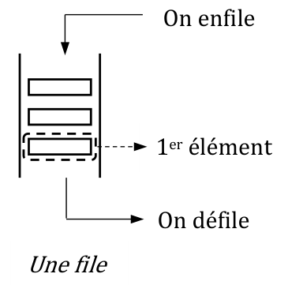

# Geipi Polytech 2021 : NSI

!!! info "Épreuve du vendredi 30 avril 2021"
    Épreuve de spécialité NSI du concours Geipi Polytech. L'épreuve écrite dure 3 heures en tout : mathématiques (obligatoire, 2 h conseillées) et une spécialité (1 h conseillée). L'usage d'une calculatrice est autorisé, aucun document n'est autorisé. Les réponses s'écrivent dans les cadres du document réponses : les éléments à compléter qui y figurent sont reproduits ci-dessous sous chaque question.

    Trois exercices : **files et ordonnancement du tourniquet**, **SQL et recherche dichotomique**, **tas**.

    [Sujet NSI et document réponses (PDF)](pdf/geipi-nsi-2021.pdf){ .md-button }
    [Corrigé officiel (PDF)](https://www.geipi-polytech.org/sites/default/files/annales/corrige_nsi_2021.pdf){ .md-button }

## Exercice I (10 points)

On rappelle qu'une file est une structure de données abstraite fondée sur le principe « dernier entré, dernier sorti ». On munit la structure de données *File* des 4 opérations primitives définies dans le tableau ci-dessous :

| **Structure de données abstraite :** File | |
|---|---|
| **Utilise :** Booléen, Élément | |
| `creer_file : ∅ → File` | `creer_file()` renvoie une file vide |
| `est_vide : File → Booléen` | `est_vide(F)` renvoie **True** si la file **F** est vide, **False** sinon |
| `enfiler : File, Élément → Rien` | `enfiler(F, x)` ajoute l'élément **x** à la fin de la file **F** |
| `defiler : File → Élément` | `defiler(F)` renvoie le premier élément de la file **F** et le retire de **F** |

{ width="180" }

On choisit d'implémenter une file en Python à l'aide d'une liste. Faire en sorte que vos réponses aux questions I-1 à I-4 respectent la spécification des opérations rappelée ci-dessus.

**I-1.** Compléter la fonction `creer_file` par une expression.

**I-2.** Compléter la fonction `est_vide` par une expression.

**I-3.** Compléter la fonction `enfiler` par le nom de la méthode à appeler.

**I-4.** Compléter la fonction `defiler` par une expression.

Sur le document réponses :

```python
def creer_file ():
    return __________

def est_vide(F):
    return __________

def enfiler(F, x):
    F. __________ (x)

def defiler(F):
    return F.pop( __________ )
```

On simule l'exécution d'un ensemble de trois processus sur un microprocesseur en suivant l'algorithme d'ordonnancement du tourniquet. Pour simplifier le problème, on pose les hypothèses suivantes :

1. Une seule instruction peut être exécutée à un instant donné.
2. L'exécution d'une instruction nécessite exactement une unité de temps.
3. Le temps de commutation entre deux processus est négligé.
4. Les processus ne sont pas en concurrence pour l'accès aux ressources autres que le microprocesseur.

| Processus 1 | Processus 2 | Processus 3 |
|---|---|---|
| Instruction 1-1 | Instruction 2-1 | Instruction 3-1 |
| Instruction 1-2 | Instruction 2-2 | Instruction 3-2 |
| Instruction 1-3 | | Instruction 3-3 |
| | | Instruction 3-4 |

Prenons l'exemple de 3 processus qui comportent respectivement 3, 2 et 4 instructions. L'algorithme du tourniquet procède ainsi : une instruction du processus 1 est exécutée, puis une instruction du processus 2, puis une instruction du processus 3 et ainsi de suite jusqu'à ce que les 9 instructions aient été exécutées. À la fin de son exécution, un processus sort définitivement de la file des processus.

**I-5.** Dans quel ordre sont exécutées les instructions des processus 1, 2 et 3 ? Compléter la séquence.

Sur le document réponses : `1-1 ; 2-1 ; …`

On représente un processus par un dictionnaire dont les clés sont : `'id'`, `'duree'` et `'temps'`. Elles correspondent respectivement au numéro du processus, au nombre d'instructions que comporte le processus et au nombre d'instructions déjà exécutées. Avant le début de son exécution, le processus 1 est représenté par `{'id': 1, 'duree': 3, 'temps': 0}`. Les processus à exécuter sont stockés dans une file. Dans les questions I-6 et I-7, une file ne doit être manipulée qu'avec les 4 fonctions primitives spécifiées plus haut.

**I-6.** La fonction `tourniquet` ci-dessous prend en paramètre une file de processus et affiche la séquence des instructions exécutées en suivant l'algorithme du tourniquet. Indiquer par quelles expressions ① et ② doivent être remplacés, et quelle instruction doit être placée en ③.

```python
def tourniquet(F):
    while not(est_vide(F)):
        x = defiler(F)
        x['temps'] = ①
        print(x['id'], "-", x['temps'])
        if ② :
            ③
```

**I-7.** Indiquer les 4 instructions qui doivent précéder l'appel « `tourniquet(proc)` » pour simuler le tourniquet appliqué aux 3 processus de l'exemple précédent. La simulation doit commencer comme à la question **I-5**.

## Exercice II (19 points)

Les réponses aux questions **II-1** à **II-5** ne peuvent utiliser que les mots suivants du langage SQL :
`AND`, `FROM`, `INSERT`, `INTO`, `JOIN`, `SELECT`, `ON`, `OR`, `VALUES`, `WHERE`

Une mère de famille imaginaire, perdue dans sa collection de films en DVD, décide d'en garder une trace dans un fichier nommé **mes_films.csv**. Un extrait de son contenu est représenté dans le tableau 1 ci-dessous. Un film apparaît autant de fois dans le tableau qu'il a de réalisateurs.

*Tableau 1*

| idfilm | titre | annee | realisateur |
|---|---:|:---:|---|
| 3849393 | Matrix | 1999 | Andy Wachowski |
| 3849393 | Matrix | 1999 | Larry Wachowski |
| 8239252 | Ping Pong | 2005 | Peter Pactol |
| 1732864 | Le recours du soi | 2003 | Peter Pactol |
| 7776767 | Citizen Kane | 1941 | Orson Welles |
| 4523783 | Django Unchained | 2013 | Quentin Tarentino |
| 3526732 | Sueurs froides | 1958 | Alfred Hitchcock |

Pour consulter plus facilement cette liste, sa fille lui propose de créer une base de données qui sera exploitable par des requêtes en langage SQL. Elle crée une table SQL dénommée **films** et une autre dénommée **realisation**, dont les structures sont données ci-dessous. Les attributs **titre** et **nom** sont des chaînes de caractères (type `CHAR`), les attributs **idfilm** et **annee** sont des entiers.

| **films** |
|---|
| idfilm (clef primaire) |
| titre |
| annee |

| **realisation** |
|---|
| idfilm (clef étrangère de la table films) |
| nom |

**II-1.** Immédiatement après avoir créé ses deux tables, quelle séquence de requêtes SQL doit écrire la fille pour enregistrer les réalisateurs du film Matrix dans la table **realisation** ?

On suppose maintenant que les tables **films** et **realisation** contiennent toutes les informations du tableau 1, sans plus, la fille souhaitant tester son modèle avant de les compléter.

**II-2.** On rappelle qu'en SQL, la fonction d'agrégation `COUNT()` permet de compter le nombre d'enregistrements dans une table. Quel est le résultat de la requête suivante : « `SELECT COUNT(nom) FROM realisation ;` » ?

**II-3.** Écrire la requête SQL qui liste les titres des films réalisés de 2000 (inclus) à 2010 (exclus).

**II-4.** Écrire la requête SQL qui liste le titre et l'année de tous les films réalisés par « Peter Pactol », à l'aide d'une jointure entre **films** et **realisation**.

Le fils de famille n'est pas en reste et il propose d'utiliser le langage Python pour créer et exploiter ces données. Prenant modèle sur sa sœur, il commence par créer les listes **liste_films** et **liste_reals** contenant toutes les informations du tableau 1. Voici un extrait des commandes qu'il utilise :

```python
liste_films = [ {'idfilm': 7776767, 'titre': 'Citizen Kane', 'annee': 1941},
                {'idfilm': 4523783, 'titre': 'Django Unchained', 'annee': 2013},
                ...
liste_reals = [ {'idfilm': 3526732, 'nom': 'Alfred Hitchcock'},
                {'idfilm': 3849393, 'nom': 'Andy Wachowski'},
                ...
```

**II-5.** Le fils a entré la liste des films par ordre lexicographique de leur titre, et celle des réalisateurs par ordre lexicographique de leur nom. Il écrit une procédure pour afficher toutes les informations du tableau 1 dans l'ordre lexicographique des noms des réalisateurs. Compléter le code de cette procédure.

Sur le document réponses :

```python
for __________ in __________ :
    for __________ in __________ :
        if __________ :
            print(film['idfilm'], film['titre'], film['annee'], real['nom'])
```

**II-6.** La procédure précédente n'affiche que 5 des 7 lignes attendues et le fils réalise qu'il a fait des fautes de frappe en entrant certaines valeurs de **idfilm**. Pour éviter que cela ne se reproduise, il écrit la fonction `coherent` ci-dessous qui vérifie la cohérence de ses deux tables. La fonction `coherent` renvoie *True* si tous les champs **idfilm** de la liste **reals** passée en paramètre apparaissent dans la liste **films** passée en paramètre, et doit retourner *False* dans le cas contraire. Compléter la définition de la fonction `contient_id` pour obtenir le résultat attendu.

```python linenums="1"
def coherent(films, reals):
    for r in reals:
        if not contient_id(films, r['idfilm']):
            return False
    return True
```

Sur le document réponses :

```python
def contient_id(films, idfilm):
    for f in films:
        if __________ :
            return __________
    return __________
```

**II-7.** En supposant que la liste **liste_films** est triée par ordre croissant du champ **idfilm**, on peut remplacer la fonction `contient_id` par une fonction de *recherche dichotomique*, plus rapide. Le fils choisit d'écrire pour cela une *fonction récursive*, qui prend en paramètres les *indices minimum* et *maximum* de l'intervalle à l'intérieur duquel se fait la recherche. Écrire les expressions à utiliser pour remplacer ①, ② et ③ dans la définition ci-dessous pour que la fonction `contient_id_rec` effectue une recherche dichotomique.

```python
def contient_id_rec(liste, id, imin, imax):
    if imin > imax:
        return False
    pivot = int((imin + imax)/2)
    if liste[pivot]['idfilm'] < id:
        return ①
    if liste[pivot]['idfilm'] > id:
        return ②
    return ③
```

**II-8.** Le fils modifie la ligne 3 de la fonction `coherent` (question II-6) pour remplacer l'appel à `contient_id` par un appel à `contient_id_rec`. Qu'a-t-il écrit à la place ?

Sur le document réponses :

```python linenums="3"
    if not contient_id_rec(films, r['idfilm'], __________ ):
```

**II-9.** Sans tri préalable, le test de cohérence peut être plus rapide en stockant la liste des films dans un dictionnaire dont les clefs seraient les numéros d'identification des films et dont les valeurs seraient les éléments de **films**. Par quelle expression remplacer ④ ci-dessous pour créer un tel dictionnaire à partir de la liste **films** ?

```python linenums="1"
def coherent_plus_rapide(films, reals):
    dico = ④
    return len([r for r in reals if r['idfilm'] not in dico]) == 0
```

## Exercice III (11 points)

« Un arbre binaire est dit presque complet si tous ses niveaux sont remplis, sauf éventuellement le dernier, qui doit être rempli sur la gauche » (*wikipedia*). Un tas est un arbre binaire presque complet tel que la valeur contenue dans un nœud est supérieure ou égale aux valeurs contenues dans ses fils.

On décide de représenter un tas contenant des entiers par une liste d'entiers. La racine a pour indice 0. Le fils gauche du nœud d'indice $i$ a pour indice $(2 \times i + 1)$. Le fils droit du nœud d'indice $i$ a pour indice $2 \times (i + 1)$. Les fonctions `droit` et `gauche`, qui renvoient respectivement l'indice du fils droit et l'indice du fils gauche du nœud d'indice $i$, sont supposées définies.

**III-1.** Indiquer quelles listes représentent des tas.

Sur le document réponses :

```python
L1 = [ 1, 2, 3, 4 ]       L3 = [ 2, 1, 4, 3 ]       L5 = [ 9, 5, 4, 2, 3, 2 ]
L2 = [ 4, 3, 2, 1 ]       L4 = [ 3, 4, 1, 2 ]       L6 = [ 8, 3, 4, 1, 2, 3 ]
```

Quelles listes représentent un tas : ☐ L1 ☐ L2 ☐ L3 ☐ L4 ☐ L5 ☐ L6

**III-2.** Compléter la fonction `parent` de sorte qu'elle renvoie l'indice du parent du nœud d'indice $i > 0$.

**III-3.** Compléter la fonction `est_feuille` de sorte qu'elle renvoie `True` si le nœud d'indice $i$ dans le tas $T$ est une feuille et `False` dans le cas contraire.

Sur le document réponses :

```python
def parent(i):
    return __________

def est_feuille(T, i):
    return __________
```

**III-4.** L'appel « `echanger(T, i, j)` » échange les valeurs des éléments d'indice `i` et `j` dans la liste `T`. La fonction `descendre` permet de rétablir la propriété de tas après avoir diminué la valeur contenue dans le nœud d'indice $i$. Indiquer par quelle expression ①, ② et ③ doivent être remplacés, et quelle instruction doit être placée en ④.

**III-5.** La fonction `maximum` renvoie le plus grand élément, le supprime et rétablit la propriété de tas. Indiquer par quelle expression ⑤ et ⑥ doivent être remplacés, et quelle instruction doit être placée en ⑦.

```python
def descendre(T, i):
    if not(est_feuille(T, i)):
        j = gauche(i)
        if droite(i) < len(T) :
            if T[j] < ①:
                j = ②
        if ③:
            echanger(T, i, j)
            ④

def maximum(T):
    x = T[⑤]
    T[⑥] = T.pop()
    ⑦
    return x
```
