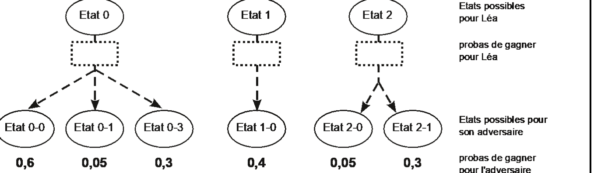

# Geipi Polytech 2022 : NSI

!!! info "Épreuve du mercredi 4 mai 2022"
    Épreuve de spécialité NSI du concours Geipi Polytech. L'épreuve écrite dure 3 heures en tout : mathématiques (2 h conseillées) et une spécialité (1 h conseillée). L'usage d'une calculatrice est autorisé. Les réponses s'écrivent dans les cadres du document réponses : les éléments à compléter qui y figurent sont reproduits ci-dessous sous chaque question.

    Deux exercices : **des « IA » pour un jeu à deux joueurs** (score, probabilités, récursivité), **affectations sportives** (parité, mariages stables, dictionnaires).

    [Sujet NSI et document réponses (PDF)](pdf/geipi-nsi-2022.pdf){ .md-button }
    [Corrigé officiel (PDF)](https://www.geipi-polytech.org/sites/default/files/annales/corrige_nsi_2022.pdf){ .md-button }

## Exercice I (20 points)

Un enseignant de NSI a programmé, en *Python*, un jeu à deux joueurs où la partie termine toujours avec un gagnant (il n'y a jamais de partie nulle). Il organise un tournoi où les « IA » programmées par ses élèves s'affronteront deux à deux à l'occasion de 20 parties : les « IA » seront classées selon la proportion de parties gagnées. L'enseignant a fourni à ses élèves une spécification des structures de données utilisées pour représenter une partie et un état du jeu, ainsi que des fonctions disponibles pour les manipuler. Ces spécifications ne sont pas utiles pour traiter les questions de cet exercice.

Une « IA » est une fonction qui attend deux arguments, le numéro du joueur (1 ou 2) et la liste des **états** possibles à la fin de son tour, et qui renvoie l'indice de l'état choisi. Chaque élève nomme son « IA » avec son prénom. Notez que si la valeur de la variable « `j` » indique le numéro d'un joueur, alors l'expression « `3 - j` » indique le numéro de son adversaire.

La fonction « `etats_suivants` » attend deux arguments, un numéro du joueur (1 ou 2) et un **état** du jeu. Elle renvoie la liste des **états** possibles après que le joueur ait joué son coup.

**I-1.** Enzo a défini une fonction « `score` » qui, étant donnés un numéro de joueur et un état du jeu, renvoie une valeur entière d'autant plus grande que le joueur a de chances de gagner la partie. L'« IA » d'Enzo évalue le score des différents états possibles à la fin du tour et elle renvoie l'indice d'un état dont le score est maximal. Quand il y a plusieurs états de score maximal, l'« IA » d'Enzo choisit aléatoirement un des meilleurs états. Vous pouvez utiliser la fonction « `alea` » qui, étant donné un entier $n$ reçu en argument, renvoie un entier aléatoire compris entre 0 et $(n - 1)$, bornes incluses.

Complétez la fonction « `enzo` ».

```python
def enzo(j, coups):
    b = [ 0 ] # indices des meilleurs
    i = 1
    while ( i < len(coups) ) :
        if score(j, coups[①]) > ② :
            b = ③
        elif score(j, coups[①]) == ②:
            ④
        i = i + 1
    return b[ ⑤ ]
```

**I-2.** Léa a défini une fonction « `proba` » qui, étant donné un numéro de joueur et un état du jeu, renvoie une estimation de la probabilité que le joueur gagne la partie. Léa a deux intuitions : (1) l'estimation de la probabilité est de plus en plus précise au fil du déroulement de la partie et (2) son adversaire cherchera lui aussi à gagner. Au lieu d'évaluer l'intérêt de ses coups possibles, elle choisit d'évaluer les coups possibles de son adversaire au prochain tour et, en supposant que son adversaire choisira le coup qui maximisera sa probabilité de gagner, elle obtient une nouvelle estimation de l'intérêt de ses coups possibles (*si la probabilité de gagner pour son adversaire est $p$ alors la probabilité de gagner est $(1 - p)$ pour Léa*). L'« IA » de Léa renvoie l'indice d'un état correspondant à la plus grande probabilité de gagner et, en cas d'*ex aequo*, elle renvoie le plus petit indice.

Avant de coder sa fonction, Léa fait un schéma pour illustrer son raisonnement sur un exemple : indiquez la probabilité que Léa gagne la partie pour les états 0, 1 et 2.

Sur le document réponses :



**I-3.** Complétez la fonction « `lea` ».

```python
def lea(j, coups):
    (b, p) = (0, 0.0)
    for i in range(0, len(coups)) :
        a = etats_suiv(3-j, coups[i])
        ba = 0
        for k in range(0, len(a)) :
            if proba(3-j, a[ ① ]) > ② :
                ③
        if 1 - proba(3-j, a[ba]) > ④ :
            (b, p) = (⑤, 1 - proba(3-j, a[ba]))
    return ⑥
```

**I-4.** Emma a discuté avec Léa : elle trouve son idée intéressante et elle la généralise à un horizon de $k$ coups en utilisant une fonction récursive. La fonction programmée par Léa correspond alors au cas $k = 2$. Léa a partagé sa fonction « `proba` » avec Emma. L'« IA » d'Emma utilise la probabilité de gagner en considérant un horizon de 3 coups.

Complétez la fonction « `emma_rec` » dont le code est donné sur le document réponse.

Sur le document réponses :

```python
def proba_rec(j, etat, nb):
    a = etats_suiv(3-j, etat)
    if nb <= 1 or len(a) == 0 :
        return proba(j, ①)
    else:
        p = 0.0
        for i in range(0, len(a)) :
            pa = proba_rec(3-j, a[②],③)
            if pa > p :
                ④
        return ⑤

def emma(j, coups):
    (b, p) = (0, 0.0)
    for i in range(0, len(coups)) :
        pc = proba_rec(j, coups[⑥], 3)
        if pc > p :
            (b, p) = ⑦
    return ⑧
```

## Exercice II (20 points)

À l'école *IPIEG*, chaque étudiant est affecté à une section sportive au début de sa première année d'étude. Durant son internat, il pratiquera essentiellement le sport auquel il aura été affecté et vivra en communauté avec les camarades de sa section. Lors des affectations initiales, l'objectif de l'école est de favoriser l'épanouissement individuel des étudiants, en leur permettant de s'orienter vers leur sport préféré, mais également d'assurer la réputation sportive de l'école, en sélectionnant pour chaque sport les étudiants qui obtiendront les meilleurs résultats lors des compétitions. Ainsi, les **affectations** s'appuient sur les préférences des étudiants, les **capacités** d'accueil de chaque activité sportive et les **classements** fournis par les responsables sportifs.

L'école souhaite que toutes les sections puissent présenter de bonnes équipes féminines même s'il y a moins d'étudiantes que d'étudiants. Les responsables sportifs doivent retoucher leur classement initial de sorte qu'il respecte la propriété de **parité faible**, qui garantit qu'à tout rang $k$, il n'y a pas plus de garçons que de filles parmi les $k$ premières places du classement, sauf s'il n'y a plus de fille après la $k^{\text{ième}}$ place. **Le classement initial des filles entre elle et celui des garçons entre eux, ne doivent jamais être modifiés.**

Dans la suite de l'exercice, on suppose que les étudiants sont identifiés par une chaîne de caractères commençant par un « F » majuscule pour les filles et par un « G » majuscule pour les garçons.

**II-1.** Le classement « `C1` » ci-dessous ne respecte pas la propriété de parité faible : il y a plus de garçons que de filles dans les trois premières places alors qu'il reste au moins une fille dans la suite du classement. Comment retoucher ce classement pour qu'il respecte la propriété de parité faible, sans modifier ni le classement initial des filles entre elles, ni le classement initial des garçons entre eux ?

```python
C1 = ['F1', 'G4', 'G7', 'G2', 'G3', 'G6', 'G1', 'F2', 'G8', 'G5', 'F3']
```

**II-2.** Reprenez la question précédente pour le classement « `C2` » ci-dessous.

```python
C2 = ['F2', 'F3', 'G5', 'G1', 'F4', 'G7', 'G3', 'G2', 'G4', 'F1', 'G6']
```

Sur le document réponses, pour II-1 comme pour II-2 : `[____, ____, ____, ____, ____, ____, ____, ____, ____, ____, ____]`

**II-3.** Complétez la fonction « `fille` » pour qu'elle renvoie « `True` » si la chaîne de caractères qu'elle reçoit en argument désigne une fille et « `False` » sinon.

Sur le document réponses :

```python
def fille(etu):
    return ① == 'F'
```

**II-4.** Complétez la fonction « `suivante` » qui, étant donné une liste d'étudiant « `etus` » et un indice « `i` », renvoie l'indice de la première fille dans $L$ à partir de l'indice $i$. Par exemple, « `suivante(C1,0)` » renvoie `0` (indice de « `F1` » dans le classement « `C1` ») et « `suivante(C1,1)` » renvoie `7` (indice de « `F2` » dans le classement « `C1` »).

Sur le document réponses :

```python
def suivante(etus, i):
    if i >= len(etus) or fille(etus[i]):
        return ①
    return suivante(etus, ②)
```

**II-5.** Complétez la fonction « `forcer_parite` » qui, étant donnée une liste ordonnée d'étudiants, renvoie une copie modifiée de façon à respecter la propriété de **parité faible**. La fonction part d'une copie du classement initial dont elle supprime itérativement les étudiants à mesure qu'ils sont ajoutés au classement final. Le classement initial des étudiants de même genre entre eux n'est pas modifié.

Sur le document réponses (la réponse ③ est de la forme `0.5 * (…)`) :

```python
def forcer_parite(etus):
    etus = etus.copy()
    (classt, nbf) = ([], 0)
    idxf = suivante(etus, 0)
    while etus:
        if fille( ① ):
            classt.append(etus.pop(0))
            nbf = nbf + 1
            idxf = suivante(etus, ②)
        elif nbf < ③ and idxf < ④ :
            classt.append(etus.pop( ⑤ ))
            nbf = nbf + 1
            idxf = suivante(etus, ⑥ )
        else:
            classt.append(etus.pop(0))
            idxf = idxf - 1
    return classt
```

Quand tous les responsables sportifs ont fourni leur classement, respectant la propriété de **parité faible**, l'école utilise l'algorithme des **mariages stables** pour tenir compte des préférences des étudiants (en priorité) et des classements par activité sportive. Cet algorithme converge toujours vers la même solution pour des conditions de départ identiques, quel que soit l'ordre dans lequel on traite les étudiants. Il procède comme suit :

1. Choisir un étudiant.
2. Affecter provisoirement cet étudiant à la section sportive qu'il préfère.
3. Recommencer l'étape 1 avec un autre étudiant jusqu'à ce que la capacité d'accueil soit dépassée d'une unité dans le sport choisi. Dans ce cas, on regarde tous les étudiants affectés à ce sport et on élimine le moins bien classé par le responsable de ce sport. Cet étudiant est éliminé définitivement du sport en question et affecté provisoirement au sport de son second choix (ou troisième s'il était affecté au sport de son deuxième choix et ainsi de suite).
4. On itère à partir de l'étape 1 jusqu'à ce qu'il n'y ait plus aucune modification la solution est alors trouvée.

On implémente cet algorithme en python en utilisant les structures de données suivantes :

- Les **listes d'étudiants** et les **listes de sports** sont représentées par des **listes de chaînes de caractères**,
- Les **préférences des étudiants** sont représentées par un **dictionnaire** dont les clefs sont les étudiants et les valeurs sont les listes des sports classés par ordre de préférences,
- Les **classements par sport** sont représentés par un **dictionnaire** dont les clefs sont les sports et les valeurs les listes des étudiants ordonnés selon le classement des responsables sportifs,
- Les **capacités d'accueil** des sections sportives sont représentées par un **dictionnaire** dont les clefs sont les sports et les valeurs sont le nombre maximum d'étudiants pouvant être accueillis dans la section.

Par exemple, avec trois étudiants et deux sections sportives :

```python
etudiants = ['F1', 'G1', 'G2']
sports = ['escrime', 'judo']
preferences = {'F1': ['judo', 'escrime'], 'G1': ['escrime','judo'],
               'G2': ['escrime', 'judo']}
classements = {'escrime': ['F1', 'G2', 'G1'], 'judo': ['F1', 'G1', 'G2']}
quotas = {'escrime': 1, 'judo': 3}
```

Le **résultat de l'algorithme** est un **dictionnaire** d'« `affectations` » dont les clefs sont les sports et dont les valeurs sont les listes des étudiants affectés. On décompose l'algorithme en trois fonctions : « `insertion_selon_classement` », « `affectation_etudiant` » et « `mariages_stables` ».

**II-6.** La fonction « `insertion_selon_classement` » attend trois arguments, un étudiant, le classement des étudiants dans un sport et une liste des étudiants déjà affectés à ce sport, et elle ajoute l'étudiant dans la liste des affectations à la position qui respecte le classement dans le sport. Par exemple :

- « `insertion_selon_classement('F1', ['F1', 'G2', 'G1'], ['G2'])` » renvoie « `['F1','G2']` »,
- « `insertion_selon_classement('G1', ['F1', 'G2', 'G1'], ['G2'])` » renvoie « `['G2','G1']` ».

Complétez le code donné ci-dessous.

```python
def insertion_selon_classement( etu, classement, affectation ):
    i = 0
    rang = classement.index(etu)
    while i < len(affectation) and rang > classement.index( ① ):
        i = i + 1
    affectation.insert( ② )
```

**II-7.** La fonction « `affectation_etudiant` » attend cinq arguments, un étudiant et quatre dictionnaires : les affectations temporaires, les préférences des étudiants, les classements par sport et les capacités d'accueil par sport. Elle ne renvoie aucune valeur rien mais elle modifie le dictionnaire des affectations de sorte à y intégrer l'étudiant, en suivant les étapes 2 et 3 de l'algorithme des mariages stables décrit plus haut. Lorsqu'un étudiant se fait éliminer d'un sport, ce sport est supprimé du dictionnaire indiquant ses préférences.

Complétez le code donné ci-dessous.

```python
def affectation_etudiant( etu, affect, prefs, classts, quotas ):
        sport = ①
        insertion_selon_classement( ② , ③ , ④ )
        if len(affect[sport]) > quotas[sport]:
            elimine = affect[sport].pop()
            prefs[etu].pop( ⑤ )
            affectation_etudiant( ⑥ , affect, prefs, classts, quotas )
```

**II-8.** La fonction « `mariages_stables` » prend en paramètres trois dictionnaires (préférences, classements et quotas) et renvoie le dictionnaire final des affectations.

Complétez le code donné sur le document réponse.

Sur le document réponses :

```python
def mariages_stables(prefs, classts, quotas):
    prefs = prefs.copy()
    affectation = { sport: [] for sport in classts.keys() }
    for ① in ② :
        affectation_etudiant( ③ , ④ , ⑤ , ⑥ , quotas)
    return affectation
```
