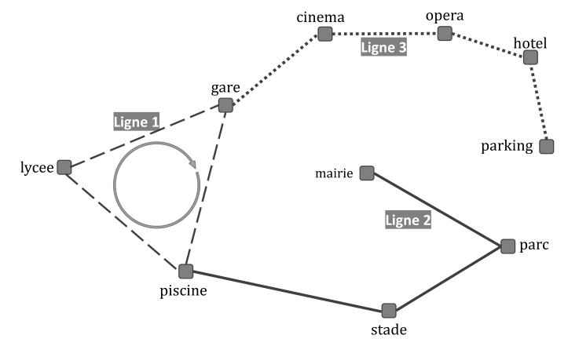

# Geipi Polytech 2023 : NSI

!!! info "Épreuve du mercredi 3 mai 2023"
    Épreuve de spécialité NSI du concours Geipi Polytech. L'épreuve écrite dure 3 heures en tout : QCM de mathématiques (1 h conseillée) et deux sujets de spécialité au choix (1 h conseillée chacun). L'usage d'une calculatrice est autorisé, aucun document n'est autorisé. Les réponses s'écrivent dans les cadres du document réponses : les éléments à compléter qui y figurent sont reproduits ci-dessous sous chaque question.

    Deux exercices : **réseau de transports urbains** (dictionnaires, listes), **suppression des images dupliquées** (similarité cosinus, algorithme glouton, cache).

    [Sujet NSI et document réponses (PDF)](pdf/geipi-nsi-2023.pdf){ .md-button }
    [Corrigé officiel (PDF)](https://www.geipi-polytech.org/sites/default/files/annales/corrige_nsi_2023.pdf){ .md-button }

## Exercice I (20 points)

On considère un réseau de transports urbains composé d'un ensemble de stations et de lignes de bus/métro/tram. Le transport des passagers est assuré en continu (7 jours sur 7 et 24 heures sur 24) par des véhicules autonomes qui circulent dans des voies qui leur sont exclusivement réservées.

Une **station** est représentée par une chaîne de caractères qui indique son nom. Deux stations différentes portent toujours deux noms différents et *vice versa*.

Une **ligne** est représentée par un dictionnaire dont les clefs sont « `num` », « `arrets` » et « `circulaire` ». Les valeurs associées à ces clefs sont respectivement :

- Un entier identifiant la ligne de façon <u>unique</u> (deux lignes différentes portent toujours deux numéros distincts et *vice versa*).
- Une liste ordonnée, <u>sans doublon</u> (une station apparaît au plus une fois dans la liste des stations desservies par une ligne), de chaînes de caractères représentant des stations. L'ordre des stations indique l'ordre dans lequel celles-ci sont desservies par les véhicules.
- Un booléen qui indique si la ligne est circulaire, c'est-à-dire si le service de cette ligne est assuré sans que les véhicules n'aient jamais besoin de faire demi-tour. Une ligne circulaire n'a pas de terminus (ou extrémité).

Un **réseau de transports** est représenté par une liste non ordonnée, <u>sans doublon</u>, de lignes.

La figure ci-dessous donne un exemple de réseau de transports urbains où

- La ligne 1 est une ligne circulaire qui relie la gare, la piscine et le lycée,
- La ligne 2 va de la mairie à la piscine en desservant le parc puis le stade,
- La ligne 3 va de la gare au parking en desservant le cinéma, l'opéra puis l'hôtel.

{ width="420" }

**I-1.** Complétez le code python de sorte que les variables `ligne1` et `ligne2` représentent respectivement les lignes 1 et 2 de l'exemple du schéma ci-dessus.

Sur le document réponses :

```python
ligne1 = { "num" : …

ligne2 = …
```

**I-2.** Complétez la fonction « `direct` » pour qu'elle renvoie `True` si un trajet direct *(c'est-à-dire sans avoir à changer de ligne)* entre les stations `depart` et `arrivee` existe dans le `reseau` de transport et `False` dans le cas contraire. La fonction reçoit en arguments, dans cet ordre, un réseau de transport (`reseau`) et deux stations (`depart` et `arrivee`).

*Indication : le trajet des lignes non circulaires est effectué dans un sens à l'aller et dans l'autre sens au retour.*

*Rappel : le nom d'une station apparaît au plus une fois dans la liste des arrêts.*

Sur le document réponses :

```python
def direct(reseau, depart, arrivee) :
    for ligne in …… :
        nb = ……
        for station in …… :
            if (station == depart) …… (station == arrivee):
                nb = ……
        if ( …… == 2) :
            return True
    return False
```

**I-3.** Complétez la fonction « `lister_lignes` » qui reçoit en argument un `reseau` de transport et qui renvoie un dictionnaire dont les clefs sont des stations (chaînes de caractères) et dont les valeurs sont les listes, non ordonnées et sans doublon, des numéros de lignes (entiers) qui desservent la station associée.

*Rappel : le nom d'une station apparaît au plus une fois dans la liste des arrêts d'une ligne donnée.*

Sur le document réponses :

```python
def lister_lignes(reseau) :
    dico = { }
    for ligne in …… :
        for station in …… :
            if …… :
                dico[station].append( …… )
            else:
                dico[station] = ……
    return ……
```

**I-4.** Complétez la fonction « `direct_bis` » qui reçoit en arguments le dictionnaire renvoyé par l'appel « `lister_lignes(reseau)` », la station `depart` et la station `arrivee`. La fonction « `direct_bis` » renvoie la même valeur que l'appel « `direct(reseau, depart, arrivee)` ».

Sur le document réponses :

```python
def direct_bis(dico, depart, arrivee) :
    for ligne in …… :
        if ligne in …… :
            return ……
    return ……
```

## Exercice II (20 points)

Si un même numéro (①, ②, …) apparaît plusieurs fois dans une question, votre réponse doit convenir pour chaque occurrence. Par exemple, les numéros ① à ⑤ apparaissent chacun deux fois à la question II-3.

Un enseignant de NSI propose à ses élèves d'écrire un programme permettant de supprimer les images dupliquées d'une base d'images. Une **base d'images** est une liste de couples : (nom du fichier de type `str`, taille du fichier de type `int`). Dans la suite, on note $(F_i, t_i)$ le couple associé à l'image $i$.

L'enseignant de NSI fournit à ses élèves une fonction d'analyse d'images faisant appel à un réseau de neurones profond. Cette fonction « `GetFeatures` », attend en argument le nom d'un fichier d'image et renvoie une liste de caractéristiques sous la forme d'une liste de valeurs comprises dans l'intervalle $[0, 1]$. La taille de la liste renvoyée est la même quelle que soit l'image en entrée. Par exemple, l'appel « `GetFeatures("image_1.jpg")` » renvoie la liste « `[ 0.51, 0.23, 0, 1.0, 0.12, … ]` ».

### Mesure de similarité entre deux images

Pour mesurer la ressemblance entre deux images, on calcule la « **similarité cosinus** » entre leurs descriptions respectives, c'est-à-dire entre les listes de caractéristiques renvoyées par la fonction « `GetFeatures` » pour chacune d'elle. La « similarité cosinus » entre les listes $x = [x_1, x_2, x_3, \ldots, x_n]$ et $y = [y_1, y_2, y_3, \ldots, y_n]$ est donnée par la formule suivante :

$$simcos(x, y) = \frac{x_1 y_1 + x_2 y_2 + x_3 y_3 + \cdots + x_n y_n}{\sqrt{(x_1^2 + x_2^2 + \cdots + x_n^2)(y_1^2 + y_2^2 + \cdots + y_n^2)}}$$

**II-1.** Complétez le code donné ci-dessous. La fonction « `simcos` » attend en arguments les descriptions `x` et `y` de deux images (c'est-à-dire deux listes, de même longueur, de valeurs comprises dans l'intervalle $[0, 1]$) et elle renvoie leur similarité cosinus.

*Rappel : la fonction python « `sqrt` » calcule la racine carrée d'une valeur.*

```python
from math import sqrt

def simcos(x, y):
    ① = 0
    sumX2 = 0
    sumY2 = 0
    for i in range(0, len(x)):
        produit_scalaire = ① + ②
        sumX2 = sumX2 + ③
        sumY2 = sumY2 + ④
    return ① / sqrt(sumX2 * sumY2)
```

### Algorithme glouton pour rassembler les images similaires dans des groupes

On parcourt la base initiale d'images et, pour chaque couple $(F_i, t_i)$ qui n'en a pas déjà été retiré :

- On crée un groupe $G_i$ sous la forme d'une liste de couples $(F_j, t_j)$ initialisée avec l'unique élément $(F_i, t_i)$ (l'image $i$ se trouve alors toute seule dans le groupe $G_i$),
- On sélectionne toutes les images de la base similaires à $i$ parmi celles qui n'ont pas déjà été retirées de la base,
- On ajoute ces images au groupe $G_i$ et on les retire de la base initiale.

À la fin de l'algorithme, on renvoie la liste de groupes ainsi construite.

**II-2.** Complétez le code donné ci-dessous. La fonction « `glouton` » attend en arguments une base d'images et un seuil de similarité. Ce seuil est une valeur comprise dans l'intervalle $[0, 1]$ : deux images ayant une similarité cosinus supérieure ou égale à ce seuil sont considérées comme suffisamment semblables pour être placées dans un même groupe.

```python
def glouton(base, seuil):
    tous_les_groupes = [ ]
    while len(base) > 0 :
        (F0, t0) = ①
        groupe = [ ① ]
        x = GetFeatures(F0)
        for Fi, ti in ② :
            y = GetFeatures(Fi)
            if ③ seuil:
                groupe.append( ④ )
        for g in groupe:
            base.remove(g)
        ⑤
    return tous_les_groupes
```

### Sélection d'un représentant pour chaque groupe

On cherche à ne conserver qu'une seule image par groupe : celle dont le fichier occupe le plus d'espace disque, en espérant qu'il s'agisse de celle dont la qualité est la meilleure.

**II-3.** Complétez les codes donnés ci-dessous. La fonction « `plusGrosse` » attend en argument un groupe (non vide) et renvoie le nom du fichier le plus volumineux de ce groupe. La fonction « `plusPetites` » attend en argument un groupe (non vide) et renvoie la liste des noms de fichiers image à supprimer.

```python
def plusGrosse(groupe):
    fichier, taille = groupe[0]
    for i in ① :
        if groupe[ ② ][ ③ ]  ④ :
            fichier, taille = ⑤
    return ⑥
```

```python
def plusPetites(groupe):
    liste = [ ]
    fichier, taille = groupe[0]
    for i in ① :
        if groupe[ ② ][ ③ ]  ④ :
            liste.append( ⑦ )
            fichier, taille = ⑤
        else :
            liste.append( ⑧ )
    return liste
```

**II-4.** Complétez le code donné ci-dessous. La fonction « `regrouper` » attend en arguments une base d'images et un seuil de similarité. Elle forme les groupes en appelant la fonction « `glouton` » et elle renvoie une liste de couples. Dans la liste renvoyée, il y a un couple pour chaque groupe : le premier élément d'un couple est le fichier à conserver pour ce groupe et le second est la liste des fichiers à supprimer.

```python
def regrouper(base, seuil):
    return [ ( ① , ② ) for g ③ ]
```

### Amélioration de l'algorithme glouton

Pour calculer la similarité de deux images, l'algorithme glouton fait appel à la fonction `GetFeatures` pour calculer la liste de caractéristiques de chacune. De ce fait, la fonction `GetFeatures` sera appelée plusieurs fois pour une même image, dès lors que cette image n'est pas sélectionnée dans le premier groupe. Pour accélérer les calculs, on utilise un « cache » mémoire sous forme d'une table associative dont les clefs sont les noms de fichiers et les valeurs sont la liste de caractéristiques calculée par la fonction `GetFeatures`. Le cache est initialement vide. Dans la fonction « `glouton` », on remplace les appels à « `GetFeatures` » par des appels à « `GetFeaturesCache` ».

**II-5.** Complétez le code donné ci-dessous. La fonction « `GetFeaturesCache` » attend en argument le nom d'un fichier d'image et elle renvoie la description de l'image sous la forme d'une liste de caractéristiques (une liste de valeurs comprises dans l'intervalle $[0, 1]$).

```python
featCache = {}

def GetFeaturesCache(fichier):
    if fichier ① featCache.keys():
        ② = GetFeatures(fichier)
    return ③
```
