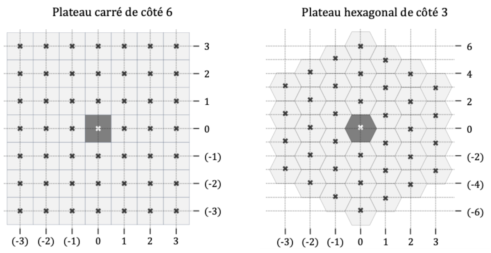
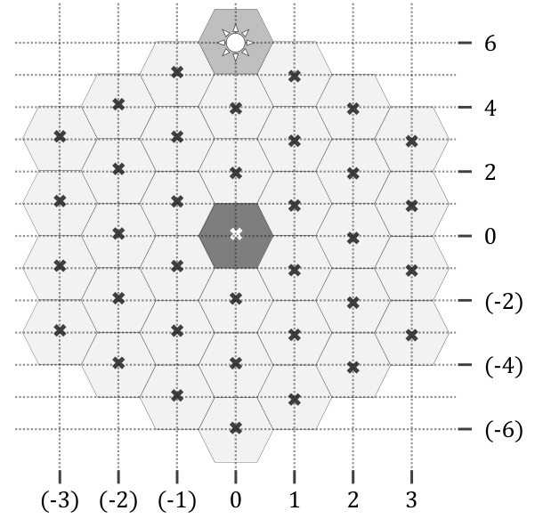

# Geipi Polytech 2025 : NSI

!!! info "Épreuve du mardi 29 avril 2025"
    Épreuve de spécialité NSI du concours Geipi Polytech. L'épreuve écrite dure 3 heures en tout : QCM de mathématiques (1 h conseillée) et deux sujets de spécialité au choix (1 h conseillée chacun). L'usage d'une calculatrice, d'un téléphone ou de tout objet communicant est interdit, aucun document n'est autorisé. Les réponses s'écrivent dans les cadres du document réponses : les éléments à compléter qui y figurent sont reproduits ci-dessous sous chaque question.

    Un seul exercice : **un jeu de chasse au trésor sur plateau carré ou hexagonal** (dictionnaires, distances, graphe de visibilité, SQL).

    [Sujet NSI et document réponses (PDF)](pdf/geipi-nsi-2025.pdf){ .md-button }
    [Corrigé officiel (PDF)](https://www.geipi-polytech.org/wp-content/uploads/2025/05/corrige-NSI-2025.pdf){ .md-button }

## Un seul exercice (40 points)

Emma et Lucas veulent organiser une compétition où s'affronteraient des IA programmées par les élèves de NSI de leur lycée. Ils imaginent un jeu qui puisse se dérouler sur un plateau dont les cases sont soit des carrés formant un grand carré, soit des hexagones réguliers formant un grand hexagone. Certaines cases contiennent des murs, une case contient un trésor et les autres cases sont vides. La case située au centre du plateau est toujours vide. L'objectif du jeu est de récupérer le trésor en minimisant le nombre de déplacements. Au début de la partie, le joueur est placé au centre du plateau et la position du trésor est connue. On dit que deux cases du plateau sont adjacentes si elles ont un côté en commun. À chaque coup, le joueur peut se déplacer sur une des cases adjacentes à sa position. Il ne peut pas sauter par-dessus une case. Le joueur connaît seulement le contenu des cases adjacentes à celles sur lesquelles il est passé.

La **forme d'un plateau** est représentée en python à l'aide d'un dictionnaire dont l'unique clé est soit `'carre'`, soit `'hexagone'`, selon que le plateau est carré ou hexagonal. La valeur associée à cette clé correspond à la longueur d'un côté du plateau.

> <u>Remarque 1 :</u> la distance entre les centres de deux cases adjacentes vaut toujours 1 et la longueur d'un côté du plateau est la distance entre les centres des cases situées à ses extrémités. Ainsi, un côté comporte une case de plus que sa longueur : sur la figure ci-dessous à droite, les 6 côtés du plateau hexagonal sont de longueur 3 et ils comportent chacun 4 cases.
>
> <u>Remarque 2 :</u> la longueur d'un côté d'un carré doit être paire. Si cette longueur est impaire, les fonctions se comporteront comme si on retirait une unité à la longueur du côté.



Les **coordonnées d'une case** sont représentées en python par un couple d'entiers `(colonne,ligne)` indiquant, respectivement, la colonne et la ligne sur lesquelles se trouve le centre de la case.

> <u>Remarque 3 :</u> dans le cas d'un plateau hexagonal, les coordonnées des cases sont deux entiers pairs, ou bien deux entiers impairs. Les couples formés d'un entier pair et d'un entier impair (ou *vice versa*) ne correspondent à aucune case.
>
> <u>Remarque 4 :</u> pour obtenir l'abscisse et l'ordonnée du centre d'une case, il faut multiplier sa colonne et sa ligne par, respectivement, $\frac{\sqrt{3}}{2}$ et $\frac{1}{2}$. Ainsi, la distance entre les centres de deux cases adjacentes est toujours égale à l'unité. Les abscisses et ordonnées des cases ne sont pas utilisées dans la suite de l'exercice.

Un **plateau** est représenté par un dictionnaire dont les clés sont les coordonnées des cases du plateau. Les valeurs associées aux clés peuvent être `'mur'`, `'tresor'` ou encore `'vide'`. La valeur associée à la clé `(0,0)` est toujours `'vide'`. La valeur `'tresor'` est associée à une clé et une clé seulement.

La **fonction `dmin`** attend trois arguments : la `forme` du plateau et les coordonnées, `colonne` et `ligne`, d'une case. Elle renvoie le nombre minimal de déplacements nécessaires au joueur pour atteindre la case `(colonne,ligne)` en partant du centre du plateau `(0,0)` quand il n'y a aucun mur sur ce plateau. Si la forme du plateau est inconnue ou si les coordonnées ne correspondent à aucune case du plateau, la fonction renvoie `inf` (c'est-à-dire l'infini).

**1.** Quelle valeur renvoie l'appel :

| | | | |
|---|---|---|---|
| (a) `dmin({'carre': 6}, 3, 2)` | (b) `dmin({'carre': 6}, -1, 3)` | (c) `dmin({'carre': 4}, 3, 2)` | (d) `dmin({'carre': 6}, 3, -2)` |
| (e) `dmin({'hexagone': 3}, -3, 3)` | (f) `dmin({'hexagone': 4}, 2, 7)` | (g) `dmin({'hexagone': 2}, 1, 3)` | (h) `dmin({'hexagone': 8}, -2, 3)` |

**2.** Complétez la définition en python de la fonction `dmin`. Il est interdit d'utiliser la fonction `math.sqrt` ou d'ajouter une structure de contrôle (par exemple, `if` ou `while`) pour répondre à cette question. Le cas échéant, il est possible d'utiliser les fonctions `abs`, `max` et `min` qui renvoient respectivement la valeur absolue d'un nombre, le maximum et le minimum d'une liste de valeurs.

> <u>Remarque 5 :</u> lorsqu'un symbole (par exemple, ① et ②, dans le code à compléter ci-dessous) apparaît plusieurs fois, votre réponse doit convenir pour toutes les occurrences de ce symbole.

```python
from math import inf
def dmin(forme, col, ligne):
   if ① in forme.keys():
      n = forme[ ① ]//2
      if max(abs(col), abs(ligne)) <= n:
         return abs(col) + abs(ligne)
   if ② in forme.keys():
      n = forme[ ② ]
      if ( ③ <= n) and ( ④ <= 2*n) and (col%2 == ⑤ ):
         return abs(col) + max(0, ( ⑥ )//2)
   return ⑦
```

La **fonction `num_colonne`** (respectivement la **fonction `num_ligne`**) attend en argument la `forme` d'un plateau et elle renvoie un couple d'entiers qui indiquent les bornes de l'intervalle de valeurs autorisées pour un numéro de colonne (respectivement de ligne) sur ce plateau. Si la forme du plateau est inconnue, les fonctions `num_colonne` et `num_ligne` renvoient `(0,0)`. <u>Indication :</u> relire la remarque 2.

**3.** Que renvoie l'appel :

| | | | |
|---|---|---|---|
| (a) `num_colonne({'carre': 6})` | (b) `num_colonne({'carre': 7})` | (c) `num_colonne({'hexagone': 3})` | (d) `num_colonne({'hexagone': 4})` |
| (e) `num_ligne ({'carre': 6})` | (f) `num_ligne ({'carre': 7})` | (g) `num_ligne ({'hexagone': 3})` | (h) `num_ligne ({'hexagone': 4})` |

**4.** Complétez les définitions en python des fonctions `num_colonne` et `num_ligne` (voir remarque 5).

```python
def num_colonne(forme):
   n = 0
   if ① in forme.keys():
      n = ②
   if ③ in forme.keys():
      n = ④
   return (-n, n)
```

```python
def num_ligne(forme):
   n = 0
   if ① in forme.keys():
      n = ②
   if ③ in forme.keys():
      n = ⑤
   return (-n, n)
```

La **fonction `creer_plateau`** attend en argument la `forme` du plateau à créer et elle renvoie un plateau dont toutes les cases sont vides (c'est-à-dire, en python, un dictionnaire dont les clés sont les coordonnées des cases du plateau, la valeur `'vide'` ayant été associée à chacune des clés). Si la forme du plateau est inconnue, le fonction `creer_plateau` renvoie un plateau vide (c'est-à-dire un dictionnaire vide).

**5.** Que renvoie l'appel :

(a) `creer_plateau({'carre': 2})` &emsp; (b) `creer_plateau({'carre': 3})` &emsp; (c) `creer_plateau({'hexagone': 1})` &emsp; (d) `creer_plateau({'rond': 1})`

**6.** Complétez la définition en python de la fonction `creer_plateau` (voir remarque 5).

```python
def creer_plateau(forme):
   cmin,cmax = ①
   rmin,rmax = num_ligne(forme)
   plateau = {}
   c = ②
   while c <= ③ :
      r = rmin
      while r <= rmax:
         if ④ in forme.keys():
            plateau[c,r] = ⑤
         if ⑥ in forme.keys():
            if dmin( ⑦ ) <= forme[ ⑥ ]:
               plateau[c,r] = ⑤
         r = r + 1
      ⑧
   return plateau
```

La fonction `init_plateau` attend trois arguments : la `forme` du plateau, la position du trésor et un niveau de difficulté. Elle renvoie un plateau initialisé de sorte que le joueur puisse atteindre le trésor en partant du centre du plateau. La fonction `init_plateau` commence par un appel à la fonction `creer_plateau`. La fonction `init_plateau` n'est décrite qu'à titre informatif et elle n'est pas utilisée dans la suite de l'exercice.

La **fonction `deplacements`** attend quatre arguments : la `forme` du plateau, le `plateau`, les coordonnées `colonne` et `ligne` du joueur. Elle renvoie la liste des coordonnées des cases adjacentes sur lesquelles le joueur peut se déplacer, c'est-à-dire celles qui ne contiennent pas de mur. Si la forme du plateau est inconnue ou si les coordonnées ne correspondent pas à une case du plateau, la fonction renvoie une liste vide.

**7.** Complétez la définition en python de la fonction `deplacements` (voir remarque 5).

```python
def deplacements(forme,plateau,col,ligne):
   mvt = []
   ① = []
   if (col,ligne) not in plateau.keys():
      return adj
   if plateau[col,ligne] == ② :
      return adj
   if ③ in forme.keys():
      mvt = [ (-1,0), ④ ]
   if ⑤ in forme.keys():
      mvt = [ ⑥ ]
   for x,y in mvt:
      if ( ⑦ , ⑧ ) in plateau.keys():
         if plateau[ ⑦ , ⑧ ] != ② :
            adj.append(( ⑦ , ⑧ ))
   return ①
```

Un **graphe de visibilité** permet au joueur d'accéder aux informations découvertes depuis le début de sa partie, c'est-à-dire le contenu des cases adjacentes à celles sur lesquelles il est passé et leurs relations d'adjacence. On représente ce graphe de visibilité à l'aide d'un dictionnaire dont les clés sont : `'coups_possibles'`, `'tresor'`, `'mur'` et `'graphe'`. La valeur associée à la clé

- `'coups_possibles'` indique la liste des coups possibles, c'est-à-dire la liste des coordonnées des cases où le joueur peut se déplacer (obtenues en appelant la fonction `deplacements`),
- `'tresor'` indique les coordonnées de la case où se trouve le trésor,
- `'mur'` est la liste des coordonnées des cases où un mur a déjà été découvert,
- `'graphe'` est un dictionnaire dont les clés sont les coordonnées des autres cases (celles qui ne sont pas dans la liste associée à la clé `'mur'`). La valeur associée à chaque clé `(colonne,ligne)` est un couple `(contenu,cases_adjacentes)` où `contenu` est une des valeurs de la liste `['inconnu','tresor','vide']` et où `cases_adjacentes` est la liste des coordonnées des cases adjacentes à la case `(colonne,ligne)` qui ne contiennent pas de murs connus.

La **fonction `jouer`** attend en argument un graphe de visibilité et elle renvoie le coup sélectionné parmi ceux proposés (éléments de la liste associée à la clé `'coups_possibles'` du graphe de visibilité). C'est cette fonction que les élèves de NSI devront coder en adoptant une stratégie « intelligente ».

Lucas propose à Emma de coder une première version de la fonction `jouer` en choisissant chaque fois le coup qui permet de se positionner au plus près du trésor en appliquant un algorithme de recherche de plus court chemin sur le graphe associé à la clé `'graphe'` du graphe de visibilité. En cas d'*ex æquo*, on choisit au hasard. Emma pense immédiatement à un exemple de partie où cette stratégie fait perdre du temps.

**8.** À quel exemple de partie Emma aurait-elle pu penser avec un plateau hexagonal de côté 3 où le trésor est placé en `(0,6)` et où exactement 12 cases du plateau contiennent des murs ? Hachurez les 12 cases qui contiennent les murs sur la figure du document réponse.

Sur le document réponses :

{ width="320" }

Pour rendre la compétition plus intéressante, Emma et Lucas décident de passer à une version multi-joueurs : ils décident que les fonctions `jouer` d'un groupe d'élèves ne pourront pas communiquer directement mais seulement mettre en commun les informations découvertes au travers d'une base de données relationnelle. Si tous les joueurs adoptent exactement la même stratégie, ils ne tireront aucun avantage de leur nombre : il leur faudra diversifier leur approche pour trouver un compromis entre l'exploration du plateau et l'exploitation des informations déjà recueillies.

On stocke les informations découvertes depuis le début dans une base de données relationnelle. Les cases dont on connaît le contenu sont stockées dans la base et les cases dont le contenu est `'inconnu'` n'y figurent pas. Le schéma relationnel de cette base de données comporte deux relations :

- `cases(`<u>`id_case`</u>`, colonne, ligne, contenu)`
- `adjacence(`<u>`#id_case_1, #id_case_2`</u>`)`

Dans ce schéma relationnel :

- l'attribut `contenu` a pour valeur des chaînes de caractères,
- les autres attributs (`colonne`, `id_case`, `id_case_1`, `id_case_2`, `ligne`) ont des valeurs entières,
- les clés primaires sont soulignées,
- `adjacence.id_case_1` est une clé étrangère faisant référence à `cases.id_case`,
- `adjacence.id_case_2` est une clé étrangère faisant référence à `cases.id_case`.

**9.** (a) Le tuple `(2,3)` apparaît dans la table/relation `adjacence`. Peut-on alors affirmer qu'il existe un tuple où `id_case` vaut `2` dans la table/relation `cases` ?

(b) Le tuple `(10, 2, 2, 'vide')` apparaît dans la table/relation `cases`. Peut-on alors affirmer qu'il existe un tuple où `id_case_1` vaut `10` dans la table/relation `adjacence` ?

Sur le document réponses : cocher oui ou non pour (a) et pour (b).

**10.** Complétez la requête SQL de sorte qu'elle renvoie les coordonnées (colonne, ligne) de toutes les cases qui sont adjacentes à un mur (voir remarque 5).

<u>Indications :</u> le mot-clé `DISTINCT` du langage SQL élimine les répétitions de tuples dans la réponse. Les réponses ①, ② et ③ sont des mots-clés du langage SQL à choisir parmi `FROM`, `JOIN … ON`, `HAVING`, `ORDER BY`, `SELECT`, `WHERE`. Les réponses ④ et ⑦ sont des opérateurs logiques. Les réponses ⑤ et ⑧ sont des attributs. Les réponses ⑥ et ⑨ sont des égalités entre attributs.

```sql
① DISTINCT x.colonne, x.ligne
② cases x, cases y, adjacence
③ y.contenu = 'mur' ④ ((id_case_1 = x.⑤ ④ ⑥ ) ⑦ (id_case_1 = ⑧ ④ ⑨ ));
```
