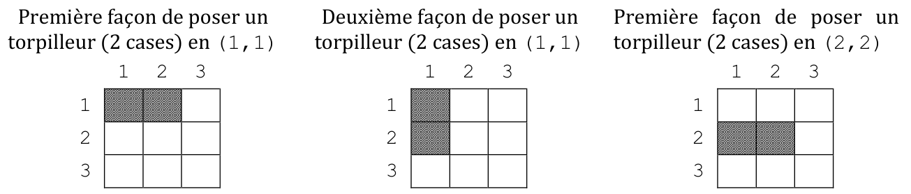
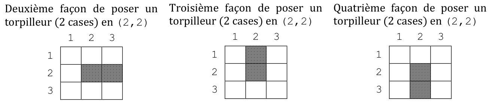
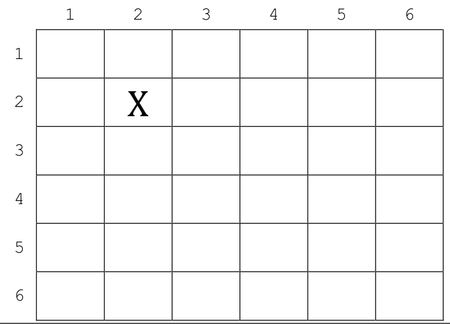

# Geipi Polytech 2026 : NSI

!!! info "Épreuve du mardi 28 avril 2026"
    Épreuve de spécialité NSI du concours Geipi Polytech. L'épreuve écrite dure 3 heures en tout : QCM de mathématiques (1 h conseillée) et deux sujets de spécialité au choix (1 h conseillée chacun). L'usage d'une calculatrice, d'un téléphone ou de tout objet communicant est interdit. Les réponses s'écrivent dans les cadres du document réponses : les éléments à compléter qui y figurent sont reproduits ci-dessous sous chaque question.

    Un seul exercice : **la bataille navale** (tuples, dictionnaires, dénombrement des placements, tir aléatoire pondéré).

    [Sujet NSI et document réponses (PDF)](pdf/geipi-nsi-2026.pdf){ .md-button }
    [Corrigé officiel (PDF)](https://www.geipi-polytech.org/wp-content/uploads/2026/04/Corrige-NSI-version-finale-2026.pdf){ .md-button }

## Un seul exercice (40 points)

Alan enseigne la spécialité NSI au lycée Philippe Auboyneau et il organise une compétition à destination de ses élèves. L'objectif est d'élaborer une stratégie gagnante au jeu de la bataille navale.

La bataille navale est un jeu à deux joueurs. Au début de la partie chaque joueur dispose de deux grilles carrées de côté 10 et d'une flotte composée de bateaux qui occupent de 1 à 5 cases. Les flottes des deux joueurs sont identiques. Chaque joueur place ses bateaux, verticalement ou horizontalement, sur une de ses grilles en veillant à ne pas placer plusieurs bateaux sur une même case. À tour de rôle, les joueurs annoncent les coordonnées de la case sur laquelle ils tirent et ils notent la réponse de leur adversaire sur leur deuxième grille : « À l'eau » si aucun bateau n'est touché, « Touché » si un bateau est touché sans être coulé (au moins une des cases que le bateau occupe n'a pas encore été touchée) ou « Coulé bateau de *X* cases » si la dernière case occupée par un bateau de *X* cases est touchée. Le joueur attaqué marque la case visée sur la grille où il a placé ses bateaux. Le premier joueur qui coule toute la flotte de son adversaire gagne la partie.

Un **identifiant de bateau** est une chaîne de caractères. Les **coordonnées d'une case** (ou d'un tir) sont représentées par un *tuple* de deux entiers `(ligne, colonne)`. Un **bateau** est représenté par un *tuple* de trois éléments (triplet) : le premier élément indique le nombre de cases occupées par le bateau, le deuxième élément est la liste des coordonnées des cases occupées par le bateau (dès qu'elles sont connues) et le troisième élément est la liste des coordonnées des cases occupées par le bateau et touchées par un tir. Une **flotte** est représentée par un dictionnaire dont chaque clé est un identifiant de bateau auquel est associé un bateau.

**1.** La fonction `initialiser_flotte` ne reçoit aucun argument. La fonction `initialiser_flotte` renvoie une flotte composée d'un porte-avion qui occupe cinq cases, d'un cuirassé qui occupe quatre cases, de deux croiseurs qui occupent chacun trois cases et d'un torpilleur qui occupe deux cases. Ces bateaux ne sont pas encore placés sur la grille et n'ont pas encore été victimes d'un tir de l'adversaire. Compléter la définition ci-dessous en indiquant par quoi doivent être remplacés les symboles ① à ⑧. Quand un même numéro apparaît plusieurs fois, toutes les occurrences/apparitions sont remplacées par la même chose.

```python
def initialiser_flotte ():
   flotte = ①
   flotte['porte-avion'] = ( ② , ③ , ④ )
   flotte['cuirasse']    = ( ⑤ , ③ , ④ )
   flotte['croiseur 1']  = ( ⑥ , ③ , ④ )
   flotte['croiseur 2']  = ( ⑥ , ③ , ④ )
   flotte['torpilleur']  = ( ⑦ , ③ , ④ )
   return ⑧
```

**2.** La fonction `attaquer` reçoit en arguments la flotte du joueur et les coordonnées du tir de son adversaire. La fonction `attaquer` renvoie `0` si le tir ne touche aucun bateau, `(-1)` si le tir touche un bateau sans le couler ou la taille du bateau touché si toutes les cases qu'il occupe ont été touchées. Compléter la définition ci-dessous en indiquant par quoi doivent être remplacés les symboles ① à ⑦.

```python
def attaquer(flotte, tir):
   for ① in flotte.values():
      if ② in bateau[1]:
         if ② ③ ④ :
            ④.append( ② )
         if ⑤ == len( ④ ):
            return ⑤
         else:
            return ⑥
   return ⑦
```

**3.** La fonction `positionner_flotte` reçoit en argument une flotte dont les bateaux ne sont pas encore placés sur la grille et n'ont pas encore été victimes d'un tir adverse. La fonction `positionner_flotte` positionne tous les bateaux de la flotte sur la grille. Un bateau peut être placé soit horizontalement, soit verticalement. Une case ne peut pas être occupée par plus d'un bateau à la fois. Compléter la définition ci-dessous en indiquant par quoi doivent être remplacés les symboles ① à ⑥.

```python
def positionner_flotte(flotte):
   # Z liste les cases occupees
   Z = []
   for id in flotte.keys():
      choix = {}
      A = range(① [0])
      numeros = [y+1 for y in range(10)]
      ② = [y+1 for y in range(11 - ① [0])]
      for ligne in numeros:
         for col in ② :
            X = [③ for dx in ④ if ③ not in Z]
            if ① [0] == len(X):
               choix[(ligne,col,'h')] = X
      for ligne in numeros_restreint:
         for col in numeros:
            X = [⑤ for dy in ④ if ⑤ not in Z]
            if ① [0] == len(X):
               choix[(ligne,col,'v')] = X
      L = list(choix.keys())
      position = random.choice(L)
      ① = ( ① [0],choix[ ⑥ ], ① [2])
      for case in ① [1]:
         Z.append(case)
```

> **Remarque 1 :** la fonction « `range` » renvoie la séquence des entiers compris entre 0 (inclus) et l'entier qui lui est fourni en argument (exclus).
>
> **Remarque 2 :** la fonction « `random.choice` » renvoie un élément choisi aléatoirement dans la liste des valeurs qui lui est fournie en argument. Si les valeurs de cette liste sont uniques à l'exception d'une valeur qui apparaît deux fois, la valeur en double a deux fois plus de chances d'être choisie.

En discutant de la stratégie à adopter pour gagner une partie de bataille navale, Léa et Thomas font un premier constat : si leur adversaire peut prévoir leurs tirs par avance alors il pourra définir une stratégie de placement pour éviter leurs tirs et il gagnera plus facilement la partie. Léa et Thomas décident donc d'intégrer une part de hasard dans le choix de la cible de leurs tirs. Léa et Thomas poursuivent leur réflexion et, pour chaque case de la grille, ils comptent le nombre de façons différentes qu'il y a de poser un bateau en occupant cette case : ce nombre dépend de la taille du bateau et du contenu des cases de la grille





Les valeurs que Léa et Thomas obtiennent, sans faire d'hypothèses sur le contenu des cases, pour un torpilleur (bateau de 2 cases) et un cuirassé (bateau de 4 cases) sont regroupées dans les tableaux ci-dessous

**Nombre de façons de poser un torpilleur**

| | 1 | 2 | 3 | 4 | 5 | 6 | 7 | 8 | 9 | 10 |
|---|---|---|---|---|---|---|---|---|---|---|
| **1** | 2 | 3 | 3 | 3 | 3 | 3 | 3 | 3 | 3 | 2 |
| **2** | 3 | 4 | 4 | 4 | 4 | 4 | 4 | 4 | 4 | 3 |
| **3** | 3 | 4 | 4 | 4 | 4 | 4 | 4 | 4 | 4 | 3 |
| **4** | 3 | 4 | 4 | 4 | 4 | 4 | 4 | 4 | 4 | 3 |
| **5** | 3 | 4 | 4 | 4 | 4 | 4 | 4 | 4 | 4 | 3 |
| **6** | 3 | 4 | 4 | 4 | 4 | 4 | 4 | 4 | 4 | 3 |
| **7** | 3 | 4 | 4 | 4 | 4 | 4 | 4 | 4 | 4 | 3 |
| **8** | 3 | 4 | 4 | 4 | 4 | 4 | 4 | 4 | 4 | 3 |
| **9** | 3 | 4 | 4 | 4 | 4 | 4 | 4 | 4 | 4 | 3 |
| **10** | 2 | 3 | 3 | 3 | 3 | 3 | 3 | 3 | 3 | 2 |

**Nombre de façons de poser un cuirassé**

| | 1 | 2 | 3 | 4 | 5 | 6 | 7 | 8 | 9 | 10 |
|---|---|---|---|---|---|---|---|---|---|---|
| **1** | 2 | 3 | 4 | 5 | 5 | 5 | 5 | 4 | 3 | 2 |
| **2** | 3 | 4 | 5 | 6 | 6 | 6 | 6 | 5 | 4 | 3 |
| **3** | 4 | 5 | 6 | 7 | 7 | 7 | 7 | 6 | 5 | 4 |
| **4** | 5 | 6 | 7 | 8 | 8 | 8 | 8 | 7 | 6 | 5 |
| **5** | 5 | 6 | 7 | 8 | 8 | 8 | 8 | 7 | 6 | 5 |
| **6** | 5 | 6 | 7 | 8 | 8 | 8 | 8 | 7 | 6 | 5 |
| **7** | 5 | 6 | 7 | 8 | 8 | 8 | 8 | 7 | 6 | 5 |
| **8** | 4 | 5 | 6 | 7 | 7 | 7 | 7 | 6 | 5 | 4 |
| **9** | 3 | 4 | 5 | 6 | 6 | 6 | 6 | 5 | 4 | 3 |
| **10** | 2 | 3 | 4 | 5 | 5 | 5 | 5 | 4 | 3 | 2 |

**4.** Compléter les 4 premières lignes du tableau obtenu, sans faire d'hypothèse sur le contenu des cases de la grille, pour un porte-avion (bateau de 5 cases).

Sur le document réponses : un tableau vierge de 4 lignes et 10 colonnes.

**5.** On effectue un premier tir en `(4,4)` qui ne touche aucun bateau adverse. Combien de cases du tableau précédent « Nombre de façons de poser un **torpilleur** » sont modifiées si on prend en compte cette information ? Si moins de 10 cases sont modifiées, préciser lesquelles en indiquant leur nouvelle valeur.

**6.** On effectue un premier tir en `(4,4)` qui ne touche aucun bateau adverse. Combien de cases du tableau précédent « Nombre de façons de poser un **cuirassé** » sont modifiées si on prend en compte cette information ? Si moins de 10 cases sont modifiées, préciser lesquelles en indiquant leur nouvelle valeur.

Sur le document réponses, pour 5 comme pour 6 : le nombre de cases modifiées, puis jusqu'à 9 lignes de la forme `( … , … ) : …`

Léa et Thomas considèrent que chaque bateau d'une flotte est placé de façon indépendante du placement des autres bateaux de cette flotte. Ce n'est pas tout à fait exact car une même case ne peut pas accueillir plus d'un bateau différent à la fois. Ainsi, pour calculer le nombre de façons qu'une case peut être utilisée pour placer tous les bateaux d'une flotte, ils font la somme du nombre de façons dont elle peut être utilisée pour placer chacun des bateaux indépendamment. Par exemple, ils considèrent que la case `(1,1)` peut être utilisée de 10 façons différentes (au lieu de 2) par une flotte de 5 bateaux. Pour représenter le **tableau des sommes** obtenues, ils utilisent un dictionnaire dont les clés sont des tuples de 2 éléments `(ligne, colonne)` et dont les valeurs sont les entiers.

**7.** La fonction `lea_et_thomas_alea` reçoit en argument le *tableau des sommes* et elle renvoie un tuple de deux éléments indiquant les coordonnées `(ligne, colonne)` de la cible de leur tir aléatoire. La probabilité du choix d'une case comme cible est proportionnelle à l'approximation du nombre de façons d'utiliser cette case pour poser un bateau de la flotte. Compléter la définition ci-dessous en indiquant par quoi doivent être remplacés les symboles ① à ⑤.

```python
def lea_et_thomas_alea(tableau_sommes):
   choix = ①
   for ( ② , ③ ) in ④ .items():
      for k in range(nb):
         ⑤ .append((ligne,col))
   return random.choice( ⑤ )
```

Léa et Thomas décident que lorsqu'au moins un bateau est touché, il est préférable de concentrer les tirs autour des positions touchées jusqu'à couler le ou les bateaux concernés. Léa et Thomas ne comptent alors que les façons de poser un bateau en occupant au moins une case touchée par un tir précédent (sans que le bateau touché ne soit coulé).

**8.** On suppose que la flotte adverse ne compte plus que deux bateaux : un torpilleur (bateau de 2 cases) et un porte-avion (bateau de 5 cases). Les autres bateaux adverses ont été coulés. En dehors d'un tir en `(2,2)` qui a touché un bateau adverse sans le couler, tous les tirs précédents concernaient soit les quatre dernières lignes (7 à 10), soit les quatre dernières colonnes (7 à 10) de la grille. Pour chacune des cases représentées sur le document réponse, indiquer la somme du nombre de façons de placer un torpilleur en incluant la case `(2,2)` et du nombre de façons de placer un porte-avion en incluant la case `(2,2)` lorsque cette somme n'est pas nulle (et uniquement dans ce cas).

Sur le document réponses :

{ width="360" }
