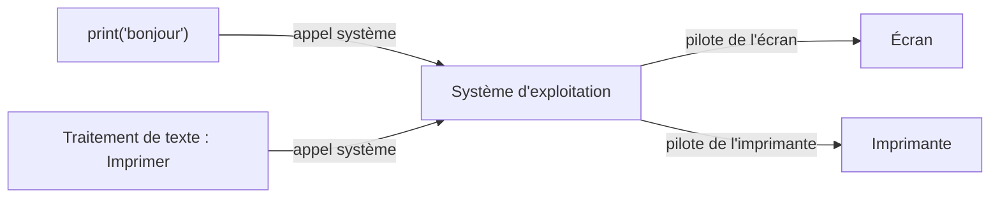
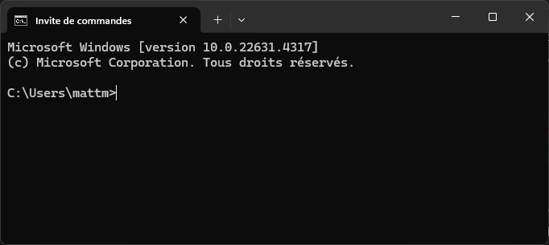

# Systèmes d'exploitation

## 1. Introduction

Windows, Linux, macOS, Android, iOS : tu utilises ces noms tous les jours. Ce sont des **systèmes d'exploitation** (OS, *Operating System*), des logiciels qui font le lien entre les **programmes** (on dit aussi les **applications**) et le **matériel** : la mémoire, le ou les processeurs, et les périphériques d'entrée-sortie (clavier, écran, disque, réseau...).

**D'où on vient.** Pour changer le programme de l'ENIAC, il fallait recâbler la machine, et cela prenait plusieurs jours. Avec le programme enregistré de von Neumann, que tu as manipulé dans le LMC, changer de programme revient à ranger d'autres nombres dans la mémoire. Mais le LMC n'exécute toujours qu'**un seul programme à la fois** : ce programme occupe la mémoire à partir de la case n°0. Pour en lancer un autre, il faut attendre que le premier soit arrivé à `HLT`, puis charger le nouveau programme dans la mémoire, à la place de l'ancien.

Le système d'exploitation fait le pas suivant : **plusieurs programmes chargés en même temps**, qui se partagent la mémoire et le processeur sans se gêner.

!!! fondamental "Le rôle du système d'exploitation"
    Le système d'exploitation rend le matériel **simple à utiliser** et le **partage sans danger** entre plusieurs programmes.

    Un programme ne touche jamais directement au matériel : il passe toujours par le système d'exploitation.

Regarde cette vidéo d'Inria, l'institut national de recherche en sciences et technologies du numérique. Elle présente les trois rôles d'un système d'exploitation.

<iframe width="560" height="315" src="https://www.youtube.com/embed/SpCP2oaCx8A" title="YouTube video player" frameborder="0" allow="accelerometer; autoplay; clipboard-write; encrypted-media; gyroscope; picture-in-picture; web-share" referrerpolicy="strict-origin-when-cross-origin" allowfullscreen></iframe>

## 2. Les trois rôles d'un système d'exploitation

### 2.1 Gérer la mémoire : la mémoire virtuelle

La mémoire est un grand tableau de cases, et c'est exactement ce que tu as manipulé avec le LMC : chaque case a une **adresse**, 0, 1, 2, 3...

**Le problème.** Si deux programmes écrivaient directement dans la mémoire, le premier pourrait ranger une valeur à l'adresse 1, puis le second écrire autre chose à la même adresse. Quand le premier reviendrait lire sa valeur, il trouverait celle de l'autre.

**La solution : la mémoire virtuelle.** Le système d'exploitation fait croire à chaque programme qu'il dispose de toute la mémoire, avec ses propres adresses 0, 1, 2, 3... Quand un programme écrit à « son » adresse 1, le système choisit une case libre dans la vraie mémoire et **retient la correspondance** dans une table.

| Programme | Adresse vue par le programme | Adresse réelle choisie par l'OS |
|---|---|---|
| A | 1 | 3 |
| B | 1 | 1 |

Les deux programmes écrivent tous deux « à l'adresse 1 », mais leurs valeurs sont rangées dans deux cases différentes.

Chaque programme peut donc commencer « à la case n°0 », comme dans le LMC : le système d'exploitation les range à des endroits différents de la vraie mémoire.

### 2.2 Partager le processeur : l'ordonnanceur

Un ordinateur fait tourner beaucoup plus de programmes qu'il n'a de processeurs. Or un processeur ne fait **qu'une chose à la fois**.

Le système d'exploitation joue l'arbitre grâce à l'**ordonnanceur** (*scheduler*). Il laisse un programme calculer un court moment, le met en pause, puis donne le processeur à un autre, et ainsi de suite.

!!! example "Ordonnancement"
    - **0-5 ms** : le navigateur affiche une page web
    - **5-10 ms** : le lecteur de musique décode un morceau
    - **10-15 ms** : le traitement de texte vérifie l'orthographe
    - **15-20 ms** : le navigateur reçoit des données du réseau
    - ...

    Les bascules ont lieu des centaines de fois par seconde : on a l'impression que tout se passe en même temps.

Un programme qui doit **attendre** un périphérique lent, par exemple lire sur le disque, ne peut rien faire en attendant. L'ordonnanceur le met en pause et donne le processeur à un autre. Il reprend son tour quand la donnée est arrivée.

### 2.3 Demander au système : les appels système

Bientôt, tu écriras en Python `print("bonjour")`, et le mot s'affichera. Tu ne sauras rien de ton écran : sa marque, sa taille, la façon dont il allume ses pixels.

Pourtant, rien n'est magique : il faut bien que des instructions, quelque part, allument un à un les pixels qui dessinent ces lettres. Ces instructions, tu ne les écris pas. Elles ont été écrites une fois pour toutes, dans le système d'exploitation, et tous les programmes s'en servent. Et le même programme marchera tel quel sur l'ordinateur de ton voisin, qui n'a pas forcément le même écran.

C'est possible parce qu'un programme ne fait jamais lui-même une opération sur le matériel. Il **demande** au système d'exploitation de la faire pour lui : c'est un **appel système**. Ton `print` demande au système d'afficher du texte, et c'est le système qui sait parler à **ton** écran. Le système :

1. **vérifie** que le programme **a le droit** de le faire
2. si oui, **exécute** l'opération à sa place, en sachant, lui, comment parler à ce matériel-là

Comment le système sait-il parler à ce matériel-là ? Grâce à un **pilote** (*driver*) : un petit programme, propre à un matériel précis (carte graphique, imprimante, clavier, carte réseau...), qui traduit les demandes du système dans le langage de cet appareil. Sans pilote, le système ne peut pas utiliser le matériel. C'est pourquoi il faut parfois en installer un quand tu branches une nouvelle imprimante. Sous Linux comme sous Windows, la plupart des pilotes sont intégrés au système ou chargés automatiquement.



Le chemin existe aussi dans l'autre sens. Quand un périphérique a quelque chose à signaler (le micro capte un son, une touche est enfoncée), il envoie un signal au système : c'est une **interruption**. Le système regarde quel programme avait demandé à recevoir ce signal et le lui transmet.

!!! info "Tu le reverras en ligne de commande"
    Quand le terminal répond `Permission denied`, c'est le système d'exploitation qui a vérifié les droits d'un fichier et refusé l'opération demandée.

## 3. Les mêmes rôles, des systèmes différents

Linux, Windows, macOS et Android remplissent tous ces trois rôles, assurés par le cœur du système, le **noyau**. Autour de lui, chaque système livre un ensemble de logiciels : interface graphique, terminal, outils, applications.

Ce qui distingue les systèmes, c'est surtout :

- leur **écosystème** : les logiciels fournis avec et le public visé (serveurs et réseau, développeurs, grand public, jeux...)
- leur **licence** :
    - un système **libre** (Linux, par exemple Debian) peut être étudié, modifié et redistribué par chacun
    - un système **propriétaire** (Windows, macOS, iOS) est fermé : on l'utilise, on ne peut pas le modifier.

La Debian que tu utilises sous WSL est un système libre.

!!! info "Exemples d'OS"
    - **Ordinateur de bureau** : Windows, macOS, Linux (Ubuntu, Fedora, Debian...)
    - **Mobile** : Android, iOS
    - **Serveur** : Linux, Windows Server
    - **Embarqué** : FreeRTOS, Zephyr (objets connectés, voitures, routeurs...)

    Il existe des centaines d'OS : [voir l'arbre généalogique](https://eylenburg.github.io/os_familytree.htm)

## Résumé

!!! fondamental "Sans système d'exploitation"
    - **Un seul programme à la fois**, comme dans le LMC : il occupe toute la mémoire, et pour en lancer un autre, il faut attendre qu'il s'arrête puis charger le suivant à sa place.
    - **Deux programmes chargés ensemble pourraient écraser la mémoire l'un de l'autre.** Avec lui, la **mémoire virtuelle** donne à chacun sa propre mémoire.
    - **Un programme qui attend le disque bloquerait le processeur.** Avec lui, l'**ordonnanceur** donne le processeur à un autre pendant l'attente.
    - **Chaque programme devrait savoir allumer les pixels de chaque modèle d'écran, piloter chaque imprimante.** Avec lui, le programme fait un **appel système**, et le système agit par le **pilote** de l'appareil.
    - **N'importe quel programme pourrait faire n'importe quoi**, par exemple lire tous tes fichiers. Avec lui, le système **vérifie les droits** avant chaque opération.
---

**Pour aller plus loin** :

??? info "Le système de fichiers"
    Le système d'exploitation organise les données du disque en une **arborescence de fichiers et de répertoires**. Sans lui, le disque ne serait qu'une suite d'octets sans structure. Chaque fichier porte des **permissions** qui disent qui peut le lire, le modifier ou l'exécuter.

    Sous Linux, tout commence à la **racine** `/` :

    ```
    /
    ├── home/           ← Répertoires des utilisateurs
    │   ├── alice/
    │   └── bob/
    ├── etc/            ← Fichiers de configuration
    ├── usr/            ← Programmes installés
    │   ├── bin/        ← Exécutables (ls, cd, cat...)
    │   └── lib/        ← Bibliothèques partagées
    ├── var/            ← Données variables (logs, caches)
    └── tmp/            ← Fichiers temporaires
    ```

??? info "Interface graphique ou ligne de commande"
    Une **interface graphique** (GUI, *Graphical User Interface*) utilise des fenêtres, des icônes, des menus et la souris. Elle est intuitive, mais consomme davantage de ressources.

    Une **interface en ligne de commande** (CLI, *Command Line Interface*) utilise un **terminal** où l'on tape des commandes. Elle demande de connaître les commandes, mais elle est rapide, légère, et permet d'automatiser des tâches et d'administrer une machine à distance.

    Sous Windows, tu peux ouvrir un terminal avec **CMD** (l'ancien terminal), **PowerShell** (plus moderne) ou **WSL** (un vrai Linux dans Windows).

    

    Sur un **serveur**, il n'y a souvent **que** la ligne de commande : pas d'interface graphique, pour économiser les ressources et réduire les risques.

??? info "Le démarrage de l'ordinateur (boot process)"
    Lorsque tu appuies sur le bouton d'alimentation, l'ordinateur n'a qu'un seul objectif : **charger le système d'exploitation en mémoire**. Ce processus se déroule en **4 étapes** :

    **POST (Power-On Self-Test)**

    L'ordinateur s'allume et le **BIOS** (*Basic Input/Output System*) ou **UEFI** (*Unified Extensible Firmware Interface*) effectue un test automatique des composants :

    - Vérification de la mémoire RAM
    - Détection du processeur
    - Test de la carte graphique
    - Inventaire des disques et périphériques

    Si un composant est défectueux, le BIOS émet des **bips sonores** ou affiche un message d'erreur.

    **Chargement du BIOS/UEFI**

    Le BIOS/UEFI initialise le matériel de base et identifie le **périphérique de démarrage** (disque dur, SSD, clé USB). Il cherche le **bootloader** sur ce périphérique.

    **Chargement du bootloader**

    Le **bootloader** (GRUB pour Linux, Bootmgr pour Windows) est un petit programme qui charge le **noyau** (*kernel*) du système d'exploitation en mémoire RAM.

    **Chargement du noyau**

    Le noyau prend le contrôle et initialise :

    - La **gestion de la mémoire** (allocation de RAM aux processus)
    - La **gestion des processus** (création du premier processus : `init` ou `systemd` sous Linux)
    - Les **pilotes matériels** (pour communiquer avec disques, réseau, clavier, etc.)

    À partir de ce moment, l'OS est opérationnel et peut lancer les programmes.

    ```mermaid
    graph TD
        A[Démarrage de l'ordinateur] --> B[POST - Power-On Self-Test]
        B --> C[Chargement du BIOS/UEFI]
        C --> D[Identification du périphérique<br>de démarrage]
        D --> E[Chargement du bootloader<br>GRUB, Bootmgr...]
        E --> F[Chargement du noyau<br>du système d'exploitation]
        F --> G[OS opérationnel]
    ```
