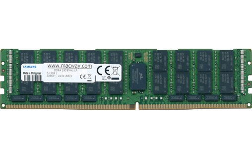
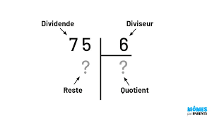
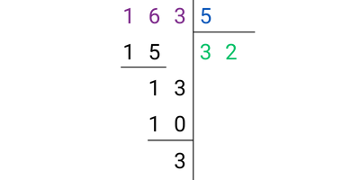

# Les variables et le type entier

!!! question "Prédire la dernière ligne"
    Pour chaque programme, écris la valeur de la dernière ligne comme Python l'écrirait (`'abc'`, `True`, `2.0`), puis valide. Quand le champ est marqué « affiche », écris ce que le programme affiche. Si le programme s'arrête sur une erreur, écris `erreur`. Les valeurs changent à chaque essai.

<script type="text/x-silent-teacher" data-titre="Variables et entiers">
a = {{a:1..5}}
a + {{b:1..5}}
---
a = {{a:1..5}}
a = {{b:6..9}}
a
---
a = {{a:2..5}}
a = a + {{b:1..3}}
a
---
x = {{x:2..5}}
y = x + {{d:1..3}}
x = {{z:6..9}}
y
---
a = {{a:1..4}}
b = {{b:5..9}}
a = b
b = a
b
---
a = {{a:1..4}}
b = {{b:5..9}}
t = a
a = b
b = t
a - b
---
{{a:13..29}} // {{b:3..6}}
---
{{a:13..29}} % {{b:3..6}}
---
n = {{a:13..29}}
q = n // {{b:3..6}}
r = n % {{b}}
q * {{b}} + r
---
{{a:2..3}} ** {{b:2..4}}
---
{{a:2..4}} + {{b:2..4}} * {{c:2..4}}
---
a = {{a:1..5}}
a += {{b:2..4}}
a += {{c:2..4}}
a
</script>
<script src="/javascripts/silent_teacher.js" defer></script>

!!! note "Rappel d'ouverture (5 minutes, cours fermé)"
    Réponds **sans rouvrir** les chapitres sur la représentation de l'information et l'architecture, en écrivant tes réponses. Se tester est ce qui fixe les acquis, relire ne le fait pas.

    1. Combien de valeurs différentes peut-on coder sur un octet ? Quelle est la plus grande, en écriture binaire ?
    2. Dans le Little Man Computer, à quoi servent les instructions `STA` et `LDA` ?
    3. Convertis `1011` (binaire) en décimal.

    ??? success "Corrigé"
        1. **256** valeurs, de `0` à `255`. La plus grande s'écrit `11111111` : huit bits, donc $2^8$ combinaisons.
        2. `STA` (*store*) **range** une valeur à une adresse mémoire. `LDA` (*load*) **lit** la valeur qui s'y trouve. Ce sont les deux seules opérations de la mémoire : écrire et lire.
        3. `1011` vaut $8 + 0 + 2 + 1 = 11$.

    Ces trois questions ne sont pas là par hasard : cette page montre que ce que Python appelle une **variable** est exactement la case mémoire du Little Man Computer, avec un nom à la place d'une adresse.

## Se souvenir d'une information

!!! fondamental "Le plus important"
    **Une variable est le seul moyen de se souvenir d'une information entre les instructions d'un programme.**

    - Toute information qui n'est pas stockée dans une variable est **perdue**.
    - Toute nouvelle information stockée dans une variable **efface** la précédente.
    - Les variables sont stockées sous forme binaire dans la mémoire de l'ordinateur : la **RAM**.



!!! question "Exercice"
    ```python
    a = 4
    a + 3
    ```
    Que vaut `a` après ces deux lignes ? Et où est passé le résultat de `a + 3` ?

    ??? warning "Réponse"
        `a` vaut toujours `4`. La deuxième ligne calcule bien `7`, mais **aucune variable ne le reçoit** : la valeur est produite puis immédiatement perdue, et plus rien dans le programme ne permet de la retrouver.

!!! question "Exercice"
    ```python
    cote = 6
    cote * cote
    ```
    Ce programme devait calculer l'aire d'un carré pour pouvoir s'en servir plus loin. Il ne le fait pas. Qu'est-ce qui manque ?

    ??? warning "Réponse"
        Il manque une **affectation** pour conserver le résultat :

        ```python
        cote = 6
        aire = cote * cote
        ```

        `aire` vaut alors `36`, et la suite du programme peut l'utiliser. Sans cette ligne, le `36` est calculé puis jeté.

!!! question "Exercice"
    ```python
    mesure = 7
    mesure = 9
    ```
    Après ces deux lignes, on voudrait pouvoir se servir **à la fois** de `7` et de `9`. Est-ce possible en l'état ? Si non, que faut-il changer ?

    ??? warning "Réponse"
        Ce n'est pas possible : `mesure` ne contient qu'une valeur à la fois, et c'est `9`. Le `7` a été effacé par la deuxième ligne.

        Pour garder les deux, il faut **deux cases**, donc deux variables :

        ```python
        mesure1 = 7
        mesure2 = 9
        ```

!!! question "Exercice"
    ```python
    jour = 12
    mois = 3
    jour = mois
    ```
    Combien de cases mémoire sont utilisées, et que vaut chacune à la fin ? Quelle valeur n'existe plus nulle part dans le programme ?

    ??? warning "Réponse"
        Deux cases. `jour` vaut `3` et `mois` vaut `3`.

        La valeur `12` n'existe plus : la troisième ligne a écrit `3` par-dessus. Noter que les deux cases contiennent maintenant la même valeur, mais elles restent **deux cases distinctes** : changer `mois` ensuite ne changerait pas `jour`.

!!! question "Exercice"
    ```python
    n = 200
    ```
    Sur combien de bits au minimum la valeur de `n` tient-elle dans la mémoire ? Justifie.

    ??? warning "Réponse"
        **8 bits**, soit un octet.

        Sur 7 bits, on code $2^7$ = 128 valeurs, de `0` à `127`, et `200` dépasse. Sur 8 bits, on code $2^8$ = 256 valeurs, de `0` à `255`, ce qui suffit.

!!! question "Exercice"
    Un programme range une valeur dans une variable, puis l'ordinateur est éteint. Que devient cette valeur ? Dans quel composant était-elle pendant l'exécution ?

    ??? warning "Réponse"
        Elle est **perdue**. Les variables vivent dans la **RAM**, qui est une mémoire **volatile** : son contenu disparaît à l'extinction.

        Pour conserver une information après l'extinction, il faut l'écrire ailleurs, sur un disque par exemple. Une variable ne sert à se souvenir que **pendant** l'exécution du programme.

## Une variable est une case mémoire nommée

Souviens-toi du modèle de von Neumann et du [Little Man Computer](../von_neumann/langage-machine.md) : la mémoire est une suite de **cases**, chacune repérée par une **adresse**, et le processeur y **range** ou y **lit** des valeurs.

Une **variable**, c'est exactement cela : une **case mémoire à laquelle on a donné un nom**. Plutôt que de retenir « la case d'adresse 17 », on écrit `age`, et l'ordinateur sait de quelle case on parle.

!!! question "Exercice"
    ```python
    a = 5
    b = a
    ```
    Pour chacune de ces deux lignes, dis si la machine **lit** une case, si elle **écrit** dans une case, ou les deux, et nomme la ou les cases concernées.

    ??? warning "Réponse"
        - `a = 5` : la machine **écrit** seulement. Elle range `5` dans la case `a`.
        - `b = a` : la machine **lit** la case `a` pour en obtenir `5`, puis **écrit** ce `5` dans la case `b`. Deux cases, deux opérations.

!!! question "Exercice"
    ```python
    x = 1
    y = 2
    x = 3
    z = x + y
    ```
    Combien de cases mémoire ce programme utilise-t-il ?

    ??? warning "Réponse"
        **Trois** : `x`, `y` et `z`. La ligne `x = 3` ne crée pas une quatrième case, elle écrit dans celle de `x`, qui existe déjà, et sa valeur `1` est effacée. À la fin, `x` vaut `3`, `y` vaut `2` et `z` vaut `5`.

## Écrire dans une variable : l'affectation

Pour ranger une valeur dans une variable, on utilise l'opérateur `=`, appelé **affectation**.

```python
a = 4
```

!!! danger "`=` n'est pas l'égalité"
    `=` **ne signifie pas « est égal à »**. C'est une **opération mécanique** : « calcule ce qui est à droite, et range le résultat dans la variable de gauche ».

    Si la variable n'existe pas encore, elle est créée. Sinon, son contenu est remplacé.

!!! abstract "Ce que fait vraiment la machine"
    Cette opération correspond très exactement à une instruction du processeur. Dans le [Little Man Computer](../von_neumann/langage-machine.md), affecter une valeur, c'est l'instruction **`STA`** (*store*) : « écris cette valeur à telle adresse mémoire ». Ainsi `a = 4` revient à **ranger `4` dans la case étiquetée `a`**.

!!! question "Exercice"
    ```python
    truc = 4
    truc = 3
    ```
    Que vaut `truc` à la fin ? Pourquoi ?

    ??? warning "Réponse"
        `3`. La deuxième affectation a **remplacé** le contenu de la case : `4` est perdu.

!!! question "Exercice"
    ```python
    score = 12
    score = 20
    score = 15
    ```
    Que vaut `score` à la fin ? Combien de valeurs différentes cette case a-t-elle contenues au cours du programme, et combien en contient-elle à la fin ?

    ??? warning "Réponse"
        `score` vaut `15`. La case a contenu **trois** valeurs successives, mais elle n'en contient **qu'une seule à la fois** : `12` puis `20` ont été effacés. Rien dans le programme ne permet de les retrouver.

## Lire une variable

On utilise le contenu d'une variable simplement en écrivant son **nom** dans une expression.

!!! abstract "Ce que fait vraiment la machine"
    Lire une variable correspond à l'instruction **`LDA`** (*load*) du Little Man Computer : « va chercher la valeur à telle adresse ». On en obtient une **copie** : **lire une variable ne la vide pas**, on peut la relire autant qu'on veut.

```python
bidule = truc + 5    # on lit truc, on calcule, on range le résultat dans bidule
```

!!! question "Exercice"
    ```python
    n = 5
    m = n + n
    n = n + m
    ```
    Que valent `n` et `m` à la fin ?

    ??? tip "Indice"
        Dans `n + n`, on lit `n` deux fois. Combien vaut-il à la deuxième lecture ?

    ??? warning "Réponse"
        `m` vaut `10` et `n` vaut `15`.

        À la deuxième ligne, on lit `n` deux fois de suite, et il vaut `5` les deux fois : la première lecture ne l'a pas vidé. On range donc `10` dans `m`. À la troisième ligne, on lit `n` (`5`) et `m` (`10`), on calcule `15`, et on le range dans `n`, dont l'ancienne valeur est effacée.

!!! question "Exercice"
    ```python
    k = 3
    a = k + k
    b = k * k
    c = k
    ```
    Que valent `a`, `b`, `c` et `k` à la fin ?

    ??? warning "Réponse"
        `a` vaut `6`, `b` vaut `9`, `c` vaut `3`, et `k` vaut **toujours** `3`.

        `k` a été lu **cinq fois** et n'a jamais changé. Seule une affectation vers `k` pourrait le modifier, et il n'y en a aucune après la première ligne.

## Afficher : sortir de la machine

Une variable sert à se souvenir **à l'intérieur** de la machine. Pour qu'une information en **sorte**, il faut une instruction de plus : `print`.

Appelée sans rien d'autre que la valeur à écrire, elle l'envoie sur la **sortie standard**, c'est-à-dire le terminal, donc l'écran. C'est son comportement par défaut, et on peut lui demander autre chose, mais ce ne sera pas utile ici.

```python
truc = 2
print(truc)
```

!!! abstract "Ce que fait vraiment la machine"
    C'est l'instruction **`OUT`** (*output*) du [Little Man Computer](../von_neumann/langage-machine.md) : « envoie la valeur de l'accumulateur sur la sortie ». `print(truc)` enchaîne donc les deux instructions que tu connais déjà : **`LDA`** pour lire la case `truc`, puis **`OUT`** pour envoyer la valeur dehors.

    C'est par là que la machine communique avec ses **périphériques**. `OUT` parle à l'écran, comme `INP` écoutait le clavier.

!!! question "Exercice"
    ```python
    n = 42
    print(n)
    ```
    Quelles instructions du Little Man Computer la deuxième ligne demande-t-elle ? Combien d'opérations la machine fait-elle ?

    ??? warning "Réponse"
        Deux : **`LDA n`** puis **`OUT`**.

        `print` ne va pas chercher la valeur directement sur la sortie. Il faut d'abord **lire** la case, ce qui en donne une copie, puis **envoyer** cette copie dehors. La case `n` n'est pas modifiée, et elle vaut toujours `42`.

!!! question "Exercice"
    ```python
    a = 3
    b = 5
    print(a + b)
    ```
    Qu'affiche ce programme ? Que valent `a` et `b` à la fin ? Une variable contient-elle `8` ?

    ??? warning "Réponse"
        Il affiche `8`. `a` vaut `3` et `b` vaut `5`, inchangés : ils ont seulement été lus.

        Et **aucune variable ne contient `8`**. La valeur a été calculée, envoyée sur la sortie, puis perdue, comme toute valeur qu'aucune affectation ne range. Afficher une information n'est pas la mémoriser : ce sont deux opérations différentes, `OUT` et `STA`.

!!! question "Exercice"
    ```python
    truc = 2
    print(truc)
    bidule = truc + 5
    print(bidule + truc)
    print(truc)
    ```
    Qu'affichent les trois `print`, dans l'ordre ?

    ??? warning "Réponse"
        `2`, puis `9`, puis `2`.

        Le deuxième lit `bidule` (`7`) et `truc` (`2`), et affiche leur somme sans la ranger nulle part. Le troisième montre que `truc` vaut **toujours** `2` : il a été lu trois fois et n'a jamais changé.

## Le membre de droite est calculé, *puis* rangé

Parce que `=` n'est pas l'égalité, une ligne comme celle-ci a un sens parfaitement clair :

```python
a = a + 1
```

En tant qu'égalité mathématique, ce serait absurde. En tant qu'affectation, c'est mécanique : **on calcule d'abord la droite** (`a + 1`, avec la valeur actuelle de `a`), **puis on range** le résultat dans `a`. Si `a` valait 4, il vaut maintenant 5.

!!! question "Exercice"
    ```python
    c = 0
    c = c + 3
    c = c * 2
    c = c - 1
    ```
    Que vaut `c` après chaque ligne ?

    ??? warning "Réponse"
        `0`, puis `3`, puis `6`, puis `5`.

        Chaque ligne lit la valeur actuelle de `c`, calcule, et range le résultat dans `c` par-dessus l'ancienne valeur.

!!! question "Exercice"
    ```python
    u = 2
    w = 5
    u = u + w
    w = w + u
    ```
    Que valent `u` et `w` à la fin ?

    ??? tip "Indice"
        À la quatrième ligne, `u` ne vaut plus `2`.

    ??? warning "Réponse"
        `u` vaut `7` et `w` vaut `12`.

        La troisième ligne range `2 + 5` dans `u`, qui vaut donc `7`. La quatrième lit `w` (`5`) et `u` (`7`, sa **nouvelle** valeur), ce qui donne `12`.

!!! abstract "Dérouler un programme pas à pas"
    Suivons l'état des cases mémoire, instruction après instruction :

    ```python
    x = 10
    y = x + 2
    x = 0
    print(x, y)
    ```

    | Instruction | `x` | `y` |
    | --- | :--: | :--: |
    | `x = 10` | 10 | |
    | `y = x + 2` | 10 | 12 |
    | `x = 0` | 0 | 12 |

    L'affichage est donc `0 12`. Remarque que `y` **garde 12** : sa valeur a été calculée au moment du `y = x + 2`, et changer `x` ensuite n'y touche pas.

!!! question "Exercice"
    À ton tour de dérouler. Recopie le tableau et remplis-le ligne par ligne, puis donne l'affichage.

    ```python
    p = 2
    q = p + 3
    p = q
    q = p - 1
    print(p, q)
    ```

    | Instruction | `p` | `q` |
    | --- | :--: | :--: |
    | `p = 2` | | |
    | `q = p + 3` | | |
    | `p = q` | | |
    | `q = p - 1` | | |

    ??? warning "Réponse"
        | Instruction | `p` | `q` |
        | --- | :--: | :--: |
        | `p = 2` | 2 | |
        | `q = p + 3` | 2 | 5 |
        | `p = q` | 5 | 5 |
        | `q = p - 1` | 5 | 4 |

        L'affichage est `5 4`. À la troisième ligne, `p` et `q` valent tous les deux `5` : `p = q` a **recopié** la valeur de `q`, il n'a pas lié les deux variables. C'est pourquoi changer `q` juste après ne touche pas `p`.

!!! question "Exercice"
    Même travail avec trois cases.

    ```python
    r = 1
    s = r + 1
    t = r + s
    r = t
    print(r, s, t)
    ```

    | Instruction | `r` | `s` | `t` |
    | --- | :--: | :--: | :--: |
    | `r = 1` | | | |
    | `s = r + 1` | | | |
    | `t = r + s` | | | |
    | `r = t` | | | |

    ??? warning "Réponse"
        | Instruction | `r` | `s` | `t` |
        | --- | :--: | :--: | :--: |
        | `r = 1` | 1 | | |
        | `s = r + 1` | 1 | 2 | |
        | `t = r + s` | 1 | 2 | 3 |
        | `r = t` | 3 | 2 | 3 |

        L'affichage est `3 2 3`. La dernière ligne change `r`, mais `t` avait été calculé avant : il garde `3`.

!!! tip "Trace toi-même avec Python Tutor"
    Ne te contente pas de lire les traces : **produis-les**. Copie un programme dans [Python Tutor](https://pythontutor.com/), avance pas à pas et observe, à chaque instruction, ce que contiennent les cases mémoire. C'est le meilleur moyen de construire une image juste de ce que fait la machine, et c'est un réflexe à garder pour tout le cours.

## Échanger le contenu de deux variables

Tu as déjà traité ce problème en langage machine, sur les cases n°10 et n°11. Rien ne change ici, sauf que les cases ont un nom au lieu d'un numéro.

!!! question "Exercice"
    ```python
    a = 4
    b = 7
    ```
    Écris la suite du programme pour que `a` vaille `7` et `b` vaille `4`.

    ??? tip "Indice"
        Écris la solution qui vient spontanément, `a = b` puis `b = a`, et déroule-la ligne par ligne. Quelle valeur n'existe déjà plus après la première ligne ?

    ??? warning "Réponse"
        La solution spontanée **échoue** :

        ```python
        a = b   # a devient 7, et le 4 est perdu
        b = a   # b devient 7 aussi. Raté.
        ```

        En rangeant `b` dans `a`, on a écrasé le `4`, et plus rien ne permet de le retrouver. Il faut le **mettre de côté** avant :

        ```python
        temp = a    # on sauvegarde 4
        a = b       # a devient 7
        b = temp    # b récupère 4
        ```

        C'est exactement la case de passage du langage machine.

!!! abstract "La variable de passage"
    Trois affectations, et une variable de plus : c'est le prix d'un échange, et il n'y a pas moins cher. La raison est la même que dans la machine : une case ne contient qu'une valeur à la fois, donc celle qu'on va écraser doit être copiée ailleurs avant de l'être.

!!! question "Exercice"
    Trois variables valent `a = 1`, `b = 2`, `c = 3`. On veut les faire **tourner** : à la fin, `a` doit valoir `3`, `b` doit valoir `1` et `c` doit valoir `2`. Chaque variable reçoit la valeur de la précédente.

    Écris les instructions, sans utiliser le raccourci de Python.

    ??? tip "Indice"
        Une seule valeur est menacée dès la première affectation que tu écris : celle de la variable que tu écrases en premier. Mets-la de côté avant.

    ??? warning "Réponse"
        ```python
        t = c    # on sauvegarde 3, la valeur qu'on va écraser
        c = b    # c devient 2
        b = a    # b devient 1
        a = t    # a récupère 3
        ```

        L'ordre compte : chaque ligne écrase une valeur, donc on part de celle qu'on a sauvegardée et on remonte. Si tu avais commencé par `a = t` avant d'avoir servi `b`, tu aurais perdu le `1`.

!!! question "Exercice"
    ```python
    a = 1
    b = 2
    c = 3

    t = a
    a = b
    b = c
    c = t
    ```
    Que valent `a`, `b` et `c` à la fin ? Que fait ce programme, comparé à celui de l'exercice précédent ?

    ??? warning "Réponse"
        `a` vaut `2`, `b` vaut `3`, `c` vaut `1`.

        Il fait tourner les trois valeurs dans l'**autre sens** : chaque variable reçoit la valeur de la suivante, et non de la précédente. La méthode est la même, seule la valeur mise de côté change : ici c'est celle de `a`, puisque c'est `a` qu'on écrase en premier.

## Le type d'une variable

Toute variable a un **type**, qui indique le genre d'information qu'elle contient :

| Type | Exemple | Signification |
| --- | --- | --- |
| `int` | `age = 16` | un entier relatif, de l'anglais *integer* |
| `float` | `taille = 1.75` | un nombre à virgule |
| `str` | `nom = "Alice"` | une [chaîne de caractères](caracteres.md) |
| `bool` | `majeur = True` | un booléen |

Python **devine** le type d'après la valeur rangée, et cela s'appelle l'**inférence de type**. On peut aussi l'écrire explicitement :

```python
age: int = 16
```

Rien n'y oblige, mais quand un programme s'allonge on finit par ne plus savoir ce que contient quoi. Prends l'habitude de noter le type à la création d'une variable.

Et pour savoir ce qu'une variable contient réellement, `type` le dit :

```python
age = 16
print(type(age))   # affiche <class 'int'>
```

!!! question "Exercice"
    Donne le type de chacune de ces quatre variables.

    ```python
    a = 7
    b = 7.0
    c = "7"
    d = True
    ```

    ??? warning "Réponse"
        `a` est un `int`, `b` un `float`, `c` un `str`, `d` un `bool`.

        `7`, `7.0` et `"7"` sont trois valeurs de **types différents**, alors qu'on y lit le même chiffre. Les guillemets de `c` en font une chaîne de caractères, c'est-à-dire du texte, et non un nombre : on ne peut pas calculer avec. La fin de cette page traite les entiers, et la [page suivante](caracteres.md) les chaînes de caractères.

!!! question "Exercice"
    Même question sur quatre autres variables.

    ```python
    a = 0
    b = "16"
    c = False
    d = 3.0
    ```

    ??? warning "Réponse"
        `a` est un `int`, `b` un `str`, `c` un `bool`, `d` un `float`.

        Deux remarques. `3.0` est un `float` bien qu'il n'ait aucune décimale après la virgule : c'est la **présence du point** qui le décide, pas la valeur. Et `"16"` est du texte, pas le nombre seize, à cause de ses guillemets.

## Calculer avec des entiers

Le type `int` vient avec ses opérateurs. Les voici tous, et il n'y en a pas d'autres au programme de cette année.

| Opération | Symbole | Exemple |
| --- | :--: | --- |
| addition | `+` | `17 + 5` donne `22` |
| soustraction | `-` | `17 - 5` donne `12` |
| multiplication | `*` | `17 * 5` donne `85` |
| quotient entier | `//` | `17 // 5` donne `3` |
| reste | `%` | `17 % 5` donne `2` |
| puissance | `**` | `17 ** 2` donne `289` |
| division | `/` | `17 / 5` donne `3.4` |

Les priorités sont celles des mathématiques : la puissance d'abord, puis la multiplication et les divisions, puis l'addition et la soustraction. Les parenthèses passent avant tout.

!!! danger "`/` ne rend jamais un entier"
    C'est le seul opérateur de cette table qui **change de type** : `10 / 2` donne `5.0`, un `float`, et non `5`. Même quand la division est exacte, même quand le résultat est un nombre rond.

    Pour obtenir un entier, c'est `//` qu'il faut écrire : `10 // 2` donne `5`.

!!! question "Exercice"
    ```python
    a = 17
    b = 5
    ```
    Que valent `a + b`, `a * b`, `a // b`, `a % b` et `a ** 2` ?

    ??? warning "Réponse"
        `22`, `85`, `3`, `2` et `289`.

!!! question "Exercice"
    Que valent ces quatre expressions ?

    ```python
    2 + 3 * 4
    (2 + 3) * 4
    10 - 2 * 3
    2 ** 3 * 2
    ```

    ??? warning "Réponse"
        `14`, `20`, `4` et `16`.

        Dans la première, la multiplication passe avant l'addition. Dans la deuxième, les parenthèses renversent l'ordre. Dans la quatrième, la puissance se calcule d'abord, ce qui donne `8 * 2`.

!!! question "Exercice"
    ```python
    x = 10 / 2
    y = 10 // 2
    ```
    Que valent `x` et `y` ? De quel type est chacune des deux variables ?

    ??? warning "Réponse"
        `x` vaut `5.0` et c'est un `float`. `y` vaut `5` et c'est un `int`.

        Les deux valeurs se lisent « cinq », mais elles ne sont pas du même type et Python ne les écrit pas pareil.

!!! question "Exercice"
    ```python
    a = 7 / 7
    b = 6 / 3
    c = 9 // 2
    ```
    Que vaut chaque variable, et de quel type est-elle ?

    ??? warning "Réponse"
        `a` vaut `1.0`, `b` vaut `2.0`, tous deux des `float` : `/` rend un `float` **même quand la division tombe juste**. `c` vaut `4`, un `int` : `9 // 2` donne le quotient entier, la moitié de `9` étant `4` et des restes.

## Écrire plus court : `+=`

Ajouter quelque chose à une variable est si fréquent que Python offre une écriture abrégée pour le faire.

```python
a = a + 3    # l'écriture longue
a += 3       # exactement la même chose
```

On appelle cela une **affectation combinée**. Il en existe pour les autres opérateurs, `-=`, `*=` et les suivantes, mais `+=` est de loin la plus utilisée, parce qu'ajouter à un total ou à un compteur est ce qu'on fait le plus souvent.

!!! abstract "Ce que fait vraiment la machine"
    Rien de nouveau : `a += 3` **lit** `a`, calcule, et **range** le résultat dans `a`. C'est le `LDA`, le calcul, puis le `STA` que tu connais déjà. Seule l'écriture raccourcit, pas le travail de la machine.

    Conséquence à retenir : la variable doit **exister avant**. `a += 3` commence par lire `a`, donc si `a` n'a jamais reçu de valeur, le programme s'arrête sur une erreur.

!!! question "Exercice"
    ```python
    a = 5
    a += 3
    a += 3
    a += 10
    ```
    Que vaut `a` après chaque ligne ?

    ??? warning "Réponse"
        `5`, puis `8`, puis `11`, puis `21`.

        Chaque ligne repart de la valeur courante de `a` et lui ajoute quelque chose. C'est ainsi qu'on accumule dans une variable.

!!! question "Exercice"
    ```python
    c = 10
    c += 7
    ```
    Réécris la deuxième ligne en écriture longue, et donne la valeur de `c`. Que se passerait-il si la première ligne n'existait pas ?

    ??? warning "Réponse"
        `c += 7` s'écrit `c = c + 7`, et `c` vaut `17`.

        Sans la première ligne, le programme s'arrête sur une **erreur** : `c += 7` commence par lire `c`, et il n'y a rien à lire dans une case qui n'a jamais été créée.

## La division euclidienne

`//` et `%` sont les deux moitiés d'une même opération, celle que tu as apprise à l'école primaire.

Le vocabulaire, d'abord. On divise le **dividende** par le **diviseur**, ce qui donne un **quotient** et un **reste**.



Voici la division de `163` par `5`, posée en entier.



Le **quotient** est `32`, et on l'obtient par `163 // 5`. Le **reste** est `3`, et on l'obtient par `163 % 5`.

!!! fondamental "Les deux propriétés à retenir"
    Pour une division de `n` par `d` :

    - `d * (n // d) + (n % d)` redonne toujours `n` ;
    - le **reste est toujours plus petit que le diviseur**. Un reste de `5` ou plus dans une division par `5` voudrait dire qu'il reste de quoi faire un paquet de plus, donc que le quotient était faux.

!!! tip "Ce que cela veut dire"
    J'ai 163 chocolats et je veux les ranger dans des boîtes de 5. Je remplis 32 boîtes, et il me reste 3 chocolats.

    $163 = 5 \times 32 + 3$

!!! question "Exercice"
    On veut ranger 47 bonbons dans des sachets de 6.

    Combien de sachets pleins, et combien de bonbons en trop ? Écris les deux calculs Python qui donnent ces deux nombres, puis vérifie ton résultat avec la première propriété.

    ??? warning "Réponse"
        `47 // 6` donne `7` sachets pleins, et `47 % 6` donne `5` bonbons en trop.

        Vérification : `6 * 7 + 5` redonne bien `47`. Et `5` est plus petit que `6`, donc on ne peut pas faire un sachet de plus.

!!! question "Exercice"
    ```python
    n = 100
    d = 7
    q = n // d
    r = n % d
    ```
    Que valent `q` et `r` ? Que vaut `d * q + r` ?

    ??? warning "Réponse"
        `q` vaut `14` et `r` vaut `2`. `d * q + r` vaut `7 * 14 + 2`, donc `100`, c'est-à-dire `n`.

!!! question "Exercice"
    Peut-on écrire un programme où `n % 5` vaut `7` ? Quelles valeurs cette expression peut-elle prendre ?

    ??? warning "Réponse"
        Non, c'est impossible pour un `n` positif. Le reste d'une division par `5` est toujours plus petit que `5`, donc l'expression ne peut valoir que `0`, `1`, `2`, `3` ou `4`.

!!! question "Exercice"
    Que valent `14 % 2` et `15 % 2` ? Et plus généralement, que t'apprend `n % 2` sur `n` ?

    ??? warning "Réponse"
        `14 % 2` vaut `0` et `15 % 2` vaut `1`.

        `n % 2` vaut `0` quand `n` est pair et `1` quand il est impair, puisque ce sont les deux seuls restes possibles d'une division par `2`. C'est la façon habituelle de tester la parité en programmation.

## Comment un entier est écrit en mémoire

Comme toute information, un entier est stocké sous forme d'une suite de **bits** groupés en octets. Deux fonctions donnent cette écriture.

```python
print(bin(157))   # affiche 0b10011101
print(hex(157))   # affiche 0x9d
```

`bin` donne l'écriture **binaire**, `hex` l'écriture **hexadécimale**. Les préfixes `0b` et `0x` ne font pas partie du nombre : ils sont là pour dire dans quelle base lire ce qui suit, puisque `10011101` tout seul serait ambigu.

!!! question "Exercice"
    ```python
    n = 200
    print(bin(n))
    ```
    Qu'affiche ce programme ? Combien de bits occupe cette écriture, et tient-elle sur un octet ?

    ??? warning "Réponse"
        Il affiche `0b11001000`.

        Huit bits après le préfixe, donc exactement un octet. C'est cohérent avec ce qu'on a vu plus haut : `200` dépasse `127`, donc 7 bits ne suffisent pas, et il reste sous `255`, donc 8 bits suffisent.

!!! question "Exercice"
    ```python
    n = 157
    print(hex(n))
    ```
    Qu'affiche ce programme ? Retrouve ce résultat à la main depuis l'écriture binaire `10011101`.

    ??? warning "Réponse"
        Il affiche `0x9d`.

        On groupe les bits par quatre en partant de la droite : `1001` et `1101`. Le premier groupe vaut $8 + 1$, soit `9`, et le second $8 + 4 + 1$, soit `13`, qui s'écrit `d` en hexadécimal. D'où `9d`.
