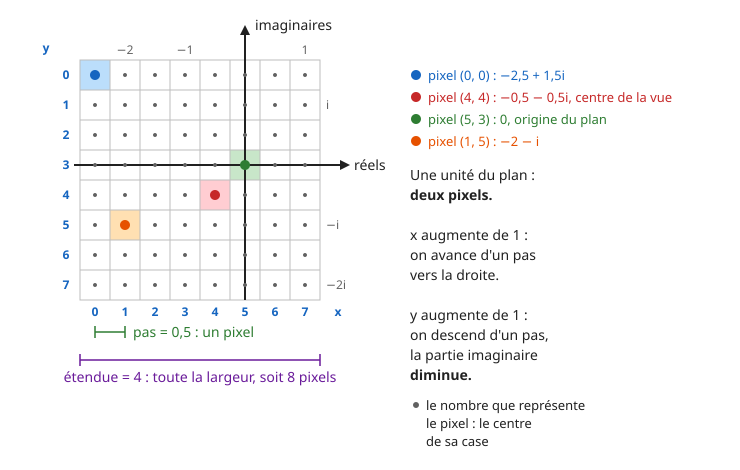

# Fractales : Mandelbrot et Julia

Une seule suite, $z_{n+1} = z_n^2 + c$, où $z_n$ et $c$ sont des nombres complexes, suffit à dessiner les deux images de cette page. Selon la valeur de $c$, la suite reste bornée ou part à l'infini, et on colorie chaque point du plan selon ce qu'elle fait.

Il faut savoir ce qu'est la **limite d'une suite** et connaître les **nombres complexes** : écriture $a + ib$, module $|z|$, calcul de $z^2$.

## Mise en place

Crée un fichier `fractales.py` dans un répertoire du projet. Tu y écriras toutes les fonctions de cette page, dans l'ordre.

```python
type Grille = list[list[int]]


if __name__ == "__main__":
    pass
```

Tout ce qui n'est pas une fonction se place dans le bloc `if __name__ == "__main__":`. Garde ce bloc à la fin du fichier.

Python connaît les nombres complexes. Le nombre $i$ s'écrit `1j`, et $3 + 4i$ s'écrit `3 + 4j`. Si `z` est un complexe, `z.real` est sa partie réelle, `z.imag` sa partie imaginaire, et `abs(z)` son **module**. `complex(a, b)` construit le complexe $a + ib$ à partir de deux réels.

!!! question "Les complexes en Python"
    Sur ton cahier, écris ce que vaut chaque expression :

    - `abs(3 + 4j)`
    - `1j * 1j`
    - `(1 + 1j) ** 2`
    - `complex(2, -1).imag`

    Puis vérifie dans la console Python.

    ??? success "Réponse"
        - `5.0` : $\sqrt{3^2 + 4^2} = 5$. Le module est toujours un `float`.
        - `(-1+0j)` : $i^2 = -1$.
        - `2j` : $(1 + i)^2 = 1 + 2i + i^2 = 2i$.
        - `-1.0`

## Partie 1 - L'ensemble de Mandelbrot

### Étape 1 - La suite

Pour un nombre complexe $c$ fixé, on définit la suite :

$$
z_0 = 0 \qquad z_{n+1} = z_n^2 + c
$$

!!! question "Calculer des termes"
    Sur ton cahier, calcule $z_0$ à $z_4$ pour chacune des valeurs $c = 0$, $c = -1$, $c = 1$, $c = i$ et $c = -2$. Pour chacune, réponds ensuite :

    - la suite $(|z_n|)$ est-elle bornée ?
    - la suite $(z_n)$ a-t-elle une limite ? Laquelle ?

    ??? success "Réponse"
        | $c$ | $z_0$ à $z_4$ | bornée ? | limite ? |
        |---|---|---|---|
        | $0$ | $0, 0, 0, 0, 0$ | oui | $0$ |
        | $-1$ | $0, -1, 0, -1, 0$ | oui | aucune : elle alterne entre $0$ et $-1$ |
        | $1$ | $0, 1, 2, 5, 26$ | non | $+\infty$ |
        | $i$ | $0, i, -1 + i, -i, -1 + i$ | oui | aucune : à partir de $z_2$, elle alterne entre $-1 + i$ et $-i$ |
        | $-2$ | $0, -2, 2, 2, 2$ | oui | $2$ |

!!! warning "Piège : bornée n'est pas convergente"
    Pour $c = -1$ et $c = i$, la suite n'a pas de limite, et pourtant elle ne part pas à l'infini : elle est **bornée**. C'est cette propriété, et pas la convergence, qui définit l'ensemble de Mandelbrot.

!!! question "Écrire `terme` (entraînement)"
    ```python
    def terme(c: complex, n: int) -> complex:
        """Renvoie z_n, pour la suite z_0 = 0 et z_{k+1} = z_k ** 2 + c."""
        pass


    def test_terme():
        assert terme(1, 0) == 0
        assert terme(1, 3) == 5
        assert terme(-1, 4) == 0
        assert terme(1j, 3) == ...
    ```

    ??? success "Solution"
        ```python
        def terme(c: complex, n: int) -> complex:
            """Renvoie z_n, pour la suite z_0 = 0 et z_{k+1} = z_k ** 2 + c."""
            z = 0j
            for k in range(0, n):
                z = z * z + c
            return z


        def test_terme():
            assert terme(1, 0) == 0
            assert terme(1, 3) == 5
            assert terme(-1, 4) == 0
            assert terme(1j, 3) == -1j
        ```

### Étape 2 - Bornée ou pas : le critère du module 2

L'**ensemble de Mandelbrot** $\mathcal{M}$ est l'ensemble des nombres complexes $c$ pour lesquels la suite $(|z_n|)$ est **bornée**.

Un programme ne peut pas calculer une infinité de termes. On s'appuie sur une propriété, admise ici et démontrée dans le bonus 1 :

!!! info "Propriété (admise)"
    Si un terme de la suite vérifie $|z_n| > 2$, alors $|z_n| \to +\infty$ : la suite n'est pas bornée, et $c$ n'est pas dans $\mathcal{M}$.

On calcule donc les termes un par un, et on s'arrête dès que le module dépasse 2. Comme il faut bien s'arrêter, on se fixe un nombre maximal de termes, `n_max`.

!!! question "Calculer à la main"
    On appelle $n$ le **premier** indice tel que $|z_n| > 2$. Sur ton cahier, avec `n_max = 10` :

    1. Que vaut $n$ pour $c = 1$ ? Pour $c = 3$ ?
    2. Pour $c = -2$, existe-t-il un tel $n$ ?
    3. Pour $c = 0$, la fonction renverra `n_max`. Cela prouve-t-il que $0$ est dans $\mathcal{M}$ ? Et pour un $c$ quelconque ?

    ??? success "Réponse"
        1. Pour $c = 1$ : $|z_0| = 0$, $|z_1| = 1$, $|z_2| = 2$, $|z_3| = 5$. Donc $n = 3$. Pour $c = 3$ : $z_1 = 3$, donc $n = 1$.
        2. Non : les modules valent $0, 2, 2, 2\dots$, et $2$ n'est pas **strictement** supérieur à $2$. $-2$ est dans $\mathcal{M}$.
        3. Pour $c = 0$, oui, puisqu'on sait que la suite est nulle. Mais en général, non : la suite pourrait dépasser 2 au terme suivant. Renvoyer `n_max` veut seulement dire « pas encore sorti après `n_max` termes ».

!!! question "Écrire `iterations` (obligatoire)"
    ```python
    def iterations(c: complex, n_max: int) -> int:
        """Renvoie le plus petit n < n_max tel que |z_n| > 2, pour la suite
        z_0 = 0 et z_{k+1} = z_k ** 2 + c. Renvoie n_max s'il n'y en a pas."""
        pass


    def test_iterations():
        assert iterations(1, 10) == 3
        assert iterations(3, 10) == 1
        assert iterations(0, 10) == 10
        assert iterations(1j, 50) == 50
        assert iterations(-2, 10) == ...
    ```

    ??? tip "Indice léger"
        Une boucle `while` avec deux conditions : on continue tant qu'on n'a pas atteint `n_max` **et** que le module ne dépasse pas 2.

    ??? tip "Indice plus précis"
        Deux variables, `z` qui part de `0` et `n` qui part de `0`. À chaque tour : `z = z * z + c`, puis `n = n + 1`. La condition est `n < n_max and abs(z) <= 2`.

    ??? question "Avant d'ouvrir la solution"
        En une phrase, sur ton cahier : qu'est-ce que l'indice t'a appris sur ce qui n'allait pas dans **ton** code ?

    ??? success "Solution"
        ```python
        def iterations(c: complex, n_max: int) -> int:
            """Renvoie le plus petit n < n_max tel que |z_n| > 2, pour la suite
            z_0 = 0 et z_{k+1} = z_k ** 2 + c. Renvoie n_max s'il n'y en a pas."""
            z = 0j
            n = 0
            while n < n_max and abs(z) <= 2:
                z = z * z + c
                n = n + 1
            return n


        def test_iterations():
            assert iterations(1, 10) == 3
            assert iterations(3, 10) == 1
            assert iterations(0, 10) == 10
            assert iterations(1j, 50) == 50
            assert iterations(-2, 10) == 10
        ```

        Avec `abs(z) < 2` à la place de `abs(z) <= 2`, `iterations(-2, 10)` vaudrait `2` : la boucle s'arrêterait sur $|z_2| = 2$, et $-2$ serait exclu de $\mathcal{M}$ à tort. C'est le test qui attrape cette erreur.

### Étape 3 - Du pixel au nombre complexe

Pour dessiner, il faut savoir quel nombre complexe chaque pixel représente.

Dans une image, un pixel est repéré par ses coordonnées `(x, y)`. L'origine `(0, 0)` est le **coin supérieur gauche** : `x` augmente vers la droite, et `y` augmente **vers le bas**. Dans le plan complexe, un nombre $a + ib$ a sa partie réelle $a$ sur l'axe horizontal et sa partie imaginaire $b$ sur l'axe vertical, qui monte **vers le haut**.

Le dessin montre une image de 8 × 8 pixels posée sur le plan. Chaque pixel représente le nombre placé **au centre de sa case**. Le pixel `(0, 0)` représente $-2{,}5 + 1{,}5i$, et l'origine du plan n'est **pas** au milieu de l'image. Une unité du plan correspond à deux pixels, donc d'un pixel à son voisin, on avance de $0{,}5$.



!!! question "Lire le dessin"
    Sur ton cahier :

    1. Quel nombre représente le pixel `(1, 0)` ? Le pixel `(0, 1)` ? Le pixel `(6, 3)` ? Le pixel `(7, 7)` ?
    2. Quel pixel représente le nombre $1 + i$ ?
    3. Quand `x` augmente de 1, que devient la partie réelle ? Quand `y` augmente de 1, que devient la partie imaginaire ?
    4. Écris la partie réelle $a$ en fonction de `x`, puis la partie imaginaire $b$ en fonction de `y`.

    ??? success "Réponse"
        1. `(1, 0)` : $-2 + 1{,}5i$. `(0, 1)` : $-2{,}5 + i$. `(6, 3)` : $0{,}5$. `(7, 7)` : $1 - 2i$.
        2. Le pixel `(7, 1)`. La partie réelle $1$ est à $3{,}5$ unités de celle de la colonne `x = 0`, qui vaut $-2{,}5$, soit 7 pixels : `x = 7`. La partie imaginaire $1$ est à $0{,}5$ unité sous celle de la ligne `y = 0`, qui vaut $1{,}5$, soit 1 pixel : `y = 1`.
        3. La partie réelle augmente de $0{,}5$. La partie imaginaire **diminue** de $0{,}5$ : `y` descend, la partie imaginaire monte.
        4. $a = -2{,}5 + 0{,}5 \times x$ et $b = 1{,}5 - 0{,}5 \times y$.

Dans le cas général, $-2{,}5$ est la partie réelle de la colonne de gauche, notée **gauche**, $1{,}5$ la partie imaginaire de la ligne du haut, notée **haut**, et $0{,}5$ le **pas**, la distance entre deux pixels voisins. Les deux formules deviennent :

$$
a = \text{gauche} + x \times \text{pas} \qquad b = \text{haut} - y \times \text{pas}
$$

L'interface ne retient pas `gauche` et `haut`. Elle retient le **centre** de la vue et son **étendue**, la largeur de la vue dans le plan, parce que c'est ce qu'un zoom modifie : un clic déplace le centre au point cliqué et divise l'étendue par 2. On retrouve le reste à partir d'eux :

- `pas = etendue / largeur`, puisque l'étendue se partage entre les `largeur` pixels d'une ligne,
- `gauche = centre.real - etendue / 2`, puisque le pixel du centre, en colonne `largeur / 2`, est à `largeur / 2` pas de la colonne de gauche,
- `haut = centre.imag + hauteur * pas / 2`, puisque le pixel du centre, en ligne `hauteur / 2`, est à `hauteur / 2` pas de la ligne du haut.

!!! question "Le centre du dessin"
    1. Sur le dessin, quel est le centre de la vue ? Quelle est son étendue ?
    2. Retrouve `gauche` et `haut` avec les deux dernières formules de la liste.

    ??? success "Réponse"
        1. Le centre de la vue est le pixel `(4, 4)`, qui représente $-0{,}5 - 0{,}5i$. L'étendue vaut $4$, puisqu'une ligne compte 8 pixels et que le pas vaut $0{,}5$.
        2. `pas = 4 / 8 = 0.5`. `gauche = -0.5 - 4 / 2 = -2.5` et `haut = -0.5 + 8 × 0.5 / 2 = 1.5`. Ce sont bien les nombres du pixel `(0, 0)`, alors que l'origine du plan est ailleurs, au pixel `(5, 3)`.

!!! question "Après un zoom"
    Une image de 4 × 4 pixels est centrée sur $-1 + i$, avec une étendue de 2. Sur ton cahier :

    1. Calcule `pas`, `gauche` et `haut`.
    2. Quel nombre représente le pixel `(0, 0)` ? Le pixel `(2, 2)` ? Le pixel `(1, 3)` ?

    ??? success "Réponse"
        1. `pas = 2 / 4 = 0.5`, `gauche = -1 - 1 = -2`, `haut = 1 + 4 × 0.5 / 2 = 2`.
        2. `(0, 0)` : $-2 + 2i$. `(2, 2)` : $-2 + 2 \times 0{,}5 = -1$ et $2 - 2 \times 0{,}5 = 1$, donc $-1 + i$, le centre. `(1, 3)` : $-2 + 0{,}5 = -1{,}5$ et $2 - 3 \times 0{,}5 = 0{,}5$, donc $-1{,}5 + 0{,}5i$.

!!! warning "Piège : le signe moins"
    Dans $b = \text{haut} - y \times \text{pas}$, le signe est **moins** : `y` augmente vers le bas, et la partie imaginaire augmente vers le haut. Avec un plus, l'image est retournée de haut en bas.

!!! question "Écrire `vers_complexe` (obligatoire)"
    ```python
    def vers_complexe(x: int, y: int, largeur: int, hauteur: int,
                      centre: complex, etendue: float) -> complex:
        """Renvoie le nombre complexe représenté par le pixel (x, y), dans une
        image de largeur × hauteur pixels d'origine le coin supérieur gauche,
        centrée sur centre et dont la largeur représente etendue."""
        pass


    def test_vers_complexe():
        assert vers_complexe(4, 4, 8, 8, -0.5 - 0.5j, 4) == -0.5 - 0.5j
        assert vers_complexe(0, 0, 8, 8, -0.5 - 0.5j, 4) == -2.5 + 1.5j
        assert vers_complexe(5, 3, 8, 8, -0.5 - 0.5j, 4) == 0
        assert vers_complexe(1, 5, 8, 8, -0.5 - 0.5j, 4) == ...
        assert vers_complexe(1, 3, 4, 4, -1 + 1j, 2) == -1.5 + 0.5j
    ```

    ??? tip "Indice"
        Calcule d'abord `pas`, `gauche` et `haut` avec les trois formules de la liste, puis `a` et `b`. `complex(a, b)` construit le résultat.

    ??? question "Avant d'ouvrir la solution"
        En une phrase, sur ton cahier : qu'est-ce que l'indice t'a appris sur ce qui n'allait pas dans **ton** code ?

    ??? success "Solution"
        ```python
        def vers_complexe(x: int, y: int, largeur: int, hauteur: int,
                          centre: complex, etendue: float) -> complex:
            """Renvoie le nombre complexe représenté par le pixel (x, y), dans une
            image de largeur × hauteur pixels d'origine le coin supérieur gauche,
            centrée sur centre et dont la largeur représente etendue."""
            pas = etendue / largeur
            gauche = centre.real - etendue / 2
            haut = centre.imag + hauteur * pas / 2
            return complex(gauche + x * pas, haut - y * pas)


        def test_vers_complexe():
            assert vers_complexe(4, 4, 8, 8, -0.5 - 0.5j, 4) == -0.5 - 0.5j
            assert vers_complexe(0, 0, 8, 8, -0.5 - 0.5j, 4) == -2.5 + 1.5j
            assert vers_complexe(5, 3, 8, 8, -0.5 - 0.5j, 4) == 0
            assert vers_complexe(1, 5, 8, 8, -0.5 - 0.5j, 4) == -2 - 1j
            assert vers_complexe(1, 3, 4, 4, -1 + 1j, 2) == -1.5 + 0.5j
        ```

### Étape 4 - L'image

La grille a `hauteur` lignes et `largeur` colonnes. Chaque case contient `iterations` du nombre représenté par le pixel.

!!! warning "Piège : `g[y][x]`, et non `g[x][y]`"
    Une grille est une liste de **lignes**. Le pixel `(x, y)` est dans la ligne `y`, à la colonne `x` : sa case est `g[y][x]`, `y` en premier. La boucle sur `y` est donc la boucle extérieure, celle qui construit les lignes.

!!! question "Écrire `grille_mandelbrot` (obligatoire)"

    ```python
    def grille_mandelbrot(largeur: int, hauteur: int, centre: complex,
                          etendue: float, n_max: int) -> Grille:
        """Renvoie la grille des valeurs de iterations, pixel par pixel."""
        pass


    def test_grille_mandelbrot():
        assert grille_mandelbrot(4, 4, 0, 4, 10) == [
            [1, 1, 2, 1],
            [1, 3, 10, 2],
            [10, 10, 10, 3],
            [1, 3, 10, 2],
        ]
    ```

    ??? tip "Indice"
        Une double boucle, `y` sur les lignes à l'extérieur, `x` sur les colonnes à l'intérieur. Chaque case vaut `iterations(vers_complexe(x, y, largeur, hauteur, centre, etendue), n_max)`.

    ??? question "Avant d'ouvrir la solution"
        En une phrase, sur ton cahier : qu'est-ce que l'indice t'a appris sur ce qui n'allait pas dans **ton** code ?

    ??? success "Solution"
        ```python
        def grille_mandelbrot(largeur: int, hauteur: int, centre: complex,
                              etendue: float, n_max: int) -> Grille:
            """Renvoie la grille des valeurs de iterations, pixel par pixel."""
            res = []
            for y in range(0, hauteur):
                ligne = []
                for x in range(0, largeur):
                    z = vers_complexe(x, y, largeur, hauteur, centre, etendue)
                    ligne.append(iterations(z, n_max))
                res.append(ligne)
            return res
        ```

Le fichier [interface_fractales.py](interface_fractales.py){ download } dessine ta grille dans une fenêtre. Il utilise **tes** fonctions `vers_complexe` et `grille_mandelbrot`, et tu n'as rien à y écrire. Un pixel est noir quand `iterations` vaut `n_max`, et coloré sinon : la couleur dépend du nombre de termes qu'il a fallu pour dépasser 2.

Place-le à côté de `fractales.py`, installe PySide6 avec `uv add pyside6`, puis lance-le avec `uv run interface_fractales.py`. Dans l'image :

- **clic gauche** : zoom, centré sur le point cliqué,
- **clic droit** : dézoom,
- **survol** : la barre du bas affiche le pixel `(x, y)` et le nombre complexe que ta fonction `vers_complexe` lui associe.

!!! question "Explorer"
    1. Repère les points $0$, $-1$, $1$ et $-2$ sur l'image. Sont-ils noirs ? Compare avec l'étape 1.
    2. Zoome six ou sept fois sur le **bord** de la partie noire. Que vois-tu apparaître ?
    3. À force de zoomer, l'image devient grossière, et le noir s'étale. Change `n_max` de `50` à `300`, puis clique sur **Dessiner**. Qu'est-ce qui change, et pourquoi ?

    ??? success "Réponse"
        1. $0$, $-1$ et $-2$ sont dans la partie noire, $1$ est en dehors. $-2$ est tout au bout de la longue pointe vers la gauche.
        2. Des formes de plus en plus fines, et de petites copies de l'ensemble entier, reliées au reste par des filaments.
        3. Près du bord, la suite met beaucoup de termes à dépasser 2. Avec `n_max = 50`, ces points sont comptés noirs alors qu'ils sont hors de $\mathcal{M}$. Avec `n_max = 300`, ils sont colorés, et les détails réapparaissent. Le dessin est plus long : pour chaque pixel noir, on calcule `n_max` termes.

À force de zoomer, l'image finit par se couvrir de bandes verticales, même avec un grand `n_max`. Ce n'est plus la suite qui est en cause, c'est la façon dont l'ordinateur range les nombres.

Chaque clic divise l'étendue par 2 : après `k` zooms depuis la vue de départ, l'étendue vaut `3 / 2 ** k`. Plutôt que de cliquer des dizaines de fois en attendant chaque image, on étudie directement ce que fait `vers_complexe`.

!!! question "Jusqu'où peut-on zoomer ? (obligatoire)"
    1. Écris la fonction `nb_confondus`. Les parties réelles d'une ligne augmentent de gauche à droite, donc deux pixels qui représentent la même partie réelle sont forcément voisins.

        ```python
        def nb_confondus(centre: complex, etendue: float) -> int:
            """Renvoie le nombre de pixels de la ligne y = 150 d'une image de
            300 × 300 pixels qui représentent la même partie réelle que leur
            voisin de gauche."""
            pass


        def test_nb_confondus():
            assert nb_confondus(-0.5, 3) == 0
            assert nb_confondus(-0.743643887037151 + 0.13182590420533j, 3 / 2 ** 47) == 108
        ```

    2. Avec `centre = -0.743643887037151 + 0.13182590420533j`, un point du bord de l'ensemble, affiche `nb_confondus(centre, 3 / 2 ** k)` pour `k` allant de `40` à `50`. À partir de combien de zooms des pixels se confondent-ils ? Que vaut alors le pas ?
    3. `math.ulp(a)`, après `import math`, renvoie l'écart entre le flottant `a` et le flottant suivant : aucun flottant n'existe entre les deux. Calcule `math.ulp(centre.real)` et compare-le au pas de la question 2.
    4. Recommence les questions 2 et 3 avec `centre = -0.1 + 0.95j`. Qu'est-ce qui change ? Pourquoi ?

    ??? tip "Indice pour la question 1"
        Une boucle sur `x` de `1` à `299`, qui compare `vers_complexe(x, 150, 300, 300, centre, etendue).real` à la même valeur pour `x - 1`.

    ??? success "Réponse"
        1. ```python
           def nb_confondus(centre: complex, etendue: float) -> int:
               """Renvoie le nombre de pixels de la ligne y = 150 d'une image de
               300 × 300 pixels qui représentent la même partie réelle que leur
               voisin de gauche."""
               n = 0
               for x in range(1, 300):
                   a = vers_complexe(x, 150, 300, 300, centre, etendue).real
                   a_gauche = vers_complexe(x - 1, 150, 300, 300, centre, etendue).real
                   if a == a_gauche:
                       n = n + 1
               return n
           ```
        2. `0` jusqu'à 46 zooms, puis `108` à 47 zooms, `203` à 48, `251` à 49, `275` à 50. À 47 zooms, l'étendue vaut environ $2{,}13 \times 10^{-14}$ et le pas environ $7{,}1 \times 10^{-17}$.
        3. `math.ulp(centre.real)` vaut environ $1{,}1 \times 10^{-16}$, soit exactement $2^{-53}$. À 46 zooms, le pas, environ $1{,}4 \times 10^{-16}$, est encore plus grand : chaque pixel a son flottant. À 47 zooms, le pas est plus petit que l'écart entre deux flottants : plusieurs pixels voisins tombent sur le même flottant, représentent le même nombre, et ont donc la même couleur. Ce sont les bandes.
        4. Les pixels ne se confondent qu'à partir de 50 zooms. `math.ulp(0.1)` vaut $2^{-56}$, huit fois moins que $2^{-53}$ : les flottants sont plus serrés près de 0. Un flottant garde **53 chiffres binaires significatifs**, quelle que soit sa taille. L'écart entre deux flottants voisins est donc proportionnel au nombre lui-même : la précision est **relative**, pas absolue.

## Partie 2 - Les ensembles de Julia

### Étape 5 - Même suite, autre point de départ

On garde la même suite, mais on change ce qui varie. Cette fois, $c$ est **fixé**, et c'est le **premier terme** $z_0 = z$ qui parcourt le plan :

$$
z_0 = z \qquad z_{n+1} = z_n^2 + c
$$

L'**ensemble de Julia rempli** $K_c$ est l'ensemble des nombres complexes $z$ pour lesquels la suite $(|z_n|)$ est bornée. Il y a donc un ensemble $K_c$ pour chaque valeur de $c$.

On garde le critère du module 2 : il reste valable tant que $|c| \leqslant 2$ (voir le bonus 1).

!!! question "Le cas c = 0"
    Avec $c = 0$, la suite est $z_0 = z$ et $z_{n+1} = z_n^2$.

    1. Exprime $z_n$ en fonction de $z$ et de $n$, puis $|z_n|$ en fonction de $|z|$.
    2. Quelle est la limite de $|z_n|$ si $|z| < 1$ ? Si $|z| = 1$ ? Si $|z| > 1$ ?
    3. Quelle est la forme de $K_0$ ?

    ??? success "Réponse"
        1. $z_1 = z^2$, $z_2 = z^4$, $z_3 = z^8$, donc $z_n = z^{2^n}$ et $|z_n| = |z|^{2^n}$.
        2. C'est une suite géométrique de raison $|z|$, prise aux rangs $2^n$. Si $|z| < 1$, la limite est $0$. Si $|z| = 1$, la suite est constante égale à $1$. Si $|z| > 1$, la limite est $+\infty$.
        3. $K_0$ est l'ensemble des $z$ tels que $|z| \leqslant 1$ : le **disque** de centre $0$ et de rayon $1$.

!!! question "Le cas c = -1"
    Sur ton cahier, calcule $z_0$ à $z_4$ pour $z = 1$, puis pour $z = 2$. Ces deux points sont-ils dans $K_{-1}$ ?

    ??? success "Réponse"
        - $z = 1$ : $1, 0, -1, 0, -1$. La suite est bornée : $1$ est dans $K_{-1}$.
        - $z = 2$ : $2, 3, 8, 63, 3968$. Dès $z_1 = 3$, le module dépasse 2 : $2$ n'est pas dans $K_{-1}$.

!!! question "Écrire `iterations_julia` (obligatoire)"
    ```python
    def iterations_julia(z: complex, c: complex, n_max: int) -> int:
        """Renvoie le plus petit n < n_max tel que |z_n| > 2, pour la suite
        z_0 = z et z_{k+1} = z_k ** 2 + c. Renvoie n_max s'il n'y en a pas."""
        pass


    def test_iterations_julia():
        assert iterations_julia(0.5, 0, 20) == 20
        assert iterations_julia(3, 0, 20) == 0
        assert iterations_julia(1j, 0, 20) == 20
        assert iterations_julia(1, -1, 20) == 20
        assert iterations_julia(2, -1, 20) == ...
    ```

    ??? tip "Indice"
        Compare avec `iterations` : une seule chose change.

    ??? success "Solution"
        ```python
        def iterations_julia(z: complex, c: complex, n_max: int) -> int:
            """Renvoie le plus petit n < n_max tel que |z_n| > 2, pour la suite
            z_0 = z et z_{k+1} = z_k ** 2 + c. Renvoie n_max s'il n'y en a pas."""
            n = 0
            while n < n_max and abs(z) <= 2:
                z = z * z + c
                n = n + 1
            return n


        def test_iterations_julia():
            assert iterations_julia(0.5, 0, 20) == 20
            assert iterations_julia(3, 0, 20) == 0
            assert iterations_julia(1j, 0, 20) == 20
            assert iterations_julia(1, -1, 20) == 20
            assert iterations_julia(2, -1, 20) == 1
        ```

        Pour $z = 2$, $|z_0| = 2$ ne dépasse pas 2 : il faut aller jusqu'à $z_1 = 3$.

!!! question "Une seule fonction pour les deux (obligatoire)"
    `iterations` et `iterations_julia` ont presque le même corps.

    1. Quel appel de `iterations_julia` calcule la même chose que `iterations(c, n_max)` ?
    2. Remplace le corps de `iterations` par une seule ligne qui utilise `iterations_julia`. Relance `test_iterations` et `test_grille_mandelbrot` : ils doivent passer sans être modifiés.

    ??? success "Réponse"
        1. `iterations_julia(0, c, n_max)` : la suite de Mandelbrot est celle de Julia qui part de $z_0 = 0$.
        2. ```python
           def iterations(c: complex, n_max: int) -> int:
               """Renvoie le plus petit n < n_max tel que |z_n| > 2, pour la suite
               z_0 = 0 et z_{k+1} = z_k ** 2 + c. Renvoie n_max s'il n'y en a pas."""
               return iterations_julia(0, c, n_max)
           ```

### Étape 6 - L'image de Julia

!!! question "Écrire `grille_julia` (obligatoire)"
    ```python
    def grille_julia(largeur: int, hauteur: int, centre: complex,
                     etendue: float, c: complex, n_max: int) -> Grille:
        """Renvoie la grille des valeurs de iterations_julia, pixel par pixel.
        Le pixel représente le premier terme z, et c est fixé."""
        pass


    def test_grille_julia():
        assert grille_julia(4, 4, 0, 4, 0, 10) == [
            [0, 0, 1, 0],
            [0, 2, 10, 2],
            [1, 10, 10, 10],
            [0, 2, 10, 2],
        ]
    ```

    ??? success "Solution"
        ```python
        def grille_julia(largeur: int, hauteur: int, centre: complex,
                         etendue: float, c: complex, n_max: int) -> Grille:
            """Renvoie la grille des valeurs de iterations_julia, pixel par pixel.
            Le pixel représente le premier terme z, et c est fixé."""
            res = []
            for y in range(0, hauteur):
                ligne = []
                for x in range(0, largeur):
                    z = vers_complexe(x, y, largeur, hauteur, centre, etendue)
                    ligne.append(iterations_julia(z, c, n_max))
                res.append(ligne)
            return res
        ```

Relance l'interface : elle a trouvé `grille_julia`, et la liste déroulante propose maintenant **Julia**. La valeur de $c$ s'écrit dans la case `c =` à la façon de Python, par exemple `-0.8+0.156j`, puis **Entrée**. En mode Mandelbrot, **Maj + clic gauche** ouvre l'ensemble de Julia du point cliqué.

!!! question "Explorer"
    1. Dessine $K_0$. Retrouves-tu la réponse de l'étape 5 ?
    2. Dessine $K_c$ pour $c = -1$, puis pour $c = -0.123+0.745j$.
    3. En mode Mandelbrot, fais **Maj + clic** sur des points pris dans la partie noire, puis sur des points pris loin d'elle. Que remarques-tu ?

    ??? success "Réponse"
        1. Un disque noir de rayon 1.
        2. $c = -1$ donne une suite de bulles reliées entre elles, qu'on appelle la **basilique**. $c = -0.123 + 0.745i$ donne le **lapin de Douady**.
        3. Pour un point de la partie noire, $K_c$ a une zone noire d'un seul morceau. Pour un point loin d'elle, il n'y a presque pas de noir.

### Étape 7 - Le lien entre les deux ensembles

!!! question "Dans l'ensemble de Mandelbrot ou pas"
    On prend $c = 0$, $c = -1$, $c = -0.123+0.745j$ et $c = 0.3$.

    1. Calcule `iterations(c, 1000)` pour chacun. Lesquels semblent être dans $\mathcal{M}$ ?
    2. Dans l'interface, dessine $K_c$ pour chacun, une fois avec `n_max = 50`, une fois avec `n_max = 300`. Que devient le noir ?

    ??? success "Réponse"
        1. Les trois premiers donnent `1000`. Pour $c = 0.3$, on obtient `12` : $0.3$ n'est pas dans $\mathcal{M}$.
        2. Pour les trois premiers, la zone noire change à peine et reste d'un seul morceau. Pour $c = 0.3$, les quelques pixels noirs disparaissent quand `n_max` augmente : $K_{0.3}$ n'a aucune surface, c'est une poussière de points isolés.

Ce que tu viens d'observer est un théorème, démontré par Pierre Fatou et Gaston Julia vers 1919, bien avant que l'on puisse dessiner ces ensembles :

!!! info "Théorème (admis)"
    $K_c$ est d'un seul morceau si et seulement si $c$ est dans $\mathcal{M}$. Sinon, $K_c$ est une poussière de points.

L'ensemble de Mandelbrot est donc la carte de tous les ensembles de Julia : chaque point de la partie noire donne un $K_c$ d'un seul morceau.

Attention, un $K_c$ d'un seul morceau n'a pas toujours de zone noire. Essaie $c = i$, qui est dans $\mathcal{M}$ d'après l'étape 1 : $K_i$ est une ligne ramifiée, sans épaisseur, que les pixels ne touchent presque jamais.

## Pour aller plus loin

!!! question "Bonus 1 - Pourquoi 2 ?"
    On démontre la propriété admise à l'étape 2. On suppose $|z_n| > 2$ et $|z_n| \geqslant |c|$.

    1. Avec l'inégalité triangulaire, montre que $|z_{n+1}| \geqslant |z_n|^2 - |c|$, puis que $|z_{n+1}| \geqslant |z_n| \, (|z_n| - 1)$.
    2. On pose $q = |z_n| - 1$. Montre que $q > 1$ et que $|z_{n+1}| \geqslant q \, |z_n|$.
    3. Montre par récurrence que $|z_{n+k}| \geqslant q^k \, |z_n|$ pour tout $k$, et conclus sur la limite de $|z_{n+k}|$.
    4. Pour Mandelbrot : si $|c| \leqslant 2$, pourquoi l'hypothèse $|z_n| \geqslant |c|$ est-elle toujours vraie dès que $|z_n| > 2$ ? Et si $|c| > 2$, que vaut $z_1$ ?

    ??? tip "Piste pour la question 1"
        Pour deux complexes $u$ et $v$, l'inégalité triangulaire donne $|u| = |(u + v) - v| \leqslant |u + v| + |v|$, donc $|u + v| \geqslant |u| - |v|$. Applique-la avec $u = z_n^2$ et $v = c$, en te souvenant que le module d'un produit est le produit des modules : $|z_n^2| = |z_n|^2$. Pour la seconde inégalité, remplace $|c|$ par plus grand que lui.

    ??? tip "Piste pour la question 2"
        La première partie découle directement de $|z_n| > 2$. Pour la seconde, réécris le membre de droite de la question 1 avec $q$.

    ??? tip "Piste pour la question 3"
        Une hypothèse de récurrence qui ne porte que sur $|z_{n+k}| \geqslant q^k \, |z_n|$ ne suffit pas pour réappliquer la question 1 au rang $n + k$ : il faut aussi savoir que $|z_{n+k}| > 2$ et $|z_{n+k}| \geqslant |c|$. Remarque que $q^k \, |z_n| \geqslant |z_n|$ puisque $q > 1$ : tu obtiens ces deux conditions, et aussi $|z_{n+k}| - 1 \geqslant q$. Pour la limite, $(q^k)$ est une suite géométrique de raison $q > 1$, et on conclut par comparaison.

    ??? tip "Piste pour la question 4"
        Si $|c| \leqslant 2$, compare $|z_n|$, $2$ et $|c|$. Si $|c| > 2$, calcule $z_1$ à partir de $z_0 = 0$, et regarde si les deux hypothèses sont vraies au rang 1. Que vaut alors `iterations(c, n_max)` ? Et pourquoi le critère ne vaut-il, pour Julia, que si $|c| \leqslant 2$ ?

!!! question "Bonus 2 - Des symétries"
    1. Sur l'image de Mandelbrot, quelle symétrie vois-tu ? Démontre-la : compare la suite obtenue avec $c$ et celle obtenue avec son conjugué $\bar{c}$.
    2. Sur les images de Julia, quelle symétrie vois-tu ? Compare les suites qui partent de $z$ et de $-z$.

    ??? tip "Piste pour la question 1"
        L'image semble symétrique par rapport à l'axe des réels. Note $(z_n)$ la suite obtenue avec $c$ et $(w_n)$ celle obtenue avec $\bar{c}$. Montre par récurrence que $w_n = \overline{z_n}$, en utilisant $\overline{u + v} = \bar{u} + \bar{v}$ et $\overline{u \times v} = \bar{u} \times \bar{v}$. Conclus avec $|\bar{z}| = |z|$ : les deux suites de modules sont les mêmes.

    ??? tip "Piste pour la question 2"
        L'image semble symétrique par rapport à l'origine. Calcule le terme $z_1$ pour la suite qui part de $z$, puis pour celle qui part de $-z$. Que dire des deux suites à partir de ce rang ? Les premiers termes $z$ et $-z$ ont-ils le même module ?

!!! question "Bonus 3 - Une autre puissance"
    Garde une copie de `fractales.py`. Dans `iterations_julia`, remplace `z * z + c` par `z * z * z + c`, puis relance l'interface. Combien de « bras » a maintenant l'ensemble de Mandelbrot ? Essaie avec la puissance 4, puis 5.
