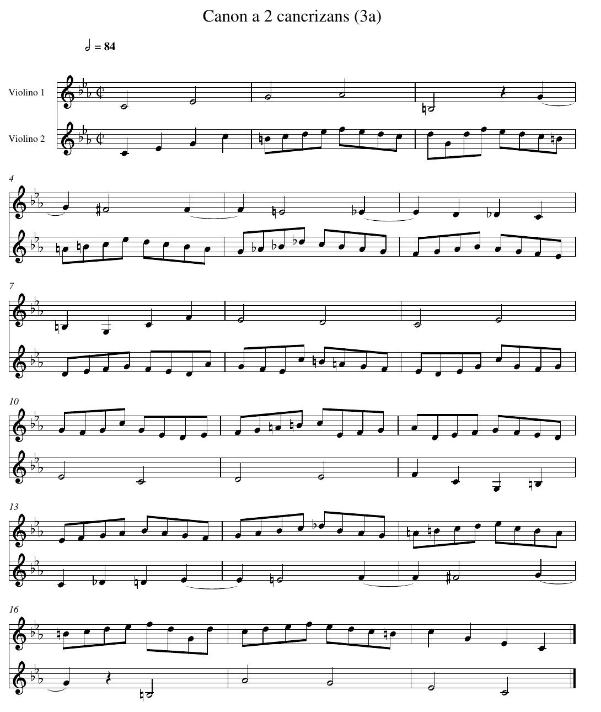

# Le canon à l'écrevisse

!!! warning "En construction"
    Cette activité est en cours d'écriture : son contenu peut encore changer.

En 1747, Jean-Sébastien Bach rend visite au roi de Prusse Frédéric II, à Potsdam. Le roi lui donne un thème et lui demande d'improviser dessus. De retour chez lui, Bach compose sur ce thème tout un recueil, l'*Offrande musicale*, qu'il envoie au roi.

Le recueil contient une pièce étrange, le *Canon a 2 cancrizans*. Bach n'y a écrit **qu'une seule ligne** de musique. Pour la jouer, il faut deux musiciens : l'un lit la ligne du début à la fin, l'autre la lit **de la fin au début**, et les deux jouent en même temps. *Cancrizans* vient du latin *cancer*, le crabe, l'écrevisse, qui semble marcher à reculons.

Voici la pièce, telle qu'on l'écrit aujourd'hui pour deux violons. Le violon 1 joue la ligne de Bach. Le violon 2 joue la même ligne, lue à l'envers.



**Ce que tu vas produire** : un fichier son `cancrizans.wav` qui joue la pièce, un peu moins de 30 secondes.

Crée un répertoire `projet_bach`, et mets-y :

- `canon.py`, pour tes fonctions, qui commence par la ligne `from ligne_bach import LIGNE`,
- `canon_test.py`, pour tes fonctions de test, qui commence par `from canon import *`,
- le fichier [ligne_bach.py](ligne_bach.py), qui contient la ligne de Bach. Ne le modifie pas.
- le fichier [son.py](son.py), qui sert à l'étape 4. Ne le modifie pas. C'est le même fichier que pour les autres projets musique : prends la version de cette page.

Le son est fabriqué par le programme **FluidSynth**, qui joue les notes avec des instruments enregistrés. Installe-le dès maintenant, une fois pour toutes, dans ton terminal :

```bash
sudo apt install fluidsynth fluid-soundfont-gm
```

## Étape 1 - Écrire une mélodie en Python

Ouvre `ligne_bach.py`. La ligne de Bach y est une liste de **notes**. Chaque note est un couple `(nom, durée)` :

- `nom` est une chaîne : `"do4"` est le do du milieu du clavier d'un piano, `"mib4"` le mi bémol juste au-dessus, `"fa#4"` un fa dièse, `"si3"` le si juste en dessous de `"do4"`. Le chiffre est le numéro de l'octave. Un silence s'écrit `"silence"`.
- `durée` est un nombre de **croches** : 1 pour une croche, 2 pour une noire, 4 pour une blanche.

Ainsi la première mesure du violon 1, deux blanches, s'écrit `[("do4", 4), ("mib4", 4)]`.

!!! question "Lire la ligne (obligatoire)"
    Sur ton cahier, à l'aide de `ligne_bach.py` et de la partition :

    1. Combien de croches dure une mesure ? Vérifie-le sur les mesures 1, 7 et 10 de `LIGNE`.
    2. La note `("sol4", 4)` est écrite sur la ligne de la mesure 3. Pourtant la mesure 3 ne contient que `("si3", 4)`, `("silence", 2)` et ce sol. Où passe la fin de ce sol ? Regarde la partition.
    3. Écris la première mesure du violon 2 sous la forme d'une liste de couples. Compare-la avec la dernière mesure de `LIGNE`.

    ??? success "Réponse"
        1. 8 croches. Mesure 1 : 4 + 4. Mesure 7 : 2 + 2 + 2 + 2. Mesure 10 : huit croches de durée 1.
        2. Le sol commence sur le dernier temps de la mesure 3 et se prolonge sur le premier temps de la mesure 4 : sur la partition, une **liaison** relie les deux moitiés. La mesure 3 contient 4 + 2 + 2 croches, la mesure 4 commence par les 2 croches restantes. `ligne_bach.py` l'écrit comme une seule note de 4 croches. Deux autres notes sont dans ce cas : le fa, des mesures 4 à 5, et le mib, des mesures 5 à 6.
        3. `[("do4", 2), ("mib4", 2), ("sol4", 2), ("do5", 2)]`. La dernière mesure de `LIGNE` est `[("do5", 2), ("sol4", 2), ("mib4", 2), ("do4", 2)]` : les mêmes notes, dans l'ordre inverse.

## Étape 2 - La durée

!!! question "La fonction `duree_totale` (obligatoire)"
    Dans `canon.py`, écris le corps de cette fonction :

    ```python
    def duree_totale(ligne: list[tuple[str, int]]) -> int:
        """Durée de ligne, en croches."""
        ...
    ```

    Dans `canon_test.py`, recopie ce test et complète la dernière ligne sans lancer ton code, en t'aidant de ta réponse à l'étape 1 :

    ```python
    def test_duree_totale() -> None:
        assert duree_totale([("do4", 4), ("silence", 2), ("sol4", 1)]) == 7
        assert duree_totale([]) == 0
        assert duree_totale(LIGNE) == ...
    ```

    ??? success "Solution"
        ```python
        def duree_totale(ligne: list[tuple[str, int]]) -> int:
            """Durée de ligne, en croches."""
            total = 0
            for nom, duree in ligne:
                total = total + duree
            return total
        ```

        La pièce a 18 mesures de 8 croches : `duree_totale(LIGNE)` vaut 144.

## Étape 3 - Lire à l'envers

!!! question "La fonction `retrograde` (obligatoire)"
    En musique, la ligne lue de la fin au début s'appelle le **rétrograde**. Écris le corps de cette fonction, **sans** utiliser `reverse` ni `[::-1]` :

    ```python
    def retrograde(ligne: list[tuple[str, int]]) -> list[tuple[str, int]]:
        """Les notes de ligne, de la dernière à la première."""
        ...


    def test_retrograde() -> None:
        assert retrograde([("do4", 4), ("silence", 2), ("sol4", 1)]) == [("sol4", 1), ("silence", 2), ("do4", 4)]
        assert retrograde([]) == []
        assert retrograde(LIGNE)[0:4] == [("do4", 2), ("mib4", 2), ("sol4", 2), ("do5", 2)]
    ```

    ??? tip "Indice léger"
        La première note du rétrograde est la dernière de `ligne`. Quel est l'indice du dernier élément d'une liste de longueur `n` ?

    ??? tip "Indice plus précis"
        La note d'indice `i` du rétrograde est la note d'indice `len(ligne) - 1 - i` de `ligne`. Parcours `i` de 0 à `len(ligne) - 1`, et ajoute chaque note au bout du résultat avec `append`.

    ??? question "Avant d'ouvrir la solution"
        En une phrase, sur ton cahier : qu'est-ce que l'indice t'a appris sur ce qui n'allait pas dans **ton** code ?

    ??? success "Solution"
        ```python
        def retrograde(ligne: list[tuple[str, int]]) -> list[tuple[str, int]]:
            """Les notes de ligne, de la dernière à la première."""
            resultat = []
            for i in range(0, len(ligne)):
                resultat.append(ligne[len(ligne) - 1 - i])
            return resultat
        ```

        Retiens la formule `len(ligne) - 1 - i` : elle va revenir à l'étape 5.

!!! question "Ce que garde le rétrograde (obligatoire)"
    Sur ton cahier, réponds par vrai ou faux à chacune de ces trois affirmations, en une phrase de justification chacune. Puis ajoute ces trois lignes à `test_retrograde` et lance le test.

    **Ne lance pas ce code tant que tu n'as pas écrit ta réponse.**

    ```python
        assert len(retrograde(LIGNE)) == len(LIGNE)
        assert duree_totale(retrograde(LIGNE)) == duree_totale(LIGNE)
        assert retrograde(retrograde(LIGNE)) == LIGNE
    ```

    ??? success "Réponse"
        Les trois sont vraies.

        - Le rétrograde contient les mêmes notes, seulement dans un autre ordre : il y en a autant.
        - Chaque note garde sa durée, et la somme ne dépend pas de l'ordre. C'est pour cela que les deux violons **finissent ensemble**.
        - Lire deux fois à l'envers, c'est lire à l'endroit.

## Étape 4 - Écouter

`son.py` contient une fonction pour les mélodies :

- `ecrire_wav_notes(voix: list[list[tuple[str, int]]], nom_fichier: str, duree_croche: float = 0.18) -> None`

Elle écrit dans un fichier `.wav` les mélodies de `voix`, jouées **en même temps** par des violons. Une croche dure `duree_croche` secondes. La partition indique « blanche = 84 », c'est-à-dire 84 blanches par minute : une croche dure alors 60 / (84 × 4) ≈ 0,18 seconde.

Crée un fichier `ecouter.py` :

```python
from canon import *
from son import ecrire_wav_notes

ecrire_wav_notes([LIGNE], "violon1.wav")
```

!!! question "Écouter (obligatoire)"
    1. Écoute `violon1.wav` : c'est la ligne de Bach seule. Son début, jusqu'au do qui ouvre la mesure 9, reprend le thème donné par le roi, à quelques détails de rythme près.
    2. Écris `violon2.wav`, la ligne seule lue à l'envers. Reconnais-tu le thème du roi ? Où est-il ?
    3. Écris `cancrizans.wav`, la pièce entière.

    ??? success "Réponse"
        2. Le thème du roi est à la fin, joué à reculons : du milieu de la mesure 10 jusqu'à la dernière note du violon 2.
        3. `ecrire_wav_notes([LIGNE, retrograde(LIGNE)], "cancrizans.wav")`

!!! question "Échanger les violons (entraînement)"
    Sur ton cahier, prédis : le fichier écrit par `ecrire_wav_notes([retrograde(LIGNE), LIGNE], "echange.wav")` est-il différent de `cancrizans.wav` ? Puis écris-le et compare les deux fichiers, par exemple avec ce code :

    ```python
    with open("cancrizans.wav", "rb") as f1:
        with open("echange.wav", "rb") as f2:
            print(f1.read() == f2.read())
    ```

    ??? success "Réponse"
        Les deux fichiers sont identiques, au dernier octet près. Les deux violons jouent la même chose, simplement échangés, et `son.py` leur donne le même timbre : à chaque instant, il additionne les deux mêmes sons, dans l'autre ordre.

        Autrement dit, si l'on retourne la partition entière, en lisant chaque violon à l'envers, on retrouve exactement la même pièce. C'est un palindrome musical.

## Étape 5 - Ce qu'on entend à chaque instant

On numérote les croches de la pièce de 0 à 143. Pour savoir ce que les deux violons jouent ensemble, il faut savoir quelle note sonne à la croche `t`.

!!! question "Quelle note à quel moment ? (obligatoire)"
    Sur ton cahier : quelle note de `LIGNE` sonne à la croche 0 ? à la croche 3 ? à la croche 4 ? à la croche 20 ? à la croche 143 ?

    ??? success "Réponse"
        `"do4"` occupe les croches 0 à 3, `"mib4"` les croches 4 à 7. À la croche 0 et à la croche 3, on entend donc `"do4"`, et à la croche 4, `"mib4"`.

        Pour la croche 20, on additionne les durées : `do4`, `mib4`, `sol4`, `lab4` et `si3` occupent les croches 0 à 19. La note suivante, `("silence", 2)`, occupe les croches 20 et 21 : c'est le silence.

        La dernière note, `("do4", 2)`, occupe les croches 142 et 143.

!!! question "La fonction `note_a` (obligatoire)"
    ```python
    def note_a(ligne: list[tuple[str, int]], t: int) -> str:
        """Le nom de la note de ligne qui sonne pendant la croche t.
        Précondition : 0 <= t < duree_totale(ligne).
        """
        ...


    def test_note_a() -> None:
        assert note_a(LIGNE, 0) == "do4"
        assert note_a(LIGNE, 3) == "do4"
        assert note_a(LIGNE, 4) == "mib4"
        assert note_a(LIGNE, 20) == "silence"
        assert note_a(LIGNE, 143) == "do4"
        assert note_a(retrograde(LIGNE), 0) == "do4"
    ```

    ??? tip "Indice léger"
        Parcours les notes en tenant à jour la croche où commence la note courante. La note cherchée est la première qui finit **après** la croche `t`.

    ??? tip "Indice plus précis"
        Avec deux variables `i = 0` (indice de la note) et `debut = 0` (croche où elle commence) : tant que la note `i` finit avant ou pendant `t`, c'est-à-dire tant que `debut + ligne[i][1] <= t`, avance `debut` de sa durée et passe à la note suivante.

    ??? question "Avant d'ouvrir la solution"
        En une phrase, sur ton cahier : qu'est-ce que l'indice t'a appris sur ce qui n'allait pas dans **ton** code ?

    ??? success "Solution"
        ```python
        def note_a(ligne: list[tuple[str, int]], t: int) -> str:
            """Le nom de la note de ligne qui sonne pendant la croche t.
            Précondition : 0 <= t < duree_totale(ligne).
            """
            assert 0 <= t < duree_totale(ligne), "il faut 0 <= t < duree_totale(ligne)"
            i = 0
            debut = 0
            while debut + ligne[i][1] <= t:
                debut = debut + ligne[i][1]
                i = i + 1
            return ligne[i][0]
        ```

!!! question "Le miroir dans le temps (obligatoire)"
    À la croche 0, le violon 2 joue la dernière note de la ligne, celle de la croche 143 du violon 1. Sur ton cahier :

    1. À la croche 1, le violon 2 joue ce que le violon 1 joue à quelle croche ? Et à la croche `t` ?
    2. Écris un test qui vérifie ta réponse pour toutes les croches de la pièce, à l'aide d'une boucle.

    ??? success "Réponse"
        1. À la croche 1, le violon 2 joue la note de la croche 142 du violon 1. À la croche `t`, celle de la croche `143 - t`. C'est la formule de `retrograde`, `len(ligne) - 1 - i`, appliquée cette fois aux croches : la pièce dure 144 croches, et 144 - 1 - t = 143 - t.
        2. ```python
           def test_miroir() -> None:
               for t in range(0, 144):
                   assert note_a(retrograde(LIGNE), t) == note_a(LIGNE, 143 - t)
           ```

!!! question "Les unissons (obligatoire)"
    On dit que les deux violons jouent à l'**unisson** quand ils jouent la même note au même moment.

    ```python
    def unissons(voix1: list[tuple[str, int]], voix2: list[tuple[str, int]]) -> list[int]:
        """Les croches où voix1 et voix2 jouent la même note (les silences ne comptent pas).
        Précondition : duree_totale(voix1) == duree_totale(voix2).
        """
        ...


    def test_unissons() -> None:
        assert unissons([("do4", 2), ("re4", 2)], [("do4", 1), ("mi4", 1), ("re4", 2)]) == [0, 2, 3]
        assert unissons([("silence", 2)], [("silence", 2)]) == []
    ```

    1. Écris `unissons`, puis affiche `unissons(LIGNE, retrograde(LIGNE))`.
    2. Les unissons vont par paires. Additionne les deux croches de chaque paire. Que remarques-tu ? Explique-le sur ton cahier à l'aide de l'exercice précédent.

    ??? success "Solution"
        ```python
        def unissons(voix1: list[tuple[str, int]], voix2: list[tuple[str, int]]) -> list[int]:
            """Les croches où voix1 et voix2 jouent la même note (les silences ne comptent pas).
            Précondition : duree_totale(voix1) == duree_totale(voix2).
            """
            assert duree_totale(voix1) == duree_totale(voix2), "les deux voix doivent avoir la même durée"
            resultat = []
            for t in range(0, duree_totale(voix1)):
                note = note_a(voix1, t)
                if note != "silence" and note == note_a(voix2, t):
                    resultat.append(t)
            return resultat
        ```

        `unissons(LIGNE, retrograde(LIGNE))` vaut `[0, 1, 58, 85, 142, 143]`. Les paires sont (0, 143), (1, 142) et (58, 85), et chaque somme vaut 143.

        Si les violons sont à l'unisson à la croche `t`, alors la note de la croche `t` de la ligne est la même que celle de la croche `143 - t`. À la croche `143 - t`, le violon 1 joue donc la note de la croche `143 - t`, et le violon 2 celle de la croche `t` : la même. Les violons sont de nouveau à l'unisson. Chaque unisson a son reflet, de l'autre côté du milieu de la pièce.

## Bonus - Les écarts entre les violons

En musique, l'écart entre deux notes se mesure en **demi-tons**. Dans une octave, il y a 12 demi-tons : `do`, `do#`, `re`, `re#`, `mi`, `fa`, `fa#`, `sol`, `sol#`, `la`, `la#`, `si`, puis le `do` de l'octave suivante. Un bémol descend d'un demi-ton : `mib` est la même touche du piano que `re#`.

!!! question "La fonction `demi_tons` (bonus)"
    Écris une fonction qui donne la position d'une note en demi-tons, à partir de `"do0"` :

    ```python
    NOTES: dict[str, int] = {"do": 0, "re": 2, "mi": 4, "fa": 5, "sol": 7, "la": 9, "si": 11}


    def demi_tons(nom: str) -> int:
        """Nombre de demi-tons entre "do0" et la note nom, par exemple "mib4" ou "fa#3".
        Précondition : nom n'est pas "silence".
        """
        ...


    def test_demi_tons() -> None:
        assert demi_tons("do0") == 0
        assert demi_tons("do4") == 48
        assert demi_tons("mib4") == 51
        assert demi_tons("fa#3") == 42
        assert demi_tons("si3") == demi_tons("do4") - 1
    ```

    ??? tip "Indice"
        Le dernier caractère du nom est l'octave. Ce qui reste est le nom de la note, éventuellement suivi de `"#"` (un demi-ton de plus) ou de `"b"` (un demi-ton de moins). Aucun nom de `NOTES` ne finit par `"b"`.

    ??? success "Solution"
        ```python
        def demi_tons(nom: str) -> int:
            """Nombre de demi-tons entre "do0" et la note nom, par exemple "mib4" ou "fa#3".
            Précondition : nom n'est pas "silence".
            """
            assert nom != "silence", "un silence n'a pas de hauteur"
            octave = int(nom[len(nom) - 1])
            base = nom[0:len(nom) - 1]
            alteration = 0
            if base[len(base) - 1] == "#":
                alteration = 1
                base = base[0:len(base) - 1]
            elif base[len(base) - 1] == "b":
                alteration = -1
                base = base[0:len(base) - 1]
            return 12 * octave + NOTES[base] + alteration
        ```

!!! question "Un écart en miroir (bonus)"
    1. Écris une fonction `ecart` qui renvoie l'écart en demi-tons, en valeur absolue (fonction `abs`), entre ce que jouent `ligne` et `retrograde(ligne)` à la croche `t`.

        ```python
        def ecart(ligne: list[tuple[str, int]], t: int) -> int:
            """Écart en demi-tons entre ligne et son rétrograde, à la croche t.
            Précondition : ni ligne ni son rétrograde ne se taisent à la croche t.
            """
            ...


        def test_ecart() -> None:
            assert ecart([("do4", 2), ("mi4", 2)], 0) == 4
            assert ecart([("do4", 2), ("mi4", 2)], 3) == 4
        ```

    2. Sur ton cahier, prédis : pour la ligne de Bach, l'écart à la croche `t` et l'écart à la croche `143 - t` sont-ils égaux ? Vérifie-le pour toutes les croches où aucun violon ne se tait.
    3. Ta réponse dépend-elle de la ligne écrite par Bach ? Essaie avec une autre ligne, par exemple `[("do4", 2), ("re4", 1), ("sol4", 3)]`, qui dure 6 croches : compare l'écart à la croche `t` et à la croche `5 - t`.

    ??? success "Réponse"
        ```python
        def ecart(ligne: list[tuple[str, int]], t: int) -> int:
            """Écart en demi-tons entre ligne et son rétrograde, à la croche t.
            Précondition : ni ligne ni son rétrograde ne se taisent à la croche t.
            """
            return abs(demi_tons(note_a(ligne, t)) - demi_tons(note_a(retrograde(ligne), t)))


        def test_ecart() -> None:
            for t in range(0, 144):
                if note_a(LIGNE, t) != "silence" and note_a(retrograde(LIGNE), t) != "silence":
                    assert ecart(LIGNE, t) == ecart(LIGNE, 143 - t)
            autre = [("do4", 2), ("re4", 1), ("sol4", 3)]
            for t in range(0, 6):
                assert ecart(autre, t) == ecart(autre, 5 - t)
        ```

        Les écarts sont égaux, pour toutes les croches, et **pour n'importe quelle ligne**. Pour une ligne de `n` croches, à la croche `t`, on entend les notes des croches `t` et `n - 1 - t` de la ligne. À la croche `n - 1 - t`, on entend les notes des croches `n - 1 - t` et `t` : les deux mêmes notes, échangées entre les violons. La valeur absolue de leur écart ne change pas.

        Le miroir est donc automatique : n'importe quelle ligne, jouée contre son rétrograde, donne un palindrome. Ce qui ne l'est pas, c'est que le résultat sonne bien. Écoute ta ligne contre son rétrograde : le travail de Bach a été d'écrire une ligne qui, lue dans les deux sens à la fois, fait encore de la musique.

??? info "Sources"
    - Article *The Musical Offering*, Wikipédia en anglais, consulté le 14 octobre 2026 : <https://en.wikipedia.org/wiki/The_Musical_Offering>. La rencontre avec Frédéric II à Potsdam en 1747, le thème du roi, le canon cancrizans comme premier des canons à 2.
    - « Bach's *Canon a 2 Cancrizans* from *The Musical Offering*: A Divine Puzzle », The Listeners' Club, 25 février 2022 : <https://thelistenersclub.com/2022/02/25/bachs-canon-a-2-cancrizans-from-the-musical-offering-a-divine-puzzle/>. Une seule ligne écrite, à lire à l'endroit et à l'envers en même temps.
    - La partition reproduite plus haut, et son indication « blanche = 84 », viennent d'une édition pour deux violons du domaine public, déposée sur Wikimedia Commons : <https://commons.wikimedia.org/wiki/File:Musikalisches_Opfer,_BWV_1079_(IA_imslp-opfer-bwv-1079-bach-johann-sebastian).pdf>, page 8.
    - `ligne_bach.py` a été produit à partir de l'encodage MusicXML du dépôt <https://github.com/yufanyufan/open_music_sheet>, puis comparé note à note à cette partition. Les hauteurs sont celles des violons de la partition.
    - Les sons de violon viennent de la banque *Fluid (R3) General MIDI SoundFont* de Frank Wen, sous licence MIT, installée par le paquet Debian `fluid-soundfont-gm`, et sont joués par FluidSynth.
