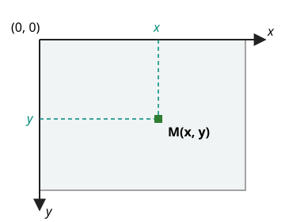

# Introduction à pyxel - Sans POO

!!! info "Setup"
    Dans le terminal, télécharge le module pyxel :

    ```bash
    uv add pyxel
    ```

Tu vas découvrir les bases de la création d'un jeu.

L'objectif est de créer un pixel capable de se dessiner et de se déplacer en fonction de son vecteur directeur (dx, dy).

!!! info "Rappel : se déplacer selon un vecteur"
    L'écran est un repère. Le pixel est un **point** de coordonnées $(x, y)$, et son vecteur directeur $\vec{u}\,(dx, dy)$ dit de combien il se déplace **à chaque frame**.

    Une frame, c'est une addition : le point $M(x, y)$ devient $M'(x + dx,\ y + dy)$.

    **Attention, le repère de l'écran n'est pas celui du cours de maths.** L'origine $(0, 0)$ est **en haut à gauche**, et $y$ augmente **vers le bas**.

    

!!! question "Calculer avant de coder"
    Le pixel est en $(15, 15)$ et son vecteur est $(2, -1)$.

    1. Où est-il après **3 frames** ? Écris le calcul, pas seulement le résultat.
    2. À l'écran, il part vers la droite et vers le haut, ou vers la droite et vers le bas ?
    3. Quel vecteur faut-il pour qu'il monte tout droit ?
    4. Le jeu tourne à 10 frames par seconde avec le vecteur $(1, 0)$. De combien de pixels avance-t-il en une seconde ?

    ??? success "Correction"
        1. $(15 + 3 \times 2,\ 15 + 3 \times (-1)) = (21, 12)$
        2. Vers la droite et vers le **haut** : $y$ diminue.
        3. $(0, -1)$
        4. $10 \times 1 = 10$ pixels. La vitesse dépend du vecteur **et** du nombre de frames par seconde. C'est ce que montre l'exercice 2.


```python
import pyxel as px

# -- CONSTANTES
W: int = 30   # Largeur
H: int = 30   # Hauteur


# -- Etat du jeu --
x: float        # Coordonnée x du pyxel
y: float        # Coordonnée y du pyxel 
dx: float       # Déplacement en x
dy: float       # déplacement en y
color: int    # Couleur


# -- Initialisation de l'état du jeu -- 

def reinit() -> None:
    """
    Initialise un pixel vert avec une position centrale et un vecteur directeur nul.
    """
    global x, y, dx, dy, color
    x = px.width/2 
    y = px.height/2
    dx = 0
    dy = 0
    color = px.COLOR_GREEN


# -- Mise à jour régulière de l'état du jeu ---

def update() -> None:
    """
    Gère les événements utilisateur pour déplacer le pixel.
    Cette fonction est automatiquement appelée en boucle par pyxel.
    """
    global x, y, dx, dy, color

    # Déplacement du pixel selon son vecteur directeur
    x = ...
    y = ...

    # Modification du vecteur directeur selon les touches fléchées
    if px.btn(px.KEY_RIGHT):
        dx = ...
        dy = ...
    elif ...
    ...


# -- Dessin régulier de l'état du jeu à l'écran ---

def draw() -> None:
    """
    Dessine le pixel sur l'écran.
    """
    global x, y, dx, dy, color
    px.cls(px.COLOR_BLACK)          # Efface l'écran
    px.pset(int(x), int(y), color)  # Dessine le pixel


# 1. Démarrer le moteur de jeu en 10 FPS
px.init(H, W, title="Pixel en Mouvement", fps = 10)
# 2. Initialiser les variables du jeu
reinit()
# 3. Lancer le jeu
px.run(update, draw)

# Cette dernière instruction lance une boucle infinie,
# qui appelle update, puis draw, de manière régulière, à chaque Frame (ici 10 fois par seconde)
```

!!! abstract "Fondamental"
    Un jeu est une succession infinie de cycles `update` puis `draw`, un cycle par frame.

!!! question "Exercices de base"

    1. Complète la fonction update. Teste.
    2. Modifie le framerate. Teste.
    3. Si ça n'est pas déjà fait, modifie la fonction update pour que le pixel s'arrête lorsqu'on lâche les touches.
    4. Le pixel ne doit pas bouger s'il va dépasser de l'écran.
        - Modifie la fonction update pour tenir compte de cette information. 
    5. Espace torique: Un pixel peut maintenant dépasser un bord mais il réapparaît au bord opposé (ce qui fait de l'espace de jeu un espace sans bord)
        - Modifie la fonction update pour tenir compte de cette information. On s'intéressera à l'opérateur modulo. La modification doit être minime.


!!! question "Remplacer un pixel par un sprite"
    1. Télécharge la planche de sprites [spritesheet.pyxres](../../assets/star_shooter/spritesheet.pyxres) et sa palette [spritesheet.pyxpal](../../assets/star_shooter/spritesheet.pyxpal).
        - Le `.pyxres` contient les images, 4 bruitages (emplacements 0 à 3) et 2 musiques. Le `.pyxpal` contient les 16 couleurs de la planche.
        - Place les deux fichiers **dans le même répertoire**, et **ne les renomme pas** : pyxel ne lit la palette que si elle porte le nom de la planche.
        - Pyxel vient avec un éditeur de ressources. Pour visualiser les ressources, exécute la commande suivante dans un terminal :
            `pyxel edit <répertoire>/spritesheet.pyxres`
        - N'hésite pas à bidouiller, tu ne peux rien casser, au pire tu pourras retélécharger les fichiers.
    2. À la place d'un simple pixel, on veut maintenant utiliser un sprite.
        - Il faut d'abord charger la planche **juste après `px.init`** :
            `px.load("<répertoire>/spritesheet.pyxres")`
        - Les sprites de cette planche font 16 sur 16.
        - La planche est découpée en **3 banques d'images**, numérotées 0, 1 et 2. L'éditeur te donne la banque et les coordonnées $(u, v)$ du sprite que tu choisis.
        - La couleur d'indice **0** est la transparence de cette planche : c'est la valeur à donner à `colkey`.
        - Il n'y a alors qu'une ligne de code à modifier dans `draw`. Je te laisse la trouver en explorant la [documentation de pyxel](https://github.com/kitao/pyxel/blob/main/docs/README.fr.md).
            - remarque: Tu auras nécessairement besoin d'augmenter la hauteur et la largeur de ta fenêtre (H et W), sans quoi le sprite occupera tout l'écran.
    3. Pour l'ambiance, un bruitage et une musique sont déjà dans la planche :
        - `px.play(0, 2)` joue la petite explosion sur le canal 0.
        - `px.playm(0, loop=True)` lance la musique de fond en boucle.
