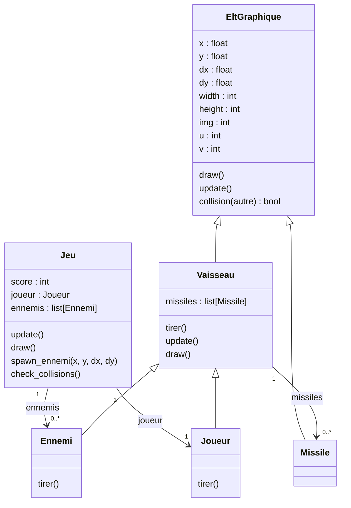

# Projet space invader

L'objectif est de créer un "space invader" like (original : <https://freeinvaders.org>)

Nous allons utiliser le retro game engine pyxel (`uv add pyxel`).

!!! warning "Propreté"
    La très grande majorité des exemples de jeux pyxel qu'on trouve sur internet ne sont pas propres du tout. Merci de ne pas t'en inspirer, afin de ne pas prendre de mauvaises habitudes.

    C'est la raison pour laquelle je te guide, afin de le faire proprement, dans la limite du raisonnable.

Voici la modélisation de ce space invader. L'héritage y sert à **ne pas écrire deux fois la même chose** : sans lui, chaque classe porterait tous les attributs et toutes les méthodes d'`EltGraphique`, et le joueur et l'ennemi porteraient en double tout ce qu'un vaisseau sait faire. Il reste toujours possible de redéfinir dans une sous classe ce qui lui est propre.

!!! info "Comment lire ce schéma"
    Les deux sortes de flèches sont celles du chapitre [héritage](../../terminale/poo/heritage.md).

    - **Pointe creuse**, de la sous classe vers la super classe : elle dit « **est un** ». Un ennemi **est un** vaisseau, un vaisseau **est un** élément graphique.
    - **Pointe simple** : elle dit « **a un** », et sa pointe désigne la classe **tenue**. Son étiquette nomme l'attribut qui porte le rapport, et les nombres aux deux bouts sont les **cardinalités**.

    Une sous classe ne déclare que ce qu'elle **ajoute** ou ce qu'elle **redéfinit**. Tout le reste se lit en remontant la flèche à pointe creuse.



## Element graphique

Un Elément Graphique est quelque chose qui peut apparaître à l'écran.

- Il a une position x, y dans le plan.
- Il a un vecteur de déplacement dx, dy duquel il se déplace en permanence.
- Il sait où est son image dans la planche de sprites : la banque `img`, et les coordonnées `u`, `v` de son coin haut gauche.
- Il a une largeur `width` et une hauteur `height`.
- Il sait se dessiner à l'écran.
- Il sait se mettre à jour en fonction de son vecteur directeur.
- Il sait dire s'il est en collision avec un autre élément graphique (voir la méthode donnée plus bas).

Par exemple, un Missile **EST UN** Element Graphique.

!!! danger
    Les vecteurs de position et de déplacement seront gérés en float. Par contre l'affichage attendra des ints.
    C'est équivalent à dire qu'on réfléchit au mouvement dans $\mathbb{R^2}$ mais qu'on affiche dans $\mathbb{Z^2}$

## La planche de sprites et les sons

Télécharge la planche [spritesheet.pyxres](../../assets/star_shooter/spritesheet.pyxres) et sa palette [spritesheet.pyxpal](../../assets/star_shooter/spritesheet.pyxpal). C'est la même que celle de l'[introduction à pyxel](intro-pyxel.md).

- Place les deux fichiers **dans le même répertoire**, et **ne les renomme pas** : pyxel ne lit la palette que si elle porte le nom de la planche.
- Charge-la **juste après `px.init`** : `px.load("<répertoire>/spritesheet.pyxres")`
- Pour la regarder et y relever ce dont tu as besoin : `pyxel edit <répertoire>/spritesheet.pyxres`

Ce qu'elle contient se range exactement dans le schéma ci-dessus.

- Les sprites font **16 sur 16**, donc `width` et `height` valent 16.
- La planche tient en **trois banques d'images**, numérotées 0, 1 et 2 : c'est ce que porte l'attribut `img`. L'éditeur te donne les trois nombres dont un élément graphique a besoin, la banque et les coordonnées `u`, `v` du coin haut gauche du sprite.
- Les **vaisseaux** occupent le début de la première ligne de la banque 0 : cinq couleurs à `v = 0`, dont les `u` vont de 16 à 80, de seize en seize. Le vaisseau blanc est donc en `(0, 16, 0)`. Prends-en un pour le joueur et un autre pour les ennemis.
- La couleur d'indice **0** est la transparence : c'est la valeur à donner à `colkey`.
- Quatre **bruitages** : 0 le laser du joueur, 1 le laser de l'ennemi, 2 une petite explosion, 3 une grosse. `px.play(0, 2)` joue la petite explosion sur le canal 0. Ils tombent sur quatre endroits précis de ton modèle, les deux `tirer` et les deux issues de `check_collisions`.
- Deux **musiques** de fond, `px.playm(0, loop=True)` et `px.playm(1, loop=True)`.

!!! tip "Une couleur n'est pas une classe"
    Deux ennemis de couleurs différentes ne demandent pas deux classes : c'est la valeur de `u` qui change, et pas une ligne de code. Tu n'écriras une sous classe d'`Ennemi` que le jour où l'un d'eux se **comportera** autrement, par exemple en tirant deux missiles à la fois.

## Le Jeu

Le jeu est le chef d'orchestre. Ce n'est **pas** un élément graphique : il n'apparaît pas à l'écran, il fait apparaître les autres. Aucune flèche à pointe creuse ne part de lui.

Il gère :

- Un Joueur
- Des Ennemis
- Un Score
- Les évènements utilisateurs dans sa méthode update

Le Jeu doit pouvoir spawner un ennemi à une certaine position pour un certain vecteur de déplacement. Le jeu sait se dessiner et demander à son joueur et à ses ennemis de se mettre à jour et de se dessiner.

Le jeu sait tester toutes les collisions et agir en conséquence. Remarque que **le jeu ne tient aucun missile** : aucune flèche ne va de `Jeu` vers `Missile`. Pour les atteindre, il passe par les vaisseaux qui les ont tirés, `self.joueur.missiles` et les `missiles` de chacun de ses ennemis. C'est exactement ce que la flèche à pointe simple entre `Vaisseau` et `Missile` annonce.

## Le Vaisseau

Un vaisseau **est un** élément graphique, et c'est la super classe du joueur comme de l'ennemi : tout ce qui suit s'écrit **une seule fois**, ici.

- Un vaisseau connaît la liste de ses missiles et sait leur demander de se mettre à jour et de se dessiner. Ses `update` et `draw` redéfinissent donc ceux d'`EltGraphique` : un vaisseau se déplace et se dessine comme tout élément graphique, puis s'occupe de ses missiles.
- Un vaisseau doit pouvoir tirer un nouveau missile, c'est-à-dire le créer à sa propre position et l'ajouter à sa liste.

## Le Joueur et l'Ennemi

Les deux **sont des** vaisseaux, et c'est tout ce qu'ils ont de commun. Ce qui les distingue tient en peu de chose, et c'est le signe que le modèle est juste.

- Leur **sprite** n'est pas le même.
- Leur missile ne part pas dans le même sens : vers le haut pour le joueur, vers le bas pour l'ennemi. `tirer` est donc **redéfinie** dans chacune des deux sous classes.
- Le joueur est unique et piloté par les touches. Les ennemis sont nombreux et pilotés par le jeu.

!!! tip "Ce que l'héritage t'autorise ici"
    Ce qui est commun à tout tir, créer le missile et l'ajouter à la liste, peut rester dans `Vaisseau`. Les deux sous classes ont alors un `tirer` très court, qui appelle celui de la super classe par `super().tirer(...)` en lui fixant ce qui leur est propre. C'est le geste du `super().__init__(nom, "aboie")` de `Chien`, au même endroit du raisonnement : **la sous classe fixe ce que la super classe laissait au choix**.

## Le missile

C'est un élément Graphique simple. Sa partie attributs est **vide** dans le schéma, et ce n'est pas un oubli : un missile n'ajoute rien à ce qu'un élément graphique sait déjà faire. Il n'y a rien à recopier.

## Optionnel

- Il existe plusieurs types d'ennemis plus ou moins puissants.
- Il y a un boss de fin de niveau.
- Les ennemis et le joueur peuvent avoir des points de vie.
- Le jeu peut créer une explosion à un certain endroit.
- Les ennemis peuvent drop des Bonus (invincibilité, changement de missile, ...)

La liste est sans fin.

Ne te lance pas dans les fonctionnalités optionnelles sans avoir un code propre et complètement testé.
Ne te lance pas dans une amélioration sans avoir pensé sa modélisation.
Si tu écris trop de code, c'est que tu as peut-être pris un mauvais chemin.

## Les collisions

Rajoute cette méthode dans ta classe EltGraphique. L'objectif ici, c'est que tu te plonges dans la POO, pas d'étudier la collision d'objets dans l'espace (très vaste sujet), donc je te la donne. (La collision peut faire l'objet d'un grand oral maths/info.)

```python
def collision(self, other: 'EltGraphique') -> bool:
    """ Cette méthode détecte les collisions entre 2 boites
    rectangulaires. Les rectangles doivent avoir des attributs:
    x, y, width, height
    Elle renvoie True si les deux boîtes sont en collision.
    """
    return not ( 
               (other.x >= self.x + self.width)   
            or (other.x + other.width <= self.x)  
            or (other.y >= self.y + self.height) 
            or (other.y + other.height <= self.y) 
     )
```

Pour aller plus loin dans les collisions, tu peux t'intéresser au théorème des axes séparateurs (accessible en spé maths), ou encore à GJK, qui utilise la somme de Minkowski (difficile à ce stade, mais je te le mets quand même parce que c'est beau)

La détection de collisions utilise plusieurs algorithmes en cascade :

**Broad phase :** Partitionnement spatial (QuadTree, Grid, etc.) 
pour identifier les paires potentielles. Élimine rapidement les objets 
trop éloignés.

**Narrow phase :** Détection précise sur les paires candidates.

- AABB/OBB : rectangles/boîtes alignées
- SAT (Separating Axis Theorem) : polygones convexes
- GJK : formes convexes quelconques

**Note :** La "Mid phase" existe dans certains moteurs (tri des paires, 
tests AABB avant SAT), mais n'est pas systématique.
