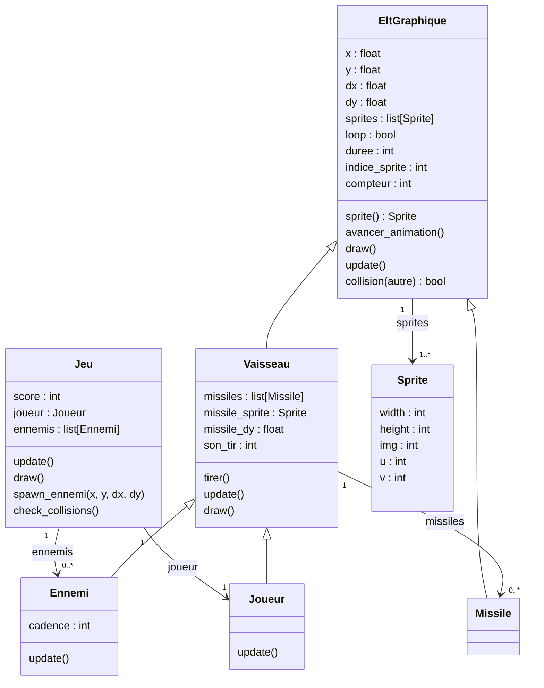
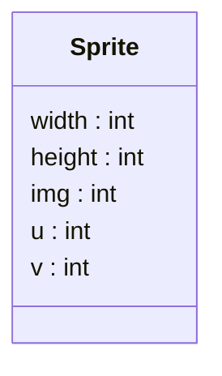
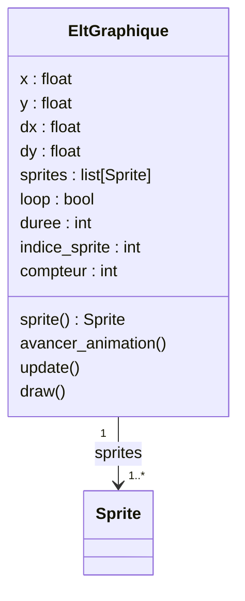
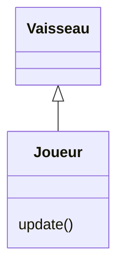
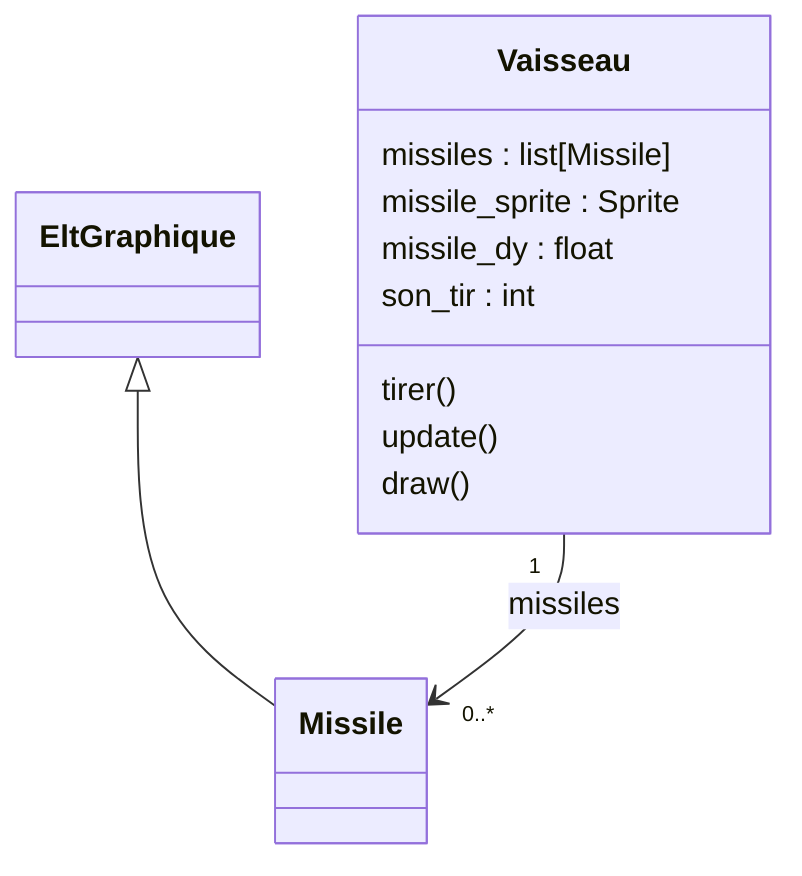
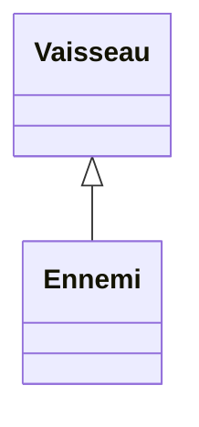
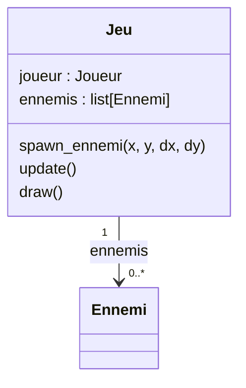
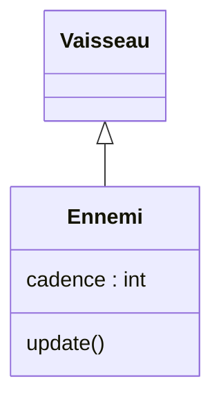
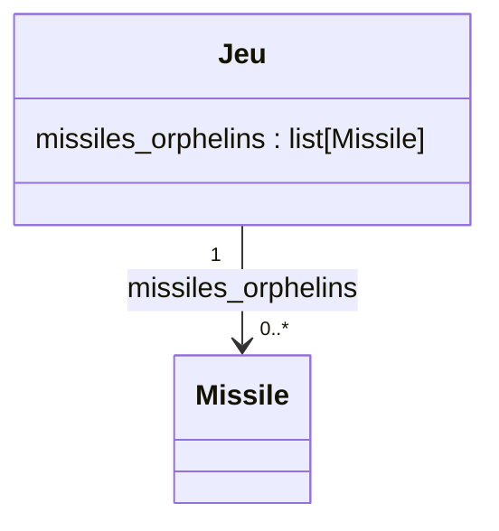

# Projet space invader

L'objectif est de créer un "space invader" like (original : <https://freeinvaders.org>)

Nous allons utiliser le retro game engine pyxel (`uv add pyxel`).

!!! warning "Propreté"
    La très grande majorité des exemples de jeux pyxel qu'on trouve sur internet ne sont pas propres du tout. Merci de ne pas t'en inspirer, afin de ne pas prendre de mauvaises habitudes.

    C'est la raison pour laquelle je te guide, afin de le faire proprement, dans la limite du raisonnable.

Voici la modélisation de ce space invader. L'héritage y sert à **ne pas écrire deux fois la même chose** : sans lui, chaque classe porterait tous les attributs et toutes les méthodes d'`EltGraphique`, et le joueur et l'ennemi porteraient en double tout ce qu'un vaisseau sait faire. Il reste toujours possible de redéfinir dans une sous classe ce qui lui est propre.

!!! info "Comment lire ce schéma"
    Les deux sortes de flèches sont celles du chapitre [héritage](../../terminale/poo/heritage.md).

    - **Pointe creuse**, de la sous classe vers la super classe : elle dit « **est un** ». Un ennemi **est un** vaisseau, un vaisseau **est un** élément graphique.
    - **Pointe simple** : elle dit « **a un** », et sa pointe désigne la classe **tenue**. Son étiquette nomme l'attribut qui porte le rapport, et les nombres aux deux bouts sont les **cardinalités**.

    Une sous classe ne déclare que ce qu'elle **ajoute** ou ce qu'elle **redéfinit**. Tout le reste se lit en remontant la flèche à pointe creuse.



## Le sprite

Un **Sprite** est une image du pyxres, et rien d'autre : sa **taille**, `width` et `height`, la **banque** `img` où elle se trouve, et les coordonnées `u`, `v` de son coin haut gauche.

Son rôle est d'**isoler la définition d'une image du pyxres**. Ces cinq nombres ne veulent rien dire séparément, ils ne servent qu'ensemble, et personne d'autre n'a besoin de les connaître : un vaisseau sait quels sprites il montre, il ne sait pas comment le fichier est rangé. Le jour où tu changes de pyxres, tu ne touches qu'à des `Sprite`.

La taille en fait partie parce qu'elle varie : sur ce pyxres, la plupart des images font 16 sur 16, mais les grosses créatures font 32 sur 32, et quelques-unes vont jusqu'à 64 sur 64.

En pratique, les sprites se déclarent **une fois pour toutes** en haut de `space.py`, à côté de `W` et `H`, et le reste du programme les désigne par leur nom.

```python
# Les sprites du pyxres, relevés une fois dans l'éditeur.
VAISSEAU_BLANC = Sprite(16, 16, 0, 16, 0)
```

## Element graphique

Un Elément Graphique est quelque chose qui peut apparaître à l'écran.

- Il a une position x, y dans le plan.
- Il a un vecteur de déplacement dx, dy duquel il se déplace en permanence.
- Il sait se mettre à jour en fonction de son vecteur directeur.
- Il sait se dessiner à l'écran.
- Il sait dire s'il est en collision avec un autre élément graphique (voir la méthode donnée plus bas).

Par exemple, un Missile **EST UN** Element Graphique.

!!! danger
    Les vecteurs de position et de déplacement seront gérés en float. Par contre l'affichage attendra des ints.
    C'est équivalent à dire qu'on réfléchit au mouvement dans $\mathbb{R^2}$ mais qu'on affiche dans $\mathbb{Z^2}$

### Ce qu'il montre, et pourquoi c'est une liste

Reste à dire quelle image il affiche. Un seul `Sprite` suffirait, si rien ne s'animait jamais.

Mais une explosion n'est pas une image, c'est une **succession** d'images jouée une fois. Une créature qui remue, c'est la même succession jouée en boucle. Avec un seul sprite, l'élément devrait aller en chercher un autre à chaque changement, et cette suite d'images serait rangée on ne sait où.

Un élément graphique porte donc **la liste de ses sprites**, dans l'ordre d'affichage, et de quoi y avancer.

- `sprites` : la liste, et `indice_sprite`, le rang de celui qu'il montre en ce moment. La méthode `sprite()` rend ce sprite-là, et c'est elle que `draw` et `collision` interrogent.
- `duree` : le nombre d'images pendant lesquelles chaque sprite reste affiché, et `compteur` ce qui les compte.
- `loop` : arrivé au bout de la liste, l'élément recommence au début si `loop` est vrai, et reste sur la dernière image sinon.
- `avancer_animation()` fait tout cela, et `update` l'appelle après avoir déplacé l'élément.

**Un élément qui ne s'anime pas est le cas particulier où la liste n'a qu'un seul sprite.** `indice_sprite` vaut alors 0 pour toujours, quoi que valent `loop` et `duree`. C'est le cas du joueur, des ennemis et des missiles de ce projet.

**Pourquoi une durée en plus de `loop`.** Le jeu tourne à 30 images par seconde. Si un élément changeait de sprite à chaque image, une animation de trois sprites tournerait **dix fois par seconde**, ce qui ne se voit pas. `duree` dit combien d'images chaque sprite reste affiché : à 6, chaque sprite tient un cinquième de seconde.

## Le pyxres : les images et les sons

Un **pyxres** est le fichier dans lequel pyxel range tout ce qu'un jeu affiche et fait entendre. Télécharge [spritesheet.pyxres](../../assets/star_shooter/spritesheet.pyxres) et sa palette [spritesheet.pyxpal](../../assets/star_shooter/spritesheet.pyxpal) : c'est le même que celui de l'[introduction à pyxel](intro-pyxel.md).

- Place les deux fichiers **dans le même répertoire**, et **ne les renomme pas** : pyxel ne lit la palette que si elle porte le nom du pyxres.
- Charge-la **juste après `px.init`** : `px.load("<répertoire>/spritesheet.pyxres")`
- Pour la regarder et y relever ce dont tu as besoin : `pyxel edit <répertoire>/spritesheet.pyxres`

Ce qu'elle contient se range exactement dans le schéma ci-dessus.

- Ses images sont rangées en **trois banques**, numérotées 0, 1 et 2. L'éditeur te donne les cinq nombres d'un `Sprite` : sa taille, sa banque, et les coordonnées `u`, `v` de son coin haut gauche.
- La plupart des images font **16 sur 16**. Les grosses créatures font **32 sur 32**, et quelques-unes vont jusqu'à 64 sur 64.
- Les **vaisseaux** occupent le début de la première ligne de la banque 0 : cinq couleurs à `v = 0`, dont les `u` vont de 16 à 80, de seize en seize. Le vaisseau blanc est donc en `(0, 16, 0)`. Prends-en un pour le joueur et un autre pour les ennemis.
- La couleur d'indice **0** est la transparence : c'est la valeur à donner à `colkey`.
- Quatre **bruitages** : 0 le laser du joueur, 1 le laser de l'ennemi, 2 une petite explosion, 3 une grosse. `px.play(0, 2)` joue la petite explosion sur le canal 0. Les deux premiers se rangent dans l'attribut `son_tir` du vaisseau, pour la même raison que son missile, et les deux autres se jouent dans `check_collisions`, là où quelque chose est touché.
- Deux **musiques** de fond, `px.playm(0, loop=True)` et `px.playm(1, loop=True)`.

## Le Jeu

Le jeu est le chef d'orchestre. Ce n'est **pas** un élément graphique : il n'apparaît pas à l'écran, il fait apparaître les autres. Aucune flèche à pointe creuse ne part de lui.

Il gère :

- Un Joueur
- Des Ennemis
- Un Score
- Les évènements du clavier

Le Jeu doit pouvoir spawner un ennemi à une certaine position pour un certain vecteur de déplacement. Le jeu sait se dessiner et demander à son joueur et à ses ennemis de se mettre à jour et de se dessiner.

**C'est lui, et lui seul, qui lit le clavier.** Les touches ne sont pas une propriété du vaisseau : la même partie pourrait se jouer à la manette, ou se rejouer depuis un enregistrement, sans qu'une ligne de `Joueur` ne change. Ce que le jeu en fait est minime, il modifie le vecteur de son joueur. Le déplacement, lui, reste l'affaire du vaisseau.

Le jeu sait tester toutes les collisions et agir en conséquence. Remarque que **le jeu ne tient aucun missile** : aucune flèche ne va de `Jeu` vers `Missile`. Pour les atteindre, il passe par les vaisseaux qui les ont tirés, `self.joueur.missiles` et les `missiles` de chacun de ses ennemis. C'est exactement ce que la flèche à pointe simple entre `Vaisseau` et `Missile` annonce.

Et cela a une conséquence que le schéma ne dit pas. Tu la rencontreras à la mission 11.

## Le Vaisseau

Un vaisseau **est un** élément graphique, et c'est la super classe du joueur comme de l'ennemi : tout ce qui suit s'écrit **une seule fois**, ici.

- Un vaisseau connaît la liste de ses missiles et sait leur demander de se mettre à jour et de se dessiner. Ses `update` et `draw` redéfinissent donc ceux d'`EltGraphique` : un vaisseau se déplace et se dessine comme tout élément graphique, puis s'occupe de ses missiles.
- Un vaisseau sait **tirer** : créer un missile à sa propre position et l'ajouter à sa liste.
- Un vaisseau sait quel missile il tire : `missile_sprite` est l'image du tir, `missile_dy` le sens dans lequel il part, et `son_tir` le bruitage qu'il fait en tirant.

Ces trois derniers attributs sont ce qui permet à `tirer` de n'être écrite **qu'une fois**, et de n'être redéfinie nulle part. Ce qui change d'un vaisseau à l'autre n'est pas ce que `tirer` **fait**, c'est le missile qu'il fabrique, et un missile se décrit par des valeurs. Le joueur tire vers le haut avec `missile_dy` négatif, l'ennemi vers le bas avec un `missile_dy` positif, et un ennemi plus dangereux tire plus vite sans une ligne de code de plus.

## Le Joueur et l'Ennemi

Les deux **sont des** vaisseaux, et ni leur sprite ni leur missile ne les distinguent : ce sont des valeurs. Ce qui les distingue est leur `update`, que tous deux redéfinissent, et pour deux raisons différentes.

- Le **joueur** ne quitte jamais l'écran. Son `update` fait ce que fait tout élément graphique, puis le ramène dans le cadre s'il allait en sortir.
- L'**ennemi** décide **seul** du moment où il tire. C'est à cela que sert `cadence` : il tire une fois toutes les `cadence` images. Lui, au contraire, a le droit de sortir par le bas.

Aucun des deux ne lit le clavier, c'est le jeu qui s'en charge. Le jeu ne leur dit que « mettez-vous à jour », et chacun sait ce que cela veut dire pour lui.

!!! tip "Le critère, et il sert partout"
    Avant d'écrire une classe de plus, pose-toi une seule question : **est-ce une valeur, ou un comportement ?**

    - Un ennemi d'une autre couleur, plus rapide, qui tire un autre missile : ce sont des **valeurs**. Aucune classe nouvelle, les attributs suffisent.
    - Un ennemi qui zigzague, qui tire trois missiles en éventail, qui change de tactique à mi-vie : c'est un **comportement**, donc une sous classe d'`Ennemi` qui redéfinit `update`.

    Deux classes au code identique sont une erreur de conception, pas une précaution.

## Le missile

C'est un élément Graphique simple. Sa partie attributs est **vide** dans le schéma, et ce n'est pas un oubli : un missile n'ajoute rien à ce qu'un élément graphique sait déjà faire. Il n'y a rien à recopier, et le missile du joueur comme celui de l'ennemi sont de cette même classe, avec des valeurs différentes.

Le jour où tu voudras un missile qui **se comporte** autrement, qui suit sa cible ou traverse plusieurs ennemis, ce sera une sous classe de `Missile`. Le schéma l'accueille sans rien changer d'autre.

## Les collisions

Rajoute cette méthode dans ta classe EltGraphique. L'objectif ici, c'est que tu te plonges dans la POO, pas d'étudier la collision d'objets dans l'espace (très vaste sujet), donc je te la donne. (La collision peut faire l'objet d'un grand oral maths/info.)

```python
def collision(self, other: "EltGraphique") -> bool:
    """Dit si cet élément et other se chevauchent à l'écran.

    Chacun est une boîte rectangulaire : sa position, et la taille du
    sprite qu'il montre en ce moment.
    """
    a = self.sprite()
    b = other.sprite()
    return not (
        (other.x >= self.x + a.width)
        or (other.x + b.width <= self.x)
        or (other.y >= self.y + a.height)
        or (other.y + b.height <= self.y)
    )
```

Remarque qu'elle demande sa taille à **chacun des deux** sprites, et pas une seule fois : un missile de 16 sur 16 et une créature de 32 sur 32 n'occupent pas la même boîte.

Pour aller plus loin dans les collisions, tu peux t'intéresser au théorème des axes séparateurs (accessible en spé maths), ou encore à GJK, qui utilise la somme de Minkowski (difficile à ce stade, mais je te le mets quand même parce que c'est beau)

La détection de collisions utilise plusieurs algorithmes en cascade :

**Broad phase :** Partitionnement spatial (QuadTree, Grid, etc.) 
pour identifier les paires potentielles. Élimine rapidement les objets 
trop éloignés.

**Narrow phase :** Détection précise sur les paires candidates.

- AABB/OBB : rectangles/boîtes alignées
- SAT (Separating Axis Theorem) : polygones convexes
- GJK : formes convexes quelconques

**Note :** La "Mid phase" existe dans certains moteurs (tri des paires, 
tests AABB avant SAT), mais n'est pas systématique.

## Les missions

Ce qui précède décrit le **modèle** : les classes, ce qu'elles portent, et qui tient qui. Ce qui suit décrit le **chemin**. Chaque mission ajoute une seule chose et se termine par quelque chose qui tourne.

Ne passe à la mission suivante qu'une fois l'objectif de celle-ci atteint à l'écran.

### Mission 1 : le sprite

**Objectif.** La classe qui tient une image du pyxres existe, et son test passe.

!!! info "Les deux fichiers"
    ```
    space.py        le jeu
    space_test.py   les tests, donnés au fur et à mesure
    ```

    C'est l'organisation des listes chaînées, à l'identique : le module d'un côté, ses tests **à côté de lui**, et le pyxres dans le même répertoire. Tu vérifies par `uv run pytest`.

    `space_test.py` commence par une ligne d'import, à laquelle **chaque mission ajoute sa classe**. Les tests, eux, se collent à la fin du fichier.

    ```python
    # space_test.py

    from space import Sprite
    ```



!!! question "Ce que tu écris"
    `Sprite` : cinq attributs et rien d'autre, pas de méthode, pas de calcul. Elle sert à tenir ensemble ce qui ne se sépare jamais, et à être **le seul endroit** du programme qui sache comment le pyxres est rangé.

    Déclare aussi, en haut du fichier, les constantes `W` et `H` de ta fenêtre, et le sprite du vaisseau que tu as choisi.

    ??? info "Test à recopier dans `space_test.py`"
        ```python
        def test_sprite_construction() -> None:
            s = Sprite(16, 16, 0, 32, 0)
            assert s.width == 16
            assert s.height == 16
            assert s.img == 0
            assert s.u == 32
            assert s.v == 0
        ```

### Mission 2 : l'élément graphique

**Objectif.** La classe dont tout le reste héritera est écrite, et ses quatre premières méthodes passent leurs tests.

Rien ne s'affiche encore : aucune fenêtre n'est ouverte avant la mission 3. Tu écris une méthode, tu colles son test, tu lances `uv run pytest`, et tu passes à la suivante.



!!! question "Étape 1 : le constructeur"
    Sept paramètres, dans l'ordre du schéma. `indice_sprite` et `compteur` n'en sont **pas** : un élément commence toujours par montrer son premier sprite, donc tous deux valent 0 au départ.

    ??? info "Test à recopier dans `space_test.py`"
        N'oublie pas d'ajouter `EltGraphique` à la ligne d'import.

        ```python
        def test_elt_graphique_construction() -> None:
            e = EltGraphique(10.0, 20.0, 0.0, 0.0, [Sprite(16, 16, 0, 16, 0)], False, 1)
            assert e.x == 10.0
            assert e.y == 20.0
            assert e.dx == 0.0
            assert e.dy == 0.0
            assert len(e.sprites) == 1
            assert e.loop == False
            assert e.duree == 1
            assert e.indice_sprite == 0
            assert e.compteur == 0
        ```

!!! question "Étape 2 : la méthode `sprite`"
    Une ligne. Elle rend le sprite dont le rang dans la liste est `indice_sprite`.

    C'est par elle que tout le reste du programme obtiendra l'image du moment, et c'est pour cela qu'elle existe : personne d'autre n'a à savoir qu'il y a une liste et un indice derrière.

    ??? info "Test à recopier dans `space_test.py`"
        ```python
        def test_elt_graphique_montre_le_sprite_choisi() -> None:
            e = EltGraphique(0.0, 0.0, 0.0, 0.0,
                             [Sprite(16, 16, 0, 16, 0), Sprite(32, 32, 2, 0, 0)], False, 1)
            assert e.sprite().width == 16
            e.indice_sprite = 1
            assert e.sprite().width == 32
            assert e.sprite().img == 2
        ```

!!! question "Étape 3 : la méthode `update`, le déplacement"
    Deux lignes pour l'instant : l'élément avance de son vecteur. L'animation viendra s'ajouter à l'étape suivante, dans la même méthode.

    ??? info "Test à recopier dans `space_test.py`"
        ```python
        def test_elt_graphique_se_deplace_de_son_vecteur() -> None:
            e = EltGraphique(10.0, 20.0, 2.0, -1.0, [Sprite(16, 16, 0, 16, 0)], False, 1)
            e.update()
            assert e.x == 12.0
            assert e.y == 19.0
            e.update()
            assert e.x == 14.0
            assert e.y == 18.0
        ```

!!! question "Étape 4 : la méthode `avancer_animation`"
    **À chaque fois que la durée expire de manière cyclique, on avance cycliquement dans les sprites.**

    Deux choses y évoluent donc cycliquement, et tu sais écrire cela en une ligne.

    1. `compteur` avance **cycliquement sur `duree`** : il augmente de un à chaque image, et revient à zéro quand il atteint `duree`.
    2. Si `compteur` n'est pas revenu à zéro, il n'y a rien d'autre à faire.
    3. Quand il revient à zéro et que `loop` est vrai, `indice_sprite` avance **cycliquement sur la longueur de la liste**, exactement de la même façon.
    4. Quand `loop` est faux, `indice_sprite` avance d'un cran s'il reste un sprite après lui, et ne bouge plus sinon.

    Puis ajoute son appel **à la fin** d'`update` : un élément se déplace, puis avance son animation.

    Voici ce que cela donne avec **trois sprites**, `duree` à **2** et `loop` vrai. Les valeurs sont celles qu'on lit **après** chaque appel.

    | appel d'`update` | `compteur` | `indice_sprite` |
    |---|---|---|
    | au départ | 0 | 0 |
    | 1 | 1 | 0 |
    | 2 | 0 | 1 |
    | 3 | 1 | 1 |
    | 4 | 0 | 2 |
    | 5 | 1 | 2 |
    | 6 | 0 | 0 |

    Six appels, et tout est revenu à son point de départ : trois sprites de deux images chacun.

    ??? info "Tests à recopier dans `space_test.py`"
        Le premier suit huit images d'une animation de trois sprites qui boucle, avec chaque sprite affiché deux images.

        ```python
        def test_animation_qui_boucle() -> None:
            a, b, c = Sprite(16, 16, 0, 0, 0), Sprite(16, 16, 0, 16, 0), Sprite(16, 16, 0, 32, 0)
            e = EltGraphique(0.0, 0.0, 0.0, 0.0, [a, b, c], True, 2)
            vus = []
            for _ in range(0, 8):
                vus.append(e.indice_sprite)
                e.update()
            assert vus == [0, 0, 1, 1, 2, 2, 0, 0]


        def test_animation_qui_ne_boucle_pas_reste_sur_la_derniere() -> None:
            a, b = Sprite(16, 16, 0, 0, 0), Sprite(16, 16, 0, 16, 0)
            e = EltGraphique(0.0, 0.0, 0.0, 0.0, [a, b], False, 1)
            e.update()
            assert e.indice_sprite == 1
            e.update()
            e.update()
            assert e.indice_sprite == 1
        ```

!!! question "Étape 5 : la méthode `draw`"
    Une ligne : `px.blt`, avec la position de l'élément et les cinq nombres du sprite qu'il montre. Voici sa documentation, tu as déjà assez à faire pour ne pas la chercher.

    ```
    blt(x, y, img, u, v, w, h, colkey=None, rotate=0.0, scale=1.0)

    Copie la zone de taille (w, h) située en (u, v) dans la banque
    d'images img, vers la position (x, y) de l'écran.

    x, y      où dessiner, à l'écran
    img       numéro de la banque d'images, de 0 à 2
    u, v      coin haut gauche de la zone à copier, dans la banque
    w, h      largeur et hauteur de la zone à copier
    colkey    couleur transparente. Si on ne la donne pas, rien n'est transparent
    rotate    angle de rotation en degrés, 0 par défaut
    scale     facteur d'agrandissement, 1 par défaut
    ```

    Les deux derniers ne te servent pas ici. `colkey`, si : **donne-lui 0**. Le fond de ce pyxres est noir, et sans `colkey` ce noir part à l'écran avec le sprite, en carré plein par-dessus ce qu'il y a derrière. Dans ce pyxres, le noir transparent porte le numéro 0.

    Les contours noirs des sprites, eux, ne disparaissent pas : ils sont peints dans la couleur **1**, qui est noire elle aussi mais qui n'est pas la couleur transparente.

    Attention, `x` et `y` sont des flottants chez toi et pyxel dessine en entiers : relis l'encart rouge plus haut.

    **Elle n'a pas de test**, et c'est la seule méthode du projet dans ce cas : dessiner demande une fenêtre ouverte, et tu ne la verras donc qu'à la mission 3.

!!! fondamental "La partie ingrate est derrière toi"
    Tu viens d'écrire la classe dont **tout le reste** du jeu hérite, sans rien voir à l'écran, guidé par des tests et par rien d'autre. C'est le seul endroit du projet où tu écris aussi longtemps avant de voir quoi que ce soit.

    Tout ce qui suit s'y ajoute : les classes qui viennent sont courtes, et **aucune de celles que tu as écrites ne sera remplacée**, elles vont seulement se remplir.

    À la mission suivante, trois classes de quelques lignes, et la fenêtre s'ouvre enfin.

### Mission 3 : le vaisseau à l'écran

**Objectif.** Le vaisseau du joueur apparaît à l'écran, à sa place de départ.

Trois classes courtes, puis la fenêtre s'ouvre enfin.

!!! question "Étape 1 : la classe `Vaisseau`"
    Elle hérite d'`EltGraphique` et **n'ajoute rien** pour l'instant : pas d'attribut de plus, donc **pas de constructeur**. Son corps tient en une docstring, et elle se remplira à la mission 5, quand elle recevra ses missiles.

    ```mermaid
    classDiagram
      EltGraphique <|-- Vaisseau
      class Vaisseau {
      }
    ```

    Elle tient en deux lignes, les voici.

    ```python
    class Vaisseau(EltGraphique):
        """Un vaisseau est un élément graphique, et n'ajoute rien pour l'instant."""
    ```

    Oui, c'est tout. On n'écrit pas un constructeur pour recopier ce qu'on a déjà : `Vaisseau` hérite de tout `EltGraphique`, attributs et méthodes, et la flèche à pointe creuse le dit à ta place.

    Et si on ne la remplit pas tout de suite, alors qu'on sait déjà ce qu'elle portera, c'est que l'objectif de cette mission est d'avoir **quelque chose à l'écran, et vite**. Les missiles viendront quand le vaisseau volera.

    La docstring n'est pas décorative ici, elle **tient lieu de corps** : une classe ne peut pas être vide en Python. Sans elle, il faudrait écrire `pass`.

    Son test ne vérifie donc aucun code que tu aurais écrit : il vérifie que l'héritage fonctionne, c'est-à-dire qu'un vaisseau se déplace sans qu'on le lui ait réappris.

    ??? info "Test à recopier dans `space_test.py`"
        ```python
        def test_vaisseau_herite_du_deplacement() -> None:
            v = Vaisseau(0.0, 0.0, 1.0, 1.0, [Sprite(16, 16, 0, 16, 0)], False, 1)
            v.update()
            assert v.x == 1.0
            assert v.y == 1.0
        ```

!!! question "Étape 2 : la classe `Joueur`"
    Elle hérite de `Vaisseau`, et cette fois **il y a quelque chose à écrire**. Un joueur n'est pas un vaisseau quelconque : c'est toujours le même sprite, et celui qui le crée n'a pas à le choisir. Son constructeur ne prend donc que la position et le vecteur, et il **fixe** le reste.

    ```mermaid
    classDiagram
      Vaisseau <|-- Joueur
      class Joueur {
      }
    ```

    À toi de compléter l'appel.

    ```python
    def __init__(self, x: float, y: float, dx: float, dy: float) -> None:
        super().__init__(......)
    ```

    Écris les quatre réponses sur ton cahier **avant** la ligne de code.

    1. Recopie la liste des **sept paramètres** d'`EltGraphique.__init__`, dans l'ordre.
    2. `Joueur.__init__` en reçoit **quatre** : `x`, `y`, `dx`, `dy`. Écris les **trois** qui manquent, et ce que tu vas mettre dans chacun.
    3. Le sprite du joueur, tu l'as déclaré en constante à la mission 1. Comment le donne-t-on à `super().__init__`, qui attend une **liste** ?
    4. Le joueur ne s'anime pas. Combien de sprites y a-t-il donc dans sa liste, et quelle valeur donnes-tu à `loop` ?

    C'est le geste du `super().__init__(nom, "aboie")` de `Chien`, dans le [chapitre héritage](../../terminale/poo/heritage.md) : **la sous classe fixe ce que la super classe laissait au choix**.

    ??? tip "Où chercher"
        Pour la question 1, le test de l'étape 1 de la mission 2 : il construit un `EltGraphique` et dit tout ce qu'il faut savoir du constructeur.

        Pour la question 2, tu peux écrire les trois valeurs dans l'ordre, ou les nommer, comme `loop=False`, ce qui se relit mieux.

    ??? info "Tests à recopier dans `space_test.py`"
        Le premier ne vérifie pas **quel** sprite tu as choisi, qui est ton choix. Il vérifie que le joueur se construit sans qu'on lui donne de sprite, donc qu'il le fixe bien lui-même, qu'il n'en a qu'un, et que ses coordonnées désignent une case du damier.

        ```python
        def test_joueur_fixe_lui_meme_son_sprite() -> None:
            j = Joueur(50.0, 90.0, 0.0, 0.0)
            assert len(j.sprites) == 1
            assert j.sprite().img in (0, 1, 2)
            assert j.sprite().u % 16 == 0
            assert j.sprite().v % 16 == 0


        def test_joueur_herite_du_deplacement() -> None:
            j = Joueur(50.0, 90.0, 0.0, -1.0)
            j.update()
            assert j.x == 50.0
            assert j.y == 89.0
        ```

!!! question "Étape 3 : la classe `Jeu`"
    Elle tient un `Joueur`, placé où tu veux et **immobile** : son vecteur est nul, c'est le clavier qui le mettra en mouvement à la mission 4.

    ```mermaid
    classDiagram
      class Jeu {
        joueur : Joueur
        update()
        draw()
      }
      Jeu "1" --> "1" Joueur : joueur
    ```

    Ses `update` et `draw` ne font rien d'autre que les lui demander. Le test ne fixe pas la position de départ, qui est ton choix : il donne lui-même un vecteur au joueur, puis vérifie que `Jeu.update` le **fait avancer**, donc que le jeu lui transmet bien l'ordre.

    ??? info "Test à recopier dans `space_test.py`"
        ```python
        def test_jeu_transmet_la_mise_a_jour_au_joueur() -> None:
            jeu = Jeu()
            jeu.joueur.dy = -1.0
            depart = jeu.joueur.y
            jeu.update()
            assert jeu.joueur.y == depart - 1.0
        ```

!!! warning "N'utilise pas `px.width` avant `px.init`"
    Avant l'initialisation, `px.width` vaut **0**, sans erreur et sans message. Ton vaisseau se retrouverait collé dans le coin haut gauche, et le test de `Jeu` échouerait sans que rien n'indique pourquoi.

    Sers-toi des constantes `W` et `H` déclarées à la mission 1.

!!! question "Étape 4 : lancer"
    En bas de `space.py` :

    ```python
    if __name__ == "__main__":
        px.init(W, H, title="Space invader", fps=30)
        px.load("spritesheet.pyxres")
        jeu = Jeu()
        px.run(jeu.update, jeu.draw)
    ```

    Ce bloc ne s'exécute **que** si tu lances `space.py` toi-même. Quand pytest importe le module pour le tester, aucune fenêtre ne s'ouvre : c'est ce qui te permet de vérifier tes classes sans lancer le jeu.

!!! fondamental "Un seul `px.blt` dans tout le jeu"
    Il y a un vaisseau à l'écran, et il sort de ton pyxres. Regarde ce que la mission 2 vient de t'acheter.

    Les missiles, les ennemis, les explosions sont tous des éléments graphiques. Ils hériteront de `update` et de `draw`, et **aucun d'eux ne te demandera d'écrire un `px.blt` de plus**. Le `Missile` de la mission 5 tiendra en deux lignes, comme `Vaisseau`, et il saura pourtant se déplacer et se dessiner.

    C'est exactement pour cela qu'on a écrit la classe mère avant de voir quoi que ce soit.

### Mission 4 : le joueur prend les commandes

**Objectif.** Tu pilotes le vaisseau avec les flèches, et il ne sort pas de l'écran.

**C'est la troisième fois que tu écris ce code.** Une première fois sans POO, sur un pixel, dans [l'introduction à pyxel](intro-pyxel-nopoo.md), une deuxième sur un rectangle dans [l'introduction avec POO](intro-pyxel.md). Les touches, le vecteur qu'on modifie, l'arrêt aux bords : tu as déjà tout fait. Va relire ton code si tu l'as sous la main.

Comme dans l'introduction, c'est le **jeu** qui lit les touches : elles ne sont pas une propriété du vaisseau. Une seule chose change, et elle vaut d'être vue : le jeu se contente de modifier le **vecteur** du joueur, et c'est le joueur qui se charge de ne pas sortir de l'écran, dans sa propre méthode `update`.

Aucune classe nouvelle, aucune classe remplacée. Tu écris dans deux méthodes : celle de `Jeu`, qui existe déjà, et celle de `Joueur`, qui n'avait que son constructeur.



!!! question "Ce que tu écris"
    - Dans `Jeu.update`, la lecture des touches : les flèches modifient `dx` et `dy` du joueur, et le relâchement les ramène à zéro.
    - Dans `Joueur`, la méthode `update`. Elle appelle d'abord celle de la super classe par `super().update()`, qui fait le déplacement, puis ramène le vaisseau dans l'écran s'il allait en sortir.
    - Attention au bord droit : il n'est pas en `x` mais en `x + self.sprite().width`, et le bord bas en `y + self.sprite().height`.

### Mission 5 : le joueur tire

**Objectif.** La barre espace fait partir un missile vers le haut, avec son bruitage.



!!! question "Ce que tu écris"
    - La classe `Missile`. Elle hérite d'`EltGraphique` et n'ajoute rien.
    - Dans `Vaisseau` : la liste `missiles`, les trois attributs du tir, la méthode `tirer`, et les `update` et `draw` qui s'occupent des missiles après s'être occupés du vaisseau.
    - Dans `Jeu.update`, à côté des flèches : la barre espace demande au joueur de tirer. C'est encore le jeu qui lit la touche, et le joueur qui sait tirer.

### Mission 6 : ce que deviennent les missiles qu'on ne voit plus

**Objectif.** Le nombre de missiles de ton joueur **redescend** au lieu de monter sans fin, et tu l'as vérifié à l'écran.

!!! question "D'abord, réponds sur ton cahier"
    Tu viens de jouer une minute sans toucher le moindre ennemi, et tu as tiré 200 missiles.

    1. Que vaut `len(self.joueur.missiles)` ?
    2. Le premier missile tiré est sorti de l'écran par le haut depuis longtemps. Existe-t-il encore ? Si oui, où est-il ?
    3. Que fait ton programme de celui-là, à chaque image ?
    4. Et si tu joues dix minutes ?

    ??? success "Correction"
        1. **200.** `tirer` ajoute, et personne n'enlève.
        2. **Il existe toujours.** Sortir de l'écran n'est pas disparaître : son `y` a continué de diminuer à chaque image, il vaut maintenant plusieurs centaines en négatif. L'écran est une fenêtre sur ce que ton programme contient, il n'efface rien.
        3. Il calcule sa nouvelle position et demande son dessin, **à chaque image**, pour quelque chose que personne ne verra jamais.
        4. La liste n'arrête **jamais** de grandir. C'est le mot qui compte ici : jamais.

!!! info "Ce que cela coûte, et le mot qui le nomme"
    Un missile occupe quelques centaines d'octets en mémoire vive. Tant que ta liste le désigne, cette place **n'est pas rendue**, et ton programme continue en plus à calculer sa position et à le dessiner.

    Ce n'est pas cela qui fera planter ton jeu ce soir. C'est exactement le défaut qui fait ramer un vrai programme au bout de quelques heures, et il porte un nom : on dit que le programme **fuit**. Rien n'est perdu par accident, c'est le programme qui garde tout.

    Faire le ménage n'est donc pas une finition : c'est ce qui décide si ton jeu tient une partie entière.

!!! question "Ce que tu écris"
    - Dans `Vaisseau.update`, ne garder dans `missiles` que ceux qui sont encore visibles.
    - Affiche le nombre de missiles avec `px.text` pendant tes essais, et vérifie qu'il redescend. Tu retireras cet affichage après.

!!! warning "Ne retire pas d'une liste pendant que tu la parcours"
    `for m in self.missiles: self.missiles.remove(m)` n'en retire que la **moitié**, et sans la moindre erreur : sur dix missiles tous sortis de l'écran, il en reste cinq.

    Chaque retrait décale ce qui suit, et le parcours saute la case décalée. Construis plutôt la liste de ceux qui restent, et donne-la à `self.missiles`.

### Mission 7 : un ennemi

**Objectif.** Un ennemi descend l'écran, avec un autre sprite que le joueur.



Le jeu, lui, tient tout de suite une **liste**, même s'il n'y met qu'un ennemi : tu n'auras rien à remplacer à la mission suivante.



!!! question "Ce que tu écris"
    - La classe `Ennemi`, qui hérite de `Vaisseau`. Comme `Joueur`, elle fixe son sprite dans son constructeur.
    - Dans `Jeu`, la liste `ennemis` et la méthode `spawn_ennemi`, qui crée un ennemi et l'ajoute à la liste.
    - Dans `Jeu.update` et `Jeu.draw`, les boucles qui demandent à chaque ennemi de se mettre à jour et de se dessiner.
    - Un appel à `spawn_ennemi` au départ de la partie.

### Mission 8 : une vague

**Objectif.** Plusieurs ennemis **entrent par le haut** de l'écran, en formation.

Rien de nouveau dans les classes : tout est déjà en place depuis la mission 7. Toute ta vague tient dans les arguments que tu passes à `spawn_ennemi`.

!!! question "Ce que tu écris"
    - Plusieurs appels à `spawn_ennemi`, avec un `y` **négatif** et un `dy` positif : l'ennemi naît au-dessus de la fenêtre et descend dedans.
    - Choisis la forme de ta vague. Les `x` lui donnent sa largeur, les `y` négatifs son ordre d'arrivée : tous le même, et les ennemis entrent de front, échelonnés, et ils arrivent les uns après les autres.

!!! info "Hors de l'écran n'est pas inexistant"
    Un ennemi en `y = -20` existe déjà. Il est mis à jour et dessiné comme les autres à chaque image, et c'est pyxel qui ne peint que ce qui tombe dans la fenêtre : rien tant que le sprite est entièrement au-dessus, puis la seule partie qui dépasse, puis le sprite entier. Aucune erreur, aucune précaution à prendre.

    C'est la mission 6 prise par l'autre bout. Là-bas, des missiles sortis par le haut **continuaient d'exister** sans que tu les voies, et cela te coûtait. Ici, c'est exactement la même zone au-dessus de l'écran, et tu t'en sers.

### Mission 9 : les ennemis tirent seuls

**Objectif.** Les ennemis tirent vers le bas sans que personne ne le leur demande, et pas tous au même instant.



!!! question "Ce que tu écris"
    - Dans `Ennemi`, l'attribut `cadence` et la méthode `update`, qui décide seule du moment de tirer.
    - Les trois attributs du tir, donnés à l'ennemi à sa création : son missile n'est ni celui du joueur, ni dans le même sens.

### Mission 10 : les collisions

**Objectif.** Quand un missile du joueur touche un ennemi, tu entends l'explosion. **Rien ne disparaît encore.**

!!! question "Ce que tu écris"
    - La méthode `collision` dans `EltGraphique`, recopiée depuis la section ci-dessus.
    - Dans `Jeu`, la méthode `check_collisions`, appelée par `update`, qui teste les missiles du joueur contre chaque ennemi et joue le son.

### Mission 11 : l'ennemi meurt, et le score monte

**Objectif.** L'ennemi touché disparaît, le score augmente, et les missiles qu'il avait en vol **continuent leur course**.

!!! question "Ce que tu écris"
    - Dans `check_collisions` : le retrait de l'ennemi touché, le retrait du missile qui l'a touché, et le score.
    - Puis ce qui suit, dans l'ordre.

!!! warning "Un ennemi qui meurt emporte ses missiles"
    Un missile est désigné par la liste `missiles` du vaisseau qui l'a tiré, et **par rien d'autre**. Le jour où `check_collisions` retire de `ennemis` un ennemi détruit, plus rien ne désigne cet ennemi, donc plus rien ne désigne sa liste, donc plus rien ne désigne les missiles qu'elle contenait : ceux qui étaient en vol **disparaissent au milieu de leur course**.

    Ce n'est pas une bizarrerie de pyxel. C'est la règle que tu as vue sur `Animal` : un nom n'est pas un objet, et un objet n'existe pour ton programme que tant que quelque chose le désigne ([objets, section 4](../../terminale/poo/poo.md)).

    C'est la même règle qu'à la mission 6, prise par l'autre bout. Là-bas, des missiles que tu ne voyais plus **continuaient d'exister** parce qu'une liste les désignait encore. Ici, des missiles que tu veux garder **cessent d'exister** parce que plus aucune liste ne les désigne. Dans les deux cas, ce n'est pas l'écran qui décide, c'est la flèche.

!!! question "Dessiner (obligatoire)"
    Le jeu tient un ennemi, et cet ennemi a deux missiles en vol. **Dessine la situation sur ton cahier** avec les deux règles du chapitre objet : un objet, un rond, un nom, une flèche.

    1. Combien de flèches désignent le premier missile ?
    2. Le jeu retire l'ennemi de `ennemis`. Barre ce qui ne désigne plus rien. Que reste-t-il du missile ?
    3. Que faudrait-il faire **avant** de retirer l'ennemi pour que ses missiles continuent leur course ? Dessine-le.

    ??? success "Correction"
        1. **Une seule**, celle qui part de la liste `missiles` de l'ennemi. C'est tout ce qui le retient.
        2. **Rien.** La seule flèche qui désignait le missile partait d'une liste que seul l'ennemi désignait. Le missile n'est effacé par aucune ligne de ton code : il devient impossible à atteindre, donc plus rien ne le met à jour ni ne le dessine.
        3. Lui donner une **seconde flèche**, venue d'ailleurs que de l'ennemi. Le seul objet qui reste là après la mort de l'ennemi est le jeu : c'est donc au jeu de désigner ces missiles.

#### Ce que cela ajoute au schéma

Le jeu reçoit une liste à lui, pour les missiles dont le tireur a disparu, et une flèche de plus vers `Missile`.



L'ordre des deux lignes qui suivent ne se renverse pas, et c'est tout l'enjeu.

```python
self.missiles_orphelins.extend(ennemi.missiles)   # d'abord
self.ennemis.remove(ennemi)                       # ensuite
```

`extend` ne copie **aucun missile** : il ajoute dans la liste du jeu les mêmes flèches que celles de l'ennemi. Les missiles ne bougent pas, ce sont les flèches qui changent, et il y a toujours autant d'objets qu'avant. À partir de là, c'est le jeu qui les met à jour, les dessine et les teste contre le joueur.

!!! danger "Un `=` à la place de l'`extend` et tu perds tout le reste"
    `self.missiles_orphelins = ennemi.missiles` a l'air de marcher : les missiles de **cet** ennemi survivent bien.

    Mais `=` ne remplit pas la liste du jeu, il lui fait **désigner celle de l'ennemi**. Tous les orphelins recueillis aux tours précédents ne sont plus désignés par personne, et disparaissent d'un coup. Aucune erreur, aucun message : c'est le bogue qui ne dit rien de la [section 5 du chapitre objet](../../terminale/poo/poo.md), sur du vrai matériel.

### Mission 12 : la fin de partie

**Objectif.** Quand un missile d'ennemi touche le joueur, la partie s'arrête et le score s'affiche.

!!! question "Ce que tu écris"
    - Dans `check_collisions`, le test des missiles de chaque ennemi contre le joueur.
    - Dans `Jeu`, de quoi savoir que la partie est finie, et un `draw` qui affiche le score à ce moment.

## Les mini projets

Tout ce qui précède était guidé : le modèle t'était donné, et les tests avec. À partir d'ici, c'est à toi.

Chacun des projets ci-dessous est **délimité** et se mène jusqu'au bout. Chacun pose **une** question de modélisation, toujours la même : *valeur, ou comportement ?* Tranche-la sur le cahier avant d'écrire une ligne, et écris tes tests dans `space_test.py` comme on l'a fait ensemble.

Trois règles communes.

- Ne commence pas un mini projet tant que `uv run pytest` ne passe pas.
- Ne te lance pas dans une amélioration sans avoir pensé sa modélisation.
- Si tu écris beaucoup de code, c'est que tu as peut-être pris un mauvais chemin.

### Les points de vie

**Ce que tu livres.** Un ennemi qui encaisse trois tirs avant de mourir, et qui montre qu'il a été touché.

**À trancher.** Est-ce que cela fait une classe de plus ? Et où mettre l'attribut, sachant que le joueur aussi finira par en avoir ? Pour la marque visible, tu as déjà tout ce qu'il faut : un élément graphique sait changer de sprite.

### L'explosion

**Ce que tu livres.** Quand un ennemi meurt, une animation s'affiche à sa place, joue **une fois**, et disparaît.

**À trancher.** Une explosion ne se déplace pas, et surtout elle s'efface toute seule, ce que personne ne sait faire dans ton jeu. Qui la tient pendant qu'elle joue, et qui la retire quand elle a fini ? C'est le seul objet du projet qui se serve enfin de `loop` et de la liste de sprites.

### Le boss de fin de niveau

**Ce que tu livres.** Une grosse créature de 32 sur 32, qui arrive seule, encaisse beaucoup, et n'attaque pas comme les autres.

**À trancher.** Sa taille et sa résistance sont des valeurs, sa façon d'attaquer non. Que dérives-tu, et de quoi ? Vérifie au passage que ta méthode `collision` traite bien un sprite de 32 face à un missile de 16, elle est écrite pour.

### Les bonus

**Ce que tu livres.** Un ennemi détruit laisse tomber un objet. Le joueur qui le touche voit quelque chose changer : son tir, sa vitesse, sa cadence.

**À trancher.** Un bonus tombe, donc il se déplace et se dessine. Que faut-il écrire de plus, et où ? Et surtout : un bonus qui change le tir du joueur n'a qu'à modifier des **attributs** du joueur, ce qui est la preuve que tu les avais mis au bon endroit.

### Les vagues successives

**Ce que tu livres.** Quand la liste des ennemis se vide, une nouvelle vague arrive, un peu plus rapide, et le niveau s'affiche.

**À trancher.** Celui-là ne demande **aucune classe** et aucun attribut nouveau sur les éléments. Tout se joue dans `Jeu`. Lequel de ses attributs te manque pour savoir où tu en es ?

### Le deuxième joueur

**Ce que tu livres.** Deux vaisseaux sur le même clavier, chacun son sprite et ses touches, chacun ses missiles.

**À trancher.** Celui-là est une **épreuve pour ton modèle** plus qu'un ajout : si tu as tout bien rangé, il ne demande presque rien. Note d'abord ce que tu crois devoir changer, écris-le, puis compare. Les écarts t'apprendront où ton modèle fuit.

