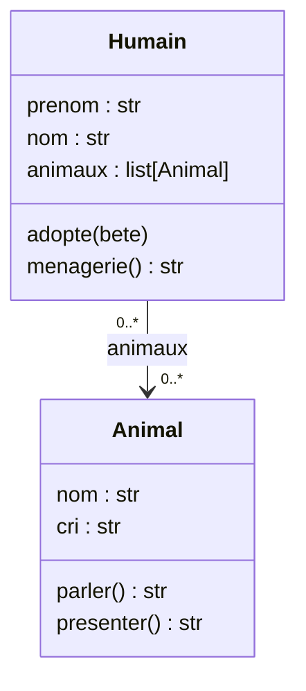
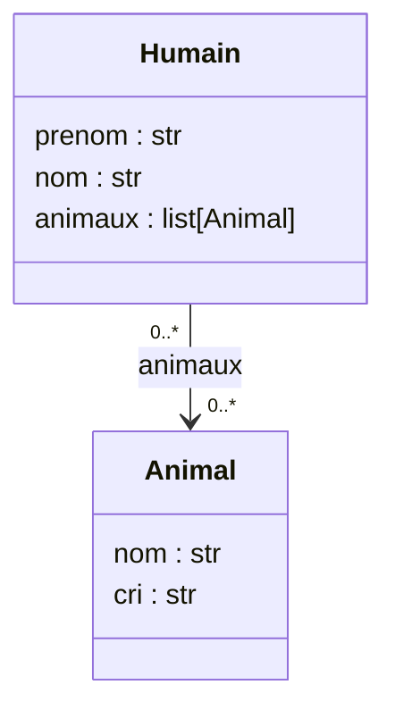
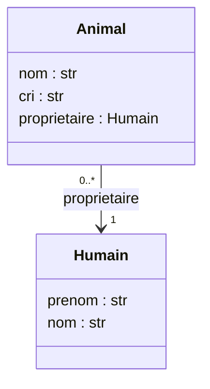

# Objets qui interagissent

!!! danger "Requis"
    La page [Objets et classes](poo.md), et la classe `Eleve` de sa section 6 écrite sans regarder la correction. Savoir dessiner des ronds et des flèches, et dire ce que `is` demande.

    Garde la classe `Animal` dans ton fichier : la classe de cette page la nomme dès sa première ligne, et Python refuse de créer une classe qui déclare un attribut d'un type qu'il ne connaît pas encore.

!!! question "Rappel d'ouverture (5 minutes, de mémoire, cahier fermé)"
    Écris tes réponses sur ton cahier avant de regarder la correction.

    1. `c = Animal("Rocket", "grogne")` et `d = Animal("Rocket", "grogne")`. Que valent `c is d` et `c.nom == d.nom` ? **Écris pourquoi**, une raison pour chacun.
    2. Une fonction annonce dans sa docstring qu'elle ne modifie pas son argument. Que doit regarder son test, en plus de la valeur renvoyée ?
    3. `self.moyenne()` apparaissait dans la méthode `bulletin` de la classe `Eleve`. Sur quel objet cette moyenne est-elle calculée ?

    ??? success "Correction"
        1. `c is d` vaut `False` et `c.nom == d.nom` vaut `True`. `is` demande « est-ce le **même objet** », et il y a bien deux ronds, chaque appel à `Animal(...)` en fabriquant un. `==` compare des **valeurs**, et elles sont égales.
        2. L'**état de l'argument après l'appel**. Un test qui ne regarde que ce qui est renvoyé passe au-dessus de la moitié du contrat.
        3. Sur l'objet courant, celui que `self` désigne, c'est-à-dire l'élève dont on demande le bulletin. Une méthode peut en appeler une autre sur le même objet.

## 1 Un objet peut en contenir d'autres

Jusqu'ici, les attributs étaient des nombres et des chaînes. Rien n'empêche un attribut d'être **un autre objet**, ou une liste d'autres objets. C'est à partir de là qu'un programme cesse d'être une classe isolée.

!!! abstract "Le contrat"
    Un humain porte un **prénom** et un **nom**, et il **adopte** des animaux. On peut demander la liste des noms de ses animaux, un par ligne.

```python
class Humain:
    prenom: str
    nom: str
    animaux: list[Animal]

    def __init__(self, prenom: str, nom: str) -> None:
        self.prenom = prenom
        self.nom = nom
        self.animaux: list[Animal] = []

    def adopte(self, bete: Animal) -> None:
        """Ajoute bete aux animaux de cet humain."""
        self.animaux.append(bete)

    def menagerie(self) -> str:
        """Renvoie les noms des animaux de cet humain, un par ligne."""
        texte = ""
        for bete in self.animaux:
            texte = texte + bete.nom + "\n"
        return texte
```

Le schéma des deux classes porte une nouveauté, la **flèche** qui les relie.



Elle dit trois choses, et chacune se vérifie sur le code au-dessus.

- Son **étiquette** nomme l'attribut qui réalise le rapport, ici `animaux`.
- Les nombres aux deux bouts sont les **cardinalités** : un humain peut avoir de zéro à plusieurs animaux, et un animal peut se trouver chez de zéro à plusieurs humains.
- Sa **pointe** désigne la classe qui est **tenue**, et elle part de celle qui **tient la référence**. Ici `Humain` porte `animaux: list[Animal]`, et `Animal` ne contient pas un seul mot sur les humains. Lis la flèche dans ce sens : un humain peut atteindre ses animaux, un animal ne peut atteindre personne.

La déclaration `animaux: list[Animal]` annonce l'attribut nouveau, et le type dit ce que la liste contiendra : des objets `Animal`, pas des chaînes. C'est pour cela que `menagerie` peut écrire `bete.nom`.

Mais c'est la ligne `self.animaux = []` d'`__init__` qui porte toute la section. Un humain neuf n'a aucun animal, et chacun reçoit **sa** liste au moment où il est fabriqué.

!!! question "Lire et prédire (obligatoire)"
    **Ne regarde pas la correction avant d'avoir écrit tes réponses sur ton cahier.**

    ```python
    peter = Humain("Peter", "Quill")
    rocket = Animal("Rocket", "grogne")
    peter.adopte(rocket)
    print(peter.menagerie())
    print(len(peter.animaux))
    print(peter.animaux[0].parler())
    ```

    Écris :

    - les lignes affichées, l'une sous l'autre,
    - combien d'objets `Animal` ce programme fabrique,
    - ce que désigne exactement `peter.animaux[0]`.

    ??? success "Correction"
        ```text
        Rocket

        1
        Rocket grogne
        ```

        La ligne vide est normale : `menagerie` termine chaque nom par un `\n`, et `print` en ajoute un second.

        **Un seul** objet `Animal` est fabriqué, à la deuxième ligne. `peter.adopte(rocket)` n'en fabrique pas un deuxième : il range dans la liste une **flèche** vers celui qui existe.

        `peter.animaux[0]` désigne donc cet animal-là, le même que `rocket`. C'est pour cela que `peter.animaux[0].parler()` fonctionne : ce qui est rangé dans la liste est un `Animal` complet, avec ses attributs et ses méthodes.

## 2 Un objet peut être à deux endroits à la fois

C'est le point dur de la section, et c'est celui où l'erreur ne se signale pas.

!!! question "Dessiner (obligatoire)"
    **Dessine sur ton cahier avant de lire la suite.** Les règles sont celles de la page précédente : un objet, un rond, ses attributs dedans ; un nom, une flèche depuis l'extérieur.

    ```python
    peter = Humain("Peter", "Quill")
    gamora = Humain("Gamora", "Zen Whoberi")
    rocket = Animal("Rocket", "grogne")
    peter.adopte(rocket)
    gamora.adopte(rocket)
    rocket.nom = "Groot"
    ```

    Produis :

    - le dessin après la cinquième ligne : tous les ronds, tous les noms, toutes les flèches, **y compris celles qui partent des listes**,
    - le nombre total de ronds,
    - ce que renvoie `peter.menagerie()` après la sixième ligne,
    - ce que renvoie `gamora.menagerie()` après la sixième ligne.

    ??? success "Correction"
        **Trois** ronds : deux humains et **un seul** animal. Et deux flèches arrivent sur l'animal, une depuis la liste de chaque humain.

        ```mermaid
        graph LR
          peter["prenom : Peter<br>nom : Quill<br>animaux : [ ]"] --> r["nom : Groot<br>cri : grogne"]
          gamora["prenom : Gamora<br>nom : Zen Whoberi<br>animaux : [ ]"] --> r
        ```

        Les deux méthodes renvoient la **même** chose, `"Groot\n"`. On a renommé l'animal par le nom `rocket`, et le changement se voit chez les deux humains, parce qu'il n'y a qu'un animal.

        C'est l'aliasing de la page précédente, remonté d'un cran : ce ne sont plus deux variables qui désignent le même objet, c'est une variable et **deux listes**.

        Et c'est ce que le `0..*` du côté `Humain`, sur le schéma de la section 1, annonçait : un même animal peut se trouver chez plusieurs humains à la fois.

### Le bogue qui ne se voit pas tout de suite

On ajoute une méthode à `Humain`. Son contrat est clair, et pourtant elle est fausse.

```python
    def adopte_tous_de(self, autre: Humain) -> None:
        """Adopte tous les animaux de autre.

        autre garde les siens : il n'en perd aucun, et ce qui arrive
        ensuite chez l'un ne change rien chez l'autre.
        """
        self.animaux = autre.animaux
```

!!! question "Trouver quand ça casse (obligatoire)"
    Voici le début d'un test. Les deux assertions écrites **passent**.

    ```python
    def test_adopte_tous_de() -> None:
        peter = Humain("Peter", "Quill")
        gamora = Humain("Gamora", "Zen Whoberi")
        peter.adopte(Animal("Rocket", "grogne"))

        gamora.adopte_tous_de(peter)
        assert gamora.menagerie() == "Rocket\n"
        assert peter.menagerie() == "Rocket\n"

        gamora.adopte(Animal("Groot", "ne dit rien"))
        assert ...        # ce que gamora a maintenant
        assert ...        # ce que peter a maintenant
    ```

    Réponds sur ton cahier :

    - que vaut `peter.menagerie()` à la fin, **vraiment** ?
    - écris les deux assertions manquantes, celles qui disent ce qui **devrait** se passer,
    - laquelle des quatre assertions échoue ?
    - réécris `adopte_tous_de` pour qu'elles passent toutes.

    ??? tip "Indice"
        Dessine après `gamora.adopte_tous_de(peter)`. Combien de **listes** y a-t-il ?

    ??? note "Avant d'ouvrir la correction"
        Les deux premières assertions passent avec la méthode fausse. Qu'est-ce que cela t'apprend sur le moment où il faut tester un contrat du genre « l'autre n'est pas modifié » ?

    ??? warning "Correction"
        `peter.menagerie()` vaut `"Rocket\nGroot\n"`. Peter a reçu un animal que **Gamora** a adopté.

        ```python
            gamora.adopte(Animal("Groot", "ne dit rien"))
            assert gamora.menagerie() == "Rocket\nGroot\n"
            assert peter.menagerie() == "Rocket\n"
        ```

        C'est la **quatrième** qui échoue. `self.animaux = autre.animaux` ne copie pas la liste : les deux humains partagent désormais la même, et tout ajout chez l'un apparaît chez l'autre.

        ```python
            def adopte_tous_de(self, autre: Humain) -> None:
                """Adopte tous les animaux de autre.

                autre garde les siens : il n'en perd aucun, et ce qui arrive
                ensuite chez l'un ne change rien chez l'autre.
                """
                for bete in autre.animaux:
                    self.adopte(bete)
        ```

        **Et une subtilité qui vaut la section entière.** Cette version fabrique une liste propre à chacun, mais les **animaux**, eux, restent partagés : `peter.animaux[0] is gamora.animaux[0]` vaut `True`. C'est voulu, c'est bien le même Rocket. Copier la liste n'est pas copier ce qu'elle contient, et c'est exactement ce qu'on voulait ici.

!!! warning "Ce que ce test apprend, et qui vaut au-delà"
    Les deux premières assertions **passent** avec la méthode fausse. Un contrat du genre « l'autre n'est pas modifié » ne se teste donc pas seulement **juste après** l'appel : il se teste **après une action ultérieure**. C'est le seul moment où un partage de structure se révèle.

## 3 Quelle classe est le chef d'orchestre

Une question se pose chaque fois que deux classes sont en rapport, et elle n'a pas de réponse automatique : **qui garde la référence vers l'autre ?** Jusqu'ici l'humain tenait ses animaux. Rien n'obligeait à faire ainsi.

Les deux schémas ci-dessous ne portent que les **attributs**, et laissent la partie des méthodes vide : c'est dans les attributs que la question se joue.

**Conception A, celle de la section 1 : l'humain tient ses animaux.**



```python
class Humain:
    prenom: str
    nom: str
    animaux: list[Animal]

    def __init__(self, prenom: str, nom: str) -> None:
        self.prenom = prenom
        self.nom = nom
        self.animaux = []
```

**Conception B : l'animal garde son propriétaire.**



```python
class Animal:
    nom: str
    cri: str
    proprietaire: Humain

    def __init__(self, nom: str, cri: str, proprietaire: Humain) -> None:
        self.nom = nom
        self.cri = cri
        self.proprietaire = proprietaire
```

Les deux décrivent le même monde, et elles n'écrivent pas le même programme. La flèche a changé de sens, les cardinalités aussi, et surtout l'attribut a changé de classe. **Ce n'est pas une question de goût**, et ce n'est pas non plus arbitraire : ce qui tranche est la liste des questions auxquelles le programme devra répondre.

!!! question "Choisir, et dire pourquoi (obligatoire)"
    Deux questions qu'un programme pourrait avoir à traiter :

    - **(a)** quels sont les animaux de Peter ?
    - **(b)** à qui appartient Rocket ?

    Recopie et remplis ce tableau sur ton cahier. Dans chaque case, écris **immédiat** si la réponse se lit directement sur l'objet, ou **parcours** s'il faut passer en revue tous les objets de l'autre classe.

    | | (a) les animaux de Peter | (b) le propriétaire de Rocket |
    |---|---|---|
    | `Humain` porte `animaux: list[Animal]` | | |
    | `Animal` porte `proprietaire: Humain` | | |

    Puis réponds en une phrase : si ton programme ne pose **jamais** la question (b), lequel des deux choix retiens-tu ?

    ??? success "Correction"
        | | (a) les animaux de Peter | (b) le propriétaire de Rocket |
        |---|---|---|
        | `Humain` porte `animaux: list[Animal]` | **immédiat** | **parcours** de tous les humains |
        | `Animal` porte `proprietaire: Humain` | **parcours** de tous les animaux | **immédiat** |

        Chaque choix rend une question immédiate et l'autre coûteuse. Si la question (b) ne se pose jamais, on retient le premier : l'humain porte ses animaux, et on n'a même pas besoin de tenir la liste de tous les animaux du monde pour répondre à (a).

        La classe qui porte la référence est celle qu'on appelle le **chef d'orchestre**, et c'est elle d'où part la flèche du schéma.

        **Et le troisième choix, celui auquel on pense toujours, est le plus cher.** Rien n'empêche de faire les deux à la fois : `Humain` garde sa liste **et** `Animal` garde son propriétaire. Les deux questions deviennent immédiates, et on paie l'addition ailleurs : à chaque adoption il faut penser à écrire les **deux** attributs, et le jour où l'un est mis à jour sans l'autre, le programme croit deux choses contradictoires sans rien signaler. C'est une version du bogue de la section 2, et elle ne se répare pas en relisant une ligne : il faut retrouver tous les endroits qui modifient l'un des deux côtés.

## 4 À toi d'écrire : la voiture

!!! question "Classe `Voiture` (obligatoire)"
    Une seule classe, pour se remettre en jambes avant la suivante.

    !!! abstract "Le contrat"
        Une voiture porte une **marque**, un **modèle**, un **prix**, une **consommation** en litres aux 100 km et une **capacité** de réservoir en litres. Elle démarre à **0 km** et le réservoir **vide**.

        - `roule(distance)` augmente le kilométrage et diminue le carburant. Précondition : il y a assez de carburant pour la distance.
        - `plein()` remplit le réservoir et renvoie le nombre de litres ajoutés.
        - `fiche()` renvoie une chaîne de la forme `"Renault Clio : 300.0 km, 35.0 L"`.

    Complète le squelette, puis les assertions marquées d'un commentaire, et lance le test.

    ```python
    class Voiture:
        ...               # les declarations d'attributs, une par ligne

        def __init__(self, marque: str, modele: str, prix: float,
                     conso: float, capacite: float) -> None:
            ...

        def roule(self, distance: float) -> None:
            """Augmente le kilométrage de distance et diminue le carburant.

            Précondition : le carburant suffit pour la distance.
            """
            ...

        def plein(self) -> float:
            """Remplit le réservoir et renvoie le nombre de litres ajoutés."""
            ...

        def fiche(self) -> str:
            """Renvoie une chaîne de la forme 'Renault Clio : 300.0 km, 35.0 L'."""
            ...


    def test_Voiture() -> None:
        v = Voiture("Renault", "Clio", 12000.0, 5.0, 50.0)
        assert v.km == 0.0
        assert v.carburant == 0.0
        assert v.plein() == 50.0
        assert ...        # le carburant apres le plein
        v.roule(100.0)
        assert v.km == 100.0
        assert ...        # le carburant apres 100 km a 5 L aux 100
        v.roule(200.0)
        assert ...        # le kilometrage
        assert ...        # le carburant
        assert ...        # ce que renvoie fiche()
    ```

    ??? tip "Indice : la consommation"
        La consommation est donnée **aux 100 km**. Pour une distance `d`, le carburant consommé est donc `d * self.conso / 100`.

    ??? note "Avant d'ouvrir la correction"
        Si une assertion échoue, écris d'abord la valeur que tu attendais et celle que Python donne. L'écart entre les deux désigne la ligne à corriger, plus sûrement que le message d'erreur.

    ??? warning "Correction"
        ```python
        class Voiture:
            marque: str
            modele: str
            prix: float
            conso: float
            capacite: float
            km: float
            carburant: float

            def __init__(self, marque: str, modele: str, prix: float,
                         conso: float, capacite: float) -> None:
                self.marque = marque
                self.modele = modele
                self.prix = prix
                self.conso = conso
                self.capacite = capacite
                self.km = 0.0
                self.carburant = 0.0

            def roule(self, distance: float) -> None:
                """Augmente le kilométrage de distance et diminue le carburant.

                Précondition : le carburant suffit pour la distance.
                """
                self.km = self.km + distance
                self.carburant = self.carburant - distance * self.conso / 100

            def plein(self) -> float:
                """Remplit le réservoir et renvoie le nombre de litres ajoutés."""
                litres = self.capacite - self.carburant
                self.carburant = self.capacite
                return litres

            def fiche(self) -> str:
                """Renvoie une chaîne de la forme 'Renault Clio : 300.0 km, 35.0 L'."""
                return f"{self.marque} {self.modele} : {self.km} km, {self.carburant} L"


        def test_Voiture() -> None:
            v = Voiture("Renault", "Clio", 12000.0, 5.0, 50.0)
            assert v.km == 0.0
            assert v.carburant == 0.0
            assert v.plein() == 50.0
            assert v.carburant == 50.0
            v.roule(100.0)
            assert v.km == 100.0
            assert v.carburant == 45.0
            v.roule(200.0)
            assert v.km == 300.0
            assert v.carburant == 35.0
            assert v.fiche() == "Renault Clio : 300.0 km, 35.0 L"
        ```

        Deux remarques. `plein` renvoie `self.capacite - self.carburant`, et non `self.capacite` : on paie ce qu'on ajoute, pas ce que contient le réservoir à la fin. Et `km` et `carburant` ne sont **pas** des paramètres du constructeur : ils valent toujours la même chose au départ, donc ils n'ont rien à faire dans les parenthèses.

## 5 À toi d'écrire : le conducteur

C'est ici que la composition revient. Le conducteur ne roule pas lui-même : il **demande** à une voiture de rouler, et il décide quand faire le plein.

!!! question "Classe `Conducteur` (obligatoire)"
    !!! abstract "Le contrat"
        Un conducteur porte un **prénom**, une somme d'**argent**, et la liste de ses **voitures**, vide au départ. Le prix du litre est la constante `PRIX_LITRE`.

        - `achete(v)` ajoute `v` à ses voitures et diminue son argent du prix de `v`. Précondition : il a assez d'argent.
        - `trajet(v, distance)` fait rouler `v` sur `distance` km. Si le carburant ne suffit pas, il fait d'abord le plein et paie les litres ajoutés. Il renvoie ce que le trajet a coûté en carburant, et `0.0` si aucun plein n'a été nécessaire. Précondition : `v` est à lui, et un réservoir plein suffit pour la distance.

    **Avant d'écrire la moindre ligne**, dessine sur ton cahier le schéma des deux classes, `Voiture` et `Conducteur`, avec la flèche et ses cardinalités. Réfléchis au sens de la pointe avant de la tracer. Le contrat ci-dessus te donne tout ce qu'il faut : attributs, types, méthodes, et ce qu'elles renvoient. Une fois le schéma fait, tu sauras quoi écrire.

    ```python
    PRIX_LITRE = 2.0


    class Conducteur:
        ...               # les declarations d'attributs, une par ligne

        def __init__(self, prenom: str, argent: float) -> None:
            ...

        def achete(self, v: Voiture) -> None:
            """Ajoute v à ses voitures et diminue son argent du prix de v.

            Précondition : il a assez d'argent.
            """
            ...

        def trajet(self, v: Voiture, distance: float) -> float:
            """Fait rouler v sur distance km, après un plein si nécessaire.

            Renvoie le coût du carburant acheté, 0.0 si aucun plein.
            Précondition : v est à lui, et un plein suffit pour la distance.
            """
            ...


    def test_Conducteur() -> None:
        sam = Conducteur("Sam", 15000.0)
        clio = Voiture("Renault", "Clio", 12000.0, 5.0, 50.0)
        assert sam.voitures == []

        sam.achete(clio)
        assert sam.argent == 3000.0
        assert len(sam.voitures) == 1
        assert ...        # la voiture rangee est bien CELLE qu'on a achetee

        cout = sam.trajet(clio, 100.0)
        assert cout == 100.0
        assert ...        # l'argent de sam
        assert ...        # le kilometrage de la clio
        assert ...        # le carburant de la clio

        cout = sam.trajet(clio, 200.0)
        assert ...        # le cout de ce second trajet
        assert ...        # le carburant de la clio
    ```

    ??? tip "Indice : la quatrième assertion"
        Elle ne compare pas des valeurs, elle demande si deux noms désignent le **même** objet. Un seul opérateur fait cela.

    ??? note "Avant d'ouvrir la correction"
        Le second trajet ne coûte rien. Avant de regarder, écris pourquoi, en une phrase, et vérifie que ton `trajet` produit bien ce résultat.

    ??? warning "Correction"
        ```python
        PRIX_LITRE = 2.0


        class Conducteur:
            prenom: str
            argent: float
            voitures: list[Voiture]

            def __init__(self, prenom: str, argent: float) -> None:
                self.prenom = prenom
                self.argent = argent
                self.voitures: list[Voiture] = []

            def achete(self, v: Voiture) -> None:
                """Ajoute v à ses voitures et diminue son argent du prix de v.

                Précondition : il a assez d'argent.
                """
                self.voitures.append(v)
                self.argent = self.argent - v.prix

            def trajet(self, v: Voiture, distance: float) -> float:
                """Fait rouler v sur distance km, après un plein si nécessaire.

                Renvoie le coût du carburant acheté, 0.0 si aucun plein.
                Précondition : v est à lui, et un plein suffit pour la distance.
                """
                necessaire = distance * v.conso / 100
                cout = 0.0
                if v.carburant < necessaire:
                    litres = v.plein()
                    cout = litres * PRIX_LITRE
                    self.argent = self.argent - cout
                v.roule(distance)
                return cout


        def test_Conducteur() -> None:
            sam = Conducteur("Sam", 15000.0)
            clio = Voiture("Renault", "Clio", 12000.0, 5.0, 50.0)
            assert sam.voitures == []

            sam.achete(clio)
            assert sam.argent == 3000.0
            assert len(sam.voitures) == 1
            assert (sam.voitures[0] is clio) == True

            cout = sam.trajet(clio, 100.0)
            assert cout == 100.0
            assert sam.argent == 2900.0
            assert clio.km == 100.0
            assert clio.carburant == 45.0

            cout = sam.trajet(clio, 200.0)
            assert cout == 0.0
            assert sam.argent == 2900.0
            assert clio.carburant == 35.0
        ```

        Le second trajet ne coûte rien : le réservoir contient encore 45 L, et 200 km à 5 L aux 100 en demandent 10. Aucun plein, donc aucune dépense.

        **La quatrième assertion est celle qui porte la section.** `sam.voitures[0] is clio` dit que la voiture rangée est **celle** qu'on a achetée, et non une copie. C'est ce qui permet à `trajet` de modifier le kilométrage et le carburant de la vraie Clio : le conducteur et la variable `clio` désignent le même rond.

        Et remarque qui dirige qui : c'est `Conducteur` qui appelle `v.plein()` et `v.roule()`, jamais l'inverse. Une voiture ne sait pas qu'elle a un propriétaire, et n'a pas besoin de le savoir.


## 6 Ce qui vient ensuite

Un objet qui en contient d'autres, et une classe qui en pilote une autre : c'est le motif de tout ce qui suit.

[Le projet de jeu](../../projets/pyxel/space_invader.md) en est fait entièrement, une classe `Jeu` tenant un vaisseau, des ennemis et des tirs, et les faisant agir à chaque image. Et la liste chaînée ira plus loin encore : un objet qui référence un objet **de sa propre classe**.

Avant cela, il reste une façon d'écrire une classe à partir d'une autre : [l'héritage](heritage.md).
