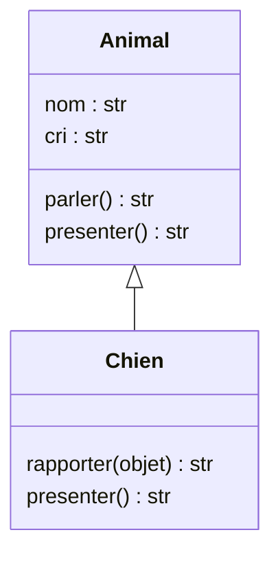

# Héritage

!!! danger "Requis"
    La page [Objets et classes](poo.md), et la classe `Eleve` de sa section 6 écrite sans regarder la correction. Savoir dire ce que vaut `self` pendant l'exécution d'une méthode.

!!! question "Rappel d'ouverture (5 minutes, de mémoire, cahier fermé)"
    Écris tes réponses sur ton cahier avant de regarder la correction.

    1. Dans une méthode, à quoi correspond `self` ? Une phrase.
    2. On a `x = Animal("Rocket", "grogne")` et `y = x`, puis `y.cri = "ne dit rien"`. Que renvoie `x.parler()` ?
    3. La méthode `presenter` d'`Animal` ne contient pas le mot `cri`, et pourtant son résultat change quand `cri` change. Pourquoi ?

    ??? success "Correction"
        1. `self` désigne l'objet **sur lequel** la méthode a été appelée. Écrire `x.parler()` exécute `parler` avec `self` valant l'objet désigné par `x`.
        2. `"Rocket ne dit rien"`. `y = x` ne copie pas l'animal, les deux noms désignent le même objet, donc écrire par `y` se lit par `x`.
        3. Parce que `presenter` appelle `self.parler()`, et que c'est `parler` qui lit `cri`. Retiens ce chemin, c'est exactement ce que cette page va exploiter.

## 1 Écrire une classe à partir d'une autre

Un chien **est un** animal. Il porte un nom, il a un cri, il sait parler et se présenter. Tout cela est déjà écrit dans `Animal`, et le recopier serait du travail en double : le jour où `parler` change, il faudrait le changer à deux endroits.

!!! abstract "Héritage"
    Une classe peut être écrite **à partir** d'une autre. Elle en reçoit tous les attributs et toutes les méthodes sans les réécrire, et elle peut en **ajouter** de nouveaux, ou en **redéfinir** un qui ne lui convient pas.

    La classe de départ est la **super classe**, celle qu'on écrit à partir d'elle est la **sous classe**. Le test en français est « **est un** » : un chien est un animal, donc `Chien` peut hériter d'`Animal`.

```python
class Chien(Animal):
    def __init__(self, nom: str) -> None:
        super().__init__(nom, "aboie")

    def rapporter(self, objet: str) -> str:
        return f"{self.nom} rapporte {objet}."

    def presenter(self) -> str:
        return f"Je suis {self.nom}, et je rapporte tout ce qui traîne."
```

Le schéma porte une seconde sorte de flèche, à **pointe creuse**, et elle ne dit pas du tout la même chose que celle de la page précédente.



La flèche à pointe simple de la page précédente disait « **a un** », et sa pointe désignait la classe tenue : un humain a des animaux. Celle-ci, à pointe creuse, dit « **est un** », et elle va toujours de la sous classe vers la super classe : un chien **est un** animal. Deux pointes différentes, deux sens de lecture différents.

Deux détails du schéma méritent qu'on s'arrête.

- La partie des attributs de `Chien` est **vide**. Un chien n'en ajoute aucun : il a `nom` et `cri` comme tout animal, et c'est la flèche qui le dit. C'est pour cela que la classe ne **déclare** aucun attribut en haut, contrairement à `Animal` et à `Humain`. Rien à recopier.
- `parler` ne figure pas non plus dans `Chien`, alors que `presenter` y figure. On n'écrit dans la sous classe que ce qu'elle **ajoute** ou ce qu'elle **redéfinit**. Tout le reste se lit en remontant la flèche.

Trois choses se passent dans ces sept lignes, et il faut les distinguer.

- **`Chien(Animal)`** dit d'où l'on part. Tout ce qu'`Animal` sait faire, `Chien` le sait déjà.
- **`super().__init__(nom, "aboie")`** appelle le constructeur de la super classe. Un chien a un cri comme tout animal, et ce cri est toujours le même : la sous classe **fixe** ce que la super classe laissait au choix. C'est pour cela que `Chien("Medor")` ne prend qu'un argument.
- **`rapporter` est ajoutée**, elle n'existe pas dans `Animal`. **`presenter` est redéfinie**, elle existait déjà et la version de `Chien` remplace celle d'`Animal` pour les chiens, et pour eux seuls.

Et `parler` n'apparaît nulle part dans `Chien`. C'est voulu : elle est héritée telle quelle.

!!! question "Lire et prédire (obligatoire)"
    **Ne regarde pas la correction avant d'avoir écrit tes réponses sur ton cahier.**

    ```python
    rocket = Animal("Rocket", "grogne")
    medor = Chien("Medor")
    print(rocket.parler())
    print(medor.parler())
    print(medor.rapporter("la balle"))
    print(rocket.presenter())
    print(medor.presenter())
    print(isinstance(medor, Animal), isinstance(rocket, Chien))
    ```

    Écris :

    - les **six lignes** affichées, l'une sous l'autre,
    - pour `medor.parler()`, le **nom** de la classe où est écrite la méthode qui s'exécute, `Animal` ou `Chien`,
    - la même question pour `medor.presenter()`.

    ??? success "Correction"
        ```text
        Rocket grogne
        Medor aboie
        Medor rapporte la balle.
        Je suis Rocket. Rocket grogne
        Je suis Medor, et je rapporte tout ce qui traîne.
        True False
        ```

        `medor.parler()` exécute la méthode d'**`Animal`** : `Chien` n'en a pas, donc on remonte à la super classe. Elle renvoie `"Medor aboie"` parce que `self.cri` vaut `"aboie"`, posé par `super().__init__`.

        `medor.presenter()` exécute la méthode de **`Chien`** : elle y existe, donc celle d'`Animal` n'est pas utilisée. `rocket`, lui, n'est pas un chien, et prend donc celle d'`Animal`.

        La dernière ligne dit que `medor` **est un** animal, et que `rocket` **n'est pas** un chien. `isinstance` sert à cela. Hors du débogage, en avoir besoin est en général le signe qu'on s'y est mal pris.

## 2 La méthode qui part est celle de l'objet, pas celle du code qui l'appelle

C'est le point qui décide si l'héritage est compris, et il se joue en trois lignes.

!!! question "Qui parle ? (obligatoire)"
    **Ne regarde pas la correction avant d'avoir écrit ta réponse sur ton cahier.**

    ```python
    class A:
        def dire(self) -> str:
            return "A"

        def presenter(self) -> str:
            return "je dis " + self.dire()

    class B(A):
        def dire(self) -> str:
            return "B"

    b = B()
    print(b.presenter())
    ```

    Écris :

    - la ligne affichée,
    - le nom de la classe où est écrite la méthode `presenter` qui s'exécute,
    - le nom de la classe où est écrite la méthode `dire` qui s'exécute.

    ??? note "Avant d'ouvrir la correction"
        `presenter` n'est écrite que dans `A`, et `A` ne connaît pas `B`. Pendant son exécution, que vaut `self` ?

    ??? success "Correction"
        La ligne affichée est `je dis B`.

        `presenter` est celle de **`A`**, puisque `B` n'en a pas.

        `dire` est celle de **`B`**. C'est le point à retenir : `presenter` écrit `self.dire()`, et `self` est l'objet sur lequel on a appelé la méthode, c'est-à-dire un `B`. On part donc chercher `dire` dans `B` d'abord, et on l'y trouve.

        Autrement dit, une méthode écrite dans la super classe appelle la version **redéfinie** de la sous classe sans rien savoir d'elle. Ce n'est pas le texte de `A` qui décide, c'est l'objet.

## 3 À toi d'écrire

!!! question "Classe `Chat` (obligatoire)"
    Un chat **est un** animal. Il miaule, toujours, et il sait en plus **ronronner**.

    Écris la classe `Chat`, sur le modèle de `Chien`, puis complète les assertions marquées d'un commentaire et lance le test.

    ```python
    class Chat(Animal):
        def __init__(self, nom: str) -> None:
            ...

        def ronronner(self) -> str:
            """Renvoie une chaîne de la forme 'Felix ronronne.'."""
            ...


    def test_Chat() -> None:
        felix = Chat("Felix")
        assert felix.nom == "Felix"
        assert ...        # son cri
        assert ...        # ce que renvoie parler()
        assert ...        # ce que renvoie ronronner()
        assert ...        # ce que renvoie presenter()
        assert isinstance(felix, Animal) == True
    ```

    ??? tip "Indice"
        Tu n'écris ni `self.nom`, ni `self.cri`, ni `parler`, ni `presenter`. Une seule ligne de `__init__` suffit, et `Chien` te la montre.

    ??? note "Avant d'ouvrir la correction"
        Deux des assertions à compléter portent sur des méthodes que tu n'as **pas** écrites. Si tu ne sais pas quoi y mettre, relis la section 1 : où est écrite la méthode qui s'exécute ?

    ??? warning "Correction"
        ```python
        class Chat(Animal):
            def __init__(self, nom: str) -> None:
                super().__init__(nom, "miaule")

            def ronronner(self) -> str:
                """Renvoie une chaîne de la forme 'Felix ronronne.'."""
                return f"{self.nom} ronronne."


        def test_Chat() -> None:
            felix = Chat("Felix")
            assert felix.nom == "Felix"
            assert felix.cri == "miaule"
            assert felix.parler() == "Felix miaule"
            assert felix.ronronner() == "Felix ronronne."
            assert felix.presenter() == "Je suis Felix. Felix miaule"
            assert isinstance(felix, Animal) == True
        ```

        `Chat` ne déclare aucun attribut en haut, comme `Chien` : il n'en ajoute pas, il **fixe** seulement le `cri` qu'`Animal` laissait au choix.

        `parler` et `presenter` fonctionnent sans qu'une ligne ait été écrite pour elles : c'est tout l'intérêt. Et `presenter` renvoie bien `"Je suis Felix. Felix miaule"`, donc elle a appelé `parler`, qui a lu le `cri` que `super().__init__` avait posé.

## 4 Ce qui vient ensuite

L'héritage sert peu quand les classes sont aussi proches que `Chien` et `Chat` : un attribut `cri` suffisait. Il devient utile quand la sous classe fait vraiment autre chose.

Tu en rencontreras deux usages dans la suite de l'année, et tu peux déjà aller voir à quoi ils ressemblent.

- **[Le projet Space Invaders](../../projets/pyxel/space_invader.md)**, où une classe `EltGraphique` porte ce que tout élément à l'écran sait faire, sa position, son déplacement, son dessin, sa collision, et où `Vaisseau`, `Ennemi` et `Missile` n'écrivent que ce qui les distingue. Le schéma de classes y est déjà dessiné, et tu sais maintenant le lire : trois flèches à pointe creuse, et un trait entre `Jeu` et `Vaisseau` avec ses cardinalités.
- **[La liste chaînée](../structures-de-donnees/listes/maillons.md)**, où une classe marque la fin de la chaîne en héritant du maillon ordinaire. Elle s'écrit en Java, et c'est là que la forme de la section 2 de la première page prend tout son sens.

!!! info "Les schémas ont un nom"
    Les trois dessins de ce chapitre, le cadre en trois parties, la flèche à pointe simple et celle à pointe creuse, ne sont pas une invention de ce cours. Ils viennent d'une notation standard, **UML**, utilisée partout où l'on conçoit des programmes à objets, et tu en as vu la petite partie qui sert ici.

    Deux choses à savoir si tu cherches par toi-même. C'est le mot à taper, et il te donnera bien plus que ce dont tu as besoin : UML compte une dizaine de sortes de schémas, et une seule nous a servi. Et tu verras des `+` et des `-` devant les attributs, que nous n'écrivons pas : ils disent ce qui est accessible depuis l'extérieur de la classe, et Python ne le marque pas.

    Tu n'as d'ailleurs pas besoin de chercher pour les rencontrer. Le schéma du projet Space Invaders les emploie, et il y écrit aussi le type **avant** le nom, `+float x` au lieu de `x : float`. C'est l'ordre de Java, celui que tu retrouveras dans la liste chaînée.
