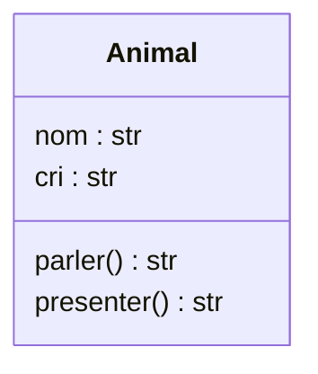

# Objets et classes

!!! danger "Requis"
    Écrire une fonction avec sa signature typée et sa docstring, et la tester. Savoir que `b = a` sur une liste Python ne copie rien.

!!! question "Rappel d'ouverture (5 minutes, de mémoire, cahier fermé)"
    Écris tes réponses sur ton cahier avant de regarder la correction.

    1. On a `a = [1, 2, 3]` et la fonction ci-dessous. Après `changer(a)`, que vaut `a` ? **Écris pourquoi.**

        ```python
        def changer(t: list[int]) -> None:
            t = [9]
        ```

    2. Même question avec celle-ci, toujours depuis `a = [1, 2, 3]`.

        ```python
        def changer(t: list[int]) -> None:
            t[0] = 9
        ```

    3. Écris la **signature typée** et la **docstring** d'une fonction qui prend une liste d'entiers non vide et renvoie la plus grande valeur. N'écris pas le corps.

    ??? success "Correction"
        1. `a` vaut `[1, 2, 3]`. La ligne `t = [9]` fabrique une liste neuve et accroche le nom local `t` dessus. Le nom `a`, lui, n'a pas bougé : il désigne toujours la même liste qu'avant l'appel.
        2. `a` vaut `[9, 2, 3]`. Cette fois on ne change pas ce que `t` désigne, on change **l'intérieur** de l'objet désigné. Et comme `a` et `t` désignent le même objet, le changement se voit par les deux noms.

            La différence entre ces deux lignes est tout le sujet de ce chapitre. Garde-les sous la main.
        3. Par exemple :

            ```python
            def maximum(nombres: list[int]) -> int:
                """Renvoie la plus grande valeur de nombres.

                Précondition : nombres contient au moins un élément.
                """
            ```

## 1 Le contrat, d'abord

Jusqu'ici, un programme était une suite de fonctions qui se passaient des données. On va écrire autrement : un programme devient un ensemble d'**entités** qui se parlent.

Tout part d'une phrase en français, et c'est elle qu'il faut savoir lire avant d'écrire la moindre ligne.

!!! abstract "Le contrat"
    Un animal porte un **nom** et un **cri**. Il sait **parler**, et il sait **se présenter**.

!!! abstract "Les quatre mots"
    - Un **objet** porte un **état** (les données qui le caractérisent) et des **comportements** (ce qu'il sait faire).
    - L'état d'un objet, ce sont ses **attributs** : ici `nom` et `cri`.
    - Ses comportements, ce sont ses **méthodes** : ici `parler` et `presenter`.
    - Une **classe** décrit une famille d'objets. À partir d'une classe, on fabrique autant d'objets qu'on veut. Chacun est une **instance** de la classe.

La phrase ci-dessus décrit **une** classe. Elle ne décrit aucun animal en particulier : relis-la, elle ne donne ni nom ni cri. C'est le partage à tenir du début à la fin du chapitre. La classe est le texte que tu écris une fois. Les objets naissent pendant que le programme tourne.

## 2 La classe `Animal`

```python
class Animal:
    nom: str
    cri: str

    def __init__(self, nom: str, cri: str) -> None:
        self.nom = nom
        self.cri = cri

    def parler(self) -> str:
        return f"{self.nom} {self.cri}"

    def presenter(self) -> str:
        debut = f"Je suis {self.nom}. "
        return debut + self.parler()
```

Le même contenu se dessine, et c'est sous cette forme qu'on parlera des classes à partir de maintenant.



!!! abstract "Lire le schéma d'une classe"
    Le cadre se lit de haut en bas, en trois parties.

    - Le **nom de la classe**.
    - Ses **attributs**, avec leur type. C'est l'état d'un objet, ce que `__init__` installe.
    - Ses **méthodes**, avec ce qu'elles renvoient après la parenthèse. C'est ce qu'un objet sait faire.

    Deux choses n'y figurent pas, et c'est voulu. `__init__` n'est pas listé : il ne fait pas partie de ce qu'un objet sait faire, il sert à le fabriquer. Et `self` n'apparaît dans aucune parenthèse : ce n'est pas un argument qu'on donne, c'est l'objet lui-même.

    Un schéma décrit la classe, donc **le texte que tu écris**. Il ne montre aucun objet : ceux-là n'existent que pendant l'exécution, et c'est à eux que servent les ronds et les flèches de la section 4.

Deux choses à relever tout de suite.

- **Les deux premières lignes déclarent l'état.** Elles disent quels attributs tout animal possède, et de quel type. C'est la liste qu'on lit dans la partie du milieu du schéma, et c'est la façon habituelle d'écrire une classe, en Python comme dans les autres langages à objets.
- **Elles annoncent l'état, elles ne le fabriquent pas.** L'attribut n'existe sur un objet que lorsqu'une ligne `self.nom = ...` s'exécute. Déclarer en haut sans affecter dans `__init__` donne un objet sans l'attribut.
- **`__init__` reçoit des paramètres**, `nom` et `cri`, et les range dans l'objet. On ne fabrique jamais un animal vide qu'on remplirait après : un objet naît avec son état.
- **Chaque méthode prend `self` en premier paramètre.** On n'écrit jamais rien dans les parenthèses à cet endroit quand on appelle la méthode. La section 3 dit ce que `self` désigne.

!!! abstract "Constructeur"
    Le **constructeur** est la méthode appelée au moment où l'objet est fabriqué. En Python, c'est `__init__`. Son travail est d'installer les attributs de l'objet.

??? info "Pour aller plus loin : `__init__` ne fait que la moitié du travail"
    `__init__` prend `self` en paramètre, donc l'objet existe déjà quand il s'exécute. Ce qui le fabrique est une autre méthode, `__new__`, que personne n'écrit à la main. Le constructeur est en réalité le couple des deux. Si on te pose la question, la réponse attendue reste `__init__`.

!!! question "Lire et prédire (obligatoire)"
    Voici un programme qui utilise la classe. **Ne regarde pas la correction avant d'avoir écrit tes réponses sur ton cahier.**

    ```python
    chien = Animal("Rex", "aboie")
    print(chien.nom)
    chien.nom = "Medor"
    message = chien.parler()
    print(message)
    ```

    Écris sur ton cahier, dans cet ordre :

    - les **deux lignes** affichées, l'une sous l'autre,
    - le nombre d'objets `Animal` fabriqués par ce programme,
    - la valeur de l'attribut `cri` à la fin.

    ??? success "Correction"
        Les deux lignes affichées :

        ```text
        Rex
        Medor aboie
        ```

        **Un seul** objet est fabriqué, à la première ligne. `chien.nom = "Medor"` ne fabrique pas un second chien : il change l'intérieur de celui qui existe. Et `cri` vaut toujours `"aboie"`, personne n'y a touché.

## 3 Qui appelle, et quand

C'est ici que le texte de la classe et l'exécution du programme cessent de se ressembler. Les méthodes sont écrites dans un certain ordre dans la classe, et elles ne s'exécutent **pas** dans cet ordre : elles s'exécutent quand on les appelle, autant de fois qu'on les appelle, et parfois sans qu'aucune ligne du programme principal ne les nomme.

Le code ci-dessous porte des numéros de ligne, et les questions s'y réfèrent.

```python linenums="1"
class Animal:
    nom: str
    cri: str

    def __init__(self, nom: str, cri: str) -> None:
        self.nom = nom
        self.cri = cri

    def parler(self) -> str:
        return f"{self.nom} {self.cri}"

    def presenter(self) -> str:
        debut = f"Je suis {self.nom}. "
        return debut + self.parler()

rocket = Animal("Rocket", "grogne")
groot = Animal("Groot", "ne dit rien")
premier = groot.parler()
print(premier)
second = rocket.presenter()
print(second)
```

!!! question "Suivre le fil (obligatoire)"
    Réponds sur ton cahier. Tu as besoin de dérouler le programme ligne à ligne : aucune de ces réponses ne se devine en lisant les noms.

    - Combien d'objets `Animal` existent **après exécution de la ligne 17** ?
    - **Combien de fois** la ligne 10 s'exécute-t-elle en tout ?
    - Pour **chaque** exécution de la ligne 10, donne le numéro de la ligne qui l'a déclenchée.
    - Pour **chaque** exécution de la ligne 10, donne la valeur de `self.nom`.
    - Les **deux lignes** affichées, l'une sous l'autre.

    ??? note "Avant d'ouvrir la correction"
        Relis les lignes 12 à 14. Y a-t-il, entre 16 et 21, une ligne qui écrit `parler` ? Et pourtant ?

    ??? success "Correction"
        **Deux** objets existent après la ligne 17, celui que `rocket` désigne et celui que `groot` désigne.

        La ligne 10 s'exécute **deux fois**.

        | Exécution | Déclenchée par | `self.nom` vaut |
        |---|---|---|
        | la première | la ligne **18** | `"Groot"` |
        | la seconde | la ligne **14** | `"Rocket"` |

        La seconde est celle qui compte. Entre les lignes 16 et 21, **aucune ligne n'écrit `parler`**. C'est la ligne 14, à l'intérieur de `presenter`, qui l'appelle. Le programme principal demande `presenter`, et `presenter` demande `parler` au passage.

        Les deux lignes affichées :

        ```text
        Groot ne dit rien
        Je suis Rocket. Rocket grogne
        ```

!!! abstract "`self` est l'objet courant"
    Dans une méthode, `self` désigne l'objet **sur lequel** la méthode a été appelée. Quand le programme écrit `groot.parler()`, la méthode `parler` s'exécute avec `self` valant l'objet désigné par `groot`, donc `self.nom` vaut `"Groot"`. Quand il écrit `rocket.presenter()`, le même code s'exécute avec `self` valant l'autre objet.

    Une méthode est écrite **une fois** et s'exécute sur **n'importe quel** objet de la classe. C'est `self` qui dit lequel, à chaque appel.

!!! warning "Trois pièges, et ils se tiennent"
    Ces trois phrases sont fausses, et elles se disent beaucoup. Note dans ton cahier la ligne du programme ci-dessus qui démolit chacune.

    1. « Les méthodes s'exécutent dans l'ordre où elles apparaissent dans la classe. »
    2. « Une méthode ne peut s'exécuter qu'une fois. »
    3. « Pour appeler une méthode, il faut écrire un objet devant le point. »

    ??? success "Correction des trois pièges"
        1. Fausse : `parler` est écrite avant `presenter`, et à la ligne 20 c'est `presenter` qui part la première.
        2. Fausse : la ligne 10 s'exécute deux fois, avec deux objets différents.
        3. Fausse : la ligne 14 écrit `self.parler()`. Il y a bien un nom devant le point, et ce nom est `self`, c'est-à-dire l'objet dans lequel on se trouve déjà.

## 4 Un nom n'est pas un objet

`chien`, `rocket`, `self` ne **sont** pas des objets. Ce sont des noms posés à côté d'une flèche qui désigne un objet. C'est le même mécanisme que sur les listes Python, celui du rappel d'ouverture, et tu vas t'en servir tout le reste du chapitre.

Cette flèche porte un nom : c'est une **référence**. Dire que `x` désigne un objet, ou que `x` porte une référence vers cet objet, est la même chose. Retiens le mot, il sert partout ensuite.

Tu vas passer ce chapitre à déplacer des flèches, et elles ne sont pas à l'écran. Le crayon est donc le premier outil, avant l'éditeur. Deux règles suffisent, les mêmes que celles que tu utiliseras sur les listes chaînées.

1. **Un objet, un rond.** Ses attributs s'écrivent dedans, un par ligne.
2. **Un nom, une flèche.** Il ne se dessine pas en rond : il s'écrit à l'extérieur, avec une flèche vers le rond qu'il désigne, en rouge si tu peux.

!!! question "Dessiner (obligatoire)"
    Voici quatre lignes. **Dessine sur ton cahier avant de lire la suite de la page.**

    ```python
    x = Animal("Rocket", "grogne")
    y = x
    y.nom = "Groot"
    print(x.nom)
    ```

    Produis **deux** dessins et **une** réponse :

    - l'état après la deuxième ligne : tous les ronds, tous les noms, toutes les flèches,
    - l'état après la troisième ligne,
    - la ligne affichée par la quatrième.

    ??? success "Correction"
        Après la deuxième ligne, il y a **un** rond et **deux** flèches qui arrivent dessus.

        ```mermaid
        graph LR
          x --> o1["nom : Rocket<br>cri : grogne"]
          y --> o1
        ```

        `y = x` n'a pas fabriqué de second animal. Elle a posé un second nom sur le même.

        Après la troisième ligne, le rond est toujours unique, et son contenu a changé.

        ```mermaid
        graph LR
          x --> o1["nom : Groot<br>cri : grogne"]
          y --> o1
        ```

        La quatrième ligne affiche donc `Groot`. On a écrit par `y`, et on lit par `x`.

Maintenant, et seulement maintenant, va confronter ton dessin à la machine. Colle ces quatre lignes dans [Python Tutor](https://pythontutor.com/), avance pas à pas, et à chaque étape **écris l'état suivant sur ton cahier avant de cliquer**. Ce qui t'apprend quelque chose est l'écart entre ce que tu avais prévu et ce qui s'affiche.

!!! abstract "Deux questions différentes : `is` et `==`"
    - `a is b` demande « est-ce le **même objet** », c'est-à-dire « ces deux noms désignent-ils le même rond ».
    - `a == b` compare des **valeurs**.

    ```python
    c = Animal("Rocket", "grogne")
    d = Animal("Rocket", "grogne")
    print(c is d)           # False : deux ronds distincts
    print(c.nom == d.nom)   # True  : ils portent le même nom
    ```

    Deux objets peuvent se ressembler en tout point et rester deux objets. « Qui est l'objet ? » est donc une vraie question, et on y répond avec `is`, jamais avec `==`.

## 5 Le bogue qui ne dit rien

Jusqu'ici, quand un programme était faux, il levait une erreur. Celui-ci ne lève rien. Il rend même la bonne valeur.

```python
def renommer(bete: Animal, nouveau: str) -> Animal:
    """Renvoie un nouvel animal, de même cri que bete, portant le nom nouveau.

    L'animal passé en argument n'est pas modifié.
    """
    copie = bete
    copie.nom = nouveau
    return copie
```

Et voici son test. Il passe.

```python
def test_renommer() -> None:
    bete = Animal("Rocket", "grogne")
    assert renommer(bete, "Groot").nom == "Groot"
```

!!! question "Trouver ce que le test ne regarde pas (obligatoire)"
    Réponds sur ton cahier, dans cet ordre :

    - la docstring annonce deux choses. Lesquelles ? Écris-les sous forme de deux phrases courtes.
    - le test en vérifie **une seule**. Laquelle, et laquelle laisse-t-il passer ?
    - écris la ou les **lignes d'assertion manquantes** dans `test_renommer`.
    - écris le `renommer` qui fait ce que sa docstring annonce.

    ??? tip "Indice"
        Dessine. Combien de ronds existent après l'exécution de `copie = bete` ?

    ??? note "Avant d'ouvrir la correction"
        Reprends ta réponse à la question 1 du rappel d'ouverture. `copie = bete` appartient à laquelle des deux lignes que tu y as comparées ?

    ??? warning "Correction"
        La docstring annonce **deux** choses : la valeur rendue est un animal au nom changé et au cri conservé, **et** l'animal passé en argument n'est pas modifié. Le test ne vérifie que le nom de la valeur rendue. Il ne regarde ni le cri, ni l'état de `bete` après l'appel.

        `copie = bete` ne copie rien : c'est la ligne `t = [9]` du rappel, sans le `=` qui fabriquerait un objet neuf. Il n'y a qu'**un** rond, et deux noms dessus. La ligne suivante change donc le nom de l'animal d'origine, et la fonction rend ce même animal.

        Le test complet :

        ```python
        def test_renommer() -> None:
            bete = Animal("Rocket", "grogne")
            autre = renommer(bete, "Groot")
            assert autre.nom == "Groot"
            assert autre.cri == "grogne"
            assert bete.nom == "Rocket"
            assert (autre is bete) == False
        ```

        Les deux dernières assertions sont celles qui comptent, et ce sont exactement celles qu'on oublie. La fonction qui les passe :

        ```python
        def renommer(bete: Animal, nouveau: str) -> Animal:
            """Renvoie un nouvel animal, de même cri que bete, portant le nom nouveau.

            L'animal passé en argument n'est pas modifié.
            """
            return Animal(nouveau, bete.cri)
        ```

!!! warning "Ce qu'il faut retenir de cette section"
    Une fonction qui annonce qu'elle ne modifie pas son argument doit être testée **sur son argument**, pas seulement sur ce qu'elle renvoie. Un test qui ne regarde que la valeur rendue passe au-dessus de la moitié du contrat, et rien ne te le signalera.

## 6 À toi d'écrire

!!! question "Classe `Eleve` (obligatoire)"
    Écris la classe décrite par la phrase suivante.

    !!! abstract "Le contrat"
        Un élève porte un **prénom** et une **classe**, et une liste de **notes**, vide au départ. On peut lui **ajouter une note**, demander sa **moyenne**, et demander son **bulletin**, qui est la chaîne `"Lucie (TG3) : 14.0"`.

    Procède dans cet ordre, et pas dans un autre.

    1. Recopie le squelette ci-dessous et la fonction de test. **Ne touche pas aux signatures.** Commence par **déclarer les attributs en haut de la classe**, avec leur type, comme dans l'exemple `Animal`. La phrase ci-dessus te dit lesquels, et le type de la liste s'écrit `list[int]`.
    2. Complète les assertions de `test_Eleve` marquées par un commentaire. Fais-le **avant** d'écrire le moindre corps de méthode : c'est ce qui te dira si ton code fait ce qui était prévu.
    3. Remplis les corps, une méthode à la fois, en relançant le test après chacune.

    ```python
    class Eleve:
        ...               # les declarations d'attributs, une par ligne

        def __init__(self, prenom: str, classe: str) -> None:
            ...

        def ajoute_note(self, note: int) -> None:
            """Ajoute note à la liste des notes de cet élève."""
            ...

        def moyenne(self) -> float:
            """Renvoie la moyenne des notes de cet élève, et 0.0 s'il n'en a aucune."""
            ...

        def bulletin(self) -> str:
            """Renvoie une chaîne de la forme 'Lucie (TG3) : 14.0'."""
            ...


    def test_Eleve() -> None:
        e = Eleve("Lucie", "TG3")
        assert e.notes == []
        assert e.moyenne() == 0.0
        e.ajoute_note(12)
        e.ajoute_note(16)
        assert ...        # la liste des notes de e
        assert ...        # sa moyenne
        assert ...        # son bulletin
        autre = Eleve("Sam", "TG3")
        assert ...        # la liste des notes de autre
    ```

    ??? tip "Indice : la dernière assertion"
        Elle ne porte pas sur Lucie. Elle vérifie quelque chose sur `autre` alors qu'on vient d'ajouter deux notes à `e`. Que faudrait-il qu'il se passe de travers pour qu'elle échoue ?

    ??? note "Avant d'ouvrir la correction"
        Si une de tes assertions échoue, écris d'abord **ce que tu croyais** que la méthode renvoyait, puis ce qu'elle renvoie vraiment. C'est l'écart entre les deux qui désigne la ligne à corriger, pas le message d'erreur.

    ??? warning "Correction"
        ```python
        class Eleve:
            prenom: str
            classe: str
            notes: list[int]

            def __init__(self, prenom: str, classe: str) -> None:
                self.prenom = prenom
                self.classe = classe
                self.notes: list[int] = []

            def ajoute_note(self, note: int) -> None:
                """Ajoute note à la liste des notes de cet élève."""
                self.notes.append(note)

            def moyenne(self) -> float:
                """Renvoie la moyenne des notes de cet élève, et 0.0 s'il n'en a aucune."""
                if len(self.notes) == 0:
                    return 0.0
                total = sum(self.notes)
                return total / len(self.notes)

            def bulletin(self) -> str:
                """Renvoie une chaîne de la forme 'Lucie (TG3) : 14.0'."""
                m = self.moyenne()
                return f"{self.prenom} ({self.classe}) : {m}"


        def test_Eleve() -> None:
            e = Eleve("Lucie", "TG3")
            assert e.notes == []
            assert e.moyenne() == 0.0
            e.ajoute_note(12)
            e.ajoute_note(16)
            assert e.notes == [12, 16]
            assert e.moyenne() == 14.0
            assert e.bulletin() == "Lucie (TG3) : 14.0"
            autre = Eleve("Sam", "TG3")
            assert autre.notes == []
        ```

        Deux remarques sur la correction.

        `bulletin` appelle `self.moyenne()`. C'est le `self.parler()` de la section 3 : une méthode qui en appelle une autre sur le même objet.

        La dernière assertion vérifie que **chaque objet a ses propres attributs**. Elle échouerait si la liste des notes était partagée entre tous les élèves, ce qui arrive quand on la fabrique ailleurs que dans `__init__`.

!!! question "Nommer (entraînement)"
    Voici une méthode récupérée dans un projet. Son nom ne correspond pas à ce qu'elle fait, ce qui est banal sur du code qu'on n'a pas écrit soi-même.

    ```python
    def total(self) -> int:
        return len(self.notes)
    ```

    Sur ton cahier :

    - écris ce que cette méthode renvoie, en une phrase,
    - propose un nom qui dit ce qu'elle fait.

    ??? success "Correction"
        Elle renvoie le **nombre** de notes, pas leur somme. `total` annonce une somme, donc le nom est trompeur. `nombre_de_notes` convient.

## 7 Ce qui vient ensuite

Tu sais fabriquer des objets d'une classe, suivre qui appelle quoi, et dire si deux noms désignent le même objet. Trois choses s'appuient là-dessus.

- Des objets qui se tiennent les uns les autres, et la question de savoir lequel dirige les autres.
- L'**héritage**, qui permet d'écrire une classe à partir d'une autre.
- Un objet qui référence un objet de sa propre classe. C'est avec cela qu'on fabrique une [liste chaînée](../structures-de-donnees/listes/maillons.md), et c'est le dernier état de la liste que tu as déjà écrite deux fois.

Et tu retrouveras la forme de la section 2 ailleurs qu'en Python. Déclarer les attributs en haut de la classe, puis les remplir dans le constructeur, est la façon ordinaire d'écrire une classe dans la plupart des langages à objets. C'est exactement ce que tu liras le jour où la liste chaînée s'écrira en Java.
