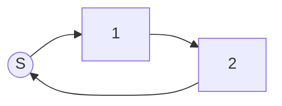
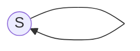
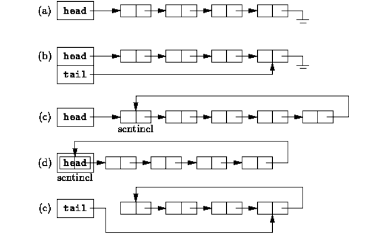
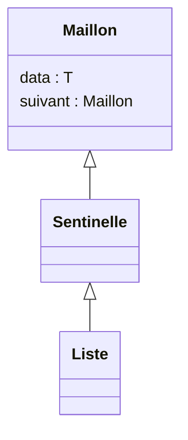

# La liste chaînée

!!! danger "Requis"
    La page [Maillons et sentinelle](maillons.md), et ses sept tests qui passent. Tes fichiers `maillon.py` et `maillon_test.py` ne changeront plus d'une ligne.

!!! question "Rappel d'ouverture (5 minutes, de mémoire, cahier fermé)"
    1. La chaîne est `1 -> 2 -> 3 -> S`, et tu tiens le maillon `b` qui porte `2`. Écris la ligne qui insère un maillon portant `7` entre le `2` et le `3`.
    2. Tu tiens `b`, et lui seul. Pourquoi ne peux-tu pas retirer de la chaîne le maillon qui porte `2` ?
    3. Que coûte `avancer(k)`, et pourquoi n'est-ce pas `O(1)` ?

    ??? success "Correction"
        1. `b.insere_apres(Maillon(7, Sentinelle()))`

            Le second argument n'a aucune importance : `insere_apres` rebranche la flèche du maillon neuf avant de l'accrocher. Mais il faut bien écrire quelque chose, et ce quelque chose n'est **jamais** `None`.

        2. Parce qu'un maillon n'a aucune flèche qui **arrive** sur lui. Pour le sortir de la chaîne, il faut tenir celui d'avant, et refermer la chaîne par-dessus. `b` ne peut rien faire à `b`.
        3. `O(k)`, parce qu'il faut suivre les flèches une par une : il n'y a pas d'adresse à calculer comme dans un tableau, il n'y a qu'un chemin à parcourir.

## 1 La sentinelle change de place

La page précédente a réglé un problème, la fin de la chaîne. Il en reste deux, et le rappel d'ouverture vient de les nommer.

- **Le premier maillon est un cas à part.** On ne peut ni insérer avant lui ni le retirer, puisque ces deux opérations se font depuis le **précédent**, et qu'il n'en a pas.
- **La chaîne vide est un cas à part.** Il n'y a aucun maillon d'où partir.

Les deux ont la même cause : il manque un maillon **avant le premier**. On va donc en poser un, qui est toujours là, qui ne porte aucune donnée, et qui ne bouge jamais. C'est une sentinelle, la même classe exactement, mais on la met **au début** au lieu de la mettre à la fin.

Et puisqu'on en a une au début, on n'en veut plus une seconde à la fin : le dernier maillon pointe **de nouveau sur elle**. La chaîne devient un **cercle**.

Voici la liste qui contient `1` puis `2`. La sentinelle est le rond `S`.



Et voici la liste **vide** : il n'y a que la sentinelle, et elle pointe sur elle-même, exactement comme à la fin d'une chaîne.



!!! question "Dessiner, et compter (obligatoire)"
    Sur ton cahier, dessine la liste qui contient `1`, `2`, `3`.

    1. Combien de ronds as-tu tracés ? Combien de flèches ?
    2. Un parcours part de la sentinelle et suit les flèches. Comment sait-il qu'il a fait le tour ?
    3. Y a-t-il encore, quelque part dans ce dessin, un maillon dont le `suivant` serait inconnu ?

    ??? success "Correction"
        1. **Quatre** ronds, trois maillons plus la sentinelle, et **quatre** flèches : une par maillon, plus celle de la sentinelle. Autant de flèches que de ronds, c'est la signature d'un cercle.
        2. Il sait qu'il a fait le tour quand il **retombe sur la sentinelle**. Un parcours ne s'arrête donc plus sur `None`, ni sur un test de sentinelle : il s'arrête quand il revient sur son point de départ.
        3. Non, et c'est tout l'intérêt. Chaque maillon a un suivant, chaque maillon a un précédent, et il n'y a plus un seul cas particulier à traiter.

## 2 La liste est sa propre sentinelle

Il reste une question : **où range-t-on cette sentinelle** ? Quelque part, il faut un objet qui désigne la liste entière, celui qu'on passe aux fonctions et qu'on garde dans une variable.

Cinq montages sont possibles, et ils sont tous employés dans la vraie vie.



On prend le **(d)**, et la réponse à la question tient en une phrase : on ne range la sentinelle nulle part, **la liste est la sentinelle**. Un seul objet fait les deux métiers.

Cela s'écrit en deux lignes. Crée `structures/lineaires/liste.py` :

```python
# structures/lineaires/liste.py

from collections.abc import Callable

from structures.lineaires.maillon import Maillon, Sentinelle

# Une clé est une fonction qui, d'un élément, rend quelque chose de comparable.
# `Comparable` est un nom de convention : il dit ce qu'on attend, il n'existe pas
# à l'exécution, et c'est celui qu'emploient déjà les cours sur les arbres.
type Cle[T] = Callable[[T], Comparable]


def identite[T](x: T) -> T:
    """Clé par défaut : l'élément est sa propre clé."""
    return x


class Liste[T](Sentinelle[T]):
    """
    Une liste simplement chaînée circulaire, qui est sa propre sentinelle.
    Le premier élément est self.suivant, et le dernier maillon pointe de nouveau
    sur la liste : une liste vide pointe donc sur elle-même.
    """

    def __init__(self) -> None:
        # Sentinelle() fait déjà pointer la liste vide sur elle-même
        super().__init__()
```

Le constructeur n'a rien à faire. `Sentinelle.__init__` fait déjà pointer l'objet sur lui-même, et c'est exactement ce qu'est une liste vide.

`Cle` et `identite` ne serviront que dans la dernière partie. Écris-les maintenant, cela t'évitera d'y revenir.



Une liste **est** une sentinelle, qui **est** un maillon. Les trois opérations de la page précédente marchent donc dessus sans une ligne de changement.

!!! info "Ce que cela change dans tous les parcours"
    Trois réflexes, et ils vont revenir dans presque chaque méthode.

    | | |
    | --- | --- |
    | le premier élément | `self.suivant`, jamais `self` |
    | la fin du parcours | `courant is not self` |
    | la liste est vide | `self.suivant is self` |

    Sur une liste vide, `self.suivant` **vaut** `self` : la première ligne et la troisième disent alors la même chose, et c'est pour cela qu'il n'y a pas de cas particulier à écrire.

    Remarque que les trois emploient `is`, et aucune `==`. On compare des maillons, donc des objets, et la question est toujours « est-ce le même ».

!!! warning "Sur un cercle, un parcours mal arrêté ne s'arrête pas"
    C'est le prix du montage (d), et il faut le savoir avant d'écrire la première boucle. Il n'y a plus de `None` au bout pour arrêter un parcours fautif : il tourne, indéfiniment.

    Quand `uv run pytest` reste bloqué sans rien afficher, c'est cela. Clique dans le terminal et appuie sur `Ctrl+C`. Cette combinaison envoie au programme un **signal** qui lui demande de s'arrêter immédiatement, où qu'il en soit. Python affiche alors quelques lignes qui se terminent par `KeyboardInterrupt` : **c'est normal**, cela veut seulement dire « arrêté au clavier ». Tu n'as rien cassé, et la condition d'arrêt de ta boucle est ce qu'il faut relire.

??? tip "Pour aller plus loin : c'est le choix du noyau Linux"
    Le schéma (d) n'est pas une curiosité de cours. C'est celui des listes chaînées du noyau Linux, dans `include/linux/list.h`. Une liste y est une `struct list_head`, et une liste vide pointe sur elle-même :

    ```c
    #define LIST_HEAD_INIT(name) { &(name), &(name) }
    ```

    Le test de vacuité y est notre `est_vide()`, ligne pour ligne, et le parcours s'y arrête en retombant sur la tête, comme notre `courant is not self` :

    ```c
    static inline int list_empty(const struct list_head *head)
    {
        return READ_ONCE(head->next) == head;
    }
    ```

    **Ce que ce choix achète.** Aucun `suivant` ne vaut jamais `None`, donc aucune opération n'a à se demander si elle est au bout de la chaîne, ni si la liste est vide. C'est le piège que Tony Hoare appelle son erreur à un milliard de dollars : il a introduit la référence nulle en 1965 dans ALGOL W parce qu'elle était facile à implémenter, et il en a fait une conférence en 2009 sous le titre *Null References: The Billion Dollar Mistake*.

    **Deux différences, pour ne pas croire que c'est le même objet.** Le noyau est **doublement chaîné**, chaque maillon ayant un `next` et un `prev` : il insère en fin et retire un maillon en `O(1)`, là où il nous faudra un `precedent` en `O(n)`. Et il est **intrusif**, il n'y a pas de champ `data` : le maillon est embarqué **dans** la donnée, et on remonte de l'un à l'autre avec `container_of`.

!!! question "Prédire, sur une chaîne circulaire (obligatoire)"
    Soit `lst` une liste contenant `1`, `2`, `3`. Tu n'as rien de nouveau à écrire : `avancer` est celle de la page précédente, inchangée.

    Donne les quatre réponses :

    - ce que renvoie `lst.avancer(0)`
    - la donnée de `lst.avancer(3)`
    - ce que renvoie `lst.avancer(4)`
    - la donnée de `lst.avancer(5)`.

    **Écris tes quatre réponses avant de dérouler la correction.**

    ??? success "Correction"
        - `lst.avancer(0)` renvoie **`lst` elle-même** : la liste est un maillon, et `avancer(0)` ne bouge pas.
        - `lst.avancer(3).data` vaut `3`. La sentinelle est le départ, donc le premier élément est à **un** cran, pas à zéro.
        - `lst.avancer(4)` renvoie **`lst`** : on est revenu sur la sentinelle.
        - `lst.avancer(5).data` vaut `1` : on repart pour un tour.

        Sur un cercle, `avancer` ne tombe jamais en panne de maillon. Il tourne, et c'est l'avertissement ci-dessus en acte.

## 3 Le fichier de tests

Crée `structures/lineaires/liste_test.py`, **à côté** de `liste.py`, et mets-y ceci. Chaque test que la suite te donne se colle à la fin du fichier.

??? info "Le fichier `liste_test.py`, à créer"
    ```python
    # structures/lineaires/liste_test.py

    from structures.lineaires.liste import Liste
    from structures.lineaires.maillon import Maillon


    class Eleve:
        """Un élève, pour tester la stabilité du tri : on trie par note uniquement."""

        nom: str
        note: int

        def __init__(self, nom: str, note: int) -> None:
            self.nom = nom
            self.note = note


    def note_de(e: Eleve) -> int:
        """Clé de tri : la note, et elle seule."""
        return e.note


    def oppose(x: int) -> int:
        """Clé de tri : l'opposé, qui range les nombres en décroissant."""
        return -x


    def L(*xs: int) -> Liste[int]:
        """Construit une liste contenant les éléments donnés, dans l'ordre, sans append."""
        lst: Liste[int] = Liste()
        ref: Maillon[int] = lst
        for x in xs:
            ref.suivant = Maillon(x, lst)
            ref = ref.suivant
        return lst


    def eleves(*es: Eleve) -> Liste[Eleve]:
        """Construit une liste d'élèves, dans l'ordre, sans append."""
        lst: Liste[Eleve] = Liste()
        ref: Maillon[Eleve] = lst
        for e in es:
            ref.suivant = Maillon(e, lst)
            ref = ref.suivant
        return lst


    def un_a(n: int) -> Liste[int]:
        """Construit la liste 1, 2, ..., n."""
        return L(*range(1, n + 1))


    def cran[T](m: Maillon[T], k: int) -> Maillon[T]:
        """Renvoie le maillon situé k crans après m (comme avancer, sans l'utiliser)."""
        ref = m
        for i in range(0, k):
            ref = ref.suivant
        return ref


    def contenu[T](lst: Liste[T]) -> list[T]:
        """Renvoie les éléments de la liste, dans l'ordre, pour les comparer facilement."""
        res = []
        ptr = lst.suivant
        while ptr is not lst:
            res.append(ptr.data)
            ptr = ptr.suivant
        return res


    def maillons[T](lst: Liste[T]) -> list[Maillon[T]]:
        """Renvoie les maillons de la liste (les objets eux-mêmes), dans l'ordre."""
        res = []
        ptr = lst.suivant
        while ptr is not lst:
            res.append(ptr)
            ptr = ptr.suivant
        return res


    def test_constructeur() -> None:
        lst: Liste[int] = Liste()
        assert lst.suivant is lst       # la liste vide pointe sur elle-même
    ```

Un mot sur ces outils, parce qu'ils ont été écrits ainsi exprès. `L(1, 2, 3)` construit une liste en **branchant les maillons à la main**, sans passer par `append` ni `ajouter_debut`. Si elle les utilisait, le jour où ta méthode `append` serait fausse, **tous** les tests échoueraient d'un coup et aucun ne te dirait où est le problème. Un test ne doit dépendre que de ce qu'il teste.

`eleves`, `un_a`, `cran` et `maillons` ne serviront que plus bas, et `Eleve`, `note_de` et `oppose` seulement dans la dernière partie.

Le test du constructeur est déjà là : lance `uv run pytest`, il doit passer.

## 4 Les méthodes de la liste

Voici ce que la liste saura faire. Lis le tableau en entier **avant** d'écrire quoi que ce soit : c'est le contrat, et la moitié des méthodes s'écrit en appelant celles d'au-dessus.

| Méthode | Ce qu'elle rend | Coût |
| --- | --- | --- |
| `est_vide()` | `True` si la liste ne contient aucun élément | `O(1)` |
| `taille()` | le nombre d'éléments | `O(n)` |
| `ajouter_debut(data)` | rien, ajoute un élément en tête | `O(1)` |
| `premier()` | le premier élément. Précondition : la liste n'est pas vide | `O(1)` |
| `dernier_maillon()` | le dernier **maillon**, la liste elle-même si elle est vide | `O(n)` |
| `append(data)` | rien, ajoute un élément en fin | `O(n)` |
| `dernier()` | le dernier élément. Précondition : la liste n'est pas vide | `O(n)` |
| `get(key)` | l'élément d'indice `key`, à partir de 0 | `O(n)` |
| `precedent(m)` | le maillon dont le suivant est `m` | `O(n)` |
| `est_egale(autre)` | `True` si les deux listes ont les mêmes éléments, dans le même ordre | `O(n)` |
| `copie()` | une copie indépendante de la liste | `O(n)` |
| `greffer_apres(m)` | rien, déplace tous les maillons de cette liste après `m`, et la vide | `O(n)` |
| `extend(lst)` | rien, ajoute à la fin une **copie** des éléments de `lst` | `O(n + m)` |

Les méthodes se placent toutes dans la classe `Liste`. Leur ordre dans le fichier n'a aucune importance, mais écris-les dans l'ordre de la page : chacune se sert des précédentes.

Et comme sur la page précédente, `...` marque ce que tu as à écrire.

### 4.1 `est_vide`

!!! question "Une seule ligne, et c'est la plus réemployée de la page (obligatoire)"
    ```python
    def est_vide(self) -> bool:
        """Indique si la liste est vide, en O(1)."""
        return ...
    ```

    Pas de `if`, pas de parcours, pas de compteur. Relis le tableau des trois réflexes de la section 2.

    ??? info "Test à recopier dans `liste_test.py`"
        ```python
        def test_est_vide() -> None:
            assert L().est_vide() == True
            assert L(1).est_vide() == False
        ```

### 4.2 `taille`

!!! question "Compter les éléments (obligatoire)"
    ```python
    def taille(self) -> int:
        """Compte les éléments de la liste, en O(n)."""
        res = 0
        courant = ...
        while ...:
            ...
            ...
        return res
    ```

    C'est le parcours type, celui que tu vas réécrire une dizaine de fois : une référence qui part du premier élément et qui avance tant qu'elle n'est pas revenue sur `self`. C'est aussi, aux `append` près, la fonction `montrer` de la page précédente.

    ??? info "Test à recopier dans `liste_test.py`"
        ```python
        def test_taille() -> None:
            assert L().taille() == 0
            assert L(1, 2, 3).taille() == 3
        ```

    ??? tip "Indice"
        Trois choses à trouver, et pas une : d'où part `courant`, quand on s'arrête, et ce qui change à chaque tour. Le tableau des trois réflexes de la section 2 en donne déjà deux sur trois.

    ??? tip "Indice plus précis"
        `is not` compare des objets : `courant is not self` demande « suis-je revenu sur la sentinelle », ce qui est exactement la question.

    ??? question "Avant d'ouvrir la correction"
        En une phrase, sur ton cahier : qu'est-ce que l'indice t'a appris sur ce qui n'allait pas dans **ton** code ?

    ??? warning "Correction"
        ```python
            res = 0
            courant = self.suivant
            while courant is not self:
                res += 1
                courant = courant.suivant
            return res
        ```

        Garde ces cinq lignes sous les yeux : `dernier_maillon`, `get`, `precedent`, `est_egale` et `copie` sont toutes des variantes de ce parcours.

### 4.3 `ajouter_debut`

!!! question "Ajouter en tête (obligatoire)"
    ```python
    def ajouter_debut(self, data: T) -> None:
        """Ajoute un élément en tête de liste, en O(1)."""
        ...
    ```

    Une ligne, et deux façons de l'écrire : en fabriquant le maillon avec le bon suivant du premier coup, ou en le fabriquant n'importe comment et en laissant `insere_apres` le brancher. Les deux sont justes. Écris celle que ton dessin te dicte.

    ??? info "Test à recopier dans `liste_test.py`"
        ```python
        def test_ajouter_debut() -> None:
            lst = L(1, 2)
            lst.ajouter_debut(0)
            assert contenu(lst) == [0, 1, 2]

            # Sur une liste vide
            v = L()
            v.ajouter_debut(5)
            assert contenu(v) == [5]
        ```

    Remarque le second cas : tu n'as rien écrit pour lui, et il passe. C'est la sentinelle qui l'a réglé.

### 4.4 `premier`

!!! question "Le premier élément, et sa précondition (obligatoire)"
    ```python
    def premier(self) -> T:
        """Renvoie le premier élément, en O(1). Précondition : la liste n'est pas vide."""
        assert ..., "La liste est vide"
        return ...
    ```

    Elle renvoie une **donnée**, pas un maillon. Sur une liste vide, elle n'a aucune réponse possible : c'est une précondition, et elle se refuse par `assert`, comme `depiler` sur une pile vide.

    ??? info "Tests à recopier dans `liste_test.py`"
        ```python
        def test_premier() -> None:
            assert L(7, 8, 9).premier() == 7


        def test_premier_liste_vide() -> None:
            try:
                L().premier()
            except AssertionError:
                return                  # comportement attendu
            assert False, "premier sur une liste vide aurait dû échouer"
        ```

### 4.5 `dernier_maillon` et `append`

!!! question "Les deux ensemble (obligatoire)"
    ```python
    def dernier_maillon(self) -> Maillon[T]:
        """Renvoie le dernier maillon (la liste elle-même si elle est vide), en O(n)."""
        ref = self
        while ...:
            ...
        # Si on est là, c'est que ref.suivant is self
        return ref
    ```

    Attention au départ : `ref` part de `self`, et **pas** de `self.suivant` comme dans `taille`. C'est ce qui fait que la liste vide renvoie la bonne chose sans un `if`.

    ```python
    def append(self, data: T) -> None:
        """Ajoute un élément en fin de liste, en O(n)."""
        ...
    ```

    `append` tient en une ligne et n'invente rien : trouver le dernier maillon, et insérer après lui. Écris `Maillon(data, self)` pour le maillon neuf, jamais `None`.

    ??? info "Tests à recopier dans `liste_test.py`"
        ```python
        def test_dernier_maillon() -> None:
            lst = L(1, 2, 3)
            d = lst.dernier_maillon()
            assert d.data == 3
            assert d.suivant is lst

            # Liste vide : c'est la liste elle-même
            v = L()
            assert v.dernier_maillon() is v


        def test_append() -> None:
            lst = L(1, 2)
            lst.append(3)
            assert contenu(lst) == [1, 2, 3]

            # Sur une liste vide
            v = L()
            v.append(5)
            assert contenu(v) == [5]
        ```

    ??? tip "Indice"
        On cherche le maillon dont le suivant est la liste. Tant que ce n'est pas le cas, on avance. Écris la condition dans ce sens-là, et le corps de la boucle tiendra sur une ligne.

### 4.6 `dernier`

!!! question "Le dernier élément (obligatoire)"
    ```python
    def dernier(self) -> T:
        """Renvoie le dernier élément, en O(n). Précondition : la liste n'est pas vide."""
        ...
        ...
    ```

    Deux lignes, et aucune n'est neuve : c'est `premier` avec une autre méthode au milieu.

    ??? info "Tests à recopier dans `liste_test.py`"
        ```python
        def test_dernier() -> None:
            assert L(7, 8, 9).dernier() == 9


        def test_dernier_liste_vide() -> None:
            try:
                L().dernier()
            except AssertionError:
                return                  # comportement attendu
            assert False, "dernier sur une liste vide aurait dû échouer"
        ```

### 4.7 `get`

!!! question "L'élément d'indice donné (obligatoire)"
    ```python
    def get(self, key: int) -> T:
        """Renvoie l'élément d'indice key (à partir de 0), en O(n)."""
        assert key >= 0, "Erreur d'indice"
        courant = self.suivant
        i = 0  # i est toujours l'indice de courant
        while ... and ...:
            ...
            ...
        assert ..., "Erreur d'indice"
        return ...
    ```

    ??? info "Tests à recopier dans `liste_test.py`"
        ```python
        def test_get() -> None:
            lst = L(1, 2, 3)
            assert lst.get(0) == 1
            assert lst.get(2) == 3


        def test_get_hors_limites() -> None:
            lst = L(1, 2, 3)
            for key in (3, -1):
                try:
                    lst.get(key)
                except AssertionError:
                    continue            # comportement attendu
                assert False, f"get({key}) aurait dû échouer"
        ```

    ??? tip "Indice"
        Deux conditions d'arrêt, pas une : on avance tant qu'on n'est **pas revenu sur la liste** et qu'on n'a **pas atteint** l'indice voulu.

    ??? tip "Indice plus précis"
        Après la boucle, c'est la **raison** de l'arrêt qui décide. Si on est revenu sur la liste, c'est que l'indice était trop grand : c'est ce que le second `assert` refuse. Le commentaire `i est toujours l'indice de courant` est ce qui rend les deux conditions lisibles : garde-le vrai à chaque tour.

    ??? question "Avant d'ouvrir la correction"
        En une phrase, sur ton cahier : qu'est-ce que l'indice t'a appris sur ce qui n'allait pas dans **ton** code ?

    ??? warning "Correction"
        ```python
            while courant is not self and i < key:
                courant = courant.suivant
                i += 1
            assert courant is not self, "Erreur d'indice"
            return courant.data
        ```

### 4.8 `precedent`

!!! question "Le maillon d'avant (obligatoire)"
    Cette méthode existe pour une raison précise, et c'est la question 2 du rappel d'ouverture : dans une chaîne à sens unique, on ne peut retirer un maillon qu'**en passant par celui d'avant**. `precedent(m).decroche_prochain()` retire `m`, et c'est la seule façon de le faire.

    ```python
    def precedent(self, m: Maillon[T]) -> Maillon[T]:
        """
        Renvoie le maillon qui précède m dans la liste, en O(n).
        Utile pour retirer m : precedent(m).decroche_prochain().
        Précondition : m est un maillon de cette liste.
        """
        ref = self
        while ...:
            ...
            assert ..., "Ce maillon n'est pas dans la liste"
        return ref
    ```

    ??? info "Tests à recopier dans `liste_test.py`"
        ```python
        def test_precedent() -> None:
            lst = L(1, 2, 3)
            assert lst.precedent(cran(lst, 3)).data == 2
            assert lst.precedent(lst.suivant) is lst    # le précédent du premier est la liste
            assert lst.precedent(lst).data == 3         # le précédent de la liste est le dernier

            # Liste vide
            v = L()
            assert v.precedent(v) is v

            # precedent permet de retirer un maillon
            r = L(1, 2, 3)
            deux = cran(r, 2)
            p = r.precedent(deux)
            p.suivant = p.suivant.suivant
            assert contenu(r) == [1, 3]


        def test_precedent_maillon_absent() -> None:
            lst = L(1, 2, 3)
            try:
                lst.precedent(Maillon(9, lst))
            except AssertionError:
                return                  # comportement attendu
            assert False, "precedent d'un maillon absent aurait dû échouer"
        ```

    ??? tip "Indice"
        On cherche la référence `ref` telle que `ref.suivant is m`. Tant que ce n'est pas le cas, on avance.

    ??? tip "Indice plus précis"
        Si `m` n'est pas dans la liste, on finira par **repasser par la sentinelle**. C'est là, et seulement là, que l'`assert` refuse. Sans lui, la boucle tourne indéfiniment : c'est ce qu'annonçait l'avertissement de la section 2, et c'est le test ci-dessus qui ne s'arrêtera pas.

    ??? question "Avant d'ouvrir la correction"
        En une phrase, sur ton cahier : qu'est-ce que l'indice t'a appris sur ce qui n'allait pas dans **ton** code ?

    ??? warning "Correction"
        ```python
            while ref.suivant is not m:
                ref = ref.suivant
                assert ref is not self, "Ce maillon n'est pas dans la liste"
            return ref
        ```

### 4.9 `est_egale`

!!! question "Comparer deux listes (obligatoire)"
    ```python
    def est_egale(self, autre: "Liste[T]") -> bool:
        """Indique si cette liste a les mêmes éléments que autre, dans le même ordre."""
        ref1 = self.suivant
        ref2 = autre.suivant
        while ... and ...:
            if ...:
                return False
            ...
            ...
        return ...
    ```

    Deux références avancent en parallèle, une par liste. La dernière ligne décide de deux choses d'un coup : la boucle s'arrête dès que **l'une** des deux listes est épuisée, et deux listes de longueurs différentes ne doivent pas être déclarées égales.

    ??? info "Test à recopier dans `liste_test.py`"
        ```python
        def test_est_egale() -> None:
            assert L(1, 2).est_egale(L(1, 2)) == True
            assert L().est_egale(L()) == True
            assert L(1, 2).est_egale(L(1, 3)) == False
            assert L(1, 2).est_egale(L(1)) == False
            assert L(1).est_egale(L(1, 2)) == False

            # Les valeurs sont comparées, pas les identités : int("1000") fabrique
            # un objet neuf à chaque appel, donc ce sont deux objets distincts
            assert L(int("1000")).est_egale(L(int("1000"))) == True
        ```

    ??? tip "Indice"
        Deux références avancent en parallèle, une par liste. La question qui décide de tout est : à chaque tour, qu'est-ce qu'on compare, les deux **maillons** ou ce qu'ils **portent** ?

    ??? tip "Indice plus précis"
        C'est **ici**, et seulement ici, que `is` n'est plus le bon outil. Les deux listes n'ont aucun maillon en commun : ce qu'on compare est leurs **données**, donc `==`.

        Le dernier test explique pourquoi l'erreur se voit si rarement : Python garde en mémoire un seul objet pour chaque petit entier, de `-5` à `256`, donc `1 is 1` est vrai alors que deux `1000` fabriqués séparément sont deux objets différents. Un code écrit avec `is` passe sur les petits nombres et échoue sur les grands.

    ??? question "Avant d'ouvrir la correction"
        En une phrase, sur ton cahier : qu'est-ce que l'indice t'a appris sur ce qui n'allait pas dans **ton** code ?

    ??? warning "Correction"
        ```python
            while ref1 is not self and ref2 is not autre:
                if ref1.data != ref2.data:
                    return False
                ref1 = ref1.suivant
                ref2 = ref2.suivant
            return ref1 is self and ref2 is autre
        ```

        La dernière ligne dit : les deux listes sont épuisées **en même temps**. Si une seule l'est, elles n'avaient pas la même longueur.

### 4.10 `copie`

!!! question "Copier la liste (obligatoire)"
    ```python
    def copie(self) -> "Liste[T]":
        """Renvoie une copie de la liste (nouveaux maillons, mêmes éléments), en O(n)."""
        lst = Liste()
        ref = self.suivant      # lit la liste d'origine
        refcopie = lst          # dernier maillon écrit dans la copie
        while ...:
            # Tricoter
            ...

            # Avancer
            ...
            ...
        return lst
    ```

    Deux références avancent en même temps, et les commentaires disent dans quel ordre : on tricote un maillon neuf après `refcopie`, puis on avance les deux.

    ??? info "Test à recopier dans `liste_test.py`"
        ```python
        def test_copie() -> None:
            lst = L(1, 2, 3)
            c = lst.copie()
            assert c is not lst
            assert contenu(c) == [1, 2, 3]

            # Les maillons sont copiés : modifier la copie ne change pas lst
            c.suivant.data = 9
            assert contenu(lst) == [1, 2, 3]

            # Liste vide
            assert contenu(L().copie()) == []
        ```

        Le `c is not lst` de la troisième ligne est la question même du rappel d'ouverture : une copie est un **autre objet**, pas un second nom.

    ??? tip "Indice"
        Deux références, deux rôles : l'une **lit** l'original, l'autre marque la **fin de la copie**. Demande-toi, pour chacune, où elle part et quand elle avance.

    ??? tip "Indice plus précis"
        Le maillon neuf se fabrique avec `Maillon(ref.data, lst)` : sa donnée est celle qu'on lit, et son suivant est la copie, puisqu'il en est pour l'instant le dernier. `insere_apres` fera le reste.

        Construire la copie à coups de `append` marcherait aussi, et coûterait `O(n²)`. La raison est dans la section 5, et c'est elle qui justifie les deux références.

    ??? question "Avant d'ouvrir la correction"
        En une phrase, sur ton cahier : qu'est-ce que l'indice t'a appris sur ce qui n'allait pas dans **ton** code ?

    ??? warning "Correction"
        ```python
            while ref is not self:
                # Tricoter
                refcopie.insere_apres(Maillon(ref.data, lst))

                # Avancer
                refcopie = refcopie.suivant
                ref = ref.suivant
            return lst
        ```

### 4.11 `greffer_apres`

!!! question "Déménager des maillons (obligatoire)"
    Attention au sens : c'est **cette** liste qui se vide, et ses maillons vont se placer après le maillon `m`, qui est ailleurs. On écrit `source.greffer_apres(destination)`.

    ```python
    def greffer_apres(self, m: Maillon[T]) -> None:
        """
        Déplace tous les maillons de cette liste juste après le maillon m, en O(n).
        Cette liste est vide après l'appel.
        """
        # Cette liste est vide : rien à déménager
        if ...:
            return
        fin = ...
        ...
        ...
        ...
    ```

    Aucun maillon n'est créé ni copié : ils **changent de liste**. Trois flèches changent à la fin, et aucune autre. Et `fin` ne demande aucune boucle : tu as déjà écrit la méthode qui le trouve.

    ??? info "Test à recopier dans `liste_test.py`"
        ```python
        def test_greffer_apres() -> None:
            lst = L(1, 2)
            g = L(8, 9)
            huit = g.suivant
            g.greffer_apres(lst.suivant)
            assert contenu(lst) == [1, 8, 9, 2]
            assert contenu(g) == []             # g est vidée
            assert cran(lst, 2) is huit         # les maillons sont déplacés, pas copiés

            # En tête
            t = L(1, 2)
            L(8, 9).greffer_apres(t)
            assert contenu(t) == [8, 9, 1, 2]

            # En fin
            f = L(1, 2)
            L(8, 9).greffer_apres(cran(f, 2))
            assert contenu(f) == [1, 2, 8, 9]

            # Avec des listes vides
            u = L(1)
            L().greffer_apres(u)
            assert contenu(u) == [1]
            v = L()
            L(5).greffer_apres(v)
            assert contenu(v) == [5]
        ```

    ??? tip "Indice"
        Dessine les deux listes côte à côte, puis pose-toi la question pour **chacune** des trois dernières flèches : d'où part-elle, et où doit-elle arriver ?

    ??? tip "Indice plus précis"
        La fin de cette liste doit pointer vers ce qui suivait `m`. `m` doit pointer vers le début de cette liste. Et cette liste doit pointer sur elle-même, puisqu'elle est maintenant vide.

        L'ordre de ces trois affectations compte, exactement comme dans `insere_apres`.

    ??? question "Avant d'ouvrir la correction"
        En une phrase, sur ton cahier : qu'est-ce que l'indice t'a appris sur ce qui n'allait pas dans **ton** code ?

    ??? warning "Correction"
        ```python
            if self.est_vide():
                return
            fin = self.dernier_maillon()
            fin.suivant = m.suivant
            m.suivant = self.suivant
            self.suivant = self
        ```

        Le premier `if` n'est pas indispensable au résultat, et c'est une bonne occasion de le vérifier : déroule les trois dernières lignes sur une liste vide, où `self.suivant` vaut `self`. Elles ne cassent rien. Il reste là parce qu'il **dit l'intention**, une liste vide n'a rien à déménager, et qu'un lecteur n'a alors pas à refaire ce calcul.

### 4.12 `extend`

!!! question "Ajouter une copie (obligatoire)"
    ```python
    def extend(self, lst: "Liste[T]") -> None:
        """Ajoute à la fin de cette liste une copie de lst, en O(n + m)."""
        ...
    ```

    Une ligne, qui n'utilise que des méthodes déjà écrites. `greffer_apres` **vide** la liste qu'elle déplace, il ne faut donc surtout pas lui donner `lst`.

    ??? info "Test à recopier dans `liste_test.py`"
        ```python
        def test_extend() -> None:
            lst = L(1, 2)
            m = L(3, 4)
            trois = cran(m, 1)
            quatre = cran(m, 2)
            lst.extend(m)
            assert contenu(lst) == [1, 2, 3, 4]
            assert contenu(m) == [3, 4]

            # Aucun maillon n'est partagé entre les deux listes
            # (cran ne boucle jamais, même si les chaînes sont mal raccordées)
            assert cran(lst, 3) is not trois     # le maillon de 3 doit être une copie
            assert cran(lst, 4) is not quatre    # le maillon de 4 doit être une copie
            assert cran(lst, 5) is lst           # la fin de lst doit revenir sur lst
            assert cran(m, 1) is trois           # m garde ses propres maillons
            assert cran(m, 2) is quatre          # m garde ses propres maillons
            assert cran(m, 3) is m               # la fin de m doit revenir sur m

            # Avec des listes vides
            v = L()
            v.extend(L(3))
            assert contenu(v) == [3]
            n = L(1)
            n.extend(L())
            assert contenu(n) == [1]

            # Avec elle-même : les éléments sont doublés
            d = L(1, 2)
            d.extend(d)
            assert contenu(d) == [1, 2, 1, 2]
        ```

    Le dernier cas mérite un instant. `d.extend(d)` rend bien `[1, 2, 1, 2]`. Demande-toi dans quel ordre les appels de ta ligne s'exécutent, et ce que ferait une version qui grefferait `lst` directement.

    ??? tip "Indice"
        Tu as déjà écrit toutes les méthodes dont tu as besoin. Celle qui déplace **vide** ce qu'elle déplace : il faut donc lui donner quelque chose qu'on a le droit de vider. Qu'est-ce qui, ici, est à nous ?

    ??? tip "Indice plus précis"
        Trois appels s'enchaînent, et il faut les poser dans le bon ordre : fabriquer une copie de `lst`, trouver où elle doit aller, puis la déménager là.

        La copie est une liste **à nous**, que personne d'autre ne tient : la vider ne gêne donc personne.

    ??? question "Avant d'ouvrir la correction"
        En une phrase, sur ton cahier : qu'est-ce que l'indice t'a appris sur ce qui n'allait pas dans **ton** code ?

    ??? warning "Correction"
        ```python
            lst.copie().greffer_apres(self.dernier_maillon())
        ```

        Et c'est ce qui fait marcher `d.extend(d)` : `lst.copie()` est évaluée **avant** que quoi que ce soit ne bouge, donc la copie est faite sur la liste telle qu'elle était.

### 4.13 Renverser la liste

!!! question "Lire, pas écrire (entraînement)"
    Ce code ne demande aucune méthode nouvelle. Il renverse une liste **en place**, sans créer un seul maillon, avec deux lignes qui n'utilisent que `decroche_prochain` et `insere_apres`.

    ```python
    premier = lst.suivant
    while premier is not lst and premier.suivant is not lst:
        lst.insere_apres(premier.decroche_prochain())
    ```

    Réponds à ces trois questions sur ton cahier, puis déroule les tours sur la liste `1, 2, 3, 4` :

    - que désigne `premier` au premier tour, et que désigne-t-il à la fin ?
    - à chaque tour, quel maillon bouge, et où va-t-il ?
    - pourquoi la boucle s'arrête-t-elle quand `premier.suivant` est `lst` ?

    ??? success "Correction"
        `premier` désigne le maillon qui portait le **premier** élément, et il n'est **jamais réaffecté** : tout le reste défile devant lui, et il finit dernier.

        À chaque tour, le maillon qui suit `premier` est décroché et réinséré juste après `lst`, c'est-à-dire **en tête**.

        ```text
        départ : 1, 2, 3, 4
        tour 1 : 2, 1, 3, 4
        tour 2 : 3, 2, 1, 4
        tour 3 : 4, 3, 2, 1
        ```

        La boucle s'arrête quand `premier.suivant` est `lst`, parce que cela veut dire que `premier` est devenu le dernier maillon : tout ce qui le suivait est passé devant.

        Le test `premier is not lst` est ce qui protège la liste **vide**, où `lst.suivant` est `lst` et où il n'y a rien à renverser.

    ??? question "À écrire (bonus)"
        Range ce code dans une méthode `renverser(self) -> None` de la classe `Liste`, et écris son test. Il doit vérifier le contenu renversé **et** qu'aucun maillon n'a été créé, avec `maillons` et `is`. Vérifie-le pour `n` allant de `0` à `4`.

## 5 Ce que cela coûte

Tu viens d'écrire une structure entière. Savoir **ce que chaque opération coûte** est ce qui te permettra de décider, le jour où tu auras le choix.

`n` est la taille de la liste, `m` celle de la liste passée en argument.

| Coût | Opérations |
| --- | --- |
| `O(1)` | `insere_apres`, `decroche_prochain`, `est_vide`, `premier`, `ajouter_debut` |
| `O(k)` | `avancer(k)` |
| `O(n)` | `taille`, `dernier_maillon`, `dernier`, `append`, `get`, `precedent`, `est_egale`, `copie`, `greffer_apres` |
| `O(n + m)` | `extend` |

Regarde la deuxième ligne du tableau et la troisième ensemble. **Tout ce qui est à un endroit connu coûte `O(1)`. Tout ce qui demande d'arriver quelque part coûte `O(n)`.** C'est la seule chose à retenir, et elle suffit à reconstruire le tableau entier.

!!! question "Combien de pas pour construire une liste ? (obligatoire)"
    On part d'une liste vide et on appelle `append` `n` fois de suite.

    1. Combien de maillons `dernier_maillon` parcourt-il au **quatrième** appel ?
    2. Donne le nombre **total** de maillons parcourus pour les `n` appels, en fonction de `n`.
    3. Quel est le coût de la construction entière : `O(n)`, `O(n log n)` ou `O(n²)` ?

    **Écris tes trois réponses avant de dérouler la correction.**

    ??? success "Correction"
        1. Trois. Au quatrième appel, la liste contient déjà trois éléments.
        2. $0 + 1 + 2 + \dots + (n-1) = \dfrac{n(n-1)}{2}$. Pour `n = 100`, cela fait 4950 pas.
        3. `O(n²)`. Chaque `append` est en `O(n)`, et on en fait `n`.

        C'est exactement pour cette raison que `copie` ne construit pas sa copie à coups de `append` : elle garde une référence sur le dernier maillon écrit et insère directement après lui. Chaque insertion coûte alors `O(1)`, et le total retombe à `O(n)`.

        Et c'est aussi pour cette raison que `L` et `eleves`, dans le fichier de tests, branchent les maillons à la main.

!!! info "Une liste qui saurait faire `append` en `O(1)`"
    Regarde de nouveau le schéma des cinq variantes. La variante (b) garde une seconde référence, `tail`, sur le dernier maillon. `append` devient alors `O(1)`, sans aucun parcours.

    Ce n'est pas gratuit. Cette référence doit être **mise à jour par toutes les autres opérations** : chaque insertion, chaque suppression, chaque greffe doit se demander si elle vient de changer le dernier maillon. Le coût quitte le calcul et arrive dans la maintenance du code.

    C'est un arbitrage, pas une amélioration : on gagne sur une opération, on paie sur toutes les autres.

!!! question "Choisir la structure (obligatoire)"
    Pour chacune des quatre situations, dis si tu prends une **liste chaînée** comme celle de ce chapitre, ou un **tableau** (une liste Python).

    Justifie **par le coût**, et en deux temps à chaque fois : quelle est l'opération la plus fréquente, et que coûte-t-elle dans chaque structure ?

    1. Un flux d'événements qu'on accumule, chaque nouvel événement passant devant les précédents.
    2. Un jeu tire au hasard, des milliers de fois par seconde, l'élément numéro `i` d'une collection de 10 000 cases.
    3. On parcourt une collection en tenant la référence du maillon courant, et on retire au passage les éléments qui ne conviennent pas.
    4. Une fois par jour, on additionne tous les nombres d'une collection, du premier au dernier.

    **Écris tes quatre réponses avant de dérouler la correction.**

    ??? success "Correction"
        1. **Liste chaînée.** L'opération fréquente est l'ajout en tête : `ajouter_debut` est en `O(1)`, alors qu'insérer en tête d'un tableau oblige à décaler toutes les cases, donc `O(n)`.
        2. **Tableau.** L'opération fréquente est l'accès par indice : `O(1)` dans un tableau, qui calcule une adresse, contre `O(n)` pour `get`, qui parcourt.
        3. **Liste chaînée.** Une fois le maillon précédent en main, `decroche_prochain` est en `O(1)`, on rebranche une flèche. Dans un tableau, chaque suppression décale la suite, donc `O(n)`.
        4. **Ni l'une ni l'autre sur ce critère.** Un parcours complet coûte `O(n)` des deux côtés. Le coût ne départage pas, la décision se prend donc ailleurs : sur ce que la collection doit faire **le reste du temps**.

        Retiens la question, pas les réponses : *quelle opération est la plus fréquente, et que coûte-t-elle dans chaque structure ?* C'est elle qui se transporte d'une situation à la suivante, et c'est elle qu'on te demandera.

## 6 Problème de fin : trier la liste

Quatre méthodes, à écrire dans l'ordre. Elles forment un **tri fusion** qui ne crée **aucun maillon** : tout se fait en déplaçant des flèches, avec les deux opérations de la page précédente.

Une **clé** est l'objet qui décide de l'ordre, et c'est le `key` de `sorted` et de `min` que tu connais depuis la première : une fonction qui, d'un élément, rend ce sur quoi on compare. `identite` range les nombres en croissant, et `oppose` en décroissant.

C'est ici que servent la classe `Eleve` et la clé `note_de` posées dans l'en-tête de `liste_test.py` : elles vérifieront que le tri est **stable**, c'est-à-dire qu'à note égale, deux élèves gardent leur ordre d'origine.

### 6.1 `milieu`

!!! question "Trouver le milieu sans compter (obligatoire)"
    Deux références partent du premier maillon. Le **lièvre** avance de deux crans quand la **tortue** en avance d'un. Quand le lièvre arrive au bout, la tortue est au milieu, et on n'a parcouru la liste qu'une seule fois.

    **Remplis ce tableau à la main avant d'écrire la méthode.** La liste contient `1, 2, ..., n`, et on demande la donnée du maillon renvoyé. Dessine les deux références qui avancent, tu n'as rien d'autre pour répondre.

    | `n` | 1 | 2 | 3 | 4 | 5 | 6 |
    | --- | --- | --- | --- | --- | --- | --- |
    | `milieu().data` | | | | | | |

    ??? success "Correction"
        | `n` | 1 | 2 | 3 | 4 | 5 | 6 |
        | --- | --- | --- | --- | --- | --- | --- |
        | `milieu().data` | 1 | 1 | 2 | 2 | 3 | 3 |

        Autrement dit, pour `n` éléments la moitié gauche en contient `(n + 1) // 2`. Elle est donc la plus grosse quand `n` est impair : pour `n = 5`, elle contient `1, 2, 3` et la droite `4, 5`.

    ```python
    def milieu(self) -> Maillon[T]:
        """
        Renvoie le dernier maillon de la moitié gauche, en O(n).
        Pour n éléments, la moitié gauche en contient (n + 1) // 2.
        """
        lievre = self.suivant
        tortue = self.suivant
        while ... and ...:
            ...
            ...
        return tortue
    ```

    ??? info "Test à recopier dans `liste_test.py`"
        ```python
        def test_milieu() -> None:
            attendus = [1, 1, 2, 2, 3, 3, 4, 4]     # pour n = 1 à 8
            for n in range(1, 9):
                lst = un_a(n)
                # Si le lièvre saute la sentinelle, milieu tourne sans fin :
                # arrête alors pytest avec Ctrl+C.
                assert lst.milieu().data == attendus[n - 1], f"n = {n}"

            # Liste vide : c'est la liste elle-même
            v = L()
            assert v.milieu() is v
        ```

    ??? tip "Indice"
        Le lièvre fait **deux** pas d'un coup. Avant de les faire, il doit vérifier qu'il peut : combien de choses cela fait-il à vérifier, et lesquelles ?

    ??? tip "Indice plus précis"
        La chaîne est un cercle, donc **rien n'arrête le lièvre tout seul**. C'est la condition de la boucle qui doit l'arrêter, et elle porte sur deux choses à la fois, puisque le lièvre fait deux pas : `lievre.suivant` et `lievre.suivant.suivant`. Si l'une des deux est déjà la sentinelle, il faut s'arrêter.

        Si tu n'en testes qu'une, le lièvre enjambe la sentinelle et repart pour un tour. C'est l'avertissement de la section 2 : le test ne rendra pas la main.

    ??? tip "Voir les deux références avancer (ligne de mise au point, à retirer)"
        Place cette ligne dans ta boucle, et lance la méthode depuis `exos/exos_maillons.py` :

        ```python
            print(lievre.data, tortue.data)
        ```

        Tu vois l'écart se creuser à chaque tour, et la sentinelle se reconnaît à son `None`. Retire la ligne une fois la méthode juste.

    ??? question "Avant d'ouvrir la correction"
        En une phrase, sur ton cahier : qu'est-ce que l'indice t'a appris sur ce qui n'allait pas dans **ton** code ?

    ??? warning "Correction"
        ```python
            while lievre.suivant is not self and lievre.suivant.suivant is not self:
                lievre = lievre.suivant.suivant
                tortue = tortue.suivant
            return tortue
        ```

### 6.2 `couper`

!!! question "Couper la liste en deux (obligatoire)"
    ```python
    def couper(self) -> "Liste[T]":
        """
        Coupe la liste en deux, en O(n), sans copier de maillon : renvoie une
        nouvelle liste avec la moitié gauche, et cette liste garde la droite.
        """
        if self.est_vide():
            return Liste()
        m1 = self.milieu()      # dernier maillon de gauche
        m2 = m1.suivant         # premier maillon de droite

        gauche = Liste()
        ...
        ...

        ...
        return gauche
    ```

    Trois flèches à poser, et aucun `Maillon(...)`. Les deux maillons de la frontière sont déjà nommés.

    ??? info "Test à recopier dans `liste_test.py`"
        ```python
        def test_couper() -> None:
            lst = L(1, 2, 3, 4, 5)
            gauche = lst.couper()
            assert contenu(gauche) == [1, 2, 3]
            assert contenu(lst) == [4, 5]

            # Pour toutes les tailles, gauche suivie de lst redonne la liste
            for n in range(0, 7):
                t = un_a(n)
                attendu = contenu(t)
                g = t.couper()
                obtenu = contenu(g) + contenu(t)
                assert obtenu == attendu, f"n = {n}"
                assert len(contenu(g)) == (n + 1) // 2, f"n = {n}"

            # Aucun maillon n'est copié
            s = L(1, 2, 3, 4)
            avant = maillons(s)
            gs = s.couper()
            assert gs.suivant is avant[0]
            assert s.suivant is avant[2]
        ```

    ??? tip "Indice"
        Dessine la liste `1, 2, 3, 4, 5` avec sa sentinelle, puis entoure les deux moitiés. Tu dois obtenir **deux cercles**, chacun refermé sur sa propre sentinelle.

    ??? tip "Indice plus précis"
        Demande-toi, pour chacune des trois flèches : le début de gauche, la fin de gauche, et le début de droite.

    ??? question "Avant d'ouvrir la correction"
        En une phrase, sur ton cahier : qu'est-ce que l'indice t'a appris sur ce qui n'allait pas dans **ton** code ?

    ??? warning "Correction"
        ```python
            gauche = Liste()
            gauche.suivant = self.suivant
            m1.suivant = gauche

            self.suivant = m2
            return gauche
        ```

### 6.3 `fusion`

!!! question "Fusionner deux listes triées (obligatoire)"
    ```python
    def fusion(self, lst: "Liste[T]", cle: Cle[T] = identite) -> None:
        """
        Fusionne lst dans cette liste, en place, en O(n + m). Les deux listes
        doivent être triées selon cle, et lst est vide après l'appel.
        """
        # ref1 et ref2 désignent le maillon d'AVANT celui qu'on compare
        ref1 = self
        ref2 = lst

        while ref1.suivant is not self and ref2.suivant is not lst:
            if cle(ref1.suivant.data) < cle(ref2.suivant.data):
                # Le maillon de cette liste est déjà à sa place : on avance
                ...
            else:
                # On déplace le maillon de lst juste après ref1,
                # puis on se place dessus pour observer son suivant
                ...
                ...
                ...
        # greffer_apres ne fait rien si lst est vide, et vide lst sinon
        ...
    ```

    Les deux références désignent le maillon **d'avant**, et ce n'est pas un détail de confort : c'est la seule position depuis laquelle on peut décrocher.

    ??? info "Test à recopier dans `liste_test.py`"
        ```python
        def test_fusion() -> None:
            lst = L(1, 4, 6)
            m = L(2, 3, 5, 7, 8)
            lst.fusion(m)
            assert contenu(lst) == [1, 2, 3, 4, 5, 6, 7, 8]
            assert contenu(m) == []             # l'autre liste est absorbée

            # Toute l'autre liste est plus petite
            p = L(5, 6)
            p.fusion(L(1, 2))
            assert contenu(p) == [1, 2, 5, 6]

            # Avec des listes vides
            v = L()
            v.fusion(L(1, 2))
            assert contenu(v) == [1, 2]
            n = L(1, 2)
            n.fusion(L())
            assert contenu(n) == [1, 2]
            vv = L()
            vv.fusion(L())
            assert contenu(vv) == []

            # En cas d'égalité, les éléments de lst passent en premier
            a = Eleve("A", 10)
            b = Eleve("B", 10)
            e = eleves(b)
            e.fusion(eleves(a), note_de)
            assert contenu(e) == [a, b]
        ```

    ??? tip "Indice"
        Dans le `else`, trois lignes et trois gestes : décrocher le maillon qui suit `ref2`, l'insérer après `ref1`, puis **faire avancer `ref1` dessus**. Si tu oublies le troisième, le maillon suivant de `lst` se placera avant celui que tu viens de poser.

        Après la boucle, il reste deux cas. Si c'est `lst` qui est vide, tout est déjà en place. Si c'est cette liste, il reste à raccrocher la fin de `lst`. Tu as déjà écrit la méthode qui fait exactement cela, et qui ne fait rien quand la liste est vide : elle traite donc les deux cas d'un coup, **sans aucun `if`**.

    ??? tip "Indice plus précis"
        Le dernier test est celui de l'égalité : quand les deux notes sont les mêmes, aucun des deux `cle(...)` n'est plus petit que l'autre, et c'est l'élément de `lst` qui doit passer en premier. Regarde donc bien quel côté de ton `if` reçoit le cas d'égalité. C'est ce détail, et lui seul, qui rendra le tri **stable**.

    ??? question "Avant d'ouvrir la correction"
        En une phrase, sur ton cahier : qu'est-ce que l'indice t'a appris sur ce qui n'allait pas dans **ton** code ?

    ??? warning "Correction"
        ```python
            ref1 = self
            ref2 = lst
            while ref1.suivant is not self and ref2.suivant is not lst:
                if cle(ref1.suivant.data) < cle(ref2.suivant.data):
                    ref1 = ref1.suivant
                else:
                    m = ref2.decroche_prochain()
                    ref1.insere_apres(m)
                    ref1 = m
            lst.greffer_apres(ref1)
        ```

        Le `<` **strict** est ce qui donne l'égalité à `lst` : à note égale, on passe dans le `else`, donc on déplace.

### 6.4 `tri_fusion`

!!! question "Trier (obligatoire)"
    ```python
    def tri_fusion(self, cle: Cle[T] = identite) -> None:
        """Trie la liste en place par tri fusion, en O(n log n), sans copier de maillon."""
        if ... or ...:
            return
        ...
        ...
        ...
        ...
    ```

    Deux cas de base, puis quatre lignes, et tu as déjà tout écrit.

    ??? info "Test à recopier dans `liste_test.py`"
        ```python
        def test_tri_fusion() -> None:
            lst = L(5, 2, 8, 1, 9, 3)
            lst.tri_fusion()
            assert contenu(lst) == [1, 2, 3, 5, 8, 9]

            # Petites listes
            vide = L()
            vide.tri_fusion()
            assert contenu(vide) == []
            un = L(1)
            un.tri_fusion()
            assert contenu(un) == [1]
            deux = L(2, 1)
            deux.tri_fusion()
            assert contenu(deux) == [1, 2]

            # Doublons, et liste déjà triée
            doublons = L(4, 4, 1, 4)
            doublons.tri_fusion()
            assert contenu(doublons) == [1, 4, 4, 4]
            triee = L(1, 2, 3, 4, 5)
            triee.tri_fusion()
            assert contenu(triee) == [1, 2, 3, 4, 5]

            # L'ordre est celui de la clé
            decroissant = L(3, 1, 2)
            decroissant.tri_fusion(oppose)
            assert contenu(decroissant) == [3, 2, 1]

            # Le tri est stable : à note égale, l'ordre d'origine est conservé
            a = Eleve("A", 2)
            b = Eleve("B", 1)
            c = Eleve("C", 2)
            d = Eleve("D", 1)
            classe = eleves(a, b, c, d)
            classe.tri_fusion(note_de)
            assert contenu(classe) == [b, d, a, c]

            # Les maillons sont réutilisés, sans en créer
            s = L(3, 1, 2)
            avant = maillons(s)
            s.tri_fusion()
            apres = maillons(s)
            assert len(apres) == 3
            for m in apres:
                assert m in avant, "maillon inconnu après le tri"
        ```

    ??? tip "Indice"
        Deux cas de base, puis trois appels, et tu as déjà écrit les trois. Les cas de base sont les listes sur lesquelles il n'y a rien à faire : lesquelles ?

    ??? tip "Indice plus précis"
        **Les deux cas de base** sont la liste vide et la liste à un seul élément : dans les deux, il n'y a rien à trier, on sort sans rien faire. « La liste n'a qu'un élément » s'écrit `self.suivant.suivant is self` : on part de la sentinelle, et deux crans plus loin on est revenu dessus.

        Ensuite : couper, trier chaque moitié, fusionner. La moitié gauche est la liste que `couper` renvoie, la droite est `self`. Les deux appels portent donc sur des listes **strictement plus courtes**, ce qui garantit l'arrêt.

        N'oublie pas de passer `cle` à chacun des trois appels, sinon les moitiés se trieront dans un ordre et la fusion dans un autre.

    ??? question "Avant d'ouvrir la correction"
        En une phrase, sur ton cahier : qu'est-ce que l'indice t'a appris sur ce qui n'allait pas dans **ton** code ?

    ??? warning "Correction"
        ```python
            if self.est_vide() or self.suivant.suivant is self:
                return
            gauche = self.couper()
            gauche.tri_fusion(cle)
            self.tri_fusion(cle)
            self.fusion(gauche, cle)
        ```

        L'ordre de la dernière ligne n'est pas libre. `fusion` donne l'égalité aux éléments de son **argument**, donc c'est `gauche` qui doit être l'argument pour que le tri reste stable. Le test de stabilité échoue si tu inverses les deux.

!!! question "Ce que le tri a coûté (obligatoire)"
    1. `couper` est en `O(n)`, et `fusion` aussi. Combien de niveaux de découpe faut-il pour arriver à des listes d'un seul élément, à partir de `n` éléments ?
    2. Combien de maillons neufs le tri entier a-t-il créés ?
    3. En Python, trier une liste de `n` éléments coûte `O(n log n)` aussi. Qu'est-ce qui change ici ?

    **Écris tes trois réponses avant de dérouler la correction.**

    ??? success "Correction"
        1. $\log_2 n$ niveaux, puisque chaque découpe divise la taille par deux. À chaque niveau, le travail total est `O(n)`, d'où `O(n log n)`.
        2. **Aucun.** Ni `couper`, ni `fusion`, ni `tri_fusion` n'écrit `Maillon(...)`. Le dernier bloc du test le vérifie : les maillons d'après le tri sont exactement ceux d'avant.
        3. Rien sur le coût en temps, et tout sur le coût en **mémoire**. Un tri de tableau doit déplacer des cases, ou recopier dans un second tableau. Ici, on n'a déplacé que des flèches.

!!! info "Pour finir"
    Lance `uv run pytest` une dernière fois : les sept tests de `maillon_test.py` et les vingt-deux de `liste_test.py` doivent passer, vingt-trois si tu as fait le bonus de la section 4.13. Tes quatre fichiers tiennent maintenant une structure de données entière, ses tests, et un tri en `O(n log n)` qui n'a créé aucun maillon : il n'a fait que déplacer des flèches, du début à la fin.
