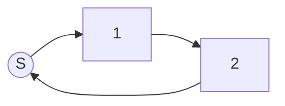
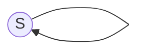
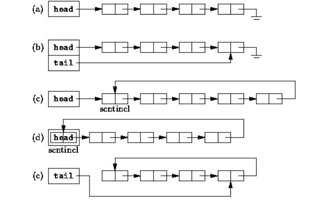
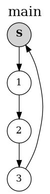

# La liste chaînée

!!! danger "Requis"
    La page [Maillons et sentinelle](maillons.md), et ses cinq tests qui passent. Tes fichiers `Maillon.java`, `Sentinelle.java` et `Dessin.java` ne changeront plus d'une ligne.

!!! question "Rappel d'ouverture (5 minutes, de mémoire, cahier fermé)"
    1. La chaîne est `1 -> 2 -> 3 -> S`, et tu tiens le maillon `b` qui porte `2`. Écris la ligne qui insère un maillon portant `7` entre le `2` et le `3`.
    2. Tu tiens `b`, et lui seul. Pourquoi ne peux-tu pas retirer de la chaîne le maillon qui porte `2` ?
    3. Que coûte `avancer(k)`, et pourquoi n'est-ce pas `O(1)` ?

    ??? success "Correction"
        1. `b.insereApres(new Maillon<>(7, new Sentinelle<>()));`

            Le second argument n'a aucune importance : `insereApres` rebranche la flèche du maillon neuf avant de l'accrocher. Mais il faut bien écrire quelque chose, et ce quelque chose n'est **jamais** `null`.

        2. Parce qu'un maillon n'a aucune flèche qui **arrive** sur lui. Pour le sortir de la chaîne, il faut tenir celui d'avant, et refermer la chaîne par-dessus. `b` ne peut rien faire à `b`.
        3. `O(k)`, parce qu'il faut suivre les flèches une par une : il n'y a pas d'adresse à calculer comme dans un tableau, il n'y a qu'un chemin à parcourir.

## 1 La sentinelle change de place

La page précédente a réglé un problème, la fin de la chaîne. Il en reste deux, et le rappel d'ouverture vient de les nommer.

- **Le premier maillon est un cas à part.** On ne peut ni insérer avant lui ni le retirer, puisque ces deux opérations se font depuis le **précédent**, et qu'il n'en a pas.
- **La chaîne vide est un cas à part.** Il n'y a aucun maillon d'où partir.

Les deux ont la même cause : il manque un maillon **avant le premier**. On va donc en poser un, qui est toujours là, qui ne porte aucune donnée, et qui ne bouge jamais. C'est une sentinelle, la même classe exactement, mais on la met **au début** au lieu de la mettre à la fin.

Et puisqu'on en a une au début, on n'en veut plus une seconde à la fin : le dernier maillon pointe **de nouveau sur elle**. La chaîne devient un **cercle**.

Voici la liste qui contient `1` puis `2`. La sentinelle est en gris.



Et voici la liste **vide** : il n'y a que la sentinelle, et elle pointe sur elle-même, exactement comme à la fin d'une chaîne.



!!! question "Dessiner, et compter (obligatoire)"
    Sur ton cahier, dessine la liste qui contient `1`, `2`, `3`.

    1. Combien de ronds as-tu tracés ? Combien de flèches ?
    2. Un parcours part de la sentinelle et suit les flèches. Comment sait-il qu'il a fait le tour ?
    3. Y a-t-il encore, quelque part dans ce dessin, un maillon dont le `suivant` serait inconnu ?

    ??? success "Correction"
        1. **Quatre** ronds, trois maillons plus la sentinelle, et **quatre** flèches : une par maillon, plus celle de la sentinelle. Autant de flèches que de ronds, c'est la signature d'un cercle.
        2. Il sait qu'il a fait le tour quand il **retombe sur la sentinelle**. Un parcours ne s'arrête donc plus sur `null`, ni sur un `instanceof Sentinelle` : il s'arrête quand il revient sur son point de départ.
        3. Non, et c'est tout l'intérêt. Chaque maillon a un suivant, chaque maillon a un précédent, et il n'y a plus un seul cas particulier à traiter.

## 2 La liste est sa propre sentinelle

Il reste une question : **où range-t-on cette sentinelle** ? Quelque part, il faut un objet qui désigne la liste entière, celui qu'on passe aux fonctions et qu'on garde dans une variable.

Cinq montages sont possibles, et ils sont tous employés dans la vraie vie.



On prend le **(d)**, et la réponse à la question tient en une phrase : on ne range la sentinelle nulle part, **la liste est la sentinelle**. Un seul objet fait les deux métiers.

En Java, cela s'écrit en trois mots. Crée `Liste.java` :

```java
import java.util.NoSuchElementException;
import java.util.Comparator;

/**
 * Une liste simplement chaînée circulaire, qui est sa propre sentinelle.
 * Le premier élément est this.suivant, et le dernier maillon pointe de nouveau
 * sur la liste : une liste vide pointe donc sur elle-même.
 */
class Liste<T> extends Sentinelle<T> {

    /** Crée une liste vide. */
    Liste() {
        // Sentinelle() fait pointer la liste vide sur elle-même
        super();
    }
}
```

Le constructeur n'a rien à faire. `Sentinelle()` fait déjà pointer l'objet sur lui-même, et c'est exactement ce qu'est une liste vide.

`Comparator` ne servira que dans la dernière partie. Garde l'import, il évitera une ligne rouge plus tard.

`Dessin` fonctionne sur une liste sans rien changer, puisqu'une liste **est** un maillon. Voici ce qu'il rend sur une liste contenant `1`, `2`, `3` : la sentinelle grise est en haut, et la flèche du dernier maillon remonte sur elle.

{ style="width: 160px; display: block; margin: 0 auto" }

!!! info "Ce que cela change dans tous les parcours"
    Trois réflexes, et ils vont revenir dans presque chaque méthode.

    | | |
    | --- | --- |
    | le premier élément | `this.suivant`, jamais `this` |
    | la fin du parcours | `courant != this` |
    | la liste est vide | `this.suivant == this` |

    Sur une liste vide, `this.suivant` **vaut** `this` : la première ligne et la troisième disent alors la même chose, et c'est pour cela qu'il n'y a pas de cas particulier à écrire.

??? tip "Pour aller plus loin : c'est le choix du noyau Linux"
    Le schéma (d) n'est pas une curiosité de cours. C'est celui des listes chaînées du noyau Linux, dans `include/linux/list.h`. Une liste y est une `struct list_head`, et une liste vide pointe sur elle-même :

    ```c
    #define LIST_HEAD_INIT(name) { &(name), &(name) }
    ```

    Le test de vacuité y est notre `estVide()`, ligne pour ligne, et le parcours s'y arrête en retombant sur la tête, comme notre `courant != this` :

    ```c
    static inline int list_empty(const struct list_head *head)
    {
        return READ_ONCE(head->next) == head;
    }
    ```

    **Ce que ce choix achète.** Aucun `suivant` ne vaut jamais `null`, donc aucune opération n'a à se demander si elle est au bout de la chaîne, ni si la liste est vide. C'est le piège que Tony Hoare appelle son erreur à un milliard de dollars : il a introduit la référence nulle en 1965 dans ALGOL W parce qu'elle était facile à implémenter, et il en a fait une conférence en 2009 sous le titre *Null References: The Billion Dollar Mistake*.

    **Deux différences, pour ne pas croire que c'est le même objet.** Le noyau est **doublement chaîné**, chaque maillon ayant un `next` et un `prev` : il insère en fin et retire un maillon en `O(1)`, là où il nous faudra un `precedent` en `O(n)`. Et il est **intrusif**, il n'y a pas de champ `data` : le maillon est embarqué **dans** la donnée, et on remonte de l'un à l'autre avec `container_of`.

!!! question "Prédire, sur une chaîne circulaire (obligatoire)"
    Soit `l` une liste contenant `1`, `2`, `3`. Tu n'as rien de nouveau à écrire : `avancer` est celle de la page précédente, inchangée.

    Donne les quatre réponses :

    - ce que renvoie `l.avancer(0)`
    - la donnée de `l.avancer(3)`
    - ce que renvoie `l.avancer(4)`
    - la donnée de `l.avancer(5)`.

    **Écris tes quatre réponses avant de dérouler la correction.**

    ??? success "Correction"
        - `l.avancer(0)` renvoie **`l` elle-même** : la liste est un maillon, et `avancer(0)` ne bouge pas.
        - `l.avancer(3).data` vaut `3`. La sentinelle est le départ, donc le premier élément est à **un** cran, pas à zéro.
        - `l.avancer(4)` renvoie **`l`** : on est revenu sur la sentinelle.
        - `l.avancer(5).data` vaut `1` : on repart pour un tour.

        Sur un cercle, `avancer` ne tombe jamais en panne de maillon. Il tourne, indéfiniment, et c'est le seul endroit du chapitre où la circularité pourrait se retourner contre toi : une boucle mal arrêtée ne s'arrête pas.

## 3 Le fichier de tests

Crée `ListeTest.java` à côté des autres, et mets-y ceci. Chaque test que la suite te donne se colle **à l'intérieur** de la classe, avant son accolade fermante.

??? tip "Le fichier `ListeTest.java`, à créer"
    ```java
    import static org.junit.jupiter.api.Assertions.*;

    import java.time.Duration;
    import java.util.ArrayList;
    import java.util.Comparator;
    import java.util.List;
    import java.util.NoSuchElementException;
    import org.junit.jupiter.api.DisplayName;
    import org.junit.jupiter.api.Test;

    /**
     * Tests de Liste. Chaque test n'utilise que la méthode qu'il teste : les listes
     * sont construites, parcourues et lues par les fonctions ci-dessous, qui branchent
     * les maillons à la main.
     */
    public class ListeTest {

        /** Construit une liste contenant les éléments donnés, dans l'ordre, sans append. */
        static Liste<Integer> L(Integer... xs) {
            Liste<Integer> l = new Liste<>();
            Maillon<Integer> ref = l;
            for (Integer x : xs) {
                ref.suivant = new Maillon<>(x, l);
                ref = ref.suivant;
            }
            return l;
        }

        /** Construit une liste d'élèves, dans l'ordre, sans append. */
        static Liste<Eleve> eleves(Eleve... es) {
            Liste<Eleve> l = new Liste<>();
            Maillon<Eleve> ref = l;
            for (Eleve e : es) {
                ref.suivant = new Maillon<>(e, l);
                ref = ref.suivant;
            }
            return l;
        }

        /** Construit la liste 1, 2, ..., n. */
        static Liste<Integer> unA(int n) {
            Integer[] xs = new Integer[n];
            for (int i = 0; i < n; i++) {
                xs[i] = i + 1;
            }
            return L(xs);
        }

        /** Renvoie le maillon situé k crans après m (comme avancer, sans l'utiliser). */
        static <T> Maillon<T> cran(Maillon<T> m, int k) {
            Maillon<T> ref = m;
            for (int i = 0; i < k; i++) {
                ref = ref.suivant;
            }
            return ref;
        }

        /** Renvoie les éléments de la liste, dans l'ordre, pour les comparer facilement. */
        static <T> List<T> contenu(Liste<T> l) {
            List<T> res = new ArrayList<>();
            Maillon<T> ptr = l.suivant;
            while (ptr != l) {
                res.add(ptr.data);
                ptr = ptr.suivant;
            }
            return res;
        }

        /** Renvoie les maillons de la liste (les objets eux-mêmes), dans l'ordre. */
        static <T> List<Maillon<T>> maillons(Liste<T> l) {
            List<Maillon<T>> res = new ArrayList<>();
            Maillon<T> ptr = l.suivant;
            while (ptr != l) {
                res.add(ptr);
                ptr = ptr.suivant;
            }
            return res;
        }

        /** Un élève, pour tester la stabilité du tri : on trie par note uniquement. */
        record Eleve(String nom, int note) {}

        static final Comparator<Eleve> PAR_NOTE = Comparator.comparingInt(Eleve::note);

        @Test
        @DisplayName("Liste() crée une liste vide qui pointe sur elle-même")
        void constructeur() {
            Liste<Integer> l = new Liste<>();
            assertSame(l, l.suivant, "la liste vide pointe sur elle-même");
        }
    }
    ```

Un mot sur ces outils, parce qu'ils ont été écrits ainsi exprès. `L(1, 2, 3)` construit une liste en **branchant les maillons à la main**, sans passer par `append` ni `ajouterDebut`. Si elle les utilisait, le jour où ta méthode `append` serait fausse, **tous** les tests échoueraient d'un coup et aucun ne te dirait où est le problème. Un test ne doit dépendre que de ce qu'il teste.

`eleves`, `unA`, `cran` et `maillons` ne serviront que plus bas, et `Eleve` seulement dans la dernière partie.

Le test du constructeur est déjà là : lance-le, il doit passer.

## 4 Les méthodes de la liste

Voici ce que la liste saura faire. Lis le tableau en entier **avant** d'écrire quoi que ce soit : c'est le contrat, et la moitié des méthodes s'écrit en appelant celles d'au-dessus.

| Méthode | Ce qu'elle rend | Coût |
| --- | --- | --- |
| `estVide()` | `true` si la liste ne contient aucun élément | `O(1)` |
| `taille()` | le nombre d'éléments | `O(n)` |
| `ajouterDebut(data)` | rien, ajoute un élément en tête | `O(1)` |
| `premier()` | le premier élément, erreur si la liste est vide | `O(1)` |
| `dernierMaillon()` | le dernier **maillon**, la liste elle-même si elle est vide | `O(n)` |
| `append(data)` | rien, ajoute un élément en fin | `O(n)` |
| `dernier()` | le dernier élément, erreur si la liste est vide | `O(n)` |
| `get(key)` | l'élément d'indice `key`, à partir de 0 | `O(n)` |
| `precedent(m)` | le maillon dont le suivant est `m` | `O(n)` |
| `estEgale(autre)` | `true` si les deux listes ont les mêmes éléments, dans le même ordre | `O(n)` |
| `clone()` | une copie indépendante de la liste | `O(n)` |
| `grefferApres(m)` | rien, déplace tous les maillons de cette liste après `m`, et la vide | `O(n)` |
| `extend(lst)` | rien, ajoute à la fin une **copie** des éléments de `lst` | `O(n + m)` |

Les méthodes se placent toutes dans la classe `Liste`. Leur ordre dans le fichier n'a aucune importance, mais écris-les dans l'ordre de la page : chacune se sert des précédentes.

Et comme sur la page précédente, `...` marque ce que tu as à écrire.

### 4.1 `estVide`

!!! question "Une seule ligne, et c'est la plus importante de la page (obligatoire)"
    ```java
    /** Indique si la liste est vide. */
    boolean estVide() {
        return ...;
    }
    ```

    Pas de `if`, pas de parcours, pas de compteur. Relis le tableau des trois réflexes de la section 2.

    ??? tip "Test à recopier dans `ListeTest.java`"
        ```java
            @Test
            @DisplayName("estVide")
            void estVide() {
                assertTrue(L().estVide());
                assertFalse(L(1).estVide());
            }
        ```

### 4.2 `taille`

!!! question "Compter les éléments (obligatoire)"
    ```java
    /** Compte les éléments de la liste, en O(n). */
    int taille() {
        int res = 0;
        Maillon<T> courant = ...;
        while (...) {
            ...
            ...
        }
        return res;
    }
    ```

    C'est le parcours type, celui que tu vas réécrire une dizaine de fois : une référence qui part du premier élément et qui avance tant qu'elle n'est pas revenue sur `this`.

    ??? tip "Test à recopier dans `ListeTest.java`"
        ```java
            @Test
            @DisplayName("taille")
            void taille() {
                assertEquals(0, L().taille());
                assertEquals(3, L(1, 2, 3).taille());
            }
        ```

    ??? tip "Indice"
        En Java, `!=` compare **toujours** des références : c'est le `is not` de Python. `courant != this` demande donc « suis-je revenu sur la sentinelle », ce qui est exactement la question.

    ??? warning "Correction"
        ```java
            int res = 0;
            Maillon<T> courant = this.suivant;
            while (courant != this) {
                res++;
                courant = courant.suivant;
            }
            return res;
        ```

        Garde ces cinq lignes sous les yeux : `dernierMaillon`, `get`, `precedent`, `estEgale` et `clone` sont toutes des variantes de ce parcours.

### 4.3 `ajouterDebut`

!!! question "Ajouter en tête (obligatoire)"
    ```java
    /** Ajoute un élément en tête de liste, en O(1). */
    void ajouterDebut(T data) {
        ...
    }
    ```

    Une ligne, et deux façons de l'écrire : en fabriquant le maillon avec le bon suivant du premier coup, ou en le fabriquant n'importe comment et en laissant `insereApres` le brancher. Les deux sont justes. Écris celle que ton dessin te dicte.

    ??? tip "Test à recopier dans `ListeTest.java`"
        ```java
            @Test
            @DisplayName("ajouterDebut ajoute en tête")
            void ajouterDebut() {
                Liste<Integer> l = L(1, 2);
                l.ajouterDebut(0);
                assertEquals(List.of(0, 1, 2), contenu(l));

                // Sur une liste vide
                Liste<Integer> v = L();
                v.ajouterDebut(5);
                assertEquals(List.of(5), contenu(v));
            }
        ```

    Remarque le second cas : tu n'as rien écrit pour lui, et il passe. C'est la sentinelle qui l'a réglé.

### 4.4 `premier`

!!! question "Le premier élément, et sa précondition (obligatoire)"
    ```java
    /** Renvoie le premier élément, en O(1). Erreur si la liste est vide. */
    T premier() {
        if (...) {
            throw new NoSuchElementException("La liste est vide");
        }
        return ...;
    }
    ```

    Elle renvoie une **donnée**, pas un maillon. Sur une liste vide, elle n'a aucune réponse possible : c'est une précondition, et en Java une précondition violée se signale en levant une exception.

    ??? tip "Test à recopier dans `ListeTest.java`"
        ```java
            @Test
            @DisplayName("premier")
            void premier() {
                assertEquals(7, L(7, 8, 9).premier());
                assertThrows(NoSuchElementException.class, () -> L().premier());
            }
        ```

### 4.5 `dernierMaillon` et `append`

!!! question "Les deux ensemble (obligatoire)"
    ```java
    /** Renvoie le dernier maillon (la liste elle-même si elle est vide), en O(n). */
    Maillon<T> dernierMaillon() {
        Maillon<T> ref = this;
        while (...) {
            ...
        }
        // Si on est là, c'est que ref.suivant == this
        return ref;
    }
    ```

    Attention au départ : `ref` part de `this`, et **pas** de `this.suivant` comme dans `taille`. C'est ce qui fait que la liste vide renvoie la bonne chose sans un `if`.

    ```java
    /** Ajoute un élément en fin de liste, en O(n). */
    void append(T data) {
        ...
    }
    ```

    `append` tient en une ligne et n'invente rien : trouver le dernier maillon, et insérer après lui. Écris `new Maillon<T>(data, this)` pour le maillon neuf, jamais `null`.

    ??? tip "Tests à recopier dans `ListeTest.java`"
        ```java
            @Test
            @DisplayName("dernierMaillon renvoie le maillon qui revient sur la liste")
            void dernierMaillon() {
                Liste<Integer> l = L(1, 2, 3);
                Maillon<Integer> d = l.dernierMaillon();
                assertEquals(3, d.data);
                assertSame(l, d.suivant);

                // Liste vide : c'est la liste elle-même
                Liste<Integer> v = L();
                assertSame(v, v.dernierMaillon());
            }

            @Test
            @DisplayName("append ajoute en fin")
            void append() {
                Liste<Integer> l = L(1, 2);
                l.append(3);
                assertEquals(List.of(1, 2, 3), contenu(l));

                // Sur une liste vide
                Liste<Integer> v = L();
                v.append(5);
                assertEquals(List.of(5), contenu(v));
            }
        ```

    ??? tip "Indice"
        On cherche le maillon dont le suivant est la liste. Tant que ce n'est pas le cas, on avance. Écris la condition dans ce sens-là, et le corps de la boucle tiendra sur une ligne.

### 4.6 `dernier`

!!! question "Le dernier élément (obligatoire)"
    ```java
    /** Renvoie le dernier élément, en O(n). Erreur si la liste est vide. */
    T dernier() {
        ...
    }
    ```

    Trois lignes, et aucune n'est neuve : c'est `premier` avec une autre méthode au milieu.

    ??? tip "Test à recopier dans `ListeTest.java`"
        ```java
            @Test
            @DisplayName("dernier")
            void dernier() {
                assertEquals(9, L(7, 8, 9).dernier());
                assertThrows(NoSuchElementException.class, () -> L().dernier());
            }
        ```

### 4.7 `get`

!!! question "L'élément d'indice donné (obligatoire)"
    ```java
    /** Renvoie l'élément d'indice key (à partir de 0), en O(n). */
    T get(int key) {
        if (key < 0) {
            throw new IndexOutOfBoundsException("Erreur d'indice");
        }
        Maillon<T> courant = this.suivant;
        int i = 0; // i est toujours l'indice de courant
        while (... && ...) {
            ...
            ...
        }
        if (...) {
            throw new IndexOutOfBoundsException("Erreur d'indice");
        }
        return ...;
    }
    ```

    ??? tip "Test à recopier dans `ListeTest.java`"
        ```java
            @Test
            @DisplayName("get renvoie l'élément d'indice donné")
            void get() {
                Liste<Integer> l = L(1, 2, 3);
                assertEquals(1, l.get(0));
                assertEquals(3, l.get(2));

                // Hors limites
                assertThrows(IndexOutOfBoundsException.class, () -> l.get(3));
                assertThrows(IndexOutOfBoundsException.class, () -> l.get(-1));
            }
        ```

    ??? tip "Indice"
        Deux conditions d'arrêt, pas une : on avance tant qu'on n'est **pas revenu sur la liste** et qu'on n'a **pas atteint** l'indice voulu.

        Après la boucle, c'est la **raison** de l'arrêt qui décide. Si on est revenu sur la liste, c'est que l'indice était trop grand. Le commentaire `i est toujours l'indice de courant` est ce qui rend les deux conditions lisibles : garde-le vrai à chaque tour.

    ??? question "Avant d'ouvrir la correction"
        En une phrase, sur ton cahier : qu'est-ce que l'indice t'a appris sur ce qui n'allait pas dans **ton** code ?

    ??? warning "Correction"
        ```java
            while (courant != this && i < key) {
                courant = courant.suivant;
                i++;
            }
            if (courant == this) {
                throw new IndexOutOfBoundsException("Erreur d'indice");
            }
            return courant.data;
        ```

### 4.8 `precedent`

!!! question "Le maillon d'avant (obligatoire)"
    Cette méthode existe pour une raison précise, et c'est la question 2 du rappel d'ouverture : dans une chaîne à sens unique, on ne peut retirer un maillon qu'**en passant par celui d'avant**. `precedent(m).decrocheProchain()` retire `m`, et c'est la seule façon de le faire.

    ```java
    /**
     * Renvoie le maillon qui précède m dans la liste, en O(n).
     * Utile pour retirer m : precedent(m).decrocheProchain().
     */
    Maillon<T> precedent(Maillon<T> m) {
        Maillon<T> ref = this;
        while (...) {
            ...
            if (...) {
                throw new NoSuchElementException("Ce maillon n'est pas dans la liste");
            }
        }
        return ref;
    }
    ```

    ??? tip "Test à recopier dans `ListeTest.java`"
        ```java
            @Test
            @DisplayName("precedent renvoie le maillon qui précède")
            void precedent() {
                Liste<Integer> l = L(1, 2, 3);
                assertEquals(2, l.precedent(cran(l, 3)).data);
                assertSame(l, l.precedent(l.suivant), "le précédent du premier est la liste");
                assertEquals(3, l.precedent(l).data, "le précédent de la liste est le dernier");

                // Liste vide
                Liste<Integer> v = L();
                assertSame(v, v.precedent(v));

                // Maillon absent
                assertThrows(NoSuchElementException.class, () -> l.precedent(new Maillon<>(9, new Sentinelle<>())));

                // precedent permet de retirer un maillon
                Liste<Integer> r = L(1, 2, 3);
                Maillon<Integer> deux = cran(r, 2);
                Maillon<Integer> p = r.precedent(deux);
                p.suivant = p.suivant.suivant;
                assertEquals(List.of(1, 3), contenu(r));
            }
        ```

    ??? tip "Indice"
        On cherche la référence `ref` telle que `ref.suivant == m`. Tant que ce n'est pas le cas, on avance.

        Si `m` n'est pas dans la liste, on finira par **repasser par la sentinelle**. C'est là, et seulement là, que l'exception se lève. Sans ce test, la boucle tourne indéfiniment : c'est le prix du cercle, annoncé en section 2.

    ??? question "Avant d'ouvrir la correction"
        En une phrase, sur ton cahier : qu'est-ce que l'indice t'a appris sur ce qui n'allait pas dans **ton** code ?

    ??? warning "Correction"
        ```java
            while (ref.suivant != m) {
                ref = ref.suivant;
                if (ref == this) {
                    throw new NoSuchElementException("Ce maillon n'est pas dans la liste");
                }
            }
            return ref;
        ```

### 4.9 `estEgale`

!!! question "Comparer deux listes (obligatoire)"
    ```java
    /** Indique si cette liste a les mêmes éléments que autre, dans le même ordre. */
    boolean estEgale(Liste<T> autre) {
        Maillon<T> ref1 = this.suivant;
        Maillon<T> ref2 = autre.suivant;
        while (... && ...) {
            if (...) {
                return false;
            }
            ...
            ...
        }
        return ...;
    }
    ```

    Deux références avancent en parallèle, une par liste. La dernière ligne est la plus délicate : deux listes de longueurs différentes ne doivent pas être déclarées égales, et la boucle s'arrête dès que **l'une** des deux est épuisée.

    ??? tip "Test à recopier dans `ListeTest.java`"
        ```java
            @Test
            @DisplayName("estEgale compare les éléments, dans l'ordre")
            void estEgale() {
                assertTrue(L(1, 2).estEgale(L(1, 2)));
                assertTrue(L().estEgale(L()));
                assertFalse(L(1, 2).estEgale(L(1, 3)));
                assertFalse(L(1, 2).estEgale(L(1)));
                assertFalse(L(1).estEgale(L(1, 2)));

                // Les valeurs sont comparées, pas les références :
                // 1000 n'est pas dans le cache des Integer, ce sont deux objets distincts
                assertTrue(L(1000).estEgale(L(1000)));
            }
        ```

    ??? tip "Indice"
        C'est **ici**, et seulement ici, que `==` n'est plus le bon outil. Comparer deux **données** demande `ref1.data.equals(ref2.data)`.

        Le dernier test explique pourquoi cela se voit si rarement : Java garde en cache les `Integer` de `-128` à `127`, donc entre deux objets différents `100 == 100` est vrai et `1000 == 1000` est faux. Un code écrit avec `==` passe sur les petits nombres et échoue sur les grands.

    ??? question "Avant d'ouvrir la correction"
        En une phrase, sur ton cahier : qu'est-ce que l'indice t'a appris sur ce qui n'allait pas dans **ton** code ?

    ??? warning "Correction"
        ```java
            while (ref1 != this && ref2 != autre) {
                if (!ref1.data.equals(ref2.data)) {
                    return false;
                }
                ref1 = ref1.suivant;
                ref2 = ref2.suivant;
            }
            return ref1 == this && ref2 == autre;
        ```

        La dernière ligne dit : les deux listes sont épuisées **en même temps**. Si une seule l'est, elles n'avaient pas la même longueur.

### 4.10 `clone`

!!! question "Copier la liste (obligatoire)"
    ```java
    /** Renvoie une copie de la liste (nouveaux maillons, mêmes éléments), en O(n). */
    @Override
    public Liste<T> clone() {
        Liste<T> lst = new Liste<T>();
        Maillon<T> ref = this.suivant;      // lit la liste d'origine
        Maillon<T> refcopy = lst;           // dernier maillon écrit dans la copie
        while (...) {
            // Tricoter
            ...

            // Avancer
            ...
            ...
        }
        return lst;
    }
    ```

    `@Override` et `public` sont imposés par la méthode dont celle-ci prend la place. Garde-les tels quels.

    Deux références avancent en même temps, et les commentaires disent dans quel ordre : on tricote un maillon neuf après `refcopy`, puis on avance les deux.

    ??? tip "Test à recopier dans `ListeTest.java`"
        ```java
            @Test
            @DisplayName("clone crée une liste indépendante")
            void clonage() {
                Liste<Integer> l = L(1, 2, 3);
                Liste<Integer> c = l.clone();
                assertNotSame(l, c);
                assertEquals(List.of(1, 2, 3), contenu(c));

                // Les maillons sont copiés : modifier la copie ne change pas l
                c.suivant.data = 9;
                assertEquals(List.of(1, 2, 3), contenu(l));

                // Liste vide
                assertEquals(List.of(), contenu(L().clone()));
            }
        ```

    ??? tip "Indice"
        Le maillon neuf se fabrique avec `new Maillon<T>(ref.data, lst)` : sa donnée est celle qu'on lit, et son suivant est la copie, puisqu'il en est pour l'instant le dernier. `insereApres` fera le reste.

        Construire la copie à coups de `append` marcherait aussi, et coûterait `O(n²)`. La raison est dans la section 5, et c'est elle qui justifie les deux références.

    ??? question "Avant d'ouvrir la correction"
        En une phrase, sur ton cahier : qu'est-ce que l'indice t'a appris sur ce qui n'allait pas dans **ton** code ?

    ??? warning "Correction"
        ```java
            while (ref != this) {
                // Tricoter
                refcopy.insereApres(new Maillon<T>(ref.data, lst));

                // Avancer
                refcopy = refcopy.suivant;
                ref = ref.suivant;
            }
            return lst;
        ```

### 4.11 `grefferApres`

!!! question "Déménager des maillons (obligatoire)"
    Attention au sens : c'est **cette** liste qui se vide, et ses maillons vont se placer après le maillon `m`, qui est ailleurs. On écrit `source.grefferApres(destination)`.

    ```java
    /**
     * Déplace tous les maillons de cette liste juste après le maillon m, en O(n).
     * Cette liste est vide après l'appel.
     */
    void grefferApres(Maillon<T> m) {
        // Cette liste est vide : rien à faire
        if (...) {
            return;
        }
        // On cherche le dernier maillon de cette liste
        Maillon<T> fin = this.suivant;
        while (...) {
            ...
        }
        ...
        ...
        ...
    }
    ```

    Aucun maillon n'est créé ni copié : ils **changent de liste**. Trois flèches changent à la fin, et aucune autre.

    ??? tip "Test à recopier dans `ListeTest.java`"
        ```java
            @Test
            @DisplayName("grefferApres insère les maillons d'une liste et la vide")
            void grefferApres() {
                Liste<Integer> l = L(1, 2);
                Liste<Integer> g = L(8, 9);
                Maillon<Integer> huit = g.suivant;
                g.grefferApres(l.suivant);
                assertEquals(List.of(1, 8, 9, 2), contenu(l));
                assertEquals(List.of(), contenu(g), "g est vidée");
                assertSame(huit, cran(l, 2), "les maillons sont déplacés, pas copiés");

                // En tête
                Liste<Integer> t = L(1, 2);
                L(8, 9).grefferApres(t);
                assertEquals(List.of(8, 9, 1, 2), contenu(t));

                // En fin
                Liste<Integer> f = L(1, 2);
                L(8, 9).grefferApres(cran(f, 2));
                assertEquals(List.of(1, 2, 8, 9), contenu(f));

                // Avec des listes vides
                Liste<Integer> u = L(1);
                L().grefferApres(u);
                assertEquals(List.of(1), contenu(u));
                Liste<Integer> v = L();
                L(5).grefferApres(v);
                assertEquals(List.of(5), contenu(v));
            }
        ```

    ??? tip "Indice"
        Dessine les deux listes côte à côte, puis pose-toi la question pour **chacune** des trois dernières flèches : d'où part-elle, et où doit-elle arriver ?

        La fin de cette liste doit pointer vers ce qui suivait `m`. `m` doit pointer vers le début de cette liste. Et cette liste doit pointer sur elle-même, puisqu'elle est maintenant vide.

        L'ordre de ces trois affectations compte, exactement comme dans `insereApres`.

    ??? question "Avant d'ouvrir la correction"
        En une phrase, sur ton cahier : qu'est-ce que l'indice t'a appris sur ce qui n'allait pas dans **ton** code ?

    ??? warning "Correction"
        ```java
            if (this.suivant == this) {
                return;
            }
            Maillon<T> fin = this.suivant;
            while (fin.suivant != this) {
                fin = fin.suivant;
            }
            fin.suivant = m.suivant;
            m.suivant = this.suivant;
            this.suivant = this;
        ```

        Le premier `if` n'est pas indispensable au résultat, et c'est une bonne occasion de le vérifier : déroule les trois dernières lignes sur une liste vide, où `this.suivant` vaut `this`. Elles ne cassent rien. Il reste là parce qu'il **dit l'intention**, une liste vide n'a rien à déménager, et qu'un lecteur n'a alors pas à refaire ce calcul.

### 4.12 `extend`

!!! question "Ajouter une copie (obligatoire)"
    ```java
    /** Ajoute à la fin de cette liste une copie de lst, en O(n + m). */
    void extend(Liste<T> lst) {
        ...
    }
    ```

    Une ligne, qui n'utilise que des méthodes déjà écrites. `grefferApres` **vide** la liste qu'elle déplace, il ne faut donc surtout pas lui donner `lst`.

    ??? tip "Test à recopier dans `ListeTest.java`"
        ```java
            @Test
            @DisplayName("extend ajoute une copie des éléments et laisse l'autre liste intacte")
            void extend() {
                Liste<Integer> l = L(1, 2);
                Liste<Integer> m = L(3, 4);
                Maillon<Integer> trois = cran(m, 1);
                Maillon<Integer> quatre = cran(m, 2);
                l.extend(m);
                assertEquals(List.of(1, 2, 3, 4), contenu(l));
                assertEquals(List.of(3, 4), contenu(m));

                // Aucun maillon n'est partagé entre les deux listes
                // (cran ne boucle jamais, même si les chaînes sont mal raccordées)
                assertNotSame(trois, cran(l, 3), "le maillon de 3 doit être une copie");
                assertNotSame(quatre, cran(l, 4), "le maillon de 4 doit être une copie");
                assertSame(l, cran(l, 5), "la fin de l doit revenir sur l");
                assertSame(trois, cran(m, 1), "m garde ses propres maillons");
                assertSame(quatre, cran(m, 2), "m garde ses propres maillons");
                assertSame(m, cran(m, 3), "la fin de m doit revenir sur m");

                // Avec des listes vides
                Liste<Integer> v = L();
                v.extend(L(3));
                assertEquals(List.of(3), contenu(v));
                Liste<Integer> n = L(1);
                n.extend(L());
                assertEquals(List.of(1), contenu(n));

                // Avec elle-même : les éléments sont doublés
                Liste<Integer> d = L(1, 2);
                d.extend(d);
                assertEquals(List.of(1, 2, 1, 2), contenu(d));
            }
        ```

    Le dernier cas mérite un instant. `d.extend(d)` rend bien `1, 2, 1, 2`. Demande-toi dans quel ordre les appels de ta ligne s'exécutent, et ce que ferait une version qui grefferait `lst` directement.

    ??? tip "Indice"
        Trois appels s'enchaînent, et il faut les poser dans le bon ordre : fabriquer une copie de `lst`, trouver où elle doit aller, puis la déménager là.

        La copie est une liste **à nous**, que personne d'autre ne tient : la vider ne gêne donc personne.

    ??? question "Avant d'ouvrir la correction"
        En une phrase, sur ton cahier : qu'est-ce que l'indice t'a appris sur ce qui n'allait pas dans **ton** code ?

    ??? warning "Correction"
        ```java
            lst.clone().grefferApres(this.dernierMaillon());
        ```

        Et c'est ce qui fait marcher `d.extend(d)` : `clone` est évalué **avant** que quoi que ce soit ne bouge, donc la copie est faite sur la liste telle qu'elle était.

### 4.13 Renverser la liste

!!! question "Lire, pas écrire (entraînement)"
    Ce code ne demande aucune méthode nouvelle. Il renverse une liste **en place**, sans créer un seul maillon, avec deux lignes qui n'utilisent que `decrocheProchain` et `insereApres`.

    ```java
    Maillon<Integer> premier = l.suivant;
    while (premier != l && premier.suivant != l) {
        l.insereApres(premier.decrocheProchain());
    }
    ```

    Réponds à ces trois questions sur ton cahier, puis déroule les tours sur la liste `1, 2, 3, 4` :

    - que désigne `premier` au premier tour, et que désigne-t-il à la fin ?
    - à chaque tour, quel maillon bouge, et où va-t-il ?
    - pourquoi la boucle s'arrête-t-elle quand `premier.suivant` vaut `l` ?

    ??? success "Correction"
        `premier` désigne le maillon qui portait le **premier** élément, et il n'est **jamais réaffecté** : tout le reste défile devant lui, et il finit dernier.

        À chaque tour, le maillon qui suit `premier` est décroché et réinséré juste après `l`, c'est-à-dire **en tête**.

        ```text
        départ : 1, 2, 3, 4
        tour 1 : 2, 1, 3, 4
        tour 2 : 3, 2, 1, 4
        tour 3 : 4, 3, 2, 1
        ```

        La boucle s'arrête quand `premier.suivant` vaut `l`, parce que cela veut dire que `premier` est devenu le dernier maillon : tout ce qui le suivait est passé devant.

        Le test `premier != l` est ce qui protège la liste **vide**, où `l.suivant` vaut `l` et où il n'y a rien à renverser.

    ??? question "À écrire (bonus)"
        Range ce code dans une méthode `void renverser()` de la classe `Liste`, et écris son test. Il doit vérifier le contenu renversé **et** qu'aucun maillon n'a été créé, avec `maillons` et `assertSame`. Vérifie-le pour `n` allant de `0` à `4`.

## 5 Ce que cela coûte

C'est la partie qui compte le plus, et c'est aussi celle qu'on survole. Tu viens d'écrire une structure entière : savoir **ce que chaque opération coûte** est ce qui te permettra de décider, le jour où tu auras le choix.

`n` est la taille de la liste, `m` celle de la liste passée en argument.

| Coût | Opérations |
| --- | --- |
| `O(1)` | `insereApres`, `decrocheProchain`, `estVide`, `premier`, `ajouterDebut` |
| `O(k)` | `avancer(k)` |
| `O(n)` | `taille`, `dernierMaillon`, `dernier`, `append`, `get`, `precedent`, `estEgale`, `clone`, `grefferApres` |
| `O(n + m)` | `extend` |

Regarde la deuxième ligne du tableau et la troisième ensemble. **Tout ce qui est à un endroit connu coûte `O(1)`. Tout ce qui demande d'arriver quelque part coûte `O(n)`.** C'est la seule chose à retenir, et elle suffit à reconstruire le tableau entier.

!!! question "Combien de pas pour construire une liste ? (obligatoire)"
    On part d'une liste vide et on appelle `append` `n` fois de suite.

    1. Combien de maillons `dernierMaillon` parcourt-il au **quatrième** appel ?
    2. Donne le nombre **total** de maillons parcourus pour les `n` appels, en fonction de `n`.
    3. Quel est le coût de la construction entière : `O(n)`, `O(n log n)` ou `O(n²)` ?

    **Écris tes trois réponses avant de dérouler la correction.**

    ??? success "Correction"
        1. Trois. Au quatrième appel, la liste contient déjà trois éléments.
        2. $0 + 1 + 2 + \dots + (n-1) = \dfrac{n(n-1)}{2}$. Pour `n = 100`, cela fait 4950 pas.
        3. `O(n²)`. Chaque `append` est en `O(n)`, et on en fait `n`.

        C'est exactement pour cette raison que `clone` ne construit pas sa copie à coups de `append` : elle garde une référence sur le dernier maillon écrit et insère directement après lui. Chaque insertion coûte alors `O(1)`, et le total retombe à `O(n)`.

        Et c'est aussi pour cette raison que `L` et `eleves`, dans le fichier de tests, branchent les maillons à la main.

!!! info "Une liste qui saurait faire `append` en `O(1)`"
    Regarde de nouveau le schéma des cinq variantes. La variante (b) garde une seconde référence, `tail`, sur le dernier maillon. `append` devient alors `O(1)`, sans aucun parcours.

    Ce n'est pas gratuit. Cette référence doit être **mise à jour par toutes les autres opérations** : chaque insertion, chaque suppression, chaque greffe doit se demander si elle vient de changer le dernier maillon. Le coût quitte le calcul et arrive dans la maintenance du code.

    C'est un arbitrage, pas une amélioration : on gagne sur une opération, on paie sur toutes les autres.

!!! question "Choisir la structure (obligatoire)"
    Pour chacune des quatre situations, dis si tu prends une **liste chaînée** comme celle de ce chapitre, ou un **tableau** (une liste Python, un tableau Java).

    Justifie **par le coût**, et en deux temps à chaque fois : quelle est l'opération la plus fréquente, et que coûte-t-elle dans chaque structure ?

    1. Un flux d'événements qu'on accumule, chaque nouvel événement passant devant les précédents.
    2. Un jeu tire au hasard, des milliers de fois par seconde, l'élément numéro `i` d'une collection de 10 000 cases.
    3. On parcourt une collection en tenant la référence du maillon courant, et on retire au passage les éléments qui ne conviennent pas.
    4. Une fois par jour, on additionne tous les nombres d'une collection, du premier au dernier.

    **Écris tes quatre réponses avant de dérouler la correction.**

    ??? success "Correction"
        1. **Liste chaînée.** L'opération fréquente est l'ajout en tête : `ajouterDebut` est en `O(1)`, alors qu'insérer en tête d'un tableau oblige à décaler toutes les cases, donc `O(n)`.
        2. **Tableau.** L'opération fréquente est l'accès par indice : `O(1)` dans un tableau, qui calcule une adresse, contre `O(n)` pour `get`, qui parcourt.
        3. **Liste chaînée.** Une fois le maillon précédent en main, `decrocheProchain` est en `O(1)`, on rebranche une flèche. Dans un tableau, chaque suppression décale la suite, donc `O(n)`.
        4. **Ni l'une ni l'autre sur ce critère.** Un parcours complet coûte `O(n)` des deux côtés. Le coût ne départage pas, la décision se prend donc ailleurs : sur ce que la collection doit faire **le reste du temps**.

        Retiens la question, pas les réponses : *quelle opération est la plus fréquente, et que coûte-t-elle dans chaque structure ?* C'est elle qui se transporte d'une situation à la suivante, et c'est elle qu'on te demandera.

## 6 Problème de fin : trier la liste

Quatre méthodes, à écrire dans l'ordre. Elles forment un **tri fusion** qui ne crée **aucun maillon** : tout se fait en déplaçant des flèches, avec les deux opérations de la page précédente.

Un `Comparator<T>` est l'objet qui décide de l'ordre. `cmp.compare(a, b)` rend un nombre négatif si `a` passe avant `b`, nul s'ils sont équivalents, et positif sinon. `Comparator.naturalOrder()` donne l'ordre croissant habituel, `Comparator.reverseOrder()` l'inverse.

C'est ici que servent le `record Eleve` et le `PAR_NOTE` posés dans l'en-tête de `ListeTest` : ils vérifieront que le tri est **stable**, c'est-à-dire qu'à note égale, deux élèves gardent leur ordre d'origine.

### 6.1 `milieu`

!!! question "Trouver le milieu sans compter (obligatoire)"
    Deux références partent du premier maillon. Le **lièvre** avance de deux crans quand la **tortue** en avance d'un. Quand le lièvre arrive au bout, la tortue est au milieu, et on n'a parcouru la liste qu'une seule fois.

    Pour `n` éléments, la moitié gauche en contient $\dfrac{n+1}{2}$, arrondi vers le bas.

    **Remplis ce tableau à la main avant d'écrire la méthode.** La liste contient `1, 2, ..., n`, et on demande la donnée du maillon renvoyé.

    | `n` | 1 | 2 | 3 | 4 | 5 | 6 |
    | --- | --- | --- | --- | --- | --- | --- |
    | `milieu().data` | | | | | | |

    ??? success "Correction"
        | `n` | 1 | 2 | 3 | 4 | 5 | 6 |
        | --- | --- | --- | --- | --- | --- | --- |
        | `milieu().data` | 1 | 1 | 2 | 2 | 3 | 3 |

        La moitié gauche est la plus grosse quand `n` est impair : pour `n = 5`, elle contient `1, 2, 3` et la droite `4, 5`.

    ```java
    /**
     * Renvoie le dernier maillon de la moitié gauche, en O(n).
     * Pour n éléments, la moitié gauche en contient (n + 1) / 2.
     */
    Maillon<T> milieu() {
        Maillon<T> lievre = this.suivant;
        Maillon<T> tortue = this.suivant;
        while (... && ...) {
            ...
            ...
        }
        return tortue;
    }
    ```

    ??? tip "Test à recopier dans `ListeTest.java`"
        ```java
            @Test
            @DisplayName("milieu renvoie le dernier maillon de la moitié gauche")
            void milieu() {
                int[] attendus = {1, 1, 2, 2, 3, 3, 4, 4}; // pour n = 1 à 8
                for (int n = 1; n <= 8; n++) {
                    Liste<Integer> l = unA(n);
                    // Si le lièvre saute la sentinelle, milieu boucle à l'infini :
                    // on arrête le test au bout d'une seconde.
                    Maillon<Integer> m = assertTimeoutPreemptively(Duration.ofSeconds(1), l::milieu, "n = " + n);
                    assertEquals(attendus[n - 1], m.data, "n = " + n);
                }

                // Liste vide : c'est la liste elle-même
                Liste<Integer> v = L();
                assertSame(v, v.milieu());
            }
        ```

    ??? tip "Indice"
        La chaîne est un cercle, donc **rien n'arrête le lièvre tout seul**. C'est la condition de la boucle qui doit l'arrêter, et elle porte sur deux choses à la fois, puisque le lièvre fait deux pas : `lievre.suivant` et `lievre.suivant.suivant`. Si l'une des deux est déjà la sentinelle, il faut s'arrêter.

        Si tu n'en testes qu'une, le lièvre enjambe la sentinelle et repart pour un tour. Le test coupe au bout d'une seconde, mais le programme, lui, ne s'arrêterait jamais.

    ??? tip "Voir les deux références avancer"
        Place cette ligne dans ta boucle, et lance en Debug avec un point d'arrêt juste dessous :

        ```java
            Dessin.dessiner(this, "lievre", lievre, "tortue", tortue);
        ```

        Les deux noms apparaissent en rouge dans `liste.png`, et tu vois l'écart se creuser à chaque tour. Retire la ligne une fois la méthode juste.

    ??? question "Avant d'ouvrir la correction"
        En une phrase, sur ton cahier : qu'est-ce que l'indice t'a appris sur ce qui n'allait pas dans **ton** code ?

    ??? warning "Correction"
        ```java
            while (lievre.suivant != this && lievre.suivant.suivant != this) {
                lievre = lievre.suivant.suivant;
                tortue = tortue.suivant;
            }
            return tortue;
        ```

### 6.2 `couper`

!!! question "Couper la liste en deux (obligatoire)"
    ```java
    /**
     * Coupe la liste en deux, en O(n), sans copier de maillon : renvoie une
     * nouvelle liste avec la moitié gauche, et cette liste garde la moitié droite.
     */
    Liste<T> couper() {
        if (this.estVide()) {
            return new Liste<T>();
        }
        Maillon<T> m1 = this.milieu();   // dernier maillon de gauche
        Maillon<T> m2 = m1.suivant;      // premier maillon de droite

        Liste<T> gauche = new Liste<T>();
        ...
        ...

        ...
        return gauche;
    }
    ```

    Trois flèches à poser, et aucun `new Maillon`. Les deux maillons de la frontière sont déjà nommés.

    ??? tip "Test à recopier dans `ListeTest.java`"
        ```java
            @Test
            @DisplayName("couper : la nouvelle liste prend la moitié gauche, this garde la droite")
            void couper() {
                Liste<Integer> l = L(1, 2, 3, 4, 5);
                Liste<Integer> gauche = l.couper();
                assertEquals(List.of(1, 2, 3), contenu(gauche));
                assertEquals(List.of(4, 5), contenu(l));

                // Pour toutes les tailles, gauche suivie de this redonne la liste
                for (int n = 0; n <= 6; n++) {
                    Liste<Integer> t = unA(n);
                    List<Integer> attendu = contenu(t);
                    Liste<Integer> g = t.couper();
                    List<Integer> obtenu = new ArrayList<>(contenu(g));
                    obtenu.addAll(contenu(t));
                    assertEquals(attendu, obtenu, "n = " + n);
                    assertEquals((n + 1) / 2, contenu(g).size(), "n = " + n);
                }

                // Aucun maillon n'est copié
                Liste<Integer> s = L(1, 2, 3, 4);
                List<Maillon<Integer>> avant = maillons(s);
                Liste<Integer> gs = s.couper();
                assertSame(avant.get(0), gs.suivant);
                assertSame(avant.get(2), s.suivant);
            }
        ```

    ??? tip "Indice"
        Dessine la liste `1, 2, 3, 4, 5` avec sa sentinelle, puis entoure les deux moitiés. Tu dois obtenir **deux cercles**, chacun refermé sur sa propre sentinelle.

        Demande-toi, pour chacune des trois flèches : le début de gauche, la fin de gauche, et le début de droite.

    ??? question "Avant d'ouvrir la correction"
        En une phrase, sur ton cahier : qu'est-ce que l'indice t'a appris sur ce qui n'allait pas dans **ton** code ?

    ??? warning "Correction"
        ```java
            Liste<T> gauche = new Liste<T>();
            gauche.suivant = this.suivant;
            m1.suivant = gauche;

            this.suivant = m2;
            return gauche;
        ```

### 6.3 `fusion`

!!! question "Fusionner deux listes triées (obligatoire)"
    ```java
    /**
     * Fusionne lst dans cette liste, en place, en O(n + m). Les deux listes
     * doivent être triées selon cmp, et lst est vide après l'appel.
     */
    void fusion(Liste<T> lst, Comparator<T> cmp) {
        // ref1 et ref2 pointent sur le maillon d'AVANT celui qu'on compare
        Maillon<T> ref1 = this;
        Maillon<T> ref2 = lst;

        while (ref1.suivant != this && ref2.suivant != lst) {
            if (cmp.compare(ref1.suivant.data, ref2.suivant.data) < 0) {
                // Le maillon de cette liste est déjà à sa place : on avance
                ...
            } else {
                // On déplace le maillon de lst juste après ref1,
                // puis on se place dessus pour observer son suivant
                ...
                ...
                ...
            }
        }
        // grefferApres ne fait rien si lst est vide, et vide lst sinon
        ...
    }
    ```

    Les deux références pointent sur le maillon **d'avant**, et ce n'est pas un détail de confort : c'est la seule position depuis laquelle on peut décrocher.

    ??? tip "Test à recopier dans `ListeTest.java`"
        ```java
            @Test
            @DisplayName("fusion de deux listes triées donne une liste triée")
            void fusion() {
                Liste<Integer> l = L(1, 4, 6);
                Liste<Integer> m = L(2, 3, 5, 7, 8);
                l.fusion(m, Comparator.naturalOrder());
                assertEquals(List.of(1, 2, 3, 4, 5, 6, 7, 8), contenu(l));
                assertEquals(List.of(), contenu(m), "l'autre liste est absorbée");

                // Toute l'autre liste est plus petite
                Liste<Integer> p = L(5, 6);
                p.fusion(L(1, 2), Comparator.naturalOrder());
                assertEquals(List.of(1, 2, 5, 6), contenu(p));

                // Avec des listes vides
                Liste<Integer> v = L();
                v.fusion(L(1, 2), Comparator.naturalOrder());
                assertEquals(List.of(1, 2), contenu(v));
                Liste<Integer> n = L(1, 2);
                n.fusion(L(), Comparator.naturalOrder());
                assertEquals(List.of(1, 2), contenu(n));
                Liste<Integer> vv = L();
                vv.fusion(L(), Comparator.naturalOrder());
                assertEquals(List.of(), contenu(vv));

                // En cas d'égalité, les éléments de lst passent en premier
                Eleve a = new Eleve("A", 10);
                Eleve b = new Eleve("B", 10);
                Liste<Eleve> e = eleves(b);
                e.fusion(eleves(a), PAR_NOTE);
                assertEquals(List.of(a, b), contenu(e));
            }
        ```

    ??? tip "Indice"
        Dans le `else`, trois lignes et trois gestes : décrocher le maillon qui suit `ref2`, l'insérer après `ref1`, puis **faire avancer `ref1` dessus**. Si tu oublies le troisième, le maillon suivant de `lst` se placera avant celui que tu viens de poser.

        Après la boucle, il reste deux cas. Si c'est `lst` qui est vide, tout est déjà en place. Si c'est cette liste, il reste à raccrocher la fin de `lst`. Tu as déjà écrit la méthode qui fait exactement cela, et qui ne fait rien quand la liste est vide : elle traite donc les deux cas d'un coup, **sans aucun `if`**.

    ??? tip "Indice plus précis"
        Le dernier test est celui de l'égalité : quand les deux éléments sont équivalents, `cmp.compare` rend `0`, et c'est l'élément de `lst` qui doit passer en premier. Regarde donc bien quel côté de ton `if` reçoit le `0`. C'est ce détail, et lui seul, qui rendra le tri **stable**.

    ??? question "Avant d'ouvrir la correction"
        En une phrase, sur ton cahier : qu'est-ce que l'indice t'a appris sur ce qui n'allait pas dans **ton** code ?

    ??? warning "Correction"
        ```java
            Maillon<T> ref1 = this;
            Maillon<T> ref2 = lst;
            while (ref1.suivant != this && ref2.suivant != lst) {
                if (cmp.compare(ref1.suivant.data, ref2.suivant.data) < 0) {
                    ref1 = ref1.suivant;
                } else {
                    Maillon<T> m = ref2.decrocheProchain();
                    ref1.insereApres(m);
                    ref1 = m;
                }
            }
            lst.grefferApres(ref1);
        ```

        Le `<` **strict** est ce qui donne l'égalité à `lst` : à note égale, on passe dans le `else`, donc on déplace.

### 6.4 `triFusion`

!!! question "Trier (obligatoire)"
    ```java
    /** Trie la liste en place par tri fusion, en O(n log n), sans copier de maillon. */
    void triFusion(Comparator<T> cmp) {
        if (... || ...) {
            return;
        }
        ...
        ...
        ...
        ...
    }
    ```

    Deux cas de base, puis quatre lignes, et tu as déjà tout écrit.

    ??? tip "Test à recopier dans `ListeTest.java`"
        ```java
            @Test
            @DisplayName("triFusion trie la liste")
            void triFusion() {
                Liste<Integer> l = L(5, 2, 8, 1, 9, 3);
                l.triFusion(Comparator.naturalOrder());
                assertEquals(List.of(1, 2, 3, 5, 8, 9), contenu(l));

                // Petites listes
                Liste<Integer> vide = L();
                vide.triFusion(Comparator.naturalOrder());
                assertEquals(List.of(), contenu(vide));
                Liste<Integer> un = L(1);
                un.triFusion(Comparator.naturalOrder());
                assertEquals(List.of(1), contenu(un));
                Liste<Integer> deux = L(2, 1);
                deux.triFusion(Comparator.naturalOrder());
                assertEquals(List.of(1, 2), contenu(deux));

                // Doublons, et liste déjà triée
                Liste<Integer> doublons = L(4, 4, 1, 4);
                doublons.triFusion(Comparator.naturalOrder());
                assertEquals(List.of(1, 4, 4, 4), contenu(doublons));
                Liste<Integer> triee = L(1, 2, 3, 4, 5);
                triee.triFusion(Comparator.naturalOrder());
                assertEquals(List.of(1, 2, 3, 4, 5), contenu(triee));

                // L'ordre est celui du comparateur
                Liste<Integer> decroissant = L(3, 1, 2);
                decroissant.triFusion(Comparator.reverseOrder());
                assertEquals(List.of(3, 2, 1), contenu(decroissant));

                // Le tri est stable : à note égale, l'ordre d'origine est conservé
                Eleve a = new Eleve("A", 2);
                Eleve b = new Eleve("B", 1);
                Eleve c = new Eleve("C", 2);
                Eleve d = new Eleve("D", 1);
                Liste<Eleve> classe = eleves(a, b, c, d);
                classe.triFusion(PAR_NOTE);
                assertEquals(List.of(b, d, a, c), contenu(classe));

                // Les maillons sont réutilisés, sans en créer
                Liste<Integer> s = L(3, 1, 2);
                List<Maillon<Integer>> avant = maillons(s);
                s.triFusion(Comparator.naturalOrder());
                List<Maillon<Integer>> apres = maillons(s);
                assertEquals(3, apres.size());
                for (Maillon<Integer> m : apres) {
                    assertTrue(avant.contains(m), "maillon inconnu après le tri");
                }
            }
        ```

    ??? tip "Indice"
        **Les deux cas de base** sont la liste vide et la liste à un seul élément : dans les deux, il n'y a rien à trier, on sort sans rien faire. « La liste n'a qu'un élément » s'écrit `this.suivant.suivant == this` : on part de la sentinelle, et deux crans plus loin on est revenu dessus.

        Ensuite : couper, trier chaque moitié, fusionner. La moitié gauche est la liste que `couper` renvoie, la droite est `this`. Les deux appels portent donc sur des listes **strictement plus courtes**, ce qui garantit l'arrêt.

    ??? question "Avant d'ouvrir la correction"
        En une phrase, sur ton cahier : qu'est-ce que l'indice t'a appris sur ce qui n'allait pas dans **ton** code ?

    ??? warning "Correction"
        ```java
            if (this.estVide() || this.suivant.suivant == this) {
                return;
            }
            Liste<T> gauche = this.couper();
            gauche.triFusion(cmp);
            this.triFusion(cmp);
            this.fusion(gauche, cmp);
        ```

        L'ordre de la dernière ligne n'est pas libre. `fusion` donne l'égalité aux éléments de son **argument**, donc c'est `gauche` qui doit être l'argument pour que le tri reste stable. Le test de stabilité échoue si tu inverses les deux.

!!! question "Ce que le tri a coûté (obligatoire)"
    1. `couper` est en `O(n)`, et `fusion` aussi. Combien de niveaux de découpe faut-il pour arriver à des listes d'un seul élément, à partir de `n` éléments ?
    2. Combien de maillons `new` le tri entier a-t-il créés ?
    3. En Python, trier une liste de `n` éléments coûte `O(n log n)` aussi. Qu'est-ce qui change ici ?

    **Écris tes trois réponses avant de dérouler la correction.**

    ??? success "Correction"
        1. $\log_2 n$ niveaux, puisque chaque découpe divise la taille par deux. À chaque niveau, le travail total est `O(n)`, d'où `O(n log n)`.
        2. **Aucun.** Ni `couper`, ni `fusion`, ni `triFusion` n'écrit `new Maillon`. Le dernier bloc du test le vérifie : les maillons d'après le tri sont exactement ceux d'avant.
        3. Rien sur le coût en temps, et tout sur le coût en **mémoire**. Un tri de tableau doit déplacer des cases, ou recopier dans un second tableau. Ici, on n'a déplacé que des flèches.

!!! info "Pour finir"
    Lance la suite complète, `MaillonTest` et `ListeTest`. Tes six fichiers tiennent maintenant une structure de données entière, ses tests, et un tri en `O(n log n)` qui n'a créé aucun maillon : il n'a fait que déplacer des flèches, du début à la fin.
