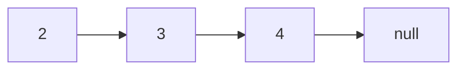
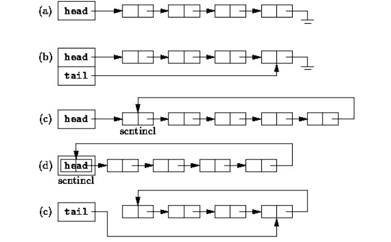
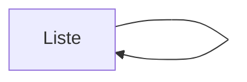

# Listes chaînées, en objet

!!! danger "Requis"
    Tu dois savoir refaire les exercices sur la création et l'utilisation de classes en POO sans regarder le corrigé, et savoir ce qu'est l'héritage.

!!! question "Rappel d'ouverture (5 minutes, de mémoire, cahier fermé)"
    1. En Python, `a = [1, 42, 312]` et `b = [1, 42, 312]`. Que vaut `a is b` ? Que vaut `a == b` ? **Écris pourquoi**, une raison pour chacun.
    2. On écrit maintenant `b = a`, puis `b.append(3)`. Que vaut `a` ?
    3. Quel est le coût de `pop(0)` sur une liste Python, et pourquoi ?

    ??? success "Correction"
        1. `a is b` vaut `False`, et `a == b` vaut `True`.

            `is` demande « est-ce le **même objet** », et la réponse est non : chaque `[...]` fabrique une liste neuve, il y en a donc deux. `==` demande « ont-ils la **même valeur** », et la réponse est oui, case par case.

            Même contenu, deux objets : c'est tout l'écart entre les deux questions.

        2. `a` vaut `[1, 42, 312, 3]`. `b = a` ne copie rien, les deux noms désignent le même objet, et cette fois `a is b` vaut `True`.
        3. `O(n)`, parce que retirer la première case oblige à décaler toutes les autres d'un cran.

        Ces trois réponses sont exactement ce dont ce chapitre a besoin. Garde-les sous la main.

## Ce qu'on fabrique

Tu as déjà implémenté une liste deux fois, en Gleam où elle était `Vide` ou `Cons(tête, queue)`, puis en Python avec le même découpage. C'est la **troisième**, et le changement est complet : une liste devient une chaîne d'objets, chacun gardant une **référence** vers le suivant.

| Gleam | Python fonctionnel | Ici |
| --- | --- | --- |
| `Vide` | `tuple[()]` | une chaîne qui ne contient aucun maillon |
| `Cons(tête, queue)` | `tuple[T, Liste[T]]` | un **maillon**, une donnée et une flèche vers le suivant |

Ce chapitre ne cherche pas à te faire apprendre Java. Ce que tu connais en Python est suffisant pour que tu ne sois pas perdu. Il cherche deux choses : voir **comment une collection est faite de l'intérieur**, et savoir **ce que chaque opération coûte**. C'est pour cela qu'on écrit tout à la main.

À la fin, tu auras écrit **deux fichiers**, et eux seuls :

- `Liste.java`, qui contient les deux classes `Maillon` et `Liste`
- `ListeTest.java`, qui contient les tests, donnés au fur et à mesure.

Place-les côte à côte dans un répertoire `java/listes/` de ton dépôt.

!!! info "L'atelier Java, à faire une fois avant de commencer"
    Java s'installe avec `nsi install openjdk`, plus deux extensions VSCode, et rien de ce chapitre ne se lance en ligne de commande. Tout est sur la page [Java, l'atelier](../../../les-outils/java.md), à faire une fois pour toutes avant d'aller plus loin.

    Deux choses à y lire pour **comprendre** cette page-ci : le tableau des [correspondances entre Python et Java](../../../les-outils/java.md#java-ce-qui-change), une dizaine de lignes, et la façon de [lancer les tests](../../../les-outils/java.md#lancer-les-tests).

    Pourquoi Java : tout y est déclaré avec son type, et `==` y compare **toujours** des références. Ce que Python laisse implicite, Java l'écrit, ce qui est utile précisément sur un chapitre dont l'objet d'étude est la flèche entre deux objets.

!!! warning "`==` ne compare pas ce que tu crois"
    En Java, `==` et `!=` comparent **toujours** des références : c'est le `is` de Python, jamais le `==` de Python. Pour comparer deux données, il faut écrire `a.equals(b)`.

    L'essentiel de ce chapitre consiste à comparer des références, donc `==` sera presque toujours le bon choix. L'exception arrive plus bas, et elle est signalée.

## Le maillon

Un maillon porte **une donnée** et **une flèche** vers le maillon suivant. Le dernier ne pointe vers rien, `null`.



Voici la classe. Copie-la dans `Liste.java`, c'est le point de départ.

```java
class Maillon<T> {

    /** La donnée portée par ce maillon. */
    T data;

    /** La référence vers le maillon suivant. */
    Maillon<T> suivant;

    Maillon(T data, Maillon<T> suivant) {
        this.data = data;
        this.suivant = suivant;
    }
}
```

!!! question "Construire une chaîne à la main"
    On construit la chaîne `2 -> 3 -> 4 -> null` dessinée plus haut. Voici la première instruction, celle qui crée le maillon portant `4` :

    ```java
    Maillon<Integer> m3 = new Maillon<>(4, null);
    ```

    Écris les **deux lignes qui manquent**, de sorte que `m1` désigne à la fin le maillon qui porte `2`.

    **Écris-les avant de dérouler la correction.**

    ??? success "Correction"
        ```java
        Maillon<Integer> m3 = new Maillon<>(4, null);
        Maillon<Integer> m2 = new Maillon<>(3, m3);
        Maillon<Integer> m1 = new Maillon<>(2, m2);
        ```

        L'ordre est imposé, et c'est pour cela que la première instruction était celle du bout : pour construire un maillon, il faut déjà tenir son suivant. C'est exactement le `Cons(2, Cons(3, Cons(4, Vide)))` de Gleam, écrit de l'intérieur vers l'extérieur.

### Quatre opérations, et leur contrat

Construire une chaîne à la main est vite pénible. On donne donc au maillon quatre opérations, qui ne font **que rebrancher des flèches** : aucune ne crée ni ne détruit de maillon.

Dans le tableau, **ce maillon** désigne celui sur lequel on appelle la méthode, et les noms d'arguments sont ceux des signatures que tu écriras.

| Opération | Ce qu'elle fait | Précondition | Coût |
| --- | --- | --- | --- |
| `insereApres(m)` | insère le maillon `m` **entre** ce maillon et son suivant | aucune | `O(1)` |
| `decrocheProchain()` | décroche de la chaîne le maillon qui suit ce maillon, et le renvoie. La chaîne se referme derrière lui, et il emporte sa flèche | il y a un maillon après ce maillon | `O(1)` |
| `avancer(k)` | renvoie le maillon situé `k` crans plus loin, `avancer(0)` renvoie ce maillon | `k` positif ou nul, sinon `IllegalArgumentException` | `O(k)` |
| `deplacerProchainApres(dest)` | décroche le maillon qui suit ce maillon, le réinsère juste après `dest`, et le renvoie | il y a un maillon après ce maillon, et `dest` n'est pas lui | `O(1)` |

!!! question "Suivre les flèches, sur papier"
    On part de la chaîne `1 -> 2 -> 3 -> 4 -> null`, dont les maillons s'appellent `a`, `b`, `c`, `d`.

    Dessine la chaîne après **chacune** des trois étapes ci-dessous, dans l'ordre. Pour chaque étape, écris :

    - la chaîne obtenue, sous la forme `1 -> ... -> null`
    - la donnée du maillon renvoyé, quand la méthode en renvoie un
    - vers quoi pointe ce maillon renvoyé.

    ```java
    Maillon<Integer> neuf = new Maillon<>(9, null);
    a.insereApres(neuf);              // étape 1
    a.decrocheProchain();             // étape 2
    a.deplacerProchainApres(c);       // étape 3
    ```

    Tu n'as que le tableau de contrats ci-dessus, et il suffit : ces trois lignes se déroulent sans avoir écrit une ligne de code.

    **Dessine les trois étapes avant de dérouler la correction.**

    ??? success "Correction"
        **Étape 1.** `1 -> 9 -> 2 -> 3 -> 4 -> null`. Rien n'est renvoyé.

        **Étape 2.** `1 -> 2 -> 3 -> 4 -> null`, la chaîne s'est refermée derrière le maillon décroché. Celui-ci porte `9`, c'est lui qui est renvoyé, et il emporte sa flèche : il pointe **toujours** vers le maillon `2`.

        **Étape 3.** `1 -> 3 -> 2 -> 4 -> null`. Le maillon renvoyé porte `2`. C'est le **même objet** qu'avant, déplacé, aucun maillon n'a été créé.

        L'étape 3 est la composition des deux premières : décrocher, puis insérer ailleurs.

### À écrire : les quatre opérations

Chaque méthode se place dans la classe `Maillon`.

**Pas de tests pour l'instant** : ils construisent tous une liste, et la classe `Liste` n'existe pas encore. Ta vérification, c'est le dessin de l'exercice précédent, à refaire sur ton code ligne à ligne. Tu retrouveras les quatre opérations testées un peu plus loin, et elles passeront d'un coup.

!!! question "`insereApres`"
    ```java
    void insereApres(Maillon<T> m) {
    ```

    Deux affectations, et l'ordre compte : `m` doit d'abord apprendre où va la suite de la chaîne, et ce maillon ne peut le pointer qu'ensuite. Dans l'autre ordre, plus rien ne désigne le maillon qui suivait.

!!! question "`decrocheProchain`"
    ```java
    Maillon<T> decrocheProchain() {
    ```

    Il faut garder une référence vers le maillon décroché **avant** de le sortir de la chaîne, sinon plus rien ne le désigne et tu ne peux plus le renvoyer.

!!! question "`avancer`"
    ```java
    Maillon<T> avancer(int k) {
    ```

    Commence par refuser un `k` négatif :

    ```java
    throw new IllegalArgumentException("k doit être positif ou nul");
    ```

    Puis une boucle `for` qui fait `k` pas. La référence qui se déplace part de `this`.

!!! question "`deplacerProchainApres`"
    ```java
    Maillon<T> deplacerProchainApres(Maillon<T> dest) {
    ```

    Trois lignes, et aucune n'est nouvelle : c'est l'étape 3 de ton dessin, écrite en Java. Tu n'écris ni `new`, ni affectation de `suivant`.

## Une liste est un maillon, et c'est le sien

Avec les seuls maillons, chaque opération traîne deux cas particuliers : « et si la chaîne est vide ? » et « et si c'est le premier maillon ? ». Ils reviennent partout.

On les supprime tous les deux d'un coup, avec une idée qui demande un instant d'adaptation : placer **avant le premier maillon** un maillon qui est toujours là, qui ne porte aucune donnée, et qui sert de point de départ. On l'appelle une **sentinelle**.



Le schéma (d) est celui qu'on construit : la **liste est elle-même la sentinelle**. Elle hérite donc de `Maillon`, et le dernier maillon pointe de nouveau sur elle. La chaîne est **circulaire**, et plus aucun `suivant` ne vaut `null`.

??? tip "Pour aller plus loin : c'est le choix du noyau Linux"
    Le schéma (d) n'est pas une curiosité de cours. C'est celui des listes chaînées du noyau Linux, dans `include/linux/list.h`. Une liste y est une `struct list_head`, et une liste vide pointe sur elle-même :

    ```c
    #define LIST_HEAD_INIT(name) { &(name), &(name) }
    ```

    Le test de vacuité y est notre `estVide()`, ligne pour ligne, et le parcours s'y arrête en retombant sur la tête, comme notre `ptr != this` :

    ```c
    static inline int list_empty(const struct list_head *head)
    {
        return READ_ONCE(head->next) == head;
    }
    ```

    **Ce que ce choix achète.** Aucun `suivant` ne vaut jamais `null`, donc aucune opération n'a à se demander si elle est au bout de la chaîne, ni si la liste est vide. C'est le piège que Tony Hoare appelle son erreur à un milliard de dollars : il a introduit la référence nulle en 1965 dans ALGOL W parce qu'elle était facile à implémenter, et il en a fait une conférence en 2009 sous le titre *Null References: The Billion Dollar Mistake*. La sentinelle ne fait pas disparaître `null` du langage, et une donnée peut toujours en être un. Elle le retire de l'endroit où il coûtait le plus cher, la fin de la chaîne, qu'il fallait tester dans chaque méthode.

    **Deux différences, pour ne pas croire que c'est le même objet.** Le noyau est **doublement chaîné**, chaque maillon ayant un `next` et un `prev` : il insère en fin et retire un maillon en `O(1)`, là où il nous faut `precedent` en `O(n)`. Et il est **intrusif**, il n'y a pas de champ `data` : le maillon est embarqué **dans** la donnée, et on remonte de l'un à l'autre avec `container_of`.

Une liste vide pointe sur elle-même :



!!! question "Dessiner la liste à deux éléments"
    Dessine la liste qui contient `1` puis `2`, avec la sentinelle. Combien de flèches as-tu tracées, et où arrive la dernière ?

    **Dessine avant de dérouler la correction.**

    ??? success "Correction"
        ```mermaid
        graph LR
          L["Liste"] --> m1["1"] --> m2["2"] --> L
        ```

        Trois flèches pour deux éléments : une par maillon, plus celle de la sentinelle. La dernière revient sur la liste.

        Un parcours ne s'arrête donc plus quand il rencontre `null`, mais quand il **retombe sur la liste** : la condition de boucle devient `ptr != this`.

Comme `Liste` hérite de `Maillon`, son constructeur appelle `super()`. Il faut donc donner à `Maillon` un constructeur sans argument. Ajoute-le dans la classe `Maillon`, sous l'autre :

```java
    /**
     * Crée un maillon sans donnée ni suivant (les deux valent {@code null}).
     * Sert à construire une sentinelle.
     */
    Maillon() {}
```

Puis, **sous** la classe `Maillon` dans le même fichier :

```java
class Liste<T> extends Maillon<T> {

    /** Crée une liste vide. */
    Liste() {
        super();
        // une liste est sa propre sentinelle : vide, elle pointe sur elle-même
        this.suivant = this;
    }

    /** Indique si la liste est vide. */
    boolean estVide() {
        return this.suivant == this;
    }
}
```

!!! info "Les quatre opérations de tricotage n'ont pas bougé d'une ligne"
    Relis-les : aucune ne parle de `null`, aucune ne parle de la fin de la chaîne. Elles ne font que rebrancher des flèches, donc elles fonctionnent telles quelles sur une chaîne circulaire. C'est la raison pour laquelle on les a écrites en premier.

### Le fichier de tests

Crée `ListeTest.java` à côté de `Liste.java`, et mets-y ceci :

```java
import static org.junit.jupiter.api.Assertions.*;

import java.time.Duration;
import java.util.ArrayList;
import java.util.Comparator;
import java.util.List;
import java.util.NoSuchElementException;
import org.junit.jupiter.api.DisplayName;
import org.junit.jupiter.api.Test;

public class ListeTest {

    /** Construit une liste contenant les éléments donnés, dans l'ordre. */
    static Liste<Integer> L(Integer... xs) {
        Liste<Integer> l = new Liste<>();
        for (Integer x : xs) {
            l.append(x);
        }
        return l;
    }

    /** Renvoie les éléments de la liste, dans l'ordre, pour les comparer facilement. */
    static <T> List<T> contenu(Liste<T> l) {
        List<T> res = new ArrayList<>();
        Maillon<T> ptr = l.suivant;
        while (ptr != l) {
            res.add(ptr.data);
            ptr = ptr.suivant;
        }
        return res;
    }

    /** Renvoie les maillons de la liste (les objets eux-mêmes), dans l'ordre. */
    static <T> List<Maillon<T>> maillons(Liste<T> l) {
        List<Maillon<T>> res = new ArrayList<>();
        Maillon<T> ptr = l.suivant;
        while (ptr != l) {
            res.add(ptr);
            ptr = ptr.suivant;
        }
        return res;
    }

    /** Un élève, pour tester la stabilité du tri : on trie par note uniquement. */
    record Eleve(String nom, int note) {}

    static final Comparator<Eleve> PAR_NOTE = Comparator.comparingInt(Eleve::note);
}
```

Chaque test que la suite te donne se colle **à l'intérieur** de la classe `ListeTest`, avant son accolade fermante. Les trois assertions qui reviennent partout, et la façon de lire un échec, sont sur la page [Java, l'atelier](../../../les-outils/java.md#les-trois-assertions).

Les quatre outils de l'en-tête serviront à tous les tests : `L(1, 2, 3)` construit une liste, `contenu` et `maillons` en rendent respectivement les éléments et les maillons, et `Eleve` servira tout à la fin, pour le tri.

!!! info "Du rouge, le temps d'un exercice"
    `L` appelle `append`, que tu n'as pas encore écrite : VSCode souligne donc des lignes en rouge, et aucun test ne tourne. Cela se débloque au premier exercice de la section suivante, et tout passe au vert d'un coup.

Deux tests à ajouter, qui vérifient les deux constructeurs de `Maillon` :

```java
    @Test
    @DisplayName("Maillon(data, suivant) stocke la donnée et le suivant")
    void maillonConstructeur() {
        Maillon<Integer> fin = new Maillon<>();
        Maillon<Integer> m = new Maillon<>(5, fin);
        assertEquals(5, m.data);
        assertSame(fin, m.suivant);
    }

    @Test
    @DisplayName("Maillon() crée un maillon sans donnée ni suivant")
    void maillonVide() {
        Maillon<Integer> m = new Maillon<>();
        assertNull(m.data);
        assertNull(m.suivant);
    }
```

!!! question "Prédire, sur une chaîne circulaire"
    Soit `l` une liste contenant `1`, `2`, `3`. Donne, sans exécuter :

    - ce que renvoie `l.avancer(0)`
    - la donnée de `l.avancer(3)`
    - ce que renvoie `l.avancer(4)`
    - la donnée de `l.avancer(5)`.

    **Écris tes quatre réponses avant de dérouler la correction.**

    ??? success "Correction"
        - `l.avancer(0)` renvoie `l` elle-même : la liste est un maillon, et `avancer(0)` ne bouge pas.
        - `l.avancer(3).data` vaut `3`. La sentinelle est le départ, donc le premier élément est à un cran.
        - `l.avancer(4)` renvoie `l` : on est revenu sur la sentinelle.
        - `l.avancer(5).data` vaut `1` : on repart pour un tour.

        Sur une chaîne circulaire, `avancer` ne tombe jamais en panne de maillon. Il tourne.

## Les méthodes de la liste

Toutes ces méthodes se placent dans la classe `Liste`, sauf une, qui est signalée. Le parcours est toujours le même : une référence qui part de `this.suivant` et qui avance tant qu'elle n'est pas revenue sur `this`.

### `dernierMaillon` et `append`

!!! question "Les deux ensemble (obligatoire)"
    ```java
    /**
     * Renvoie le dernier maillon, celui qui revient sur la liste, en O(n).
     * Renvoie la liste elle-même si elle est vide.
     */
    Maillon<T> dernierMaillon() {
    ```

    ```java
    /** Ajoute un élément en fin de liste, en O(n). */
    void append(T data) {
    ```

    `dernierMaillon` cherche le maillon dont le suivant est `this`. Une liste vide n'en a pas, elle renvoie alors `this`, ce qui tombe juste si ta référence part de `this`.

    `append` tient en une ligne et n'invente rien : trouver le dernier maillon, et insérer après lui.

    ```java
        @Test
        @DisplayName("dernierMaillon renvoie le maillon qui revient sur la liste")
        void dernierMaillon() {
            Liste<Integer> l = L(1, 2, 3);
            Maillon<Integer> d = l.dernierMaillon();
            assertEquals(3, d.data);
            assertSame(l, d.suivant);
        }

        @Test
        @DisplayName("dernierMaillon d'une liste vide est la liste elle-même")
        void dernierMaillonVide() {
            Liste<Integer> l = L();
            assertSame(l, l.dernierMaillon());
        }
    ```

### Les quatre opérations de tricotage, enfin testées

`append` existe, donc `L` fonctionne, donc tous les tests peuvent construire une liste. Colle les sept qui suivent : ils vérifient les quatre méthodes de `Maillon` que tu as écrites avant d'avoir une liste. Ils doivent passer sans que tu touches à ton code.

```java
    @Test
    @DisplayName("insereApres branche un maillon juste après")
    void insereApres() {
        Liste<Integer> l = L(1, 3);
        Maillon<Integer> m = new Maillon<>(2, null);
        l.suivant.insereApres(m);
        assertEquals(List.of(1, 2, 3), contenu(l));
        assertSame(m, l.suivant.suivant);
    }

    @Test
    @DisplayName("decrocheProchain retire le maillon suivant et le renvoie")
    void decrocheProchain() {
        Liste<Integer> l = L(1, 2, 3);
        Maillon<Integer> deux = l.suivant.suivant;
        Maillon<Integer> m = l.suivant.decrocheProchain();
        assertSame(deux, m);
        assertEquals(List.of(1, 3), contenu(l));
    }

    @Test
    @DisplayName("decrocheProchain depuis la liste retire le premier élément")
    void decrocheProchainTete() {
        Liste<Integer> l = L(1, 2);
        Maillon<Integer> m = l.decrocheProchain();
        assertEquals(1, m.data);
        assertEquals(List.of(2), contenu(l));
    }

    @Test
    @DisplayName("avancer(k) renvoie le maillon k crans plus loin")
    void avancer() {
        Liste<Integer> l = L(1, 2, 3);
        assertSame(l, l.avancer(0));
        assertEquals(1, l.avancer(1).data);
        assertEquals(3, l.avancer(3).data);
        assertSame(l, l.avancer(4), "on revient sur la sentinelle");
    }

    @Test
    @DisplayName("avancer avec k négatif lève une exception")
    void avancerNegatif() {
        assertThrows(IllegalArgumentException.class, () -> L(1).avancer(-1));
    }

    @Test
    @DisplayName("deplacerProchainApres déplace le maillon suivant après dest")
    void deplacerProchainApres() {
        Liste<Integer> l = L(1, 2, 3, 4);
        Maillon<Integer> deux = l.avancer(2);
        Maillon<Integer> m = l.suivant.deplacerProchainApres(l.avancer(3));
        assertSame(deux, m, "c'est le même maillon, pas une copie");
        assertEquals(List.of(1, 3, 2, 4), contenu(l));
    }

    @Test
    @DisplayName("deplacerProchainApres(liste) ramène un maillon en tête")
    void deplacerProchainApresTete() {
        Liste<Integer> l = L(1, 2, 3);
        l.avancer(2).deplacerProchainApres(l);
        assertEquals(List.of(3, 1, 2), contenu(l));
    }
```

### `taille`

!!! question "Compter les éléments (obligatoire)"
    ```java
    /** Compte les éléments de la liste, en O(n). */
    int taille() {
    ```

    ```java
        @Test
        @DisplayName("Une liste neuve est vide")
        void listeNeuveVide() {
            Liste<Integer> l = L();
            assertTrue(l.estVide());
            assertEquals(0, l.taille());
            assertSame(l, l.suivant, "la liste vide pointe sur elle-même");
        }

        @Test
        @DisplayName("taille et estVide sur une liste non vide")
        void tailleNonVide() {
            assertEquals(3, L(1, 2, 3).taille());
            assertFalse(L(1).estVide());
        }
    ```

### `ajouterDebut`

!!! question "Ajouter en tête (obligatoire)"
    ```java
    /** Ajoute un élément en tête de liste, en O(1). */
    void ajouterDebut(T data) {
    ```

    Une ligne. Le maillon neuf s'insère juste après la sentinelle, et c'est `insereApres` qui se charge de brancher sa flèche : tu peux donc le construire avec `null` comme suivant.

    ```java
        @Test
        @DisplayName("append ajoute en fin, ajouterDebut en tête")
        void ajouts() {
            Liste<Integer> l = L(1, 2);
            l.ajouterDebut(0);
            l.append(3);
            assertEquals(List.of(0, 1, 2, 3), contenu(l));
        }
    ```

### `premier` et `dernier`

!!! question "Les deux bouts (obligatoire)"
    ```java
    /**
     * Renvoie le premier élément, en O(1).
     * @throws NoSuchElementException si la liste est vide
     */
    T premier() {
    ```

    ```java
    /**
     * Renvoie le dernier élément, en O(n).
     * @throws NoSuchElementException si la liste est vide
     */
    T dernier() {
    ```

    Les deux renvoient une **donnée**, pas un maillon. Sur une liste vide, ni l'un ni l'autre n'a de sens, c'est une précondition, et elle s'annonce par

    ```java
    throw new NoSuchElementException("La liste est vide");
    ```

    ```java
        @Test
        @DisplayName("premier et dernier")
        void premierDernier() {
            assertEquals(7, L(7, 8, 9).premier());
            assertEquals(9, L(7, 8, 9).dernier());
        }

        @Test
        @DisplayName("premier et dernier sur une liste vide lèvent une exception")
        void premierDernierVide() {
            assertThrows(NoSuchElementException.class, () -> L().premier());
            assertThrows(NoSuchElementException.class, () -> L().dernier());
        }
    ```

### `get`

!!! question "L'élément d'indice donné (obligatoire)"
    ```java
    /**
     * Renvoie l'élément d'indice key, à partir de 0, en O(n).
     * @throws IndexOutOfBoundsException si key est négatif ou trop grand
     */
    T get(int key) {
    ```

    ```java
        @Test
        @DisplayName("get renvoie l'élément d'indice donné")
        void get() {
            Liste<Integer> l = L(1, 2, 3);
            assertEquals(1, l.get(0));
            assertEquals(3, l.get(2));
        }

        @Test
        @DisplayName("get hors limites lève une exception")
        void getHorsLimites() {
            Liste<Integer> l = L(1, 2, 3);
            assertThrows(IndexOutOfBoundsException.class, () -> l.get(3));
            assertThrows(IndexOutOfBoundsException.class, () -> l.get(-1));
        }
    ```

    ??? tip "Indice"
        Deux conditions d'arrêt, pas une : tu avances tant que tu n'es **pas revenu sur la liste** et que tu n'as **pas atteint** l'indice voulu. Après la boucle, c'est la raison de l'arrêt qui décide, et si tu es revenu sur la liste, l'indice était trop grand.

        Tiens un compteur `i` qui est, à tout instant, l'indice du maillon courant. La condition devient lisible, et l'après-boucle aussi.

### `precedent`

!!! question "Le maillon d'avant (obligatoire)"
    ```java
    /**
     * Renvoie le maillon dont le suivant est m, en O(n).
     * Le précédent du premier élément est la liste elle-même,
     * et celui de la liste est son dernier maillon.
     * @throws NoSuchElementException si m n'est pas dans la liste
     */
    Maillon<T> precedent(Maillon<T> m) {
    ```

    Cette méthode existe pour une raison précise : dans une chaîne à sens unique, on ne peut retirer un maillon qu'**en passant par celui d'avant**, avec `precedent(m).decrocheProchain()`. Le dernier test le montre.

    ```java
        @Test
        @DisplayName("precedent renvoie le maillon qui précède")
        void precedent() {
            Liste<Integer> l = L(1, 2, 3);
            assertEquals(2, l.precedent(l.avancer(3)).data);
            assertSame(l, l.precedent(l.suivant), "le précédent du premier est la liste");
            assertEquals(3, l.precedent(l).data, "le précédent de la liste est le dernier");
        }

        @Test
        @DisplayName("precedent dans une liste vide")
        void precedentVide() {
            Liste<Integer> l = L();
            assertSame(l, l.precedent(l));
        }

        @Test
        @DisplayName("precedent d'un maillon absent lève une exception")
        void precedentAbsent() {
            Liste<Integer> l = L(1, 2);
            assertThrows(NoSuchElementException.class, () -> l.precedent(new Maillon<>(9, null)));
        }

        @Test
        @DisplayName("precedent permet de retirer un maillon")
        void supprimerAvecPrecedent() {
            Liste<Integer> l = L(1, 2, 3);
            Maillon<Integer> deux = l.avancer(2);
            l.precedent(deux).decrocheProchain();
            assertEquals(List.of(1, 3), contenu(l));
        }
    ```

    ??? tip "Indice"
        On cherche la référence `ref` telle que `ref.suivant == m`. Tant que ce n'est pas le cas, on avance.

        Si `m` n'est pas dans la liste, on finira par **repasser par la sentinelle**. C'est là, et seulement là, que l'exception se lève. Sans ce test, la boucle tourne indéfiniment.

### `estEgale`

!!! question "Comparer deux listes (obligatoire)"
    ```java
    /** Indique si cette liste a les mêmes éléments que autre, dans le même ordre. */
    boolean estEgale(Liste<T> autre) {
    ```

    Deux références avancent en parallèle, une par liste. Attention à la condition de fin, deux listes de longueurs différentes ne doivent pas être déclarées égales.

    ```java
        @Test
        @DisplayName("estEgale compare les éléments, dans l'ordre")
        void egalite() {
            assertTrue(L(1, 2).estEgale(L(1, 2)));
            assertTrue(L().estEgale(L()));
            assertFalse(L(1, 2).estEgale(L(1, 3)));
            assertFalse(L(1, 2).estEgale(L(1)));
            assertFalse(L(1).estEgale(L(1, 2)));
        }

        @Test
        @DisplayName("estEgale compare les valeurs, pas les références")
        void egaliteGrandsEntiers() {
            // 1000 n'est pas dans le cache des Integer : deux objets distincts
            assertTrue(L(1000).estEgale(L(1000)));
        }
    ```

    ??? tip "Indice"
        C'est ici que `==` n'est plus le bon outil. Comparer deux **données** demande `ref1.data.equals(ref2.data)`.

        Le second test explique pourquoi cela se voit si rarement : Java garde en cache les `Integer` de `-128` à `127`, donc `100 == 100` est vrai entre deux objets différents, alors que `1000 == 1000` est faux. Un code écrit avec `==` passe sur les petits nombres et échoue sur les grands.

### `clone`

!!! question "Copier la liste (obligatoire)"
    ```java
    /**
     * Crée une copie de la liste, en O(n).
     * Les maillons sont neufs, les éléments eux-mêmes ne sont pas copiés.
     */
    @Override
    public Liste<T> clone() {
    ```

    `@Override` et `public` sont imposés par la méthode dont celle-ci prend la place. Garde-les tels quels.

    ```java
        @Test
        @DisplayName("clone crée une liste indépendante")
        void clonage() {
            Liste<Integer> l = L(1, 2, 3);
            Liste<Integer> c = l.clone();
            assertNotSame(l, c);
            assertTrue(l.estEgale(c));

            c.append(4);
            assertEquals(List.of(1, 2, 3), contenu(l));
            assertEquals(List.of(1, 2, 3, 4), contenu(c));
        }
    ```

    ??? tip "Indice"
        Deux références avancent en même temps : une qui **lit** la liste d'origine, une qui pointe sur le dernier maillon **écrit** dans la copie. À chaque tour, on insère un maillon neuf après la seconde, puis on avance les deux.

        Construire la copie à coups de `append` marcherait aussi, mais coûterait `O(n²)`. La raison est dans la section suivante.

### `greffer`

!!! question "Absorber une liste (obligatoire)"
    Cette méthode-ci se place dans la classe **`Maillon`**, pas dans `Liste` : on greffe après un maillon quelconque, pas forcément après la sentinelle. C'est la seule opération de maillon qui ait besoin de connaître une liste, et c'est pour cela qu'elle n'était pas dans le premier lot.

    ```java
    /**
     * Insère tous les maillons de lst juste après ce maillon, en O(m).
     * Les maillons sont déplacés, pas copiés : lst est vide après l'appel.
     */
    void greffer(Liste<T> lst) {
    ```

    ```java
        @Test
        @DisplayName("greffer insère les maillons d'une liste et la vide")
        void greffer() {
            Liste<Integer> l = L(1, 2);
            Liste<Integer> g = L(8, 9);
            Maillon<Integer> huit = g.suivant;
            l.suivant.greffer(g);
            assertEquals(List.of(1, 8, 9, 2), contenu(l));
            assertTrue(g.estVide());
            assertSame(huit, l.avancer(2), "les maillons sont déplacés, pas copiés");
        }

        @Test
        @DisplayName("greffer en tête et en fin de liste")
        void grefferTeteFin() {
            Liste<Integer> l = L(1, 2);
            l.greffer(L(8, 9));
            assertEquals(List.of(8, 9, 1, 2), contenu(l));

            Liste<Integer> n = L(1, 2);
            n.dernierMaillon().greffer(L(8, 9));
            assertEquals(List.of(1, 2, 8, 9), contenu(n));
            assertEquals(9, n.dernier());
        }

        @Test
        @DisplayName("greffer avec des listes vides")
        void grefferVides() {
            Liste<Integer> l = L(1);
            l.greffer(L());
            assertEquals(List.of(1), contenu(l));

            Liste<Integer> v = L();
            v.greffer(L(5));
            assertEquals(List.of(5), contenu(v));
        }
    ```

    ??? tip "Indice"
        Commence par le cas où `lst` est vide : il n'y a rien à faire, et le traiter d'abord évite d'avoir à y penser ensuite.

        Sinon, trois flèches changent, et aucune autre. Trouve le dernier maillon de `lst`, puis demande-toi, pour chacune de ces trois flèches, d'où elle part et où elle doit arriver : la fin de `lst` vers l'ancien suivant, ce maillon-ci vers le début de `lst`, et `lst` vers elle-même puisqu'elle est maintenant vide.

### `extend`

!!! question "Ajouter une copie (obligatoire)"
    ```java
    /** Ajoute à la fin de cette liste une copie des maillons de lst, en O(n + m). */
    void extend(Liste<T> lst) {
    ```

    Une ligne, qui n'utilise que des méthodes déjà écrites. `greffer` **vide** la liste qu'elle absorbe, il ne faut donc pas lui donner `lst`.

    ```java
        @Test
        @DisplayName("extend ajoute une copie des éléments et laisse l'autre liste intacte")
        void extend() {
            Liste<Integer> l = L(1, 2);
            Liste<Integer> m = L(3, 4);
            l.extend(m);
            assertEquals(List.of(1, 2, 3, 4), contenu(l));
            assertEquals(4, l.taille());
            assertEquals(List.of(3, 4), contenu(m));

            // Les maillons sont copiés : modifier m ne change pas l
            m.append(5);
            assertEquals(List.of(1, 2, 3, 4), contenu(l));
        }

        @Test
        @DisplayName("extend clone lst : aucun maillon n'est partagé entre les deux listes")
        void extendClone() {
            Liste<Integer> l = L(1, 2);
            Liste<Integer> m = L(3, 4);
            Maillon<Integer> trois = m.avancer(1);
            Maillon<Integer> quatre = m.avancer(2);

            l.extend(m);

            // avancer ne boucle jamais, même si les chaînes sont mal raccordées
            assertNotSame(trois, l.avancer(3), "le maillon de 3 doit être une copie");
            assertNotSame(quatre, l.avancer(4), "le maillon de 4 doit être une copie");
            assertSame(l, l.avancer(5), "la fin de l doit revenir sur l");

            assertSame(trois, m.avancer(1), "m garde ses propres maillons");
            assertSame(quatre, m.avancer(2), "m garde ses propres maillons");
            assertSame(m, m.avancer(3), "la fin de m doit revenir sur m");
        }

        @Test
        @DisplayName("extend avec des listes vides")
        void extendVide() {
            Liste<Integer> l = L();
            l.extend(L(3));
            assertEquals(List.of(3), contenu(l));
            assertEquals(3, l.dernier());

            Liste<Integer> n = L(1);
            n.extend(L());
            assertEquals(List.of(1), contenu(n));
        }

        @Test
        @DisplayName("extend d'une liste avec elle-même double ses éléments")
        void extendElleMeme() {
            Liste<Integer> l = L(1, 2);
            l.extend(l);
            assertEquals(List.of(1, 2, 1, 2), contenu(l));
        }
    ```

    Le dernier test mérite un instant. `l.extend(l)` rend bien `[1, 2, 1, 2]`. Demande-toi dans quel ordre les appels de ta ligne s'exécutent, et ce que ferait une version qui grefferait `lst` directement.

### Renverser la liste

!!! question "Lire, pas écrire"
    Ce test ne demande aucune méthode nouvelle. Il renverse une liste **en place**, sans créer un seul maillon, avec trois lignes qui n'utilisent que `deplacerProchainApres`.

    Lis-le, et réponds à ces trois questions sur ton cahier **avant** de dérouler la correction :

    - que désigne `premier` au premier tour, et que désigne-t-il à la fin ?
    - à chaque tour, quel maillon bouge, et où va-t-il ?
    - pourquoi la boucle s'arrête-t-elle quand `premier.suivant` vaut `l` ?

    ```java
        @Test
        @DisplayName("deplacerProchainApres permet de renverser une liste en place")
        void renverserAvecDeplacer() {
            for (int n = 0; n <= 4; n++) {
                Liste<Integer> l = new Liste<>();
                List<Integer> attendu = new ArrayList<>();
                for (int i = 1; i <= n; i++) {
                    l.append(i);
                    attendu.add(0, i);
                }
                Maillon<Integer> premier = l.suivant;
                while (premier != l && premier.suivant != l) {
                    premier.deplacerProchainApres(l);
                }
                assertEquals(attendu, contenu(l), "n = " + n);
            }
        }
    ```

    ??? success "Correction"
        `premier` désigne le maillon qui portait le **premier** élément, et il n'est jamais réaffecté : tout le reste défile devant lui, et il finit **dernier**.

        À chaque tour, le maillon qui suit `premier` est décroché et réinséré juste après `l`, c'est-à-dire **en tête**. Sur `1, 2, 3, 4` :

        ```text
        départ : [1, 2, 3, 4]
        tour 1 : [2, 1, 3, 4]
        tour 2 : [3, 2, 1, 4]
        tour 3 : [4, 3, 2, 1]
        ```

        La boucle s'arrête quand `premier.suivant` vaut `l`, parce que cela veut dire que `premier` est devenu le dernier maillon : tout ce qui le suivait est passé devant.

        Le test boucle de `n = 0` à `4` parce que c'est sur les listes de zéro et un élément que la condition d'arrêt est la plus facile à écrire de travers. `premier != l` est ce qui protège la liste vide.

## Ce que cela coûte

Voici le coût de tout ce que tu viens d'écrire. `n` est la taille de la liste, `m` celle de la liste passée en argument.

| Coût | Opérations |
| --- | --- |
| `O(1)` | `insereApres`, `decrocheProchain`, `deplacerProchainApres`, `estVide`, `premier`, `ajouterDebut` |
| `O(k)` | `avancer(k)` |
| `O(n)` | `taille`, `dernierMaillon`, `dernier`, `append`, `get`, `precedent`, `estEgale`, `clone` |
| `O(m)` | `greffer` |
| `O(n + m)` | `extend` |

!!! question "Combien de pas pour construire une liste ? (obligatoire)"
    On part d'une liste vide et on appelle `append` `n` fois de suite.

    1. Combien de maillons `dernierMaillon` parcourt-il au **quatrième** appel ?
    2. Donne le nombre **total** de maillons parcourus pour les `n` appels, en fonction de `n`.
    3. Quel est le coût de la construction entière : `O(n)`, `O(n log n)` ou `O(n²)` ?

    **Écris tes trois réponses avant de dérouler la correction.**

    ??? success "Correction"
        1. Trois. Au quatrième appel, la liste contient déjà trois éléments.
        2. $0 + 1 + 2 + \dots + (n-1) = \dfrac{n(n-1)}{2}$. Pour `n = 100`, cela fait 4950 pas.
        3. `O(n²)`. Chaque `append` est en `O(n)`, et on en fait `n`.

        C'est pour cette raison que `clone` ne construit pas sa copie à coups de `append` : elle garde une référence sur le dernier maillon écrit et insère directement après lui. Chaque insertion coûte alors `O(1)`, et le total retombe à `O(n)`.

!!! info "Une liste qui saurait faire `append` en `O(1)`"
    Regarde de nouveau le schéma plus haut. La variante (b) garde une seconde référence, `tail`, sur le dernier maillon. `append` devient alors `O(1)`, sans aucun parcours.

    Ce n'est pas gratuit. Cette référence doit être **mise à jour par toutes les autres opérations** : chaque insertion, chaque suppression, chaque greffe doit se demander si elle vient de changer le dernier maillon. Le coût quitte le calcul et arrive dans la maintenance du code.

    C'est un arbitrage, pas une amélioration : on gagne sur une opération, on paie sur toutes les autres.

!!! question "Choisir la structure (obligatoire)"
    Pour chacune des quatre situations, dis si tu prends une **liste chaînée** comme celle de ce chapitre, ou un **tableau** (une liste Python, un tableau Java). Justifie **par le coût** : quelle est l'opération la plus fréquente, et que coûte-t-elle dans chaque structure ?

    1. Un flux d'événements qu'on accumule, chaque nouvel événement passant devant les précédents.
    2. Un jeu tire au hasard, des milliers de fois par seconde, l'élément numéro `i` d'une collection de 10 000 cases.
    3. On parcourt une collection en tenant la référence du maillon courant, et on retire au passage les éléments qui ne conviennent pas.
    4. Une fois par jour, on additionne tous les nombres d'une collection, du premier au dernier.

    **Écris tes quatre réponses avant de dérouler la correction.**

    ??? success "Correction"
        1. **Liste chaînée.** L'opération fréquente est l'ajout en tête : `ajouterDebut` est en `O(1)`, alors qu'insérer en tête d'un tableau oblige à décaler toutes les cases, donc `O(n)`.
        2. **Tableau.** L'opération fréquente est l'accès par indice : `O(1)` dans un tableau, qui calcule l'adresse, contre `O(n)` pour `get`, qui parcourt.
        3. **Liste chaînée.** Une fois le maillon précédent en main, `decrocheProchain` est en `O(1)`, on rebranche une flèche. Dans un tableau, chaque suppression décale la suite, donc `O(n)`.
        4. **Ni l'une ni l'autre sur ce critère.** Un parcours complet coûte `O(n)` des deux côtés. Le coût ne départage pas, la décision se prend donc ailleurs : sur ce que la collection doit faire **le reste du temps**.

        Retiens la question, pas les réponses : *quelle opération est la plus fréquente, et que coûte-t-elle dans chaque structure ?* C'est elle qui se transporte d'une situation à la suivante.

## Problème de fin : trier la liste

Quatre méthodes, à écrire dans l'ordre. Elles forment un tri fusion qui ne crée **aucun maillon** : tout se fait en déplaçant des flèches.

C'est ici que servent le `record Eleve` et le `PAR_NOTE` posés dans l'en-tête de `ListeTest` : ils serviront à vérifier que le tri est **stable**, c'est-à-dire qu'à note égale, deux élèves gardent leur ordre d'origine.

Un `Comparator<T>` est l'objet qui décide de l'ordre. `cmp.compare(a, b)` rend un nombre négatif si `a` passe avant `b`, nul s'ils sont équivalents, et positif sinon. `Comparator.naturalOrder()` donne l'ordre croissant habituel, `Comparator.reverseOrder()` l'inverse.

### `milieu`

!!! question "Trouver le milieu sans compter (obligatoire)"
    ```java
    /**
     * Renvoie le dernier maillon de la moitié gauche, en O(n).
     * Renvoie la liste elle-même si elle est vide.
     */
    Maillon<T> milieu() {
    ```

    La méthode s'appelle le **lièvre et la tortue** : deux références partent du premier maillon, le lièvre avance de deux crans quand la tortue en avance d'un. Quand le lièvre arrive au bout, la tortue est au milieu, et on n'a parcouru la liste qu'une fois.

    Pour `n` éléments, la moitié gauche en contient $\dfrac{n+1}{2}$, arrondi vers le bas.

    **Remplis ce tableau à la main avant d'écrire la méthode.** La liste contient `1, 2, ..., n`, et on demande la donnée du maillon renvoyé.

    | `n` | 1 | 2 | 3 | 4 | 5 | 6 |
    | --- | --- | --- | --- | --- | --- | --- |
    | `milieu().data` | | | | | | |

    ??? success "Le tableau rempli"
        | `n` | 1 | 2 | 3 | 4 | 5 | 6 |
        | --- | --- | --- | --- | --- | --- | --- |
        | `milieu().data` | 1 | 1 | 2 | 2 | 3 | 3 |

        La moitié gauche est la plus grosse quand `n` est impair : pour `n = 5`, elle contient `1, 2, 3` et la droite `4, 5`.

    ```java
        @Test
        @DisplayName("milieu renvoie le dernier maillon de la moitié gauche")
        void milieu() {
            int[] attendus = {1, 1, 2, 2, 3, 3}; // pour n = 1 à 6
            for (int n = 1; n <= 6; n++) {
                Liste<Integer> l = new Liste<>();
                for (int i = 1; i <= n; i++) {
                    l.append(i);
                }
                // Si le lièvre saute la sentinelle, milieu boucle à l'infini :
                // on arrête le test au bout d'une seconde.
                Maillon<Integer> m = assertTimeoutPreemptively(Duration.ofSeconds(1), l::milieu, "n = " + n);
                assertEquals(attendus[n - 1], m.data, "n = " + n);
            }
        }

        @Test
        @DisplayName("milieu d'une liste vide est la liste elle-même")
        void milieuVide() {
            Liste<Integer> l = L();
            assertSame(l, l.milieu());
        }
    ```

    ??? tip "Indice"
        La chaîne est circulaire, donc rien n'arrête le lièvre tout seul. C'est la **condition de la boucle** qui doit l'arrêter, et elle porte sur deux choses à la fois, puisque le lièvre fait deux pas : `lievre.suivant` et `lievre.suivant.suivant`. Si l'une des deux est déjà la sentinelle, il faut s'arrêter.

        Si tu n'en testes qu'une, le lièvre enjambe la sentinelle et repart pour un tour. Le test coupe au bout d'une seconde, mais le programme, lui, ne s'arrêterait jamais.

    ??? note "Avant d'ouvrir la correction"
        En une phrase, sur ton cahier : qu'est-ce que l'indice t'a appris sur ce qui n'allait pas dans **ton** code ?

    ??? success "Correction"
        ```java
            Maillon<T> lievre = this.suivant;
            Maillon<T> tortue = this.suivant;
            while (lievre.suivant != this && lievre.suivant.suivant != this) {
                lievre = lievre.suivant.suivant;
                tortue = tortue.suivant;
            }
            return tortue;
        ```

### `couper`

!!! question "Couper la liste en deux (obligatoire)"
    ```java
    /**
     * Coupe la liste en deux, en O(n), sans copier de maillon.
     * La moitié gauche part dans une nouvelle liste, qui est renvoyée ;
     * cette liste garde la moitié droite.
     */
    Liste<T> couper() {
    ```

    ```java
        @Test
        @DisplayName("couper : la nouvelle liste prend la moitié gauche, this garde la droite")
        void couper() {
            Liste<Integer> l = L(1, 2, 3, 4, 5);
            Liste<Integer> gauche = l.couper();
            assertEquals(List.of(1, 2, 3), contenu(gauche));
            assertEquals(List.of(4, 5), contenu(l));
        }

        @Test
        @DisplayName("couper : gauche suivie de this redonne la liste, pour toutes les tailles")
        void couperToutesTailles() {
            for (int n = 0; n <= 6; n++) {
                Liste<Integer> l = new Liste<>();
                List<Integer> attendu = new ArrayList<>();
                for (int i = 1; i <= n; i++) {
                    l.append(i);
                    attendu.add(i);
                }
                Liste<Integer> gauche = l.couper();

                List<Integer> obtenu = new ArrayList<>(contenu(gauche));
                obtenu.addAll(contenu(l));
                assertEquals(attendu, obtenu, "n = " + n);
                assertEquals((n + 1) / 2, gauche.taille(), "n = " + n);
            }
        }

        @Test
        @DisplayName("couper ne copie aucun maillon")
        void couperSansCopie() {
            Liste<Integer> l = L(1, 2, 3, 4);
            List<Maillon<Integer>> avant = maillons(l);
            Liste<Integer> gauche = l.couper();
            assertSame(avant.get(0), gauche.suivant);
            assertSame(avant.get(2), l.suivant);
        }
    ```

    ??? tip "Indice"
        Traite d'abord la liste vide : il n'y a rien à couper, on renvoie une liste vide.

        Sinon, nomme les deux maillons de la frontière, le dernier de gauche que `milieu` te donne, et le premier de droite qui est son suivant. Il reste à faire pointer trois flèches au bon endroit pour que les deux chaînes circulaires soient refermées, chacune sur sa propre sentinelle.

    ??? note "Avant d'ouvrir la correction"
        En une phrase, sur ton cahier : qu'est-ce que l'indice t'a appris sur ce qui n'allait pas dans **ton** code ?

    ??? success "Correction"
        ```java
            if (this.estVide()) {
                return new Liste<T>();
            }
            Maillon<T> m1 = this.milieu();
            Maillon<T> m2 = m1.suivant;

            Liste<T> gauche = new Liste<T>();
            gauche.suivant = this.suivant;
            m1.suivant = gauche;

            this.suivant = m2;
            return gauche;
        ```

### `fusion`

!!! question "Fusionner deux listes triées (obligatoire)"
    ```java
    /**
     * Fusionne lst dans cette liste, en place, en O(n + m).
     * Les deux listes doivent être triées selon cmp.
     * Les maillons de lst sont absorbés : lst est vide après l'appel.
     */
    void fusion(Liste<T> lst, Comparator<T> cmp) {
    ```

    ```java
        @Test
        @DisplayName("fusion de deux listes triées donne une liste triée")
        void fusion() {
            Liste<Integer> l = L(1, 4, 6);
            Liste<Integer> m = L(2, 3, 5, 7, 8);
            l.fusion(m, Comparator.naturalOrder());
            assertEquals(List.of(1, 2, 3, 4, 5, 6, 7, 8), contenu(l));
        }

        @Test
        @DisplayName("fusion absorbe l'autre liste, qui devient vide")
        void fusionAbsorbe() {
            Liste<Integer> l = L(1, 3);
            Liste<Integer> m = L(2, 4);
            l.fusion(m, Comparator.naturalOrder());
            assertTrue(m.estVide());
            assertEquals(4, l.taille());
        }

        @Test
        @DisplayName("fusion avec des listes vides")
        void fusionVides() {
            Liste<Integer> l = L();
            l.fusion(L(1, 2), Comparator.naturalOrder());
            assertEquals(List.of(1, 2), contenu(l));

            Liste<Integer> n = L(1, 2);
            n.fusion(L(), Comparator.naturalOrder());
            assertEquals(List.of(1, 2), contenu(n));

            Liste<Integer> v = L();
            v.fusion(L(), Comparator.naturalOrder());
            assertTrue(v.estVide());
        }

        @Test
        @DisplayName("fusion quand toute l'autre liste est plus petite")
        void fusionAutrePlusPetite() {
            Liste<Integer> l = L(5, 6);
            l.fusion(L(1, 2), Comparator.naturalOrder());
            assertEquals(List.of(1, 2, 5, 6), contenu(l));
            assertEquals(6, l.dernier());
        }

        @Test
        @DisplayName("fusion : en cas d'égalité, les éléments de lst passent en premier")
        void fusionEgalite() {
            Eleve a = new Eleve("A", 10);
            Eleve b = new Eleve("B", 10);
            Liste<Eleve> l = new Liste<>();
            l.append(b);
            Liste<Eleve> lst = new Liste<>();
            lst.append(a);
            l.fusion(lst, PAR_NOTE);
            assertEquals(List.of(a, b), contenu(l));
        }
    ```

    ??? tip "Indice"
        Garde deux références, une par liste, et fais-les pointer sur le maillon **d'avant** celui que tu compares. C'est ce qui te permet ensuite de décrocher, puisque dans une chaîne à sens unique on agit toujours depuis le précédent.

        À chaque tour, compare les deux suivants. Si celui de cette liste passe en premier, il est déjà à sa place et tu avances. Sinon, tu déplaces celui de `lst` juste après ta référence.

    ??? tip "Indice plus précis"
        La boucle s'arrête dès que **l'une** des deux listes est épuisée, et il reste alors deux cas. Si c'est `lst` qui est vide, tout est déjà en place. Si c'est cette liste, il reste à raccrocher la fin de `lst`.

        Tu as déjà écrit la méthode qui fait exactement cela, et qui ne fait rien quand la liste est vide : elle traite donc les deux cas d'un coup, sans aucun `if`.

        Dernier point, celui du test `fusionEgalite` : quand les deux éléments sont équivalents, c'est celui de `lst` qui doit passer en premier. Regarde bien quel côté de ton `if` reçoit l'égalité.

    ??? note "Avant d'ouvrir la correction"
        En une phrase, sur ton cahier : qu'est-ce que l'indice t'a appris sur ce qui n'allait pas dans **ton** code ?

    ??? success "Correction"
        ```java
            Maillon<T> ref1 = this;
            Maillon<T> ref2 = lst;
            while (ref1.suivant != this && ref2.suivant != lst) {
                if (cmp.compare(ref1.suivant.data, ref2.suivant.data) < 0) {
                    // On avance la flèche 1
                    ref1 = ref1.suivant;
                } else {
                    // On déplace le maillon de lst après ref1,
                    // puis on observe le suivant depuis ce maillon
                    ref1 = ref2.deplacerProchainApres(ref1);
                }
            }
            // greffer ne fait rien si lst est vide, et vide lst sinon
            ref1.greffer(lst);
        ```

        Le `<` strict est ce qui donne l'égalité à `lst` : à note égale, on passe dans le `else`, donc on déplace.

### `triFusion`

!!! question "Trier (obligatoire)"
    ```java
    /**
     * Trie la liste en place par tri fusion, en O(n log n).
     * Le tri est stable, et aucun maillon n'est copié.
     */
    void triFusion(Comparator<T> cmp) {
    ```

    ```java
        @Test
        @DisplayName("triFusion trie la liste")
        void triFusion() {
            Liste<Integer> l = L(5, 2, 8, 1, 9, 3);
            l.triFusion(Comparator.naturalOrder());
            assertEquals(List.of(1, 2, 3, 5, 8, 9), contenu(l));
        }

        @Test
        @DisplayName("triFusion sur des petites listes")
        void triFusionPetites() {
            Liste<Integer> vide = L();
            vide.triFusion(Comparator.naturalOrder());
            assertTrue(vide.estVide());

            Liste<Integer> un = L(1);
            un.triFusion(Comparator.naturalOrder());
            assertEquals(List.of(1), contenu(un));

            Liste<Integer> deux = L(2, 1);
            deux.triFusion(Comparator.naturalOrder());
            assertEquals(List.of(1, 2), contenu(deux));
        }

        @Test
        @DisplayName("triFusion avec des doublons et une liste déjà triée")
        void triFusionDoublons() {
            Liste<Integer> l = L(4, 4, 1, 4);
            l.triFusion(Comparator.naturalOrder());
            assertEquals(List.of(1, 4, 4, 4), contenu(l));

            Liste<Integer> triee = L(1, 2, 3, 4, 5);
            triee.triFusion(Comparator.naturalOrder());
            assertEquals(List.of(1, 2, 3, 4, 5), contenu(triee));
        }

        @Test
        @DisplayName("triFusion suit l'ordre donné par le comparateur")
        void triFusionDecroissant() {
            Liste<Integer> l = L(3, 1, 2);
            l.triFusion(Comparator.reverseOrder());
            assertEquals(List.of(3, 2, 1), contenu(l));
        }

        @Test
        @DisplayName("triFusion est stable : à note égale, l'ordre d'origine est conservé")
        void triFusionStable() {
            Eleve a = new Eleve("A", 2);
            Eleve b = new Eleve("B", 1);
            Eleve c = new Eleve("C", 2);
            Eleve d = new Eleve("D", 1);
            Liste<Eleve> l = new Liste<>();
            for (Eleve e : List.of(a, b, c, d)) {
                l.append(e);
            }
            l.triFusion(PAR_NOTE);
            assertEquals(List.of(b, d, a, c), contenu(l));
        }

        @Test
        @DisplayName("triFusion réutilise les maillons, sans en créer")
        void triFusionSansCopie() {
            Liste<Integer> l = L(3, 1, 2);
            List<Maillon<Integer>> avant = maillons(l);
            l.triFusion(Comparator.naturalOrder());
            List<Maillon<Integer>> apres = maillons(l);
            assertEquals(3, apres.size());
            for (Maillon<Integer> m : apres) {
                assertTrue(avant.contains(m), "maillon inconnu après le tri");
            }
        }
    ```

    ??? tip "Indice"
        Cinq lignes, et tu as déjà tout écrit. Deux cas de base, qui s'arrêtent sans rien faire : la liste vide, et la liste à un seul élément. Puis couper, trier chaque moitié, fusionner.

        La moitié gauche est la liste que `couper` renvoie, la droite est `this`. Les deux appels récursifs portent donc sur des listes **strictement plus courtes**, ce qui garantit l'arrêt.

    ??? note "Avant d'ouvrir la correction"
        En une phrase, sur ton cahier : qu'est-ce que l'indice t'a appris sur ce qui n'allait pas dans **ton** code ?

    ??? success "Correction"
        ```java
            if (this.estVide() || this.suivant.suivant == this) {
                return;
            }
            Liste<T> gauche = this.couper();
            gauche.triFusion(cmp);
            this.triFusion(cmp);
            this.fusion(gauche, cmp);
        ```

        `this.suivant.suivant == this` est le test « la liste n'a qu'un élément » : on part de la sentinelle, et deux crans plus loin on est revenu dessus.

        L'ordre de la dernière ligne n'est pas libre. `fusion` donne l'égalité aux éléments de son argument, donc c'est `gauche` qui doit être l'argument pour que le tri reste stable. Le test `triFusionStable` échoue si on inverse.

!!! info "Pour finir"
    Lance la suite complète. Tes deux fichiers tiennent maintenant une structure de données entière, ses tests, et un tri en `O(n log n)` qui n'a créé aucun maillon : il n'a fait que déplacer des flèches, du début à la fin.
