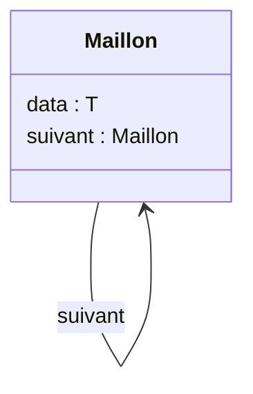
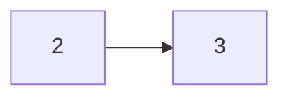
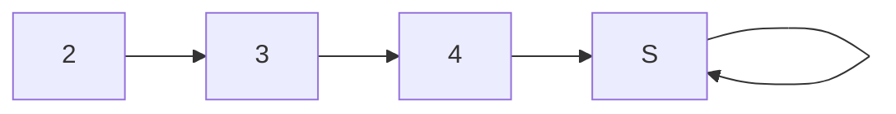

# Maillons et sentinelle

!!! danger "Requis"
    Le chapitre [Objet (POO)](../../poo/poo.md) en entier. Trois choses doivent être acquises, et pas seulement comprises en lisant.

    - **Écrire une classe** sans regarder un corrigé : ses attributs déclarés en haut avec leur type, son constructeur, ses méthodes.
    - **Dire ce que `self` désigne**, et pourquoi deux noms peuvent pointer sur le même objet. Toute cette page repose là-dessus.
    - **[L'héritage](../../poo/heritage.md)**, et savoir lire un schéma de classes.

    **Il n'y a rien de nouveau à installer et aucun langage à apprendre.** C'est le Python et la POO que tu connais déjà, et la nouveauté est ailleurs : dans la structure.

!!! question "Rappel d'ouverture (5 minutes, de mémoire, cahier fermé)"
    1. En Python, `a = [1, 42, 312]` et `b = [1, 42, 312]`. Que vaut `a is b` ? Que vaut `a == b` ? **Écris pourquoi**, une raison pour chacun.
    2. On écrit maintenant `b = a`, puis `b.append(3)`. Que vaut `a` ?
    3. Quel est le coût de `pop(0)` sur une liste Python, et pourquoi ?

    ??? success "Correction"
        1. `a is b` vaut `False`, et `a == b` vaut `True`.

            `is` demande « est-ce le **même objet** », et la réponse est non : chaque `[...]` fabrique une liste neuve, il y en a donc deux. `==` demande « ont-ils la **même valeur** », et la réponse est oui, case par case.

            Même contenu, deux objets : c'est tout l'écart entre les deux questions.

        2. `a` vaut `[1, 42, 312, 3]`. `b = a` ne copie rien, les deux noms désignent le même objet, et cette fois `a is b` vaut `True`.
        3. `O(n)`, parce que retirer la première case oblige à décaler toutes les autres d'un cran.

        Ces trois réponses sont exactement ce dont ce chapitre a besoin. Garde-les sous la main.

## 1 Ce qu'on fabrique

Une liste devient une **chaîne d'objets** : chacun porte une donnée et une **référence** vers le suivant. Plus d'indice, plus de cases côte à côte, seulement des flèches d'un objet à l'autre.

C'est là tout l'objet de ces deux pages, **les références en mémoire**. Tout ce que tu écriras consiste à rebrancher des flèches, et la question reviendra sans cesse : quel objet ce nom désigne-t-il ? Tu mesureras aussi ce que chaque opération **coûte**.

Celle-ci construit la brique, le **maillon**. La [suivante](liste.md) en fait une **liste**.

Cette page-ci te fait écrire deux fichiers. Les chemins sont donnés depuis le répertoire `python/` de ton dépôt, et tout répertoire que tu crées reçoit un fichier vide `__init__.py`.

```text
structures/
  lineaires/
    maillon.py          la brique, à compléter
    maillon_test.py     les tests, donnés au fur et à mesure
```

C'est l'organisation des piles et des files, à l'identique : le module d'un côté, ses tests **à côté de lui**. Tu vérifies tout par `uv run pytest`, depuis la racine de ton dépôt. Si un répertoire est neuf et que Python te répond `ModuleNotFoundError: No module named 'structures'`, lance une fois `uv sync` depuis la racine.

!!! info "Dans ce chapitre, la question est presque toujours `is`"
    L'objet d'étude de ces deux pages est la **flèche entre deux objets**. La question qu'on se pose sans arrêt est donc « est-ce le **même** maillon », et elle s'écrit `is`, jamais `==`.

    `==` ne servira qu'une seule fois, page suivante, à l'endroit où l'on compare des **données** et non des maillons. Il y est signalé.

## 2 Le maillon

Un maillon porte deux choses, et deux seulement :

- une **donnée**, celle qu'on range dans la collection
- une **flèche** vers le maillon suivant.

C'est tout. Il n'a pas d'indice, il ne sait pas combien de maillons le suivent, et il ne sait pas qui le précède. Il ne connaît que son voisin de droite.

Crée `structures/lineaires/maillon.py` et mets-y ceci. C'est la classe complète pour l'instant : un attribut, un attribut, un constructeur.

```python
# structures/lineaires/maillon.py


class Maillon[T]:
    """Un maillon d'une chaîne : une donnée, et une référence vers le suivant."""

    data: T
    suivant: "Maillon[T]"

    def __init__(self, data: T, suivant: "Maillon[T]") -> None:
        self.data = data
        self.suivant = suivant
```



Deux détails d'écriture, et aucun n'est une nouveauté de fond.

- Le `[T]` est celui que tu as déjà écrit sur `Pile[T]` : un maillon peut porter n'importe quoi, un entier, une chaîne de caractères, un élève, et le type choisi vaut pour toute la chaîne.
- Les **guillemets** autour de `"Maillon[T]"` sont là parce que la classe se nomme elle-même **dans sa propre définition**, à un moment où son nom n'existe pas encore. Sans eux, Python s'arrête sur une erreur. C'est la même écriture que dans `Noeud[T]` au chapitre des arbres.

## 3 Dessiner un maillon, puis une chaîne

Tu vas passer ce chapitre à déplacer des flèches, et tu ne les verras pas à l'écran. Le crayon est donc le premier outil, avant l'éditeur. Il tient en trois règles.

1. **Un objet, un rectangle.** La donnée s'écrit dedans.
2. **Un `suivant`, une flèche.** Elle part du rectangle et arrive sur un autre rectangle. Chaque rectangle a **une seule** flèche qui en part, puisqu'un maillon n'a qu'un `suivant`.
3. **Un nom n'est pas un objet, c'est une flèche.** `m1`, `self`, `ref` ne sont pas des rectangles : ce sont des étiquettes posées à côté d'une flèche qui désigne un rectangle. Écris-les **à l'extérieur**, et en rouge si tu peux.

Voilà un maillon seul, nommé `m`, qui porte `2` et pointe sur un maillon qui porte `3`.



Le nom `m` n'apparaît pas sur ce dessin, et c'est voulu : il ne se dessine pas en rectangle. Sur ton cahier, écris-le **à gauche du premier rectangle**, avec une petite flèche vers lui, et en rouge.

!!! question "Dessiner une chaîne (obligatoire)"
    Sur ton cahier, dessine la chaîne de **trois** maillons qui portent `2`, puis `3`, puis `4`, et nomme `m1` le premier.

    Réponds ensuite à ces deux questions, par écrit :

    - combien de flèches as-tu tracées entre des rectangles ?
    - vers quoi pointe le troisième maillon ?

    ??? success "Correction"
        ```mermaid
        graph LR
          m1["2"] --> m2["3"] --> m3["4"]
        ```

        **Deux** flèches entre des rectangles, pour trois maillons. Celle qui porte le nom `m1`, à gauche, ne compte pas : ce n'est pas un `suivant`.

        Et la deuxième question n'a pas de réponse pour l'instant : le dernier maillon doit bien pointer quelque part, puisqu'il a un attribut `suivant`. C'est l'objet de la section suivante.

## 4 La sentinelle, pour en finir avec `None`

Le dernier maillon doit pointer sur quelque chose. La réponse immédiate est « sur rien », `None`. Elle coûte cher : à partir de là, **chaque** opération doit se demander « est-ce que je suis au bout ? » avant de toucher à un `suivant`, et celle qui oublie de le demander casse.

On fait autre chose. On met au bout un maillon **qui est toujours là**, qui ne porte aucune donnée, et qui **pointe sur lui-même**. On l'appelle une **sentinelle**.



Une sentinelle est un maillon comme les autres, avec deux particularités : sa donnée n'existe pas, et son `suivant` est elle-même. Elle **hérite** donc de `Maillon`. Ajoute-la à la fin de `maillon.py` :

```python
class Sentinelle[T](Maillon[T]):
    """
    Un maillon sans donnée (data vaut None) qui marque la fin d'une chaîne.
    Une sentinelle pointe sur elle-même.
    """

    def __init__(self) -> None:
        super().__init__(None, self)
```

Le constructeur tient en une ligne, et cette ligne dit exactement les deux particularités : pas de donnée, et `self` comme suivant. C'est l'héritage que tu connais, `super().__init__(...)` appelant le constructeur de la super classe.

!!! warning "`None` n'apparaît nulle part ailleurs"
    C'est le **seul** `None` de tout le chapitre, et c'est exactement ce que la sentinelle apporte. Quand tu auras besoin d'un maillon de fin, tu écriras `Sentinelle()`, jamais `None`.

    Si `None` réapparaît ailleurs dans ton code, c'est le signe que tu es en train de refaire à la main ce que la sentinelle fait pour toi.

!!! question "Construire une chaîne (obligatoire)"
    Reprends la chaîne `2 -> 3 -> 4 -> S` de la section 3, en nommant `m1` le premier maillon.

    1. **Dessine-la d'abord** sur ton cahier.
    2. Écris les **trois lignes** qui la construisent, une par maillon.

    **Écris-les avant de dérouler la correction.**

    ??? success "Correction"
        ```python
        m3 = Maillon(4, Sentinelle())
        m2 = Maillon(3, m3)
        m1 = Maillon(2, m2)
        ```

        L'ordre est imposé, et c'est pour cela que la première ligne est celle du **bout** : pour construire un maillon, il faut déjà tenir son suivant.

        Cela s'écrit aussi d'un seul coup, en emboîtant les appels. Le code se lit alors **de l'intérieur vers l'extérieur**, et dit la même chose sans les noms intermédiaires :

        ```python
        m1 = Maillon(2, Maillon(3, Maillon(4, Sentinelle())))
        ```

## 5 Le fichier de tests

Crée `structures/lineaires/maillon_test.py`, **à côté** de `maillon.py`, et mets-y ceci. Chaque test que la suite te donne se colle à la fin du fichier.

??? info "Le fichier `maillon_test.py`, à créer"
    ```python
    # structures/lineaires/maillon_test.py

    from structures.lineaires.maillon import Maillon, Sentinelle


    def chaine(*xs: int) -> Maillon[int]:
        """
        Construit la chaîne xs[0] -> xs[1] -> ... -> S et renvoie son premier maillon
        (la sentinelle si xs est vide).
        """
        res: Maillon[int] = Sentinelle()
        for i in range(len(xs) - 1, -1, -1):
            res = Maillon(xs[i], res)
        return res


    def contenu[T](m: Maillon[T]) -> list[T]:
        """Renvoie les données de la chaîne qui commence à m, jusqu'à la sentinelle."""
        res = []
        ptr = m
        while ptr.suivant is not ptr:
            res.append(ptr.data)
            ptr = ptr.suivant
        return res
    ```

`chaine(1, 2, 3)` construit une chaîne, `contenu` en rend les données sous une forme qui se compare d'un coup. L'étoile de `*xs` veut dire « autant d'arguments qu'on veut » : `chaine()`, `chaine(1)` et `chaine(1, 2, 3)` sont tous les trois des appels valides.

Voici les deux premiers tests, qui vérifient ce que tu as déjà écrit. Colle-les et lance `uv run pytest` : ils doivent passer tout de suite.

??? info "Tests à recopier dans `maillon_test.py`"
    ```python
    def test_maillon_constructeur() -> None:
        fin: Maillon[int] = Sentinelle()
        m = Maillon(5, fin)
        assert m.data == 5
        assert m.suivant is fin


    def test_sentinelle() -> None:
        s: Sentinelle[int] = Sentinelle()
        assert s.data is None
        assert s.suivant is s
    ```

    Regarde bien quelle assertion emploie quel outil. `m.data == 5` compare une **valeur**. `m.suivant is fin` et `s.suivant is s` demandent « est-ce le **même objet** », et c'est la seule question qui ait un sens sur une flèche.

## 6 Deux opérations, et leur contrat

Construire une chaîne à la main est vite pénible. On donne donc au maillon deux opérations, qui ne font **que rebrancher des flèches** : aucune ne crée ni ne détruit de maillon.

Dans le tableau, **ce maillon** désigne celui sur lequel on appelle la méthode.

| Opération | Ce qu'elle fait | Coût |
| --- | --- | --- |
| `insere_apres(m)` | insère le maillon `m` **entre** ce maillon et son suivant | `O(1)` |
| `deplacer_prochain_apres(dest)` | déplace le maillon qui suit ce maillon juste après `dest`, et le renvoie. La chaîne se referme derrière lui | `O(1)` |

!!! question "Suivre les flèches, sur papier (obligatoire)"
    On part de la chaîne `1 -> 2 -> 3 -> 4 -> S`, dont les maillons s'appellent `a`, `b`, `c`, `d`.

    Dessine la chaîne après **chacune** des deux lignes, dans l'ordre. Pour chaque ligne, écris :

    - la chaîne obtenue, sous la forme `1 -> ... -> S`
    - la donnée du maillon renvoyé, quand la méthode en renvoie un
    - vers quoi pointe ce maillon renvoyé.

    ```python linenums="1"
    neuf = Maillon(9, Sentinelle())
    a.insere_apres(neuf)
    x = a.deplacer_prochain_apres(c)
    ```

    Tu n'as que le tableau de contrats ci-dessus, et il suffit : ces deux lignes se déroulent sans avoir écrit une ligne de code.

    **Dessine les deux étapes avant de dérouler la correction.**

    ??? success "Correction"
        **Après la ligne 2.** `1 -> 9 -> 2 -> 3 -> 4 -> S`. Rien n'est renvoyé.

        **Après la ligne 3.** `1 -> 2 -> 3 -> 9 -> 4 -> S`. Le maillon `9` a changé de place, et c'est le **même objet** : aucun maillon n'a été créé, et c'est lui que `x` désigne. Sa flèche pointe maintenant vers `4`, puisqu'il suit `3`.

        **Trois flèches ont changé, et trois seulement** : celle de `1`, qui se referme sur `2`, celle de `3`, qui va vers `9`, et celle de `9`, qui va vers `4`. C'est ainsi que tout se déplacera dans ce chapitre : rien ne se crée, rien ne se détruit, des flèches se rebranchent.

## 7 À écrire : les deux opérations

Chaque méthode se place dans la classe `Maillon`, sous le constructeur.

Dans les squelettes qui suivent, `...` marque ce que tu as à écrire.

!!! question "`insere_apres` (obligatoire)"
    ```python
    def insere_apres(self, m: "Maillon[T]") -> None:
        """
        Insère le maillon m juste après celui-ci, en O(1).

        Exemple : un désigne le maillon 1 dans 1 -> 2
          un.insere_apres(Maillon(5, Sentinelle()))   # 1 -> 5 -> 2
        """
        ...
        ...
    ```

    Deux affectations, et **l'ordre compte** : `m` doit d'abord apprendre où va la suite de la chaîne, et ce maillon ne peut le pointer qu'ensuite. Dans l'autre ordre, plus rien ne désigne le maillon qui suivait.

    Dessine les deux ordres avant de choisir.

    ??? info "Test à recopier dans `maillon_test.py`"
        ```python
        def test_insere_apres() -> None:
            c = chaine(1, 3)
            m = Maillon(2, Sentinelle())
            c.insere_apres(m)
            assert contenu(c) == [1, 2, 3]
            assert c.suivant is m

            # Sur le dernier maillon : on ajoute avant la sentinelle
            f = chaine(1, 2)
            f.suivant.insere_apres(Maillon(3, Sentinelle()))
            assert contenu(f) == [1, 2, 3]
            fin = f.suivant.suivant.suivant
            assert fin.suivant is fin
        ```

!!! question "`deplacer_prochain_apres` (obligatoire)"
    ```python
    def deplacer_prochain_apres(self, dest: "Maillon[T]") -> "Maillon[T]":
        """
        Déplace le maillon qui suit celui-ci juste après dest, et le renvoie, en O(1).

        Exemple : un et deux désignent les maillons 1 et 2 dans 1 -> 5 -> 2 -> 3
          m = un.deplacer_prochain_apres(deux)   # 1 -> 2 -> 5 -> 3, et m.data vaut 5
        """
        m = ...
        ...
        ...
        ...
        return m
    ```

    Quatre lignes, et **leur ordre n'est pas libre**. Chaque flèche qu'on écrit écrase la précédente, donc une flèche se lit **avant** d'être écrasée. La première ligne dit laquelle : garde une référence vers le maillon qui va bouger, sinon plus rien ne le désigne.

    ??? info "Test à recopier dans `maillon_test.py`"
        ```python
        def test_deplacer_prochain_apres() -> None:
            c = chaine(1, 5, 2, 3)
            deux = c.suivant.suivant
            m = c.deplacer_prochain_apres(deux)
            assert m.data == 5
            assert contenu(c) == [1, 2, 5, 3]
            assert m.suivant is deux.suivant.suivant    # il a pris la suite de deux

            # D'une chaîne vers une autre
            a = chaine(1, 2)
            b = chaine(7, 8)
            x = a.deplacer_prochain_apres(b)
            assert x.data == 2
            assert contenu(a) == [1]
            assert contenu(b) == [7, 2, 8]

            # Déplacer le dernier maillon : la chaîne se referme sur la sentinelle
            f = chaine(1, 2)
            g = chaine(9)
            f.deplacer_prochain_apres(g)
            assert contenu(f) == [1]
            assert f.suivant.suivant is f.suivant        # 1 pointe sur la sentinelle
            assert contenu(g) == [9, 2]
        ```


## 8 Ce que cela coûte

Deux opérations, toutes deux en `O(1)`. Le tableau est court, et pourtant il contient déjà ce qui distingue une chaîne d'un tableau : rebrancher une flèche ne dépend pas du nombre de maillons, mais **arriver** jusqu'au bon maillon se paie un cran à la fois.

| Coût | Opération |
| --- | --- |
| `O(1)` | `insere_apres`, `deplacer_prochain_apres` |

!!! question "Ce que la flèche unique interdit (obligatoire)"
    La chaîne est `1 -> 2 -> 3 -> 4 -> S`. Tu tiens une référence `m` vers le maillon qui porte `3`, et **lui seul** : tu ne tiens pas les autres.

    1. Est-ce que `m.deplacer_prochain_apres(dest)` déplace le maillon qui porte `3` ? Sinon, lequel déplace-t-il ?
    2. Quel maillon faut-il tenir pour déplacer celui qui porte `3` ?
    3. Tu tiens aussi le premier maillon. Combien de crans faut-il parcourir depuis lui pour atteindre le maillon qu'il te faut ? Et si la chaîne avait `n` maillons et que `m` était le dernier ?
    4. En Python, `t.insert(2, 7)` sur une liste `t` de `n` cases coûte `O(n)`. `insere_apres` coûte `O(1)`. D'où vient l'écart ?

    **Écris tes quatre réponses avant de dérouler la correction.**

    ??? success "Correction"
        1. Non. `deplacer_prochain_apres` déplace le maillon qui **suit** celui sur lequel on l'appelle, donc ici celui qui porte `4`. Un maillon ne peut rien faire à lui-même : il n'a aucune flèche qui arrive sur lui.
        2. Celui qui porte `2`. Pour agir sur un maillon, il faut tenir **son précédent**, c'est la seule façon de refermer la chaîne derrière lui.
        3. Un cran. Et si `m` était le dernier d'une chaîne de `n` maillons, il faudrait en parcourir `n - 2`, donc `O(n)`.
        4. Dans un tableau, les cases sont **côte à côte** en mémoire : en insérer une oblige à décaler toutes les suivantes. Dans une chaîne, les maillons sont n'importe où, et insérer revient à rebrancher deux flèches, quel que soit le nombre de maillons.

        Retiens le partage, il décidera de tout à la page suivante. Une chaîne est **imbattable là où on est déjà**, et **lente pour arriver quelque part**.

!!! info "La suite"
    Tu as la brique. La [page suivante](liste.md) en fait une collection, en déplaçant la sentinelle : elle passera de la fin au début, et la liste deviendra sa propre sentinelle.
