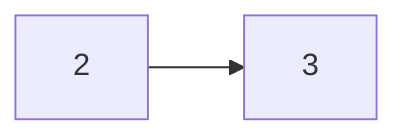
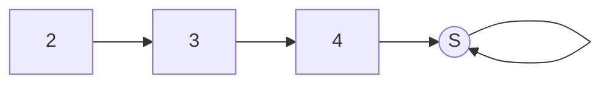
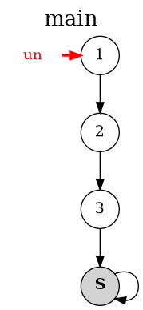

# Maillons et sentinelle

!!! danger "Requis"
    Tu dois savoir refaire les exercices sur la création et l'utilisation de classes en POO sans regarder le corrigé, et savoir ce qu'est l'héritage.

!!! question "Rappel d'ouverture (5 minutes, de mémoire, cahier fermé)"
    1. En Python, `a = [1, 42, 312]` et `b = [1, 42, 312]`. Que vaut `a is b` ? Que vaut `a == b` ? **Écris pourquoi**, une raison pour chacun.
    2. On écrit maintenant `b = a`, puis `b.append(3)`. Que vaut `a` ?
    3. Quel est le coût de `pop(0)` sur une liste Python, et pourquoi ?

    ??? success "Correction"
        1. `a is b` vaut `False`, et `a == b` vaut `True`.

            `is` demande « est-ce le **même objet** », et la réponse est non : chaque `[...]` fabrique une liste neuve, il y en a donc deux. `==` demande « ont-ils la **même valeur** », et la réponse est oui, case par case.

            Même contenu, deux objets : c'est tout l'écart entre les deux questions.

        2. `a` vaut `[1, 42, 312, 3]`. `b = a` ne copie rien, les deux noms désignent le même objet, et cette fois `a is b` vaut `True`.
        3. `O(n)`, parce que retirer la première case oblige à décaler toutes les autres d'un cran.

        Ces trois réponses sont exactement ce dont ce chapitre a besoin. Garde-les sous la main.

## 1 Ce qu'on fabrique

Tu as déjà implémenté une liste deux fois, en Gleam où elle était `Vide` ou `Cons(tête, queue)`, puis en Python avec le même découpage. C'est la **troisième**, et le changement est complet : une liste devient une chaîne d'objets, chacun gardant une **référence** vers le suivant.

| Gleam | Python fonctionnel | Ici |
| --- | --- | --- |
| `Vide` | `tuple[()]` | une **sentinelle**, un maillon sans donnée |
| `Cons(tête, queue)` | `tuple[T, Liste[T]]` | un **maillon**, une donnée et une flèche vers le suivant |

Ce chapitre ne cherche pas à te faire apprendre Java. Ce que tu connais en Python est suffisant pour que tu ne sois pas perdu. Il cherche deux choses : voir **comment une collection est faite de l'intérieur**, et savoir **ce que chaque opération coûte**.

Il tient sur deux pages. Celle-ci construit la brique, le **maillon**. La [suivante](liste.md) en fait une **liste**.

Cette page-ci te fait écrire quatre fichiers, dans un répertoire `java/listes/` de ton dépôt.

```text
java/
  listes/
    Maillon.java        la brique, à compléter
    Sentinelle.java     la fin de la chaîne, donnée
    Dessin.java         l'outil qui dessine, donné
    MaillonTest.java    les tests, donnés au fur et à mesure
```

!!! info "L'atelier Java, à faire une fois avant de commencer"
    Java s'installe avec `nsi install openjdk`, plus deux extensions VSCode, et rien de ce chapitre ne se lance en ligne de commande. Tout est sur la page [Java, l'atelier](../../../les-outils/java.md), à faire une fois pour toutes avant d'aller plus loin.

    Deux choses à y lire pour **comprendre** cette page-ci : le tableau des [correspondances entre Python et Java](../../../les-outils/java.md#java-ce-qui-change), une dizaine de lignes, et la façon de [lancer les tests](../../../les-outils/java.md#lancer-les-tests).

    Pourquoi Java : tout y est déclaré avec son type, et `==` y compare **toujours** des références. Ce que Python laisse implicite, Java l'écrit, ce qui est utile sur un chapitre dont l'objet d'étude est la flèche entre deux objets.

!!! warning "`==` ne compare pas ce que tu crois"
    En Java, `==` et `!=` comparent **toujours** des références : c'est le `is` de Python, jamais le `==` de Python. Pour comparer deux données, il faut écrire `a.equals(b)`.

    L'essentiel de ce chapitre consiste à comparer des références, donc `==` sera presque toujours le bon choix. L'exception arrive sur la page suivante, et elle y est signalée.

## 2 Le maillon

Un maillon porte deux choses, et deux seulement :

- une **donnée**, celle qu'on range dans la collection
- une **flèche** vers le maillon suivant.

C'est tout. Il n'a pas d'indice, il ne sait pas combien de maillons le suivent, et il ne sait pas qui le précède. Il ne connaît que son voisin de droite.

Crée `Maillon.java` et mets-y ceci. C'est la classe complète pour l'instant : un attribut, un attribut, un constructeur.

```java
/** Un maillon d'une chaîne : une donnée, et une référence vers le maillon suivant. */
class Maillon<T> {

    /** La donnée portée par ce maillon. */
    T data;

    /** Le maillon suivant. */
    Maillon<T> suivant;

    /** Crée un maillon portant une donnée et pointant sur suivant. */
    Maillon(T data, Maillon<T> suivant) {
        this.data = data;
        this.suivant = suivant;
    }
}
```

Le `<T>` est le `[T]` de Python : un maillon peut porter n'importe quoi, un entier, une chaîne de caractères, un élève, et le type choisi vaut pour toute la chaîne.

## 3 Dessiner un maillon, puis une chaîne

Tu vas passer ce chapitre à déplacer des flèches, et tu ne les verras pas à l'écran. Le crayon est donc le premier outil, avant l'éditeur. Il tient en trois règles.

1. **Un objet, un rond.** La donnée s'écrit dedans.
2. **Un `suivant`, une flèche.** Elle part du rond et arrive sur un autre rond. Chaque rond a **une seule** flèche qui en part, puisqu'un maillon n'a qu'un `suivant`.
3. **Un nom n'est pas un objet, c'est une flèche.** `m1`, `this`, `ref` ne sont pas des ronds : ce sont des étiquettes posées à côté d'une flèche qui désigne un rond. Écris-les **à l'extérieur**, et en rouge si tu peux.

Voilà un maillon seul, nommé `m`, qui porte `2` et pointe sur un maillon qui porte `3`.



Le nom `m` ne se dessine pas en rond : il s'écrit **à gauche du premier rond**, avec une petite flèche vers lui, et en rouge. Tu verras exactement cette convention sur l'image de la section 6.

!!! question "Dessiner une chaîne (obligatoire)"
    Sur ton cahier, dessine la chaîne de **trois** maillons qui portent `2`, puis `3`, puis `4`, et nomme `m1` le premier.

    Réponds ensuite à ces deux questions, par écrit :

    - combien de flèches as-tu tracées entre des ronds ?
    - vers quoi pointe le troisième maillon ?

    ??? success "Correction"
        ```mermaid
        graph LR
          m1["2"] --> m2["3"] --> m3["4"]
        ```

        **Deux** flèches entre des ronds, pour trois maillons. Celle qui porte le nom `m1`, à gauche, ne compte pas : ce n'est pas un `suivant`.

        Et la deuxième question n'a pas de réponse pour l'instant : le dernier maillon doit bien pointer quelque part, puisqu'il a un attribut `suivant`. C'est l'objet de la section suivante.

## 4 La sentinelle, pour en finir avec `null`

Le dernier maillon doit pointer sur quelque chose. La réponse immédiate est « sur rien », `null` en Java, `None` en Python. Elle coûte cher : à partir de là, **chaque** opération doit se demander « est-ce que je suis au bout ? » avant de toucher à un `suivant`, et celle qui oublie de le demander casse.

On fait autre chose. On met au bout un maillon **qui est toujours là**, qui ne porte aucune donnée, et qui **pointe sur lui-même**. On l'appelle une **sentinelle**.



Une sentinelle est un maillon comme les autres, avec deux particularités : sa donnée n'existe pas, et son `suivant` est elle-même. Elle hérite donc de `Maillon`. Crée `Sentinelle.java` :

```java
/**
 * Un maillon sans donnée (data vaut null) qui marque la fin d'une chaîne.
 * Une sentinelle pointe sur elle-même.
 */
class Sentinelle<T> extends Maillon<T> {
    Sentinelle() {
        super(null, null);
        this.suivant = this;
    }
}
```

!!! warning "`null` n'apparaît nulle part ailleurs"
    C'est la **seule** ligne de tout le chapitre où tu écriras `null`, et c'est exactement ce que la sentinelle achète. Quand tu auras besoin d'un maillon de fin, tu écriras `new Sentinelle<>()`, jamais `null`.

    Si `null` réapparaît ailleurs dans ton code, c'est le signe que tu es en train de refaire à la main ce que la sentinelle fait pour toi.

## 5 Ton premier programme

Ajoute un `main` à la classe `Maillon`, **à l'intérieur de la classe**, sous le constructeur. C'est ton bac à sable pour toute la page.

```java
    public static void main(String args[]) {

        // La chaîne 1 -> 2 -> 3 -> S
        Maillon<Integer> un = new Maillon<>(1, new Maillon<>(2, new Maillon<>(3, new Sentinelle<>())));

    }
```

Cette ligne-là mérite un instant. Elle se lit **de l'intérieur vers l'extérieur** : on fabrique d'abord la sentinelle, puis le maillon `3` qui la pointe, puis le maillon `2` qui pointe le `3`, et enfin le maillon `1`. L'ordre est imposé, puisque pour construire un maillon il faut déjà tenir son suivant.

C'est mot pour mot le `Cons(1, Cons(2, Cons(3, Vide)))` de Gleam.

## 6 `Dessin`, pour vérifier ton dessin

Un outil est fourni, qui dessine une chaîne telle qu'elle est réellement en mémoire. Récupère **[Dessin.java](Dessin.java)** et place-le à côté de tes autres fichiers, sans rien y changer.

Il s'emploie en une ligne, n'importe où :

```java
        Dessin.dessiner(un);                 // la chaîne qui commence à un
        Dessin.dessiner(un, "retire", m);    // la même, avec une flèche rouge nommée "retire" vers m
```

Trois choses à savoir avant de l'essayer.

1. **Il ne fait rien en mode Run.** Il faut lancer en **Debug** (`F5`).
2. **Pose un point d'arrêt** sur la ligne qui suit l'appel, sinon le programme se termine avant que tu aies regardé.
3. Il écrit une image **`liste.png`**, à côté de tes fichiers `.java`. Ouvre-la dans VSCode : elle se met à jour toute seule à chaque arrêt.

Ajoute cette ligne à ton `main`, sous la construction de la chaîne, et pose ton point d'arrêt juste dessous :

```java
        Dessin.dessiner(un, "un", un);
```

Tu dois obtenir exactement ceci :

{ style="width: 160px; display: block; margin: 0 auto" }

Le titre est le nom de la méthode qui a appelé `dessiner`. La sentinelle est le rond gris marqué `S`, et sa flèche revient bien sur elle. Et le nom `un` est en rouge, **à l'extérieur**, avec sa flèche : c'est la règle 3 de la section 3, dessinée par la machine.

!!! warning "`Dessin` ne remplace pas ton crayon"
    Il dit si ton dessin était juste, il ne le fait pas à ta place. L'ordre est toujours le même, et il ne s'inverse pas : **tu dessines, puis tu lances, puis tu compares**. Un dessin obtenu sans l'avoir cherché ne t'apprend rien, et c'est à la main que tu écriras tes méthodes.

!!! question "Construire, dessiner, vérifier (obligatoire)"
    Dans ton `main`, construis la chaîne `2 -> 3 -> 4 -> S` de la section 3, en nommant `m1` le premier maillon.

    1. **Dessine-la d'abord** sur ton cahier.
    2. Écris les **trois lignes** qui la construisent, une par maillon, sans emboîter les `new` les uns dans les autres cette fois.
    3. Ajoute `Dessin.dessiner(m1);` et lance en Debug.

    **Écris les trois lignes avant de dérouler la correction.**

    ??? success "Correction"
        ```java
        Maillon<Integer> m3 = new Maillon<>(4, new Sentinelle<>());
        Maillon<Integer> m2 = new Maillon<>(3, m3);
        Maillon<Integer> m1 = new Maillon<>(2, m2);
        ```

        L'ordre est imposé, et c'est pour cela que la première ligne est celle du **bout** : pour construire un maillon, il faut déjà tenir son suivant.

        Une fois les trois lignes écrites, la version emboîtée de la section 5 se relit toute seule : c'est la même chose, sans les noms intermédiaires.

## 7 Le fichier de tests

Crée `MaillonTest.java` à côté des autres, et mets-y ceci. Chaque test que la suite te donne se colle **à l'intérieur** de la classe, avant son accolade fermante.

??? tip "Le fichier `MaillonTest.java`, à créer"
    ```java
    import static org.junit.jupiter.api.Assertions.*;

    import java.util.ArrayList;
    import java.util.List;
    import org.junit.jupiter.api.DisplayName;
    import org.junit.jupiter.api.Test;

    /** Tests de Maillon et de Sentinelle. */
    public class MaillonTest {

        /**
         * Construit la chaîne xs[0] -> xs[1] -> ... -> S et renvoie son premier maillon
         * (la sentinelle si xs est vide).
         */
        static Maillon<Integer> chaine(Integer... xs) {
            Maillon<Integer> res = new Sentinelle<>();
            for (int i = xs.length - 1; i >= 0; i--) {
                res = new Maillon<>(xs[i], res);
            }
            return res;
        }

        /** Renvoie les données de la chaîne qui commence à m, jusqu'à la sentinelle. */
        static <T> List<T> contenu(Maillon<T> m) {
            List<T> res = new ArrayList<>();
            Maillon<T> ptr = m;
            while (!(ptr instanceof Sentinelle)) {
                res.add(ptr.data);
                ptr = ptr.suivant;
            }
            return res;
        }
    }
    ```

`chaine(1, 2, 3)` construit une chaîne, `contenu` en rend les données sous une forme qui se compare d'un coup. Les trois assertions qui reviennent partout, et la façon de lire un échec, sont sur la page [Java, l'atelier](../../../les-outils/java.md#les-trois-assertions).

Voici les deux premiers tests, qui vérifient ce que tu as déjà écrit. Colle-les et lance-les : ils doivent passer tout de suite.

??? tip "Tests à recopier dans `MaillonTest.java`"
    ```java
        @Test
        @DisplayName("Maillon(data, suivant) stocke la donnée et le suivant")
        void maillonConstructeur() {
            Maillon<Integer> fin = new Sentinelle<>();
            Maillon<Integer> m = new Maillon<>(5, fin);
            assertEquals(5, m.data);
            assertSame(fin, m.suivant);
        }

        @Test
        @DisplayName("Sentinelle() crée un maillon sans donnée qui pointe sur lui-même")
        void sentinelle() {
            Sentinelle<Integer> s = new Sentinelle<>();
            assertNull(s.data);
            assertSame(s, s.suivant);
        }
    ```

## 8 Trois opérations, et leur contrat

Construire une chaîne à la main est vite pénible. On donne donc au maillon trois opérations, qui ne font **que rebrancher des flèches** : aucune ne crée ni ne détruit de maillon.

Dans le tableau, **ce maillon** désigne celui sur lequel on appelle la méthode.

| Opération | Ce qu'elle fait | Précondition | Coût |
| --- | --- | --- | --- |
| `insereApres(m)` | insère le maillon `m` **entre** ce maillon et son suivant | aucune | `O(1)` |
| `decrocheProchain()` | décroche de la chaîne le maillon qui suit ce maillon et le renvoie. La chaîne se referme derrière lui, et il emporte sa flèche | il y a un vrai maillon après celui-ci, c'est-à-dire que son suivant n'est pas la sentinelle | `O(1)` |
| `avancer(k)` | renvoie le maillon situé `k` crans plus loin. `avancer(0)` renvoie ce maillon, et arrivé sur la sentinelle on y reste | `k` positif ou nul, sinon `IllegalArgumentException` | `O(k)` |

!!! question "Suivre les flèches, sur papier (obligatoire)"
    On part de la chaîne `1 -> 2 -> 3 -> 4 -> S`, dont les maillons s'appellent `a`, `b`, `c`, `d`.

    Dessine la chaîne après **chacune** des quatre lignes, dans l'ordre. Pour chaque ligne, écris :

    - la chaîne obtenue, sous la forme `1 -> ... -> S`
    - la donnée du maillon renvoyé, quand la méthode en renvoie un
    - vers quoi pointe ce maillon renvoyé.

    ```java
    Maillon<Integer> neuf = new Maillon<>(9, new Sentinelle<>());
    a.insereApres(neuf);                            // ligne 1
    Maillon<Integer> x = a.decrocheProchain();      // ligne 2
    c.insereApres(x);                               // ligne 3
    Maillon<Integer> y = a.avancer(2);              // ligne 4
    ```

    Tu n'as que le tableau de contrats ci-dessus, et il suffit : ces quatre lignes se déroulent sans avoir écrit une ligne de code.

    **Dessine les quatre étapes avant de dérouler la correction.**

    ??? success "Correction"
        **Ligne 1.** `1 -> 9 -> 2 -> 3 -> 4 -> S`. Rien n'est renvoyé.

        **Ligne 2.** `1 -> 2 -> 3 -> 4 -> S`, la chaîne s'est refermée derrière le maillon décroché. `x` porte `9`, et il emporte sa flèche : il pointe **toujours** vers le maillon `2`, qui ne le sait pas.

        **Ligne 3.** `1 -> 2 -> 3 -> 9 -> 4 -> S`. C'est le **même objet** `x` qu'à la ligne 2, déplacé, aucun maillon n'a été créé. Et sa flèche a changé toute seule : `insereApres` la rebranche vers `4`, c'est sa première affectation.

        **Ligne 4.** `y` porte `3`. On part de `a`, un cran mène à `2`, deux crans mènent à `3`.

        La ligne 3 est la seconde moitié de la ligne 2 : décrocher, puis réinsérer ailleurs. C'est ainsi que tout se déplacera dans ce chapitre.

    ??? question "Une de plus, sur la sentinelle"
        Que renvoie `a.avancer(10)` sur la chaîne de départ, qui n'a que quatre maillons ? Et `a.avancer(100)` ?

        ??? success "Correction"
            Les deux renvoient **la sentinelle**, et c'est le **même objet** dans les deux cas. Une fois dessus, on n'en bouge plus, puisqu'elle pointe sur elle-même. Avec `null` au bout, les deux appels auraient planté.

## 9 À écrire : les trois opérations

Chaque méthode se place dans la classe `Maillon`, sous le constructeur et au-dessus du `main`.

Dans les squelettes qui suivent, `...` marque ce que tu as à écrire.

!!! question "`insereApres` (obligatoire)"
    ```java
    /**
     * Insère le maillon m juste après celui-ci, en O(1).
     *
     * Exemple : un pointe sur 1 dans 1 -> 2
     *   un.insereApres(new Maillon<>(5, new Sentinelle<>()));   // 1 -> 5 -> 2
     */
    void insereApres(Maillon<T> m) {
        ...
        ...
    }
    ```

    Deux affectations, et **l'ordre compte** : `m` doit d'abord apprendre où va la suite de la chaîne, et ce maillon ne peut le pointer qu'ensuite. Dans l'autre ordre, plus rien ne désigne le maillon qui suivait.

    Dessine les deux ordres avant de choisir.

    ??? tip "Test à recopier dans `MaillonTest.java`"
        ```java
            @Test
            @DisplayName("insereApres branche un maillon juste après")
            void insereApres() {
                Maillon<Integer> c = chaine(1, 3);
                Maillon<Integer> m = new Maillon<>(2, new Sentinelle<>());
                c.insereApres(m);
                assertEquals(List.of(1, 2, 3), contenu(c));
                assertSame(m, c.suivant);

                // Sur le dernier maillon : on ajoute avant la sentinelle
                Maillon<Integer> f = chaine(1, 2);
                f.suivant.insereApres(new Maillon<>(3, new Sentinelle<>()));
                assertEquals(List.of(1, 2, 3), contenu(f));
                assertInstanceOf(Sentinelle.class, f.suivant.suivant.suivant);
            }
        ```

!!! question "`decrocheProchain` (obligatoire)"
    ```java
    /**
     * Retire de la chaîne le maillon qui suit celui-ci et le renvoie, en O(1).
     *
     * Exemple : un pointe sur 1 dans 1 -> 5 -> 2
     *   Maillon<Integer> m = un.decrocheProchain();   // 1 -> 2, et m.data vaut 5
     */
    Maillon<T> decrocheProchain() {
        Maillon<T> m = ...;
        ...
        return m;
    }
    ```

    La première ligne est déjà là, et elle dit l'essentiel : il faut **garder** une référence vers le maillon décroché avant de le sortir de la chaîne, sinon plus rien ne le désigne et tu ne peux plus le renvoyer.

    ??? tip "Test à recopier dans `MaillonTest.java`"
        ```java
            @Test
            @DisplayName("decrocheProchain retire le maillon suivant et le renvoie")
            void decrocheProchain() {
                Maillon<Integer> c = chaine(1, 2, 3);
                Maillon<Integer> deux = c.suivant;
                Maillon<Integer> m = c.decrocheProchain();
                assertSame(deux, m);
                assertEquals(List.of(1, 3), contenu(c));

                // Le dernier maillon : la chaîne se raccroche à la sentinelle
                Maillon<Integer> f = chaine(1, 2);
                Maillon<Integer> dernier = f.decrocheProchain();
                assertEquals(2, dernier.data);
                assertEquals(List.of(1), contenu(f));
                assertInstanceOf(Sentinelle.class, f.suivant);
            }
        ```

!!! question "`avancer` (obligatoire)"
    Deux choses de Java que tu n'as pas encore vues sont données ici : la façon de refuser un argument, et la boucle `for`. Le commentaire donne la ligne Python correspondante.

    ```java
    /**
     * Renvoie le maillon situé k crans plus loin, en O(k).
     * Arrivé sur la sentinelle de fin, on y reste, car elle pointe sur elle-même.
     *
     * Exemple : un pointe sur 1 dans 1 -> 2 -> 3 -> S
     *   un.avancer(0);   // le maillon 1
     *   un.avancer(2);   // le maillon 3
     *   un.avancer(5);   // la sentinelle S
     */
    Maillon<T> avancer(int k) {
        if (k < 0) {
            throw new IllegalArgumentException("k doit être positif ou nul");
        }
        Maillon<T> ref = this;

        // for i in range(0, k):
        for (int i = 0; i < k; i++) {
            ...
        }
        return ref;
    }
    ```

    Une seule ligne à écrire, dans la boucle. Demande-toi ce qui doit avoir changé après un tour, et une seule chose a le droit de changer.

    ??? tip "Test à recopier dans `MaillonTest.java`"
        ```java
            @Test
            @DisplayName("avancer(k) renvoie le maillon k crans plus loin, et reste sur la sentinelle")
            void avancer() {
                Maillon<Integer> c = chaine(1, 2, 3);
                assertSame(c, c.avancer(0));
                assertEquals(3, c.avancer(2).data);
                Maillon<Integer> s = c.avancer(3);
                assertInstanceOf(Sentinelle.class, s);
                assertSame(s, c.avancer(10), "on reste sur la sentinelle");

                // k négatif
                assertThrows(IllegalArgumentException.class, () -> c.avancer(-1));
            }
        ```

    ??? tip "Indice"
        `ref` est une **flèche**, pas un rond : l'affecter ne déplace aucun maillon, cela déplace seulement l'endroit où la flèche arrive.

        Dessine la chaîne, pose `ref` sur le premier maillon, et demande-toi où elle doit être après le premier tour. La ligne à écrire est la réponse.

    ??? question "Avant d'ouvrir la correction"
        En une phrase, sur ton cahier : qu'est-ce que l'indice t'a appris sur ce qui n'allait pas dans **ton** code ?

    ??? warning "Correction"
        ```java
                ref = ref.suivant;
        ```

!!! info "Relance tout"
    Les cinq tests de `MaillonTest` doivent passer. Si l'un d'eux échoue, lis le message : `expected` est ce qu'on attendait, `but was` ce que **ton** code a produit.

    Et garde ces trois méthodes en tête telles qu'elles sont : aucune ne parle de la fin de la chaîne, aucune ne parle de `null`. Elles ne font que rebrancher des flèches, et c'est ce qui leur permettra de resservir **sans une ligne de changement** sur la page suivante.

## 10 Ce que cela coûte

Trois opérations, deux en `O(1)` et une en `O(k)`. Ce tableau est court, et pourtant il contient déjà tout ce qui distingue une chaîne d'un tableau.

| Coût | Opération |
| --- | --- |
| `O(1)` | `insereApres`, `decrocheProchain` |
| `O(k)` | `avancer(k)` |

!!! question "Ce que la flèche unique interdit (obligatoire)"
    La chaîne est `1 -> 2 -> 3 -> 4 -> S`. Tu tiens une référence `m` vers le maillon qui porte `3`, et **lui seul** : tu ne tiens pas les autres.

    1. Est-ce que `m.decrocheProchain()` retire le maillon qui porte `3` ? Sinon, lequel retire-t-il ?
    2. Quel maillon faut-il tenir pour retirer de la chaîne celui qui porte `3` ?
    3. Tu tiens aussi le premier maillon. Combien de crans faut-il parcourir depuis lui pour atteindre le maillon qu'il te faut ? Et si la chaîne avait `n` maillons et que `m` était le dernier ?
    4. En Python, `t.insert(2, 7)` sur une liste `t` de `n` cases coûte `O(n)`. `insereApres` coûte `O(1)`. D'où vient l'écart ?

    **Écris tes quatre réponses avant de dérouler la correction.**

    ??? success "Correction"
        1. Non. `decrocheProchain` retire le maillon qui **suit** celui sur lequel on l'appelle, donc ici celui qui porte `4`. Un maillon ne peut rien faire à lui-même : il n'a aucune flèche qui arrive sur lui.
        2. Celui qui porte `2`. Pour retirer un maillon, il faut tenir **son précédent**, c'est la seule façon de refermer la chaîne.
        3. Un cran. Et si `m` était le dernier d'une chaîne de `n` maillons, il faudrait en parcourir `n - 2`, donc `O(n)`.
        4. Dans un tableau, les cases sont **côte à côte** en mémoire : en insérer une oblige à décaler toutes les suivantes. Dans une chaîne, les maillons sont n'importe où, et insérer revient à rebrancher deux flèches, quel que soit le nombre de maillons.

        Retiens le partage, il décidera de tout sur la page suivante. Une chaîne est **imbattable là où on est déjà**, et **lente pour arriver quelque part**.

!!! info "La suite"
    Tu as la brique. La [page suivante](liste.md) en fait une collection, en déplaçant la sentinelle : elle passera de la fin au début, et la liste deviendra sa propre sentinelle.
