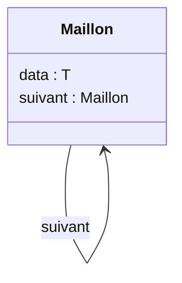
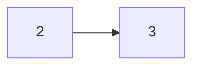
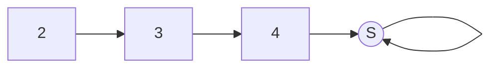

# Maillons et sentinelle

!!! danger "Requis"
    Le chapitre [Objet (POO)](../../poo/poo.md) en entier. Trois choses doivent être acquises, et pas seulement comprises en lisant.

    - **Écrire une classe** sans regarder un corrigé : ses attributs déclarés en haut avec leur type, son constructeur, ses méthodes.
    - **Dire ce que `self` désigne**, et pourquoi deux noms peuvent pointer sur le même objet. Toute cette page repose là-dessus.
    - **[L'héritage](../../poo/heritage.md)**, et savoir lire un schéma de classes.

    Tu as aussi écrit la liste **deux fois**, en Gleam puis en Python. Garde ces deux versions sous la main : c'est la même structure, une troisième fois.

    **Il n'y a rien de nouveau à installer et aucun langage à apprendre.** C'est le Python et la POO que tu connais déjà, et la nouveauté est ailleurs : dans la structure.

!!! question "Rappel d'ouverture (5 minutes, de mémoire, cahier fermé)"
    1. En Python, `a = [1, 42, 312]` et `b = [1, 42, 312]`. Que vaut `a is b` ? Que vaut `a == b` ? **Écris pourquoi**, une raison pour chacun.
    2. On écrit maintenant `b = a`, puis `b.append(3)`. Que vaut `a` ?
    3. Quel est le coût de `pop(0)` sur une liste Python, et pourquoi ?

    ??? success "Correction"
        1. `a is b` vaut `False`, et `a == b` vaut `True`.

            `is` demande « est-ce le **même objet** », et la réponse est non : chaque `[...]` fabrique une liste neuve, il y en a donc deux. `==` demande « ont-ils la **même valeur** », et la réponse est oui, case par case.

            Même contenu, deux objets : c'est tout l'écart entre les deux questions.

        2. `a` vaut `[1, 42, 312, 3]`. `b = a` ne copie rien, les deux noms désignent le même objet, et cette fois `a is b` vaut `True`.
        3. `O(n)`, parce que retirer la première case oblige à décaler toutes les autres d'un cran.

        Ces trois réponses sont exactement ce dont ce chapitre a besoin. Garde-les sous la main.

## 1 Ce qu'on fabrique

Tu as déjà implémenté une liste deux fois, en Gleam où elle était `Vide` ou `Cons(tête, queue)`, puis en Python avec le même découpage. C'est la **troisième**, et le changement est complet : une liste devient une chaîne d'objets, chacun gardant une **référence** vers le suivant.

| Gleam | Python fonctionnel | Ici |
| --- | --- | --- |
| `Vide` | `tuple[()]` | une **sentinelle**, un maillon sans donnée |
| `Cons(tête, queue)` | `tuple[T, Liste[T]]` | un **maillon**, une donnée et une flèche vers le suivant |

Ce chapitre cherche deux choses : voir **comment une collection est faite de l'intérieur**, et savoir **ce que chaque opération coûte**.

Il tient sur deux pages. Celle-ci construit la brique, le **maillon**. La [suivante](liste.md) en fait une **liste**.

Cette page-ci te fait écrire trois fichiers. Les chemins sont donnés depuis le répertoire `python/` de ton dépôt, et tout répertoire que tu crées reçoit un fichier vide `__init__.py`.

```text
structures/
  lineaires/
    maillon.py          la brique, à compléter
    maillon_test.py     les tests, donnés au fur et à mesure
exos/
  exos_maillons.py      ton bac à sable, pour regarder ce que tu fabriques
```

C'est l'organisation des piles et des files, à l'identique : le module d'un côté, ses tests **à côté de lui**, et tes essais dans `exos/`. Tu vérifies tout par `uv run pytest`, depuis la racine de ton dépôt. Si un répertoire est neuf et que Python te répond `ModuleNotFoundError: No module named 'structures'`, lance une fois `uv sync` depuis la racine.

!!! info "Dans ce chapitre, la question est presque toujours `is`"
    L'objet d'étude de ces deux pages est la **flèche entre deux objets**. La question qu'on se pose sans arrêt est donc « est-ce le **même** maillon », et elle s'écrit `is`, jamais `==`.

    `==` ne servira qu'une seule fois, page suivante, à l'endroit où l'on compare des **données** et non des maillons. Il y est signalé.

## 2 Le maillon

Un maillon porte deux choses, et deux seulement :

- une **donnée**, celle qu'on range dans la collection
- une **flèche** vers le maillon suivant.

C'est tout. Il n'a pas d'indice, il ne sait pas combien de maillons le suivent, et il ne sait pas qui le précède. Il ne connaît que son voisin de droite.

Crée `structures/lineaires/maillon.py` et mets-y ceci. C'est la classe complète pour l'instant : un attribut, un attribut, un constructeur.

```python
# structures/lineaires/maillon.py


class Maillon[T]:
    """Un maillon d'une chaîne : une donnée, et une référence vers le suivant."""

    data: T
    suivant: "Maillon[T]"

    def __init__(self, data: T, suivant: "Maillon[T]") -> None:
        self.data = data
        self.suivant = suivant
```



Deux détails d'écriture, et aucun n'est une nouveauté de fond.

- Le `[T]` est celui que tu as déjà écrit sur `Pile[T]` : un maillon peut porter n'importe quoi, un entier, une chaîne de caractères, un élève, et le type choisi vaut pour toute la chaîne.
- Les **guillemets** autour de `"Maillon[T]"` sont là parce que la classe se nomme elle-même **dans sa propre définition**, à un moment où son nom n'existe pas encore. Sans eux, Python s'arrête sur une erreur. C'est la même écriture que dans `Noeud[T]` au chapitre des arbres.

## 3 Dessiner un maillon, puis une chaîne

Tu vas passer ce chapitre à déplacer des flèches, et tu ne les verras pas à l'écran. Le crayon est donc le premier outil, avant l'éditeur. Il tient en trois règles.

1. **Un objet, un rond.** La donnée s'écrit dedans.
2. **Un `suivant`, une flèche.** Elle part du rond et arrive sur un autre rond. Chaque rond a **une seule** flèche qui en part, puisqu'un maillon n'a qu'un `suivant`.
3. **Un nom n'est pas un objet, c'est une flèche.** `m1`, `self`, `ref` ne sont pas des ronds : ce sont des étiquettes posées à côté d'une flèche qui désigne un rond. Écris-les **à l'extérieur**, et en rouge si tu peux.

Voilà un maillon seul, nommé `m`, qui porte `2` et pointe sur un maillon qui porte `3`.



Le nom `m` n'apparaît pas sur ce dessin, et c'est voulu : il ne se dessine pas en rond. Sur ton cahier, écris-le **à gauche du premier rond**, avec une petite flèche vers lui, et en rouge.

!!! question "Dessiner une chaîne (obligatoire)"
    Sur ton cahier, dessine la chaîne de **trois** maillons qui portent `2`, puis `3`, puis `4`, et nomme `m1` le premier.

    Réponds ensuite à ces deux questions, par écrit :

    - combien de flèches as-tu tracées entre des ronds ?
    - vers quoi pointe le troisième maillon ?

    ??? success "Correction"
        ```mermaid
        graph LR
          m1["2"] --> m2["3"] --> m3["4"]
        ```

        **Deux** flèches entre des ronds, pour trois maillons. Celle qui porte le nom `m1`, à gauche, ne compte pas : ce n'est pas un `suivant`.

        Et la deuxième question n'a pas de réponse pour l'instant : le dernier maillon doit bien pointer quelque part, puisqu'il a un attribut `suivant`. C'est l'objet de la section suivante.

## 4 La sentinelle, pour en finir avec `None`

Le dernier maillon doit pointer sur quelque chose. La réponse immédiate est « sur rien », `None`. Elle coûte cher : à partir de là, **chaque** opération doit se demander « est-ce que je suis au bout ? » avant de toucher à un `suivant`, et celle qui oublie de le demander casse.

On fait autre chose. On met au bout un maillon **qui est toujours là**, qui ne porte aucune donnée, et qui **pointe sur lui-même**. On l'appelle une **sentinelle**.



Une sentinelle est un maillon comme les autres, avec deux particularités : sa donnée n'existe pas, et son `suivant` est elle-même. Elle **hérite** donc de `Maillon`. Ajoute-la à la fin de `maillon.py` :

```python
class Sentinelle[T](Maillon[T]):
    """
    Un maillon sans donnée (data vaut None) qui marque la fin d'une chaîne.
    Une sentinelle pointe sur elle-même.
    """

    def __init__(self) -> None:
        super().__init__(None, self)
```

Le constructeur tient en une ligne, et cette ligne dit exactement les deux particularités : pas de donnée, et `self` comme suivant. C'est l'héritage que tu connais, `super().__init__(...)` appelant le constructeur de la super classe.

Il reste à pouvoir **demander** à un maillon s'il est la fin. La question se pose à n'importe quel maillon, donc **tout** maillon doit savoir y répondre. Ajoute cette méthode à `Maillon` :

```python
    def est_sentinelle(self) -> bool:
        """Dit si ce maillon marque la fin d'une chaîne. Un maillon ordinaire, non."""
        return False
```

et sa **redéfinition** dans `Sentinelle` :

```python
    def est_sentinelle(self) -> bool:
        return True
```

Une méthode qui renvoie `False` en dur a l'air de ne rien faire, et c'est pourtant elle qui porte tout le mécanisme. Quand tu écris `ptr.est_sentinelle()`, ce n'est pas ton code qui décide de la réponse, c'est **l'objet que `ptr` désigne** : un maillon ordinaire répond `False`, une sentinelle répond `True`. C'est la redéfinition du chapitre [héritage](../../poo/heritage.md), section 2, cette fois sur du vrai matériel. C'est aussi pourquoi on n'écrit pas `isinstance(ptr, Sentinelle)`, qui inspecterait l'objet **de l'extérieur** : ce chapitre-là le dit déjà, hors du débogage, en avoir besoin est en général le signe qu'on s'y est mal pris. Un maillon sait ce qu'il est, il suffit de le lui demander.

!!! warning "Si tu oublies la redéfinition, rien ne te le dira"
    Sans la version de `Sentinelle`, une sentinelle répond `False` comme un maillon ordinaire, donc un parcours ne s'arrête jamais sur elle. Et comme elle pointe sur elle-même, il tourne indéfiniment, **sans message d'erreur**.

    Quand un programme reste bloqué sans rien afficher, c'est souvent cela. Clique dans le terminal et appuie sur `Ctrl+C` : Python s'arrête et affiche `KeyboardInterrupt`, ce qui veut seulement dire « arrêté au clavier ». Tu n'as rien cassé.

!!! warning "`None` n'apparaît nulle part ailleurs"
    C'est le **seul** `None` de tout le chapitre, et c'est exactement ce que la sentinelle achète. Quand tu auras besoin d'un maillon de fin, tu écriras `Sentinelle()`, jamais `None`.

    Si `None` réapparaît ailleurs dans ton code, c'est le signe que tu es en train de refaire à la main ce que la sentinelle fait pour toi.

## 5 Ton bac à sable, et comment vérifier ton dessin

Crée `exos/exos_maillons.py`. C'est ton brouillon pour toute la page : tu y construis des chaînes et tu regardes ce qu'elles sont devenues. Tu le lances par le bouton **▷** de VSCode.

```python
# exos/exos_maillons.py

from structures.lineaires.maillon import Maillon, Sentinelle


def montrer[T](m: Maillon[T]) -> str:
    """Rend la chaîne qui commence à m sous la forme 1 -> 2 -> 3 -> S."""
    res = ""
    ptr = m
    while not ptr.est_sentinelle():
        res = res + str(ptr.data) + " -> "
        ptr = ptr.suivant
    return res + "S"


# La chaîne 1 -> 2 -> 3 -> S
un = Maillon(1, Maillon(2, Maillon(3, Sentinelle())))
print(montrer(un))
```

La ligne qui construit la chaîne mérite un instant. Elle se lit **de l'intérieur vers l'extérieur** : on fabrique d'abord la sentinelle, puis le maillon `3` qui la pointe, puis le maillon `2` qui pointe le `3`, et enfin le maillon `1`. L'ordre est imposé, puisque pour construire un maillon il faut déjà tenir son suivant.

C'est mot pour mot le `Cons(1, Cons(2, Cons(3, Vide)))` de Gleam. Tu dois lire :

```text
1 -> 2 -> 3 -> S
```

**Un affichage ne montre pas les flèches, il montre la suite des données.** Quand c'est une flèche précise qui t'intéresse, demande-la directement : `m.suivant.data`, ou `x.suivant is un`. Ce sont deux lignes de Python, et elles répondent exactement à la question « où pointe ce maillon ».

!!! warning "L'affichage ne remplace pas ton crayon"
    Il dit si ton dessin était juste, il ne le fait pas à ta place. L'ordre est toujours le même, et il ne s'inverse pas : **tu dessines, puis tu lances, puis tu compares**. Un dessin obtenu sans l'avoir cherché ne t'apprend rien, et c'est à la main que tu écriras tes méthodes.

!!! question "Construire, dessiner, vérifier (obligatoire)"
    Dans `exos_maillons.py`, construis la chaîne `2 -> 3 -> 4 -> S` de la section 3, en nommant `m1` le premier maillon.

    1. **Dessine-la d'abord** sur ton cahier.
    2. Écris les **trois lignes** qui la construisent, une par maillon, sans emboîter les `Maillon(...)` les uns dans les autres cette fois.
    3. Ajoute `print(montrer(m1))` et lance.

    **Écris les trois lignes avant de dérouler la correction.**

    ??? success "Correction"
        ```python
        m3 = Maillon(4, Sentinelle())
        m2 = Maillon(3, m3)
        m1 = Maillon(2, m2)
        ```

        L'ordre est imposé, et c'est pour cela que la première ligne est celle du **bout** : pour construire un maillon, il faut déjà tenir son suivant.

        L'affichage rend `2 -> 3 -> 4 -> S`. Une fois les trois lignes écrites, la version emboîtée se relit toute seule : c'est la même chose, sans les noms intermédiaires.

## 6 Le fichier de tests

Crée `structures/lineaires/maillon_test.py`, **à côté** de `maillon.py`, et mets-y ceci. Chaque test que la suite te donne se colle à la fin du fichier.

??? info "Le fichier `maillon_test.py`, à créer"
    ```python
    # structures/lineaires/maillon_test.py

    from structures.lineaires.maillon import Maillon, Sentinelle


    def chaine(*xs: int) -> Maillon[int]:
        """
        Construit la chaîne xs[0] -> xs[1] -> ... -> S et renvoie son premier maillon
        (la sentinelle si xs est vide).
        """
        res: Maillon[int] = Sentinelle()
        for i in range(len(xs) - 1, -1, -1):
            res = Maillon(xs[i], res)
        return res


    def contenu[T](m: Maillon[T]) -> list[T]:
        """Renvoie les données de la chaîne qui commence à m, jusqu'à la sentinelle."""
        res = []
        ptr = m
        while not ptr.est_sentinelle():
            res.append(ptr.data)
            ptr = ptr.suivant
        return res
    ```

`chaine(1, 2, 3)` construit une chaîne, `contenu` en rend les données sous une forme qui se compare d'un coup. L'étoile de `*xs` veut dire « autant d'arguments qu'on veut » : `chaine()`, `chaine(1)` et `chaine(1, 2, 3)` sont tous les trois des appels valides.

Voici les deux premiers tests, qui vérifient ce que tu as déjà écrit. Colle-les et lance `uv run pytest` : ils doivent passer tout de suite.

??? info "Tests à recopier dans `maillon_test.py`"
    ```python
    def test_maillon_constructeur() -> None:
        fin: Maillon[int] = Sentinelle()
        m = Maillon(5, fin)
        assert m.data == 5
        assert m.suivant is fin


    def test_sentinelle() -> None:
        s: Sentinelle[int] = Sentinelle()
        assert s.data is None
        assert s.suivant is s
    ```

    Regarde bien quelle assertion emploie quel outil. `m.data == 5` compare une **valeur**. `m.suivant is fin` et `s.suivant is s` demandent « est-ce le **même objet** », et c'est la seule question qui ait un sens sur une flèche.

## 7 Trois opérations, et leur contrat

Construire une chaîne à la main est vite pénible. On donne donc au maillon trois opérations, qui ne font **que rebrancher des flèches** : aucune ne crée ni ne détruit de maillon.

Dans le tableau, **ce maillon** désigne celui sur lequel on appelle la méthode.

| Opération | Ce qu'elle fait | Précondition | Coût |
| --- | --- | --- | --- |
| `insere_apres(m)` | insère le maillon `m` **entre** ce maillon et son suivant | aucune | `O(1)` |
| `decroche_prochain()` | décroche de la chaîne le maillon qui suit ce maillon et le renvoie. La chaîne se referme derrière lui, et il emporte sa flèche | il y a un vrai maillon après celui-ci, c'est-à-dire que son suivant n'est pas la sentinelle | `O(1)` |
| `avancer(k)` | renvoie le maillon situé `k` crans plus loin. `avancer(0)` renvoie ce maillon, et arrivé sur la sentinelle on y reste | `k` positif ou nul | `O(k)` |

!!! info "Une précondition s'écrit, et elle se vérifie par `assert`"
    C'est la convention des piles et des files, et elle ne change pas ici : la docstring **dit** la précondition, et un `assert` au début de la méthode la **refuse** quand elle est violée.

    ```python
    assert k >= 0, "k doit être positif ou nul"
    ```

    Un `assert` qui échoue arrête le programme sur une `AssertionError` portant ton message. C'est ce que les tests iront chercher.

!!! question "Suivre les flèches, sur papier (obligatoire)"
    On part de la chaîne `1 -> 2 -> 3 -> 4 -> S`, dont les maillons s'appellent `a`, `b`, `c`, `d`.

    Dessine la chaîne après **chacune** des quatre lignes, dans l'ordre. Pour chaque ligne, écris :

    - la chaîne obtenue, sous la forme `1 -> ... -> S`
    - la donnée du maillon renvoyé, quand la méthode en renvoie un
    - vers quoi pointe ce maillon renvoyé.

    ```python linenums="1"
    neuf = Maillon(9, Sentinelle())
    a.insere_apres(neuf)
    x = a.decroche_prochain()
    c.insere_apres(x)
    y = a.avancer(2)
    ```

    Tu n'as que le tableau de contrats ci-dessus, et il suffit : ces quatre lignes se déroulent sans avoir écrit une ligne de code.

    **Dessine les quatre étapes avant de dérouler la correction.**

    ??? success "Correction"
        **Après la ligne 2.** `1 -> 9 -> 2 -> 3 -> 4 -> S`. Rien n'est renvoyé.

        **Après la ligne 3.** `1 -> 2 -> 3 -> 4 -> S`, la chaîne s'est refermée derrière le maillon décroché. `x` porte `9`, et il emporte sa flèche : il pointe **toujours** vers le maillon `2`, qui ne le sait pas. C'est ce que dit `x.suivant is b`.

        **Après la ligne 4.** `1 -> 2 -> 3 -> 9 -> 4 -> S`. C'est le **même objet** `x` qu'à la ligne 3, déplacé, aucun maillon n'a été créé. Et sa flèche a changé toute seule : `insere_apres` la rebranche vers `4`, c'est sa première affectation.

        **Après la ligne 5.** `y` porte `3`. On part de `a`, un cran mène à `2`, deux crans mènent à `3`.

        La ligne 4 est la seconde moitié de la ligne 3 : décrocher, puis réinsérer ailleurs. C'est ainsi que tout se déplacera dans ce chapitre.

    ??? question "Une de plus, sur la sentinelle"
        Que renvoie `a.avancer(10)` sur la chaîne de départ, qui n'a que quatre maillons ? Et `a.avancer(100)` ?

        ??? success "Correction"
            Les deux renvoient **la sentinelle**, et c'est le **même objet** dans les deux cas : `a.avancer(10) is a.avancer(100)` vaut `True`. Une fois dessus, on n'en bouge plus, puisqu'elle pointe sur elle-même. Avec `None` au bout, les deux appels auraient planté.

## 8 À écrire : les trois opérations

Chaque méthode se place dans la classe `Maillon`, sous le constructeur.

Dans les squelettes qui suivent, `...` marque ce que tu as à écrire.

!!! question "`insere_apres` (obligatoire)"
    ```python
    def insere_apres(self, m: "Maillon[T]") -> None:
        """
        Insère le maillon m juste après celui-ci, en O(1).

        Exemple : un désigne le maillon 1 dans 1 -> 2
          un.insere_apres(Maillon(5, Sentinelle()))   # 1 -> 5 -> 2
        """
        ...
        ...
    ```

    Deux affectations, et **l'ordre compte** : `m` doit d'abord apprendre où va la suite de la chaîne, et ce maillon ne peut le pointer qu'ensuite. Dans l'autre ordre, plus rien ne désigne le maillon qui suivait.

    Dessine les deux ordres avant de choisir.

    ??? info "Test à recopier dans `maillon_test.py`"
        ```python
        def test_insere_apres() -> None:
            c = chaine(1, 3)
            m = Maillon(2, Sentinelle())
            c.insere_apres(m)
            assert contenu(c) == [1, 2, 3]
            assert c.suivant is m

            # Sur le dernier maillon : on ajoute avant la sentinelle
            f = chaine(1, 2)
            f.suivant.insere_apres(Maillon(3, Sentinelle()))
            assert contenu(f) == [1, 2, 3]
            assert f.suivant.suivant.suivant.est_sentinelle() == True
        ```

!!! question "`decroche_prochain` (obligatoire)"
    ```python
    def decroche_prochain(self) -> "Maillon[T]":
        """
        Retire de la chaîne le maillon qui suit celui-ci et le renvoie, en O(1).
        Précondition : le maillon suivant n'est pas une sentinelle.

        Exemple : un désigne le maillon 1 dans 1 -> 5 -> 2
          m = un.decroche_prochain()   # 1 -> 2, et m.data vaut 5
        """
        assert not self.suivant.est_sentinelle(), "Il n'y a pas de maillon après celui-ci"
        m = ...
        ...
        return m
    ```

    La ligne `m = ...` dit l'essentiel : il faut **garder** une référence vers le maillon décroché avant de le sortir de la chaîne, sinon plus rien ne le désigne et tu ne peux plus le renvoyer.

    ??? info "Tests à recopier dans `maillon_test.py`"
        ```python
        def test_decroche_prochain() -> None:
            c = chaine(1, 2, 3)
            deux = c.suivant
            m = c.decroche_prochain()
            assert m is deux
            assert contenu(c) == [1, 3]

            # Le dernier maillon : la chaîne se raccroche à la sentinelle
            f = chaine(1, 2)
            dernier = f.decroche_prochain()
            assert dernier.data == 2
            assert contenu(f) == [1]
            assert f.suivant.est_sentinelle() == True


        def test_decroche_prochain_sans_suivant() -> None:
            c = chaine(1)
            try:
                c.decroche_prochain()
            except AssertionError:
                return                  # comportement attendu
            assert False, "decroche_prochain sans maillon après aurait dû échouer"
        ```

        Le second test est la forme que tu connais depuis les piles : on provoque l'échec, et on vérifie qu'il a bien lieu.

!!! question "`avancer` (obligatoire)"
    ```python
    def avancer(self, k: int) -> "Maillon[T]":
        """
        Renvoie le maillon situé k crans plus loin, en O(k).
        Arrivé sur la sentinelle de fin, on y reste : elle pointe sur elle-même.
        Précondition : k est positif ou nul.

        Exemple : un désigne le maillon 1 dans 1 -> 2 -> 3 -> S
          un.avancer(0)   # le maillon 1
          un.avancer(2)   # le maillon 3
          un.avancer(5)   # la sentinelle S
        """
        assert k >= 0, "k doit être positif ou nul"
        ref = self
        for i in range(0, k):
            ...
        return ref
    ```

    Une seule ligne à écrire, dans la boucle. Demande-toi ce qui doit avoir changé après un tour, et une seule chose a le droit de changer.

    ??? info "Tests à recopier dans `maillon_test.py`"
        ```python
        def test_avancer() -> None:
            c = chaine(1, 2, 3)
            assert c.avancer(0) is c
            assert c.avancer(2).data == 3
            s = c.avancer(3)
            assert s.est_sentinelle() == True
            assert c.avancer(10) is s       # on reste sur la sentinelle


        def test_avancer_k_negatif() -> None:
            c = chaine(1, 2, 3)
            try:
                c.avancer(-1)
            except AssertionError:
                return                      # comportement attendu
            assert False, "avancer(-1) aurait dû échouer"
        ```

    ??? tip "Indice"
        Dessine la chaîne, pose `ref` sur le premier maillon, et demande-toi où elle doit être après le premier tour. La ligne à écrire est la réponse.

    ??? tip "Indice plus précis"
        `ref` est une **flèche**, pas un rond : l'affecter ne déplace aucun maillon, cela déplace seulement l'endroit où la flèche arrive.

    ??? question "Avant d'ouvrir la correction"
        En une phrase, sur ton cahier : qu'est-ce que l'indice t'a appris sur ce qui n'allait pas dans **ton** code ?

    ??? warning "Correction"
        ```python
                ref = ref.suivant
        ```

!!! info "Relance tout"
    `uv run pytest` doit faire passer les sept tests de `maillon_test.py`. Si l'un d'eux échoue, lis le message : pytest affiche la ligne fautive et les deux valeurs comparées, celle qu'on attendait et celle que **ton** code a produite.

    Et garde ces trois méthodes en tête telles qu'elles sont : aucune ne parle de la fin de la chaîne, aucune ne parle de `None`. Elles ne font que rebrancher des flèches, et c'est ce qui leur permettra de resservir **sans une ligne de changement** sur la page suivante.

## 9 Ce que cela coûte

Trois opérations, deux en `O(1)` et une en `O(k)`. Ce tableau est court, et pourtant il contient déjà tout ce qui distingue une chaîne d'un tableau.

| Coût | Opération |
| --- | --- |
| `O(1)` | `insere_apres`, `decroche_prochain` |
| `O(k)` | `avancer(k)` |

!!! question "Ce que la flèche unique interdit (obligatoire)"
    La chaîne est `1 -> 2 -> 3 -> 4 -> S`. Tu tiens une référence `m` vers le maillon qui porte `3`, et **lui seul** : tu ne tiens pas les autres.

    1. Est-ce que `m.decroche_prochain()` retire le maillon qui porte `3` ? Sinon, lequel retire-t-il ?
    2. Quel maillon faut-il tenir pour retirer de la chaîne celui qui porte `3` ?
    3. Tu tiens aussi le premier maillon. Combien de crans faut-il parcourir depuis lui pour atteindre le maillon qu'il te faut ? Et si la chaîne avait `n` maillons et que `m` était le dernier ?
    4. En Python, `t.insert(2, 7)` sur une liste `t` de `n` cases coûte `O(n)`. `insere_apres` coûte `O(1)`. D'où vient l'écart ?

    **Écris tes quatre réponses avant de dérouler la correction.**

    ??? success "Correction"
        1. Non. `decroche_prochain` retire le maillon qui **suit** celui sur lequel on l'appelle, donc ici celui qui porte `4`. Un maillon ne peut rien faire à lui-même : il n'a aucune flèche qui arrive sur lui.
        2. Celui qui porte `2`. Pour retirer un maillon, il faut tenir **son précédent**, c'est la seule façon de refermer la chaîne.
        3. Un cran. Et si `m` était le dernier d'une chaîne de `n` maillons, il faudrait en parcourir `n - 2`, donc `O(n)`.
        4. Dans un tableau, les cases sont **côte à côte** en mémoire : en insérer une oblige à décaler toutes les suivantes. Dans une chaîne, les maillons sont n'importe où, et insérer revient à rebrancher deux flèches, quel que soit le nombre de maillons.

        Retiens le partage, il décidera de tout sur la page suivante. Une chaîne est **imbattable là où on est déjà**, et **lente pour arriver quelque part**.

!!! info "La suite"
    Tu as la brique. La [page suivante](liste.md) en fait une collection, en déplaçant la sentinelle : elle passera de la fin au début, et la liste deviendra sa propre sentinelle.
